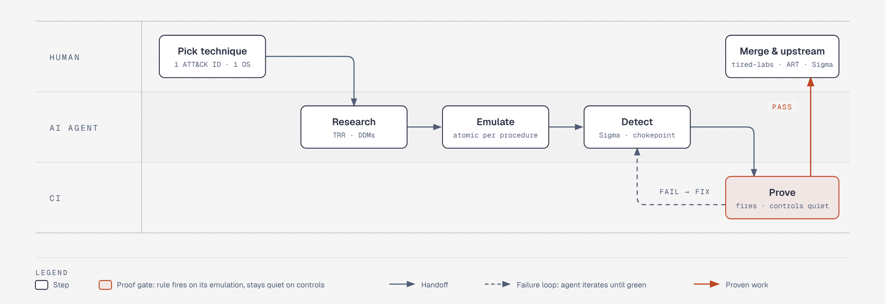

# Detection at Scale

[](https://github.com/vasquja/det-eng/actions/workflows/lint-trr.yml) [](https://github.com/vasquja/det-eng/actions/workflows/validate-detections.yml) [](https://github.com/vasquja/det-eng/actions/workflows/validate-apiserver-detections.yml) [](https://github.com/vasquja/det-eng/actions/workflows/validate-cloud-detections.yml)

**AI-driven detection engineering, held to a proof standard.**

Attackers already use AI to find and weaponize weaknesses at scale, faster
than a human team can review them. Defenders cannot answer exploitation at
scale one hand-written rule at a time; they need **detection at scale**. This
repository is an experiment in what that takes: an AI agent does the heavy
lifting of detection engineering — research, emulation, rule writing — and a
strict, automated validation loop decides what is allowed to count as done.

> **Not production.** Nothing here is meant for production use. Rules are
> `status: experimental` and need baselining before they alert. Finished work
> is contributed upstream (see [Contributing upstream](#5-contribute-upstream)).

---

## Detection at scale, and why AI alone is not enough

Coverage is a volume problem. ATT&CK has hundreds of techniques, each with
several execution paths, across Linux, Kubernetes, and three major clouds. A
careful human writes a well-researched detection in days. An AI agent can draft
one in minutes.

But a fast, wrong detection is worse than none: it gives false confidence. The
thing that makes AI-written detections worth anything is **evidence**, not
speed. So the agent works inside a method that does not trust its output:

- **Research before rules.** The agent must write a structured Technique
  Research Report (TRR) that models every execution path *before* it writes a
  rule, so the reasoning is on the page where a human can check it.
- **Chokepoints, not signatures.** The target is the one condition every
  procedure must pass through. That is the opposite of the pile of brittle,
  per-tool rules that cheap generation tends to produce.
- **Proof, not claims.** Every detection strategy is paired with an emulation,
  and CI asserts the rule fires on telemetry that emulation produced — and
  stays silent on no-op runs, broken mutants, and benign baselines. A rule that cannot pass
  that loop does not merge, however plausible it reads.

### Who does what

| Human | AI agent ([Claude Code](https://claude.com/claude-code)) |
|-------|-----------------------------------------------------------|
| Picks the technique and platform | Researches the mechanics and enumerates procedures |
| Sets the method and the bar for "done" | Draws a Detection Data Model per procedure |
| Reviews the reasoning and the gaps | Writes the emulation, the telemetry config, and the Sigma rules |
| Merges | Iterates against CI until the proof passes |

### What that looks like in practice

From the first TRR (October 4, 2026) to TRR9019 (October 12, 2026), roughly
nine days:

- **19 Technique Research Reports** across Linux, Kubernetes, AWS, Azure, and GCP
- **20 ATT&CK techniques** with behavioral emulations
- **52 Sigma rules**, all compiled in CI, with each technique's primary rule
  proven to fire on its own emulation
- **82 Detection Data Models**, rendered and freshness-checked by the linter

Several of these cover ground that public emulation libraries (Atomic Red Team,
Stratus Red Team) do not, which is where machine-speed research pays off most.

---

## What this repository is

Most detection content starts at the rule. You see a syscall or a log field,
you write a Sigma rule, and the reasoning — *why that field, what it misses,
what an attacker can do to dodge it* — lives only in the author's head.

This repository inverts that. **Research comes first.** Every detection here
begins as a written **Technique Research Report (TRR)** that models the
technique, enumerates its distinct execution paths, and finds the one place
they all have to pass through. The rule is the *last* artifact, and it traces
back to a documented decision. That ordering matters even more when an AI is
the author: it forces the model to show its work.

The method follows Andrew VanVleet's TRR process and the
[tired-labs/techniques](https://github.com/tired-labs/techniques) project. The
layout here mirrors tired-labs so a report is ready to contribute with little
reshaping.

---

## The workflow

One technique, one platform, five steps. Each step produces an artifact, and
every artifact names the **procedure ID** it serves (see
[the spine](#the-procedure-id-is-the-spine)).

<picture>
  <source media="(prefers-color-scheme: dark)" srcset="docs/diagrams/workflow-dark.png">
  
</picture>

<sub>Drawn with <a href="https://github.com/cathrynlavery/diagram-design">diagram-design</a>; source in <a href="docs/diagrams/"><code>docs/diagrams/</code></a>.</sub>

### 1. Research — write the TRR

The TRR is the source of truth. It is a structured document (see
[`research/templates/TRR-TEMPLATE.md`](research/templates/TRR-TEMPLATE.md))
with a fixed section order:

- **Technique Overview** — plain language. A team lead with no deep technical
  background should understand what the technique is and why an adversary uses
  it.
- **Technical Background** — the mechanics: the kernel interfaces, protocols,
  and security controls involved, and *why the technique works* / what control
  it defeats.
- **Procedures** — the distinct execution paths (A, B, C …).
- **Detection Data Model (DDM)** — one graph per procedure (see
  [below](#detection-data-models-ddms)).
- **Detection Strategy** — the key section: compare the DDMs, find the
  invariant chokepoint, state the fallbacks.

Prose is written in Simplified Technical English (ASD-STE100) where practical.
Technical names — syscalls, CVE IDs, kernel symbols, ATT&CK IDs — stay as they
are.

### 2. Emulate — one behavioral test per procedure

Each procedure gets a **behavioral atomic** under [`atomics/`](atomics/): a
small program (Atomic Red Team style) that emits the *syscall pattern* of the
abuse primitive and then stops before doing any harm. The point is to generate
the exact telemetry a defender would see, safely and repeatably.

### 3. Detect — one Sigma rule per detection strategy

Rules live in [`detections/sigma/`](detections/sigma/). A rule keys on the
**invariant chokepoint** when one exists (one rule, many procedures) and falls
back to a per-procedure rule only where no chokepoint covers it.

### 4. Prove — close the loop

A test and a rule sitting next to each other prove nothing. The validator
([`detections/validate_detections.py`](detections/validate_detections.py))
runs each atomic, compiles its paired Sigma rule with a real Sigma backend
(pySigma), and asserts the rule matches telemetry *the atomic itself*
produced, on syscalls that succeeded. Controls then test the test: a no-op, a
set of broken mutants, and allowlisted process names must all fail. This runs
in CI on every push (see [Continuous validation](#continuous-validation)).

### 5. Contribute upstream

When a report is done, it goes where it belongs:

| Artifact | Destination |
|----------|-------------|
| TRR      | [tired-labs/techniques](https://github.com/tired-labs/techniques) |
| Tests    | [redcanaryco/atomic-red-team](https://github.com/redcanaryco/atomic-red-team) |
| Rules    | [SigmaHQ/sigma](https://github.com/SigmaHQ/sigma) |

See [`UPSTREAM.md`](UPSTREAM.md) for the full mapping, the per-gate conformance
checks (`sigma check` passes with 0 errors), and the submission steps.

---

## The methodologies

### The procedure ID is the spine

Every artifact names the procedure it serves, so the research, the test, and
the rule are tied together. The ID format (VanVleet) is
`TRRID.PLATFORM.LETTER` — for example `TRR9001.LIN.A`.

A **procedure is a distinct execution path**, not a tool. The same path in a
different tool or language is the *same* procedure: `tcpdump` and a hand-written
C sniffer both open an `AF_PACKET` socket, so they are one procedure, not two.
This is what keeps the procedure list short and the detection strategy honest.

### Detection Data Models (DDMs)

Each procedure gets a DDM: a graph of the operations the procedure performs,
drawn the way tired-labs TRRs draw them.

- Circle nodes are **operations** (verb + object, e.g. "Call `socket()`").
- Node border colour says **who performs** the operation.
- Pill labels name the **telemetry** that records it (auditd, eBPF, EDR …).
- `Key: value` properties hold **what a rule can match** (`a0`, flags, …).
- The primary detection node is shaded.

DDMs are authored as [Arrows app](https://arrows.app) JSON in a TRR's `ddms/`
folder, then rendered to PNG with
[`research/tools/render_ddm.py`](research/tools/render_ddm.py). The linter fails
if a PNG is missing or older than its JSON, so the picture never drifts from
its source.

### The chokepoint idea — cover the most procedures

This is the heart of the detection strategy. Read the DDM for every procedure
and look for a node or edge that **every procedure must pass through**. That is
an **invariant chokepoint** — a condition the attacker cannot avoid, whatever
tool they pick or how they obfuscate.

One rule at the chokepoint covers many procedures. You write a per-procedure
rule only for a procedure the chokepoint does not reach. Good detection
engineering is finding the chokepoint; a pile of per-tool signatures is the
thing we are trying not to build.

### The three-layer detection stack

A rule does not fire on an atomic by itself. There are three layers, and the
middle one is easy to forget:

1. **Atomic** — the stimulus. Emits the syscall pattern, then stops.
2. **Audit rules** ([`detections/audit/atomic.rules`](detections/audit/atomic.rules))
   — *make the telemetry exist.* On a default auditd install the relevant
   syscalls are not logged, so a Sigma rule has nothing to match. Load this
   first.
3. **Sigma rule** — what to look for in the audit events.

The Kubernetes technique (TRR9002) has the same shape with cloud-native layers:
the stimulus is `emulate.sh`, the telemetry is the API server audit log turned
on by an [audit policy](detections/k8s/audit-policy.yaml), and the rule keys on
audit events rather than syscalls.

### Continuous validation

Proving the loop is automated:

- **Linux / auditd** —
  [`.github/workflows/validate-detections.yml`](.github/workflows/validate-detections.yml)
  loads the audit rules and runs the validator on an `ubuntu-latest` runner
  (a full VM, so root has the audit subsystem). It is strict: a rule that does
  not fire, or a control that does, fails the job. A rule is skipped only when
  an independent kernel-feature probe shows the kernel lacks what the
  technique needs (no AF_ALG, io_uring disabled …).
- **Kubernetes** —
  [`.github/workflows/validate-k8s-detections.yml`](.github/workflows/validate-k8s-detections.yml)
  (TRR9002 exec),
  [`.github/workflows/validate-staticpod-detections.yml`](.github/workflows/validate-staticpod-detections.yml)
  (TRR9003 static pods), and
  [`.github/workflows/validate-apiserver-detections.yml`](.github/workflows/validate-apiserver-detections.yml)
  (TRR9004–9010: RBAC, Jobs/CronJobs, Secrets, dangerous pod specs, disabling
  admission control, impersonation, and indicator removal, on one shared `kind`
  cluster) spin up a `kind` cluster and run the emulation strict:
  a rule that does not fire on the emulation's own events fails the job. Each
  also runs the validator on the audit log captured *before* the emulation,
  where it must not pass — and the API server loop proves the rules fire on the
  emulation's own records even though a fresh cluster is full of baseline
  matches (bootstrap RBAC, controller Jobs, controller Secret reads,
  kube-proxy and kindnet privileged pods).
- **External cloud (AWS / Azure / GCP)** —
  [`.github/workflows/validate-cloud-detections.yml`](.github/workflows/validate-cloud-detections.yml)
  (TRR9011–9019: IMDS creds used off-instance, leaked access keys, Entra
  federated-identity backdoors, public GCP IAM exposure, GitHub-OIDC role-trust
  abuse, Cognito unauthenticated identity-pool abuse, Entra illicit OAuth consent
  and device-code phishing, GCP Workload Identity Federation abuse, and public /
  cross-account AWS resource exposure). Cloud has no free CI target, so the loop
  runs the same pySigma backend over committed, schema-faithful **recorded**
  attack/benign log fixtures: every rule must fire on its attack fixture and match
  nothing in a hard benign baseline. Pure Python — no cluster, no cloud account.
- **Lint** — [`.github/workflows/lint-trr.yml`](.github/workflows/lint-trr.yml)
  checks TRR structure, DDM PNG freshness, and markdown links.

Run the Linux loop locally:

```bash
pip install -r detections/requirements.txt   # pySigma + its SQLite backend

# Real validation — needs root and a running auditd:
sudo python3 detections/validate_detections.py

# Compile rules and atomics only — no auditd needed:
python3 detections/validate_detections.py --dry-run
```

---

## Repository map

| Folder | Role |
|--------|------|
| [`research/`](research/README.md) | TRRs — the source of truth. **Start here.** |
| [`atomics/`](atomics/) | Behavioral emulation tests, organised by ATT&CK technique ID. |
| [`detections/`](detections/README.md) | Sigma rules, the auditd ruleset, the K8s audit policy, and the validators. |
| [`.github/`](.github/) | CI workflows (validation + lint) and their scripts. |

A TRR lives at `research/trrNNNN/<platform>/README.md`, with its DDMs beside it.
Local TRR IDs use the **`TRR9000+` band** so they never collide with the
sequential IDs that tired-labs assigns upstream; at contribution time the folder
is copied to `trr0000/` and the maintainer assigns the final ID.

---

## Worked examples

- **[TRR9001 — Network Sniffing (T1040, Linux)](research/trr9001/lin/README.md)**
  The full loop: four procedures, a DDM for each, and a chokepoint rule
  (`AF_PACKET` socket) that covers the two common procedures, with fallbacks
  for the raw IP socket and the eBPF/XDP path.

- **[TRR9002 — Command Execution in a Running Container (T1609, Kubernetes)](research/trr9002/k8s/README.md)**
  Five control paths (exec, attach, ephemeral container, node proxy, direct
  kubelet), audit-log telemetry via a `kind` cluster, and a demonstrated
  detection gap on the direct-kubelet path.

- **[TRR9003 — Static Pod Persistence (T1543.005, Kubernetes)](research/trr9003/k8s/README.md)**
  A pod the kubelet runs from a node-local manifest, bypassing the API server.
  A node runtime chokepoint (the CRI sees a pod the API never scheduled) plus a
  mirror-pod audit fallback, with the invalid-namespace variant as the gap.

- **[TRR9004 — Additional Container Cluster Roles (T1098.006, Kubernetes)](research/trr9004/k8s/README.md)**
  Five RBAC paths (bind a powerful role, namespaced binding to a cluster role,
  write a wildcard/escalate role, bind a group, patch an existing object), all
  on one audit chokepoint, with a Request-level severity rule that grades the
  grant.

- **[TRR9005 — Container Orchestration Job (T1053.007, Kubernetes)](research/trr9005/k8s/README.md)**
  CronJobs and Jobs for persistence and execution. One batch-write chokepoint
  (with the controller fan-out excluded), plus a node-runtime fallback that
  catches the executed pod by its Job label.

- **[TRR9006 — Unsecured Credentials: Container API (T1552.007, Kubernetes)](research/trr9006/k8s/README.md)**
  Reading Secrets (get/list/watch) and minting tokens, on one audit chokepoint
  plus a TokenRequest fallback, with the already-mounted token read off disk as
  the demonstrated gap the API server never sees.

- **[TRR9007 — Escape to Host via a Dangerous Pod Spec (T1611, Kubernetes)](research/trr9007/k8s/README.md)**
  Privileged, hostPath, host-namespace, and capability requests, caught at
  admission in the audit `requestObject` (Request level). A controller-template
  fallback and a static-pod gap round it out.

- **[TRR9008 — Disabling Admission Control (T1562.001, Kubernetes)](research/trr9008/k8s/README.md)**
  Deleting or neutering admission webhooks (OPA/Gatekeeper, Kyverno, Falco). One
  chokepoint on `admissionregistration.k8s.io` writes, a Request-level rule that
  grades a fail-open neuter, and an enforcer-workload-removal fallback.

- **[TRR9009 — User Impersonation (T1134, Kubernetes)](research/trr9009/k8s/README.md)**
  Acting as another user, group, or service account via the `impersonate` verb.
  One presence rule on `impersonatedUser` catches every variant, including a
  denied probe, where an allow-list rule does not.

- **[TRR9010 — Indicator Removal (T1070, Kubernetes)](research/trr9010/k8s/README.md)**
  Deleting Kubernetes Events (including the bulk `deletecollection` wipe upstream
  misses) and the workloads that ran, with the node audit-log clearing as the
  documented gap.

- **[TRR9011 — IMDS Credential Theft Used Off-Instance (T1552.005, AWS)](research/trr9011/aws/README.md)**
  SSRF or on-host theft of EC2 instance-role credentials, then used off-instance.
  The theft leaves no trace; the chokepoint is the instance-role session making a
  CloudTrail call from a source the instance does not own (GuardDuty's approach as
  a provider-agnostic rule), with the InsideAWS variant as the gap.

- **[TRR9012 — Leaked Long-Term Access Key (T1078.004, AWS)](research/trr9012/aws/README.md)**
  Using a leaked `AKIA` key from outside: the `whoami` + enumeration burst from a
  new source. Unemulated by Stratus/ART; the composite (IAMUser + AKIA + new source
  + enumeration) is the novel detection.

- **[TRR9013 — Federated Identity Credential Backdoor (T1098.001, Azure)](research/trr9013/azr/README.md)**
  Adding an OIDC federated credential to an Entra app that trusts an attacker's
  issuer. One Entra-audit chokepoint on the FIC write with an unapproved issuer, and
  a companion rule for the managed-identity (Azure Activity Log) variant.

- **[TRR9014 — Public IAM Exposure (T1098.003, GCP)](research/trr9014/gcp/README.md)**
  Granting `allUsers`/`allAuthenticatedUsers` to expose a resource to the internet.
  One cross-service chokepoint unifying the two Cloud-Audit-Log shapes (policy delta
  vs full request) and both public principals; ACL/invoker-disable paths as gaps.

- **[TRR9015 — GitHub Actions OIDC Role-Trust Abuse (T1098.001, AWS)](research/trr9015/aws/README.md)**
  An IAM role trust policy trusting GitHub OIDC with an over-broad or absent subject,
  so any repo/fork can assume it. The grant is the baseline-free chokepoint; the use
  path and pre-existing-wildcard case are documented gaps.

- **[TRR9016 — Cognito Unauthenticated Identity Pool Abuse (T1078.004, AWS)](research/trr9016/aws/README.md)**
  A Cognito identity pool that allows guest identities hands AWS creds to any anonymous
  caller. Unemulated by Stratus/ART; covers the classic-flow `AssumeRoleWithWebIdentity`
  and downstream `Cognito_*Unauth_Role` session in the default trail, plus the enabling
  misconfiguration — with the data-event issuance path as the documented gap.

- **[TRR9017 — Illicit OAuth Consent + Device-Code Phishing (T1528, Azure)](research/trr9017/azr/README.md)**
  Tricking a user or admin into consenting a malicious app to high-privilege Graph scopes,
  and the separate device-code-flow signal in the sign-in log. First emulation + CI fixtures
  for T1528 consent/device-code; the granted-token data-plane use is the gap.

- **[TRR9018 — Workload Identity Federation Abuse (T1098.001, GCP)](research/trr9018/gcp/README.md)**
  Trusting an external OIDC/AWS/SAML issuer and binding its `principalSet` to a service
  account so an outside identity can impersonate it. Two always-on Admin-Activity
  chokepoints (provider trust + SA binding), discriminated from benign GKE Workload
  Identity; the data-plane token exchange is the gap.

- **[TRR9019 — Public / Cross-Account Resource Exposure (T1537, AWS)](research/trr9019/aws/README.md)**
  Exposing a resource with a `Principal:*` policy, a `group=all` snapshot/AMI share, or by
  disabling Block Public Access — unified across seven resource-policy services plus the
  snapshot and BPA families. The public form is new ground vs Stratus's account-to-account
  variants; object-level ACLs are the data-event gap.

See [`research/index.json`](research/index.json) for the machine-readable index.

---

## Getting started

```bash
# Read the research layer first.
less research/README.md

# Start a new TRR from the template.
cp research/templates/TRR-TEMPLATE.md research/trrNNNN/<platform>/README.md

# Compile the atomics and the rules without needing auditd.
pip install -r detections/requirements.txt
python3 detections/validate_detections.py --dry-run
```

The research layer's [`research/README.md`](research/README.md) and the
detection layer's [`detections/README.md`](detections/README.md) go deeper than
this overview.
