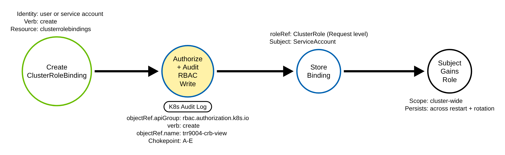
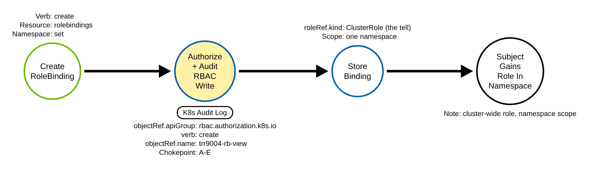
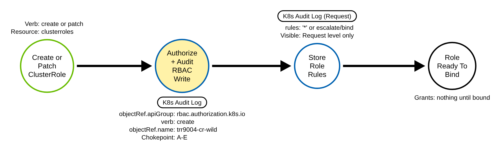
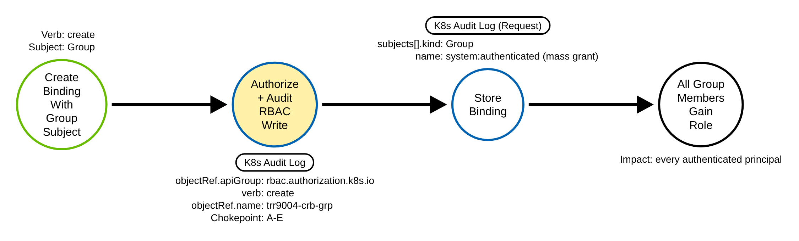
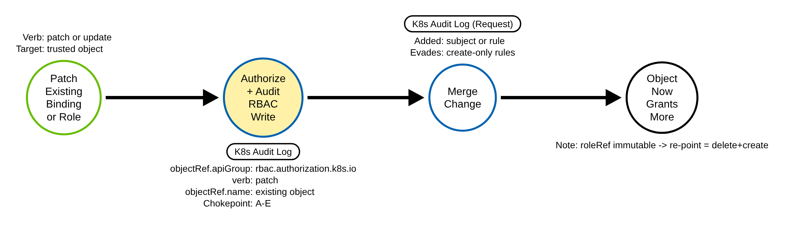
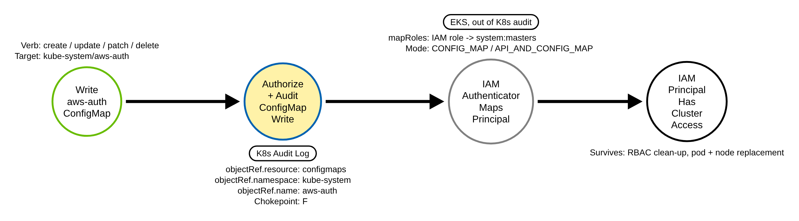
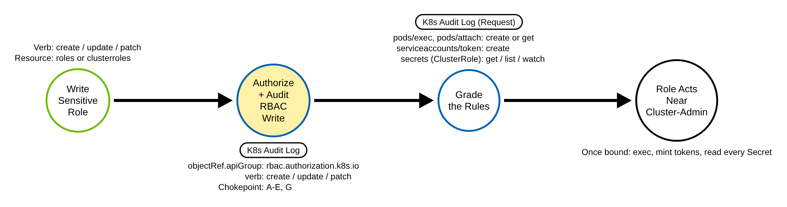

# Additional Container Cluster Roles (Kubernetes)

> Prose uses Simplified Technical English (ASD-STE100) where practical.
> API group names, resource names, verbs, field names, and ATT&CK IDs are
> technical names.

## Metadata

| Key          | Value |
|--------------|-------|
| ID           | TRR9004 |
| External IDs | T1098.006 |
| Tactics      | Persistence, Privilege Escalation |
| Platforms    | Kubernetes |
| Contributors | det-eng |
| Status       | draft |

### Scope Statement

This TRR covers privilege escalation and persistence through **Kubernetes
RBAC**: writing or changing the objects in the `rbac.authorization.k8s.io` API
group (`roles`, `clusterroles`, `rolebindings`, `clusterrolebindings`) so that
an identity the adversary controls gains more permission than it had. It also
covers one adjacent object: on Amazon EKS, the `kube-system/aws-auth` ConfigMap
that maps IAM principals to RBAC identities (Procedure F). That is a `core/v1`
ConfigMap, not an `rbac.authorization.k8s.io` object, but writing it is a
Kubernetes API call the audit log records, and it grants the same kind of
standing access, so it is in scope here (the exclusion list below explains the
boundary).

This TRR does not cover these related actions:

- Authenticating with a credential the adversary already stole and using the
  access it already has, with no permission change. ATT&CK T1078 (Valid
  Accounts) covers that. The chokepoint here is the *write* that changes a
  permission, not a login.
- Granting a cloud IAM role on a managed cluster, when the grant is a cloud API
  write. An EKS access entry, a GKE IAM binding, or an AKS role assignment is a
  call to the cloud provider's API, not the Kubernetes API server, so the
  Kubernetes audit log does not see it; ATT&CK T1098.003 (Additional Cloud Roles)
  covers it, and a managed-cluster attack can chain both. The **EKS aws-auth
  ConfigMap is the exception**: it is an ordinary Kubernetes ConfigMap in
  kube-system, so a write to it *does* reach the Kubernetes API server and the
  audit log. Mapping an IAM principal through aws-auth is therefore in scope here,
  as Procedure F.
- Creating a Kubernetes identity (a ServiceAccount). This report changes what an
  identity *can do*, not whether it exists.

> One third-party catalog files this technique under T1548 (Abuse Elevation
> Control Mechanism) with a Defense Evasion tactic. ATT&CK is authoritative:
> T1098.006, tactics Persistence and Privilege Escalation.

## Technique Overview

Kubernetes decides what every identity — a user, a group, or a service account —
is allowed to do with Role-Based Access Control (RBAC). Four object types hold
those decisions. A Role or a ClusterRole lists permissions. A RoleBinding or a
ClusterRoleBinding grants a listed set of permissions to a subject.

An adversary who can already write these objects can quietly give an identity
they control a great deal of power, up to full cluster-admin. The grant stays
after a password reset or a pod restart, because it lives in the cluster's own
configuration, not in a stolen credential. This is the Kubernetes form of
"adding yourself to the admins group."

The technique is attractive for three reasons. It looks like ordinary
administration, because operators and GitOps pipelines create bindings all the
time. It survives reboots and credential rotation. And in its loudest form it
can grant power to *every* authenticated user at once, by binding a built-in
group such as `system:authenticated`. The defensive goal is to see when an RBAC
object is written, and to tell an everyday, harmless grant apart from one that
hands out dangerous power.

## Technical Background

### The four objects and the one group

All four RBAC object types live in the API group `rbac.authorization.k8s.io`,
with the resource names `roles`, `clusterroles`, `rolebindings`, and
`clusterrolebindings`. A Role or ClusterRole carries a `rules` list; each rule is
a set of `apiGroups`, `resources`, and `verbs`. A binding carries a `subjects`
list and a single, required, **immutable** `roleRef` (an `apiGroup`, a `kind`,
and a `name`) that names the role it grants. Because `roleRef` is immutable,
re-pointing a binding at a different role means delete and re-create.

A RoleBinding's `roleRef` may name a Role in its own namespace **or** a
ClusterRole. In the second case the ClusterRole's rules apply inside that one
namespace. A ClusterRoleBinding may reference only a ClusterRole, and it grants
cluster-wide.

### The escalation guard, and the verbs that defeat it

Kubernetes has a built-in guard against privilege escalation. When you write a
Role or ClusterRole, you may normally include only permissions you already hold.
When you create a binding, you may normally bind only a role whose permissions
you already hold. Two special RBAC verbs defeat this guard: `escalate` lets a
subject write a role that grants more than it holds, and `bind` lets a subject
create a binding to a role it does not hold. A wildcard verb (`*`) on
`roles`/`clusterroles` includes `escalate` and `bind` by implication.

**An audit nuance that matters for detection.** `escalate` and `bind` are
authorization checks on a write request. They are *not* the audit `verb`. When
the adversary actually creates a binding or writes a role, the audit event's
`verb` is the ordinary `create`, `update`, or `patch`. The escalation shows up
two other ways: if the adversary is *granting* `escalate`/`bind` to someone, it
appears in the written role's `rules[].verbs` (in `requestObject`, so Request
level); and the authorization decision that let the write through is recorded in
the event annotations (`authorization.k8s.io/decision` and
`authorization.k8s.io/reason`).

There is also no `replace` audit verb. An HTTP `PUT` — `kubectl replace`, or an
apply sent as `PUT` — is recorded as `verb: update`. So the write-verb set is
`create`, `update`, `patch`, `delete`, and `deletecollection` (a bulk delete of the
roles or bindings in a namespace).

### The audit log, and what Metadata level hides

The API server writes audit events as its policy specifies, at level `None`,
`Metadata`, `Request`, or `RequestResponse`. For this technique the chokepoint
*fires* at `Metadata`: `verb`, `objectRef.apiGroup`, `objectRef.resource`,
`objectRef.name`, and `responseStatus.code` are all present, and
`objectRef.name` is what a name-gated test matches.

But `Metadata` hides the part that says whether the grant is dangerous. The
binding's `roleRef` (which role), the binding's `subjects` (who, or which group),
and the role's `rules` (wildcard, or `escalate`/`bind`) all live only in
`requestObject`, which `Metadata` does not record. At `Metadata` a binding to
`view` and a binding to `cluster-admin` are byte-for-byte identical. So the RBAC
audit rule must run at `Request` (or `RequestResponse`) level. RBAC writes are
rare and security-critical, so the extra volume is cheap.

### Why the technique works

Writing RBAC is a normal administration action. The cluster cannot tell a good
grant from a bad one by the write alone. The only controls are authorization
(who may write RBAC) and admission. A detection must therefore use the *content*
of the write: which role is bound, to whom, and with what rules — and the actor,
to separate an operator or a controller from an adversary.

## Procedures

| Procedure | ID | Name | Entry point |
|-----------|----|------|-------------|
| A | TRR9004.K8S.A | ClusterRoleBinding to a powerful ClusterRole | `create clusterrolebindings` |
| B | TRR9004.K8S.B | Namespaced RoleBinding to a ClusterRole | `create rolebindings` |
| C | TRR9004.K8S.C | Write a wildcard or escalate/bind role | `create`/`update`/`patch` `clusterroles` or `roles` |
| D | TRR9004.K8S.D | Bind a built-in group (mass grant) | `create` binding with a Group subject |
| E | TRR9004.K8S.E | Patch an existing binding or role | `patch`/`update` any RBAC object |
| F | TRR9004.K8S.F | Map an IAM principal through the EKS aws-auth ConfigMap | `create`/`update`/`patch`/`delete` `configmaps` `kube-system/aws-auth` |
| G | TRR9004.K8S.G | Write a sensitive (non-wildcard) role: exec, token, cluster-wide secret reads | `create`/`update`/`patch` `clusterroles` or `roles` |

> A tool is not a procedure. `kubectl`, `client-go`, Helm, Argo CD, and a raw
> HTTP client all send the same RBAC write. They are the same procedure. The
> protocol and the client do not change the audit path.

**Reading the DDMs.** Each DDM is a PNG in the style of the
`tired-labs/techniques` reports, rendered from the Arrows app JSON beside it.
Green borders are operations the client performs. Blue borders are operations
the API server performs. Black borders are the abstract effect. The pill on a
node names the telemetry that records it, and the `Key: value` lines are the
details a rule can match. A shaded node is the primary detection opportunity. In
Procedures A–E and G the shaded node is the same one: the API server's audit of
the RBAC write. Procedure F is the exception: its shaded node is the API server's
audit of the `configmaps` write to `kube-system/aws-auth`.

### Procedure A: ClusterRoleBinding to a powerful ClusterRole  (`TRR9004.K8S.A`)

The adversary creates a ClusterRoleBinding whose `roleRef` names a powerful
ClusterRole (`cluster-admin`, the built-in `admin` or `edit`, or a custom
wildcard role) and whose subject is an identity they control. The grant is
cluster-wide and persists.

- **Prerequisites:** `create` on `clusterrolebindings`. To bind a role more
  powerful than the writer holds, the `bind` verb (or a wildcard that includes
  it) as well.
- **Mechanics:** the API server stores the binding. From then on, the subject has
  the ClusterRole's permissions across the whole cluster.
- **Impact:** cluster-wide privilege escalation and persistence. A binding to
  `cluster-admin` gives full control.
- **Tools on this path:** `kubectl create clusterrolebinding`, `kubectl apply`,
  and any client that POSTs to the `clusterrolebindings` endpoint.

#### Detection Data Model — `TRR9004.K8S.A`

Source: [`ddms/trr9004_k8s_a.json`](ddms/trr9004_k8s_a.json) (Arrows app format).

**DDM summary.** The shaded node is the API server's authorize-and-audit of the
RBAC write (*Authorize + Audit RBAC Write*). It fires at `Metadata` on
`objectRef.apiGroup: rbac.authorization.k8s.io` with a write verb, which is the
invariant for every RBAC procedure (A–E and G; Procedure F keys on the
`kube-system/aws-auth` ConfigMap write instead). `roleRef` (the fact that this binds a ClusterRole,
and which one) is on the next node, visible only at `Request` level — that is
what grades the severity.

### Procedure B: Namespaced RoleBinding to a ClusterRole  (`TRR9004.K8S.B`)

The adversary creates a namespaced RoleBinding whose `roleRef.kind` is
`ClusterRole`. The binding lives in one namespace, but the role it grants is
defined cluster-wide, so a powerful ClusterRole (`admin`, `edit`, or a custom
wildcard role) grants strong power scoped to that namespace.

- **Prerequisites:** `create` on `rolebindings` in the target namespace; `bind`
  if the referenced role exceeds the writer's permissions.
- **Mechanics:** lower prerequisite than Procedure A (a namespaced create), and
  it blends with normal per-namespace operator activity.
- **Impact:** namespace-scoped escalation and persistence; strong if the
  referenced ClusterRole is powerful.
- **Tools on this path:** `kubectl create rolebinding --clusterrole=...`,
  `kubectl apply`.

#### Detection Data Model — `TRR9004.K8S.B`

Source: [`ddms/trr9004_k8s_b.json`](ddms/trr9004_k8s_b.json) (Arrows app format).

**DDM summary.** The anchor is the same RBAC-write audit event as Procedure A;
only the resource is `rolebindings` and `objectRef.namespace` is set. The tell
that a namespaced binding reaches a cluster-wide role is
`requestObject.roleRef.kind: ClusterRole`, which is on the store node and needs
`Request` level.

### Procedure C: Write a wildcard or escalate/bind role  (`TRR9004.K8S.C`)

Instead of binding an existing powerful role, the adversary writes a *new* role
(or widens one they can already be bound to) that contains a wildcard rule
(`apiGroups: ['*']`, `resources: ['*']`, `verbs: ['*']`) or the escalation verbs
`escalate`/`bind`/`impersonate`. A stealth variant adds only a label so the role
is merged into a built-in aggregated ClusterRole; the written object looks tiny
while the aggregation controller inflates its effect.

- **Prerequisites:** `create`/`update`/`patch` on `roles` or `clusterroles`;
  `escalate` (or a pre-existing wildcard) to add permissions beyond what the
  writer holds.
- **Mechanics:** this builds the powerful role that a later or existing binding
  points at. A role grants nothing until it is bound.
- **Impact:** the role is the raw material for escalation; the aggregation
  variant hides the power.
- **Tools on this path:** `kubectl create clusterrole`/`role`, `kubectl apply`,
  `kubectl edit`, `kubectl patch`.

#### Detection Data Model — `TRR9004.K8S.C`

Source: [`ddms/trr9004_k8s_c.json`](ddms/trr9004_k8s_c.json) (Arrows app format).

**DDM summary.** Same chokepoint audit event, resource `clusterroles` (or
`roles`). The dangerous content is the `rules` list — a wildcard `*`, or
`escalate`/`bind`/`impersonate` — which is on the store node and recorded only at
`Request` level. At `Metadata` a wildcard role and a read-only role are
indistinguishable.

### Procedure D: Bind a built-in group — mass grant  (`TRR9004.K8S.D`)

The adversary sets the binding's subject to a built-in group rather than a single
identity. Binding `system:authenticated` grants the role to *every*
authenticated user; `system:unauthenticated` or `system:anonymous` grants it to
unauthenticated callers. One small object grants power broadly, which is both
high-impact and easy to miss, because the object count is tiny.

- **Prerequisites:** `create` on `clusterrolebindings` or `rolebindings`; `bind`
  if the referenced role exceeds the writer's permissions.
- **Mechanics:** the subject is a `Group`, not a user or a service account.
- **Impact:** a mass privilege grant to all authenticated (or all anonymous)
  principals.
- **Tools on this path:** `kubectl create clusterrolebinding --group=...`,
  `kubectl apply`.

#### Detection Data Model — `TRR9004.K8S.D`

Source: [`ddms/trr9004_k8s_d.json`](ddms/trr9004_k8s_d.json) (Arrows app format).

**DDM summary.** The chokepoint audit event is identical to Procedure A. The
signal is the subject: `requestObject.subjects[].kind: Group` with a built-in
group name, on the store node, at `Request` level. The group name is the whole
point and is invisible at `Metadata`.

### Procedure E: Patch an existing binding or role  (`TRR9004.K8S.E`)

Rather than create a new object, the adversary amends a legitimate existing one:
patch a well-known binding to append an adversary subject, or patch an existing
role to add rules. This hides inside an object operators expect to exist, and it
evades detections that watch only `create`. (`roleRef` is immutable, so
re-pointing a binding needs delete-and-create, which also passes the chokepoint.)

- **Prerequisites:** `update`/`patch` on the target object; `bind`/`escalate` as
  applicable.
- **Mechanics:** the write verb is `patch` or `update`, not `create`.
- **Impact:** stealthy persistence and escalation by amending trusted RBAC
  objects.
- **Tools on this path:** `kubectl patch`/`edit`/`apply`, a client `PATCH`/`PUT`.

#### Detection Data Model — `TRR9004.K8S.E`

Source: [`ddms/trr9004_k8s_e.json`](ddms/trr9004_k8s_e.json) (Arrows app format).

**DDM summary.** Same chokepoint, verb `patch` or `update`. Because the chokepoint
keys on the API group and the write verb, not on `create`, it sees this path
where a create-only rule does not. The added subject or rule is in
`requestObject` at `Request` level.

### Procedure F: Map an IAM principal through the EKS aws-auth ConfigMap  (`TRR9004.K8S.F`)

On an Amazon EKS cluster whose authentication mode is `CONFIG_MAP` or
`API_AND_CONFIG_MAP`, the AWS IAM authenticator reads one ConfigMap,
`kube-system/aws-auth`, and maps each IAM role or user it lists (`mapRoles`,
`mapUsers`, `mapAccounts`) to a Kubernetes username and groups. The adversary
edits that ConfigMap to map an IAM principal they control to `system:masters`, or
to a group that a binding grants cluster-admin.

Unlike an EKS *access entry*, a GKE IAM binding, or an AKS role assignment — each
a cloud-API write that never reaches the Kubernetes audit log — aws-auth is an
ordinary Kubernetes ConfigMap, so the write *is* a Kubernetes API call and the
audit log records it. That is why this managed-cluster grant is in scope here.

- **Prerequisites:** `create`/`update`/`patch` on `configmaps` in `kube-system`
  (or cluster-admin). The cluster must use the aws-auth authentication path.
- **Mechanics:** no RBAC object changes, so the `k8s_rbac_*` rules do not see it.
  The access survives pod, node and RBAC clean-up, because it lives in the IAM
  mapping, not in a Kubernetes binding.
- **Impact:** persistent cluster access for an IAM principal the adversary holds.
- **Tools on this path:** `kubectl edit/patch/apply configmap aws-auth`, `eksctl`,
  a client `PATCH`/`PUT`, Stratus Red Team
  `eks.persistence.backdoor-aws-auth-configmap` (a client-go `Update`).

#### Detection Data Model — `TRR9004.K8S.F`

Source: [`ddms/trr9004_k8s_f.json`](ddms/trr9004_k8s_f.json) (Arrows app format).

**DDM summary.** The shaded node is the API server's audit of the `configmaps`
write to `kube-system/aws-auth`. It fires at `Metadata`:
`objectRef.resource: configmaps`, `objectRef.namespace: kube-system`,
`objectRef.name: aws-auth`, and a write verb are all present, and the object name
is forced (the IAM authenticator reads only that name). The grey node — the IAM
authenticator mapping the principal — is out of the Kubernetes audit scope (it
runs in EKS). A content grade cannot stand on one record: every `update`
re-sends the existing admin mapping, so the chokepoint is the detection and the
actor is the discriminator.

### Procedure G: Write a sensitive (non-wildcard) role  (`TRR9004.K8S.G`)

Rather than a wildcard, the adversary writes a Role or ClusterRole whose rules
grant a *specific* permission that is not a wildcard but acts close to
cluster-admin once bound: command execution in pods (`pods/exec` or `pods/attach`
with `create` or `get`), minting service-account tokens (`serviceaccounts/token`
with `create`), or reading every Secret in the cluster (`secrets` with `get`,
`list` or `watch`, in a ClusterRole). It is a distinct procedure from C by its
content, the way Procedure D is distinct from A and B: the write verb and resource
are the same as C's, but the dangerous grant is an explicit, named permission
rather than a wildcard or an `escalate`/`bind` verb, so a different grader (a
medium one) covers it and the high-severity wildcard grader does not.

- **Prerequisites:** `create`/`update`/`patch` on `roles` or `clusterroles`; the
  `escalate` verb (or a pre-existing grant) to add a permission beyond what the
  writer holds.
- **Mechanics:** the role grants nothing until it is bound; it is the raw material
  for escalation, one step quieter than a wildcard.
- **Impact:** exec into any pod, mint a token for any service account, or read
  every Secret — each a path to broader control.
- **Tools on this path:** `kubectl create clusterrole`/`role --verb=... --resource=...`,
  `kubectl apply`, `kubectl patch`.

#### Detection Data Model — `TRR9004.K8S.G`

Source: [`ddms/trr9004_k8s_g.json`](ddms/trr9004_k8s_g.json) (Arrows app format).

**DDM summary.** Same chokepoint audit event as Procedure C, resource
`clusterroles` or `roles`. The grading node reads the `rules` list at `Request`
level: `pods/exec`/`pods/attach` with `create`/`get`, `serviceaccounts/token`
with `create`, or `secrets` reads in a ClusterRole. At `Metadata` a sensitive
role and a read-only role are indistinguishable.

## Detection Strategy

Compare the seven DDMs. Procedures A–E and G are mutating calls against the
`rbac.authorization.k8s.io` API group, and every one leaves the same kind of RBAC
audit event; there is no path that escalates through RBAC without this write.
Procedure F is a write of the `kube-system/aws-auth` ConfigMap — a different API
object, a different audit event, but the same persistence effect. So the plan is
**two chokepoint rules** (Strategy 1 for the RBAC write, Strategy 4 for the
aws-auth write) plus **two severity rules** that read the request body to grade an
RBAC grant (Strategy 2, high, for wildcards and escalate/bind; Strategy 3, medium,
for explicit sensitive permissions).

**Telemetry requirement.** The audit policy must record the
`rbac.authorization.k8s.io` group for the write verbs at **Request** (or
`RequestResponse`) level, so `requestObject` is present. Put the RBAC rule above
any `level: None` rule, and keep it user-agnostic: do not drop
`system:kube-controller-manager` or the bootstrap identities' RBAC *writes*,
because an adversary who impersonates a controller would then be invisible, and
the negative control needs to see the baseline writes and exclude them by name.

For Procedure F the audit policy must record `kube-system/aws-auth` ConfigMap
writes at **Metadata** or above (never `None`), which is enough for the chokepoint
to fire. This repo logs the `update`, `patch` and `delete` at `RequestResponse`, as
EKS logs them, so the stored `mapRoles` after an update or patch are kept for
triage; it logs the `create` at `Request` (the kube-system ConfigMap create rule).
The validator's sentinel gate needs only `Request`: it reads the create body and
the patch body. See
[`detections/k8s/audit-policy-apiserver.yaml`](../../../detections/k8s/audit-policy-apiserver.yaml).

**Strategy 1 — chokepoint (covers A–E and G).**
Match audit events where `objectRef.apiGroup` is `rbac.authorization.k8s.io` and
`verb` is `create`, `update`, `patch`, `delete`, or `deletecollection`. Filter one
request: the namespace controller's `deletecollection` when it empties a namespace
that is being deleted (the namespace delete names the actor). This is noisy on its own: a
kubeadm cluster writes dozens of RBAC objects at bootstrap and reconciles the
default roles continuously. Baseline the **actor**, not the object: suppress
`system:kube-controller-manager`, `system:apiserver`, the kubeadm and
`system:bootstrappers` identities, and known GitOps or CI service accounts by
`user.username` and `user.groups`. Every RBAC-object grant passes through an RBAC
write, so this rule covers A–E and G. Procedure F (aws-auth) changes no RBAC object;
Strategy 4 covers it. Two companion rules grade the same writes:
`k8s_rbac_privileged_grant` (Strategy 2, high) and
`k8s_rbac_sensitive_permission_grant` (Strategy 3, medium). One write leaves no record
at all: a server-side apply patch with a YAML body, which the JSON audit backend drops
at Request level or higher
([`RULE_DEFECTS.md`](../../../detections/RULE_DEFECTS.md) K23).

- Sensor: API server audit log.
- Rule: `detections/sigma/T1098.006/k8s_rbac_write.yml` (built).

**Strategy 2 — severity (grades A–E; needs Request level).**
On top of the chokepoint, match the writes that grant dangerous power: a
`roleRef.name` of `cluster-admin`, `admin`, or `edit`; a subject that is a
built-in group (`system:authenticated`, `system:unauthenticated`,
`system:anonymous`, `system:serviceaccounts`, or
`system:serviceaccounts:<namespace>`); a `rules` list with a wildcard or an
`escalate`/`bind`/`impersonate` verb; or a `rules` list that grants `nodes/proxy`
or `*/proxy` with any verb (a `get` is enough to run a command in every pod on the
node through the kubelet). A JSON patch (`kubectl patch --type=json`,
Procedure E's form) logs `requestObject` as the operation list, so the rule also
reads that list: an operation on `/rules` that carries a wildcard, one of the
verbs, `nodes/proxy` or `*/proxy`, or an operation on `/subjects` that names one of the groups. A patch or
update of a built-in binding whose `roleRef` is `cluster-admin` (`cluster-admin`,
`kubeadm:cluster-admins`) matches by name, because a patch carries no `roleRef`;
this grades Procedure E's headline form, a subject appended to that binding. A
subject appended to any other existing binding is graded only when it is one of
the groups above; otherwise only Strategy 1 sees it.

The kube-system `clusterrole-aggregation-controller` re-applying the built-in
`admin` and `edit` roles (both carry `impersonate` on `serviceaccounts`) is
filtered, but only while the written rules carry nothing more: no wildcard, no
`escalate` or `bind`, no `nodes/proxy`, and no `impersonate` on `users`, `groups`,
`uids` or `userextras`. `view` is never filtered. This keeps Procedure C's stealth variant
visible: a label patch that aggregates an existing powerful role
(`kubectl label clusterrole cluster-admin rbac.authorization.k8s.io/aggregate-to-view=true`)
carries no rules and does not fire, but the controller's next write of `view`,
`edit` or `admin` carries the wildcard and fires. The aggregated `impersonate`
test reads the rule in the Go field order the controller writes (`verbs`,
`apiGroups`, `resources`); a log pipeline that re-orders keys leaves that one
case filtered. This rule reads `requestObject`, so it needs `Request` level —
which is exactly the gap below.

- Sensor: API server audit log at `Request` level.
- Rule: `detections/sigma/T1098.006/k8s_rbac_privileged_grant.yml` (built).

**Strategy 3 — sensitive-grant severity (grades G, and a sensitive grant added by
Procedure E except as a JSON patch; needs Request level).**
A medium companion to Strategy 2 for the writes that grant a *specific*
sensitive permission rather than a wildcard. Match a Role or ClusterRole write
whose `rules` grant, each inside one rule object: `pods/exec` or `pods/attach`
with `create` or `get` (command execution in pods); `serviceaccounts/token` with
`create` (mint tokens); or `secrets` with `get`/`list`/`watch` in a ClusterRole
(read every Secret). The `*/exec`, `*/attach` and `*/token` resource forms count,
because RBAC matches `*/<subresource>` on every resource. The verb and the
resource must be in the same rule object, in either key order (a create or update
body is in Go field order; a patch keeps the client's order). It therefore grades
Procedure G (whose emulated shape is a create of such a role) and a Procedure E
write that adds a sensitive grant through a create, update, or merge/strategic/apply
patch; it does **not** grade Procedure E's emulated JSON patch (`kubectl patch
--type=json`), whose `requestObject` is an operation list this rule does not read
(K27). It also does **not** grade Procedure C: C is a wildcard or an
`escalate`/`bind`/`impersonate` role, and this rule deliberately does not read the
wildcard `*` verb or resource, so a C write raises the high-severity Strategy 2
alert only; a rule that is both wildcard and explicit raises both. The `clusterrole-aggregation-controller` writing the built-in `admin`
and `edit` (which carry these by design) is filtered; `view` is not, so a role
aggregated into `view` fires on the controller's next write. Limits
([`RULE_DEFECTS.md`](../../../detections/RULE_DEFECTS.md) K26, K27): the
bootstrap roles the API server writes fire (`system:aggregate-to-edit`,
`system:node`, `system:kube-controller-manager`; `edit` itself does not, it is
written with only an aggregation rule), a JSON-patch operation list is not read,
and `pods/ephemeralcontainers` and `resourceNames` are not graded.

- Sensor: API server audit log at `Request` level.
- Rule: `detections/sigma/T1098.006/k8s_rbac_sensitive_permission_grant.yml` (built).

**Strategy 4 — aws-auth chokepoint (covers F).**
Match an audit event whose `objectRef.resource` is `configmaps`, whose
`objectRef.namespace` is `kube-system`, whose `objectRef.name` is `aws-auth`, and
whose `verb` is `create`, `update`, `patch` or `delete`. This is the EKS
managed-identity path (Procedure F). The object name is forced — the IAM
authenticator reads only that one ConfigMap — so the marker is load-bearing and
non-spoofable. Metadata level is enough. Fire on any outcome of an `update`,
`patch` or `delete` (a denied write is an attempt worth a look), and on an
authorized `create`. A `create` that authorization denies logs no
`objectRef.name` ([`RULE_DEFECTS.md`](../../../detections/RULE_DEFECTS.md) K28),
and a server-side apply sent as raw YAML is dropped by the JSON audit backend (K23),
so neither can fire. Baseline the
real writers by actor
(`eks:kms-storage-migrator`, `eksctl`, the Terraform provider, Defender's
agentless-discovery role). A content grade cannot stand on one record, so this
stays a chokepoint.

- Sensor: API server audit log.
- Rule: `detections/sigma/T1098.006/k8s_eks_aws_auth_configmap_modified.yml` (built).

**Demonstrated gap — the Metadata blindness.**
Emulate Procedure A (bind the read-only `view` role) and read the audit event at
`Metadata`: it shows `objectRef.resource: clusterrolebindings`,
`objectRef.name: trr9004-crb-view`, `verb: create` — and is indistinguishable
from a binding to `cluster-admin`, because `roleRef` lives only in
`requestObject`. The chokepoint still *fires* (good: high coverage), but it
cannot grade severity. Raising the RBAC audit rule to `Request` captures
`requestObject.roleRef` and closes the gap. The lab demonstrates this
harmlessly, by binding `view` and never granting real power.

**Deeper bypass — off the audit path (node/etcd sensor).**
RBAC written directly to etcd (with `etcdctl` or control-plane file and key
access), or injected by a malicious static-pod controller, never reaches the API
server, so no audit event exists. Only a node runtime or etcd sensor, or a
reconciliation that compares the RBAC in etcd and the API with an expected set,
catches it. This connects to TRR9003: node access, then a static pod, then a
mutation of RBAC off the audit path.

**Enrichment (raises fidelity; not a primary anchor).**

- **Actor.** An RBAC write from an identity that has never written RBAC, or from
  a pod service account, is unusual.
- **Authorization annotations.** `authorization.k8s.io/reason` names the binding
  that allowed the write; a write allowed by a binding the adversary just made is
  a chain.
- **Target.** A grant to a subject in a system namespace, or a self-grant (the
  writer binds a role to itself), is higher signal.

**Coverage summary.**

| Procedure | Covered by | How |
|-----------|-----------|-----|
| A | Strategy 1; graded by Strategy 2 | `create clusterrolebindings` |
| B | Strategy 1; graded by Strategy 2 | `create rolebindings` with `roleRef.kind: ClusterRole` |
| C | Strategy 1; graded by Strategy 2 | `create`/`update`/`patch` role with wildcard or escalate/bind |
| D | Strategy 1; graded by Strategy 2 | binding with a built-in Group subject |
| E | Strategy 1; graded by Strategy 2; Strategy 3 for a sensitive grant added by a non-JSON-patch write | `patch`/`update` an existing RBAC object |
| F | Strategy 4 | `create`/`update`/`patch`/`delete` `kube-system/aws-auth` |
| G | Strategy 1; graded by Strategy 3 | `create`/`update`/`patch` role granting exec, token or cluster-wide secrets |

The RBAC chokepoint rule (Strategy 1) covers every RBAC-write procedure (A–E, G);
a separate chokepoint (Strategy 4) covers the EKS aws-auth write (F). Two severity
rules read the request body to grade a grant: Strategy 2 (high) for wildcards,
escalate/bind, powerful bindings and group subjects, and Strategy 3 (medium) for
sensitive non-wildcard permissions.

## Available Emulation Tests

The tests run in a lab cluster with an audit policy that records the RBAC group
at `Request` level. The lab is a `kind` cluster; its config and audit policy are
in [`detections/k8s/`](../../../detections/k8s/). Every object the tests write is
named with the unique prefix `trr9004-`, so a validator matches the emulation's
own events and the many bootstrap RBAC writes cannot be confused for it.
(Procedure F is the exception: the aws-auth object name is fixed, so the validator
gates it on the `trr9004` sentinel the emulation writes into the body.) One
script drives them all:
[`atomics/T1098.006/src/emulate.sh`](../../../atomics/T1098.006/src/emulate.sh),
with an Atomic Red Team wrapper in
[`atomics/T1098.006/T1098.006.yaml`](../../../atomics/T1098.006/T1098.006.yaml).

| Procedure | Test | Status |
|-----------|------|--------|
| TRR9004.K8S.A | `emulate.sh a` — bind a throwaway service account to the read-only `view` ClusterRole; then A-sev: an inert `edit` binding to the nonexistent user `trr9004-nouser`, deleted at once, so the high-severity grader is proven live. | **built** |
| TRR9004.K8S.B | `emulate.sh b` — a namespaced RoleBinding whose `roleRef` is the `view` ClusterRole; then B-sev: an inert `edit` RoleBinding to `trr9004-nouser` in a throwaway namespace `trr9004-sev`; the binding is deleted at once, the namespace in cleanup. | **built** |
| TRR9004.K8S.C | `emulate.sh c` — create a read-only role and a wildcard role that is never bound. | **built** |
| TRR9004.K8S.D | `emulate.sh d` — bind the `view` role to a throwaway group (the mass-grant shape); then D-sev: an empty ClusterRole bound to the group `system:serviceaccounts:trr9004-none` (no such namespace, no rules); the binding, then the role, are deleted at once. | **built** |
| TRR9004.K8S.E | `emulate.sh e` — patch the benign role to add a rule (`verb: patch`); then E-sev: a JSON patch that adds `impersonate` on users to an unbound ClusterRole `trr9004-cr-esc`, deleted at once. | **built** |
| TRR9004.K8S.F | `emulate.sh f` — create, patch and delete the EKS aws-auth ConfigMap with a `trr9004` sentinel; it touches only an aws-auth it wrote (it skips when the object exists without being exactly its own, fails without a write when it cannot read the object, and removes only a leftover that is exactly what it writes); a refused create, patch or delete fails it. | **built** |
| TRR9004.K8S.G | `emulate.sh g` — create `trr9004-cr-secrets` (secrets get/list), `trr9004-role-exec` (create pods/exec) and `trr9004-role-token` (create serviceaccounts/token), none bound. | **built** |

The main binding of each procedure points at the read-only `view` role, the
wildcard role is never bound, the group binding uses a throwaway group
`trr9004-nogroup` that no principal belongs to. Procedures A, B, D and E each also
make ONE inert graded object so the high-severity grader is proven live, not only
by its sidecar cases: a binding of the least privileged graded role `edit` (never
`cluster-admin`) to the nonexistent user `trr9004-nouser` (A-sev, B-sev), an empty
ClusterRole bound to the group `system:serviceaccounts:trr9004-none` (D-sev), and
a JSON patch adding `impersonate` to an unbound role (E-sev). Each graded binding
and graded role is deleted at once by the next `kubectl` call (a failed delete fails
the procedure) and again in cleanup; the throwaway namespace `trr9004-sev` is
removed in cleanup. No credential exists for the user `trr9004-nouser`, no
namespace `trr9004-none` exists (so no service account is in its group), and the
roles are empty or unbound. So no principal that authenticates gains anything; a
principal that may impersonate users (cluster-admin on kind) could act as
`trr9004-nouser` only while its binding exists. The sensitive roles (Procedure G) are
never bound, and the
aws-auth procedure (F) touches only an aws-auth it wrote: it skips when the object
exists without being exactly its own, fails without a write when it cannot read the
object, and removes only a leftover that is exactly what it writes. Its patch carries the create's
`resourceVersion` and its delete a `resourceVersion` precondition, so the API
server refuses either (409 Conflict) if another writer changed the object in
between. It maps its one added role to a throwaway group, not `system:masters`.
Nothing gains real power.

## Detections

| Strategy | Covers | Sigma rule | Sensor |
|----------|--------|------------|--------|
| 1 (chokepoint) | A, B, C, D, E, G | [`detections/sigma/T1098.006/k8s_rbac_write.yml`](../../../detections/sigma/T1098.006/k8s_rbac_write.yml) | API server audit log |
| 2 (severity) | grades A–E | [`detections/sigma/T1098.006/k8s_rbac_privileged_grant.yml`](../../../detections/sigma/T1098.006/k8s_rbac_privileged_grant.yml) | API server audit log (Request) |
| 3 (severity) | grades G; E except a JSON patch | [`detections/sigma/T1098.006/k8s_rbac_sensitive_permission_grant.yml`](../../../detections/sigma/T1098.006/k8s_rbac_sensitive_permission_grant.yml) | API server audit log (Request) |
| 4 (chokepoint) | F | [`detections/sigma/T1098.006/k8s_eks_aws_auth_configmap_modified.yml`](../../../detections/sigma/T1098.006/k8s_eks_aws_auth_configmap_modified.yml) | API server audit log |

The auditd validator (`detections/validate_detections.py`) replays syscall
atomics and cannot test these rules. The Kubernetes API server loop has its own
validator,
[`detections/validate_apiserver_detections.py`](../../../detections/validate_apiserver_detections.py):
it reads the API server audit log the emulation produced and asserts each Sigma
rule above matches an event from the emulation itself (one naming a `trr9004-`
object, or — for the fixed-name aws-auth object — one carrying the `trr9004`
sentinel the emulation writes into the body). The workflow
[`validate-apiserver-detections.yml`](../../../.github/workflows/validate-apiserver-detections.yml)
runs the whole loop on a `kind` cluster for every change to these files, and runs
the validator as a negative control on the audit log captured *before* the
emulation (where the many bootstrap RBAC writes must not make any rule pass).
The high-severity rule (Strategy 2) has five gates, each inside its procedure's
ledger window: the wildcard role (C), the two `edit` bindings to `trr9004-nouser`
(A-sev, B-sev), the group-subject binding (D-sev) and the JSON patch that adds
`impersonate` (E-sev). Its other branches (a `nodes/proxy` rule, a JSON patch of
`/subjects`, a write to a built-in cluster-admin binding) and its
aggregation-controller filter are proven by its sidecar cases only.

Upstream: the SigmaHQ rule `kubernetes_audit_rolebinding_modification.yml`
matches bindings only (not role writes, procedure C), does not inspect
`requestObject`, and has no group-subject or escalate/bind detection. Elastic already
grades role bodies: "Kubernetes Creation or Modification of Sensitive Role" reads
`requestObject`/`responseObject` rules for a wildcard, `escalate`, `bind` or
`impersonate` (RequestResponse level only), and "Kubernetes RBAC Wildcard Elevation on
Existing Role" reads the stored role after a patch. Falco's k8saudit ruleset has
"ClusterRole With Wildcard Created" and "Attach to cluster-admin Role". None grades a
built-in group subject (Procedure D) or reads a JSON-patch operation list. Stratus Red
Team `k8s.persistence.create-admin-clusterrole` emulates Procedures A and C together.
Propose the chokepoint rule (whole RBAC group, all write verbs) plus the
`requestObject` severity rule as an improvement.

For the sensitive-grant severity rule (Strategy 3), the nearest prior art is
Elastic's "Kubernetes Creation or Modification of Sensitive Role", whose one query
grades the wildcard/escalate tier and the `pods/exec`/`serviceaccounts/token`/`secrets`
tier together; Falco's "ClusterRole With Pod Exec Created" grades the exec grant
alone. This rule splits the explicit-permission tier into a medium rule separate
from the high wildcard rule, so a sensitive grant and a wildcard grant raise
different severities. For the aws-auth chokepoint (Strategy 4, Procedure F), the
nearest prior art is Elastic's "EKS Authentication Configuration Modified" (same
chokepoint: `configmaps` + name `aws-auth` + `kube-system` + update/patch/delete);
Stratus Red Team `eks.persistence.backdoor-aws-auth-configmap` ships the emulation.
SigmaHQ, Splunk ESCU, Panther and Falco carry no aws-auth rule. This is the Sigma
counterpart of Elastic's rule — it adds `create` (a delete-and-recreate) and is
proven in CI on a live kind audit log; it is not a discovery.

## References

- MITRE ATT&CK, T1098.006 Additional Container Cluster Roles:
  <https://attack.mitre.org/techniques/T1098/006/>
- Kubernetes documentation, Using RBAC Authorization (objects, `roleRef`,
  `escalate`/`bind`, privilege escalation prevention):
  <https://kubernetes.io/docs/reference/access-authn-authz/rbac/>
- Kubernetes documentation, RBAC Good Practices (escalation verbs):
  <https://kubernetes.io/docs/concepts/security/rbac-good-practices/>
- Kubernetes documentation, RoleBinding v1 API (`roleRef` immutable):
  <https://kubernetes.io/docs/reference/kubernetes-api/authorization-resources/role-binding-v1/>
- Kubernetes documentation, Auditing (levels, stages, event fields):
  <https://kubernetes.io/docs/tasks/debug/debug-cluster/audit/>
- SigmaHQ rule, Kubernetes Rolebinding Modification:
  <https://github.com/SigmaHQ/sigma/blob/master/rules/application/kubernetes/audit/kubernetes_audit_rolebinding_modification.yml>
- Elastic rule, Kubernetes Cluster-Admin Role Binding Created:
  <https://www.elastic.co/docs/reference/security/prebuilt-rules/rules/integrations/kubernetes/persistence_cluster_admin_rolebinding_created>
- Elastic rule, Kubernetes Creation or Modification of Sensitive Role (the exec /
  token / cluster-wide-secrets tier):
  <https://www.elastic.co/docs/reference/security/prebuilt-rules/rules/integrations/kubernetes/persistence_sensitive_role_creation_or_modification>
- Elastic rule, EKS Authentication Configuration Modified (the aws-auth chokepoint):
  <https://www.elastic.co/docs/reference/security/prebuilt-rules/rules/integrations/kubernetes/persistence_kubernetes_eks_aws_auth_configmap_modified>
- Stratus Red Team, Backdoor aws-auth EKS ConfigMap:
  <https://stratus-red-team.cloud/attack-techniques/EKS/eks.persistence.backdoor-aws-auth-configmap/>
- AWS documentation, Grant IAM users and roles access to Kubernetes (the aws-auth
  ConfigMap): <https://docs.aws.amazon.com/eks/latest/userguide/auth-configmap.html>
- Microsoft Threat Matrix for Kubernetes:
  <https://microsoft.github.io/Threat-Matrix-for-Kubernetes/>
- TRR method:
  <https://github.com/tired-labs/techniques/blob/main/docs/TECHNIQUE-RESEARCH-REPORT.md>
