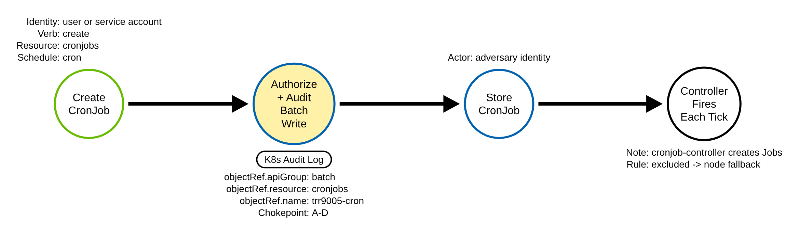
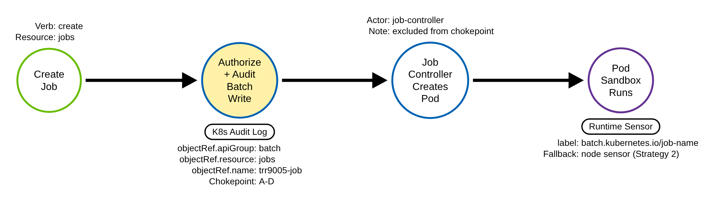
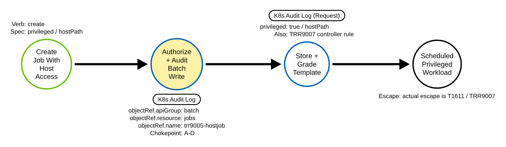
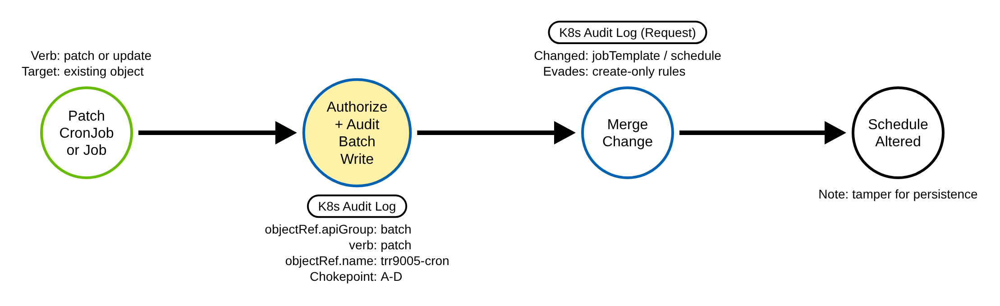

# Container Orchestration Job (Kubernetes)

> Prose uses Simplified Technical English (ASD-STE100) where practical.
> API group names, resource names, verbs, field names, and ATT&CK IDs are
> technical names.

## Metadata

| Key          | Value |
|--------------|-------|
| ID           | TRR9005 |
| External IDs | T1053.007 |
| Tactics      | Execution, Persistence, Privilege Escalation |
| Platforms    | Kubernetes |
| Contributors | det-eng |
| Status       | draft |

### Scope Statement

This TRR covers execution and persistence through **Kubernetes batch
workloads**: `Job` and `CronJob` objects in the `batch` API group. A Job runs a
Pod to completion once; a CronJob runs a Job on a schedule. An adversary who can
write batch objects schedules their own container, once or forever.

This TRR does not cover these related actions:

- Deploying a workload that is not a batch object to run code — a bare Pod, a
  Deployment, or a DaemonSet. ATT&CK T1610 (Deploy Container) covers that. A
  Job/CronJob create is a `batch`-group write; a Pod or Deployment create is a
  core or `apps`-group write.
- A static pod (a pod the kubelet runs from a node-local manifest, bypassing the
  API server). ATT&CK T1543.005 covers it; it is TRR9003 in this repository. A
  static pod produces no batch write and is detected on the node. T1053.007
  never bypasses the API server.
- The actual escape from a privileged or host-mounting Job's container to its
  node. ATT&CK T1611 (Escape to Host) covers that; it is TRR9007 in this
  repository. Procedure C here is the *scheduling* of such a workload, visible at
  the batch chokepoint; the escape itself is out of scope.

## Technique Overview

Kubernetes ships a built-in scheduler for recurring and one-off work. A CronJob
runs a Job on a cron schedule; a Job runs one or more Pods to completion. These
are normal, heavily used features — nightly backups, report generation, batch
processing.

An adversary who can create workload objects abuses the same feature to run their
own container, either once (a Job) or forever on a schedule (a CronJob). A
CronJob is an especially durable foothold: the cluster itself re-launches the
adversary's container on every tick, so the adversary does not need to keep
anything alive — the control plane does it for them. The container runs with
whatever identity, image, and privileges the adversary put in the spec, so this
one feature gives execution, long-term persistence, and, when the spec asks for a
privileged or host-mounting Pod, a path to higher privilege. It is the Kubernetes
form of a cron job or a scheduled task on a server.

## Technical Background

### The objects and the control flow

`Job` and `CronJob` are both in the `batch` API group, `apiVersion batch/v1`. A
Job carries a `.spec.template` Pod template and runs Pods until the configured
number complete. A CronJob carries `.spec.schedule` (cron syntax) and
`.spec.jobTemplate`; on each tick it creates a Job, which creates Pods.

The control flow matters for detection, because it produces three distinct audit
identities:

1. The adversary creates the CronJob or Job. The API server records a `batch`
   write attributed to the **adversary's** identity (`user.username`,
   `user.groups`).
2. When a CronJob fires, the **cronjob controller** creates the Job. That create
   is attributed to `system:serviceaccount:kube-system:cronjob-controller`.
3. The **job controller** then creates the Pods. That create is attributed to
   `system:serviceaccount:kube-system:job-controller`.

This fan-out — adversary, then cronjob-controller, then job-controller — is both
a useful correlation and the dominant false-positive source for a naive "batch
create" rule, because the controllers legitimately create Jobs and Pods
continuously for every real CronJob in the cluster.

### The audit log and the two levels

Every one of these writes passes through the API server, so the authoritative
record is the API server audit log. At `Metadata` level the create event carries
`verb`, `user`, `objectRef` (`apiGroup: batch`, `resource: cronjobs` or `jobs`,
`name`, `namespace`), `requestURI`, and `responseStatus.code` — enough for the
chokepoint rule to fire. The Pod spec inside the object — the schedule, the image,
the command, and `privileged`/`hostPath`/`hostPID` — appears only at `Request`
level and higher, in `requestObject`. There is no `replace` audit verb: an HTTP
`PUT` is recorded as `verb: update`.

### What this technique defeats, and where it is weak

On the preventive side, the technique defeats weak RBAC: anyone granted `create`
on `jobs` or `cronjobs` can schedule arbitrary containers. On the detection side,
the technique is fully visible to the API server — unlike static pods (T1543.005)
or direct-kubelet exec (T1609), it is **not** an API-server bypass. Its genuine
detection weaknesses are two: audit-policy coverage (if the `batch` group is not
recorded, the create is invisible), and the controller fan-out (which forces
false-positive tuning that can hide the ongoing executions). A node runtime
sensor closes both gaps, because every Job pod carries the label
`batch.kubernetes.io/job-name`.

## Procedures

| Procedure | ID | Name | Entry point |
|-----------|----|------|-------------|
| A | TRR9005.K8S.A | Create a CronJob (recurring persistence) | `create cronjobs` |
| B | TRR9005.K8S.B | Create a one-shot Job (execution) | `create jobs` |
| C | TRR9005.K8S.C | Privileged or host-mounting Job/CronJob | `create jobs`/`cronjobs` with a host-access template |
| D | TRR9005.K8S.D | Modify an existing CronJob/Job | `patch`/`update` `cronjobs`/`jobs` |

> A tool is not a procedure. `kubectl`, Helm, a GitOps controller, and a raw HTTP
> client all send the same batch write. They are the same procedure.

**Reading the DDMs.** Green borders are operations the client performs. Blue
borders are operations the API server performs. Purple borders are operations on
the node (the container runtime). Black borders are the abstract effect. The pill
on a node names the telemetry that records it, and the `Key: value` lines are what
a rule can match. A shaded node is the primary detection opportunity; here it is
the batch-write audit event, shared by all four procedures.

### Procedure A: Create a CronJob — recurring persistence  (`TRR9005.K8S.A`)

The adversary creates a CronJob whose `jobTemplate` runs their container, on a
schedule. The cluster re-launches it on every tick.

- **Prerequisites:** `create` on `cronjobs` in the target namespace.
- **Mechanics:** the cronjob controller creates a Job on each tick; the job
  controller creates the Pods.
- **Impact:** durable persistence and execution. The control plane keeps the
  foothold alive.
- **Tools on this path:** `kubectl create cronjob`, `kubectl apply`, any client.

#### Detection Data Model — `TRR9005.K8S.A`

Source: [`ddms/trr9005_k8s_a.json`](ddms/trr9005_k8s_a.json) (Arrows app format).

**DDM summary.** The shaded node is the API server's authorize-and-audit of the
batch write (`objectRef.apiGroup: batch`, `resource: cronjobs`, a write verb),
attributed to the adversary. The later controller fires (right, black) are
attributed to `cronjob-controller` and are excluded from the chokepoint rule to
kill the fan-out noise — which is why the node fallback matters for the recurring
executions.

### Procedure B: Create a one-shot Job — execution  (`TRR9005.K8S.B`)

The adversary creates a Job that runs their container once.

- **Prerequisites:** `create` on `jobs`.
- **Mechanics:** the job controller creates a Pod; the Pod runs to completion.
- **Impact:** one-shot execution with the identity and access the spec requests.
- **Tools on this path:** `kubectl create job`, `kubectl apply`, any client.

#### Detection Data Model — `TRR9005.K8S.B`

Source: [`ddms/trr9005_k8s_b.json`](ddms/trr9005_k8s_b.json) (Arrows app format).

**DDM summary.** The chokepoint audit event is the same, `resource: jobs`. The job
controller's Pod create (attributed to `job-controller`) is excluded from the
chokepoint, so the second anchor is on the node: the Pod sandbox carries the label
`batch.kubernetes.io/job-name`, which a runtime sensor sees. That node anchor
catches the execution even when the audit rule excludes the controllers or the
`batch` group is absent from the audit policy.

### Procedure C: Privileged or host-mounting Job/CronJob  (`TRR9005.K8S.C`)

The adversary schedules a batch workload whose Pod template requests host access —
a privileged container, a `hostPath` mount, `hostPID`, or `hostNetwork`.

- **Prerequisites:** `create` on `jobs`/`cronjobs`, and a namespace that admits
  the host-access Pod (no restrictive Pod Security Admission).
- **Mechanics:** the scheduled Pod runs with host access, which is a stepping
  stone to escape.
- **Impact:** a scheduled foothold with a path to the node. The escape itself is
  T1611 (TRR9007).
- **Tools on this path:** `kubectl apply` of a Job/CronJob manifest with a
  host-access template.

#### Detection Data Model — `TRR9005.K8S.C`

Source: [`ddms/trr9005_k8s_c.json`](ddms/trr9005_k8s_c.json) (Arrows app format).

**DDM summary.** The chokepoint fires at `Metadata` on the batch write, as in A
and B. The host-access fields are inside the embedded Pod template and need
`Request` level. The same write is also graded by the TRR9007 controller rule
(`k8s_podspec_controller_host_access.yml`), which inspects the template of any
workload controller — the same event, two lenses. Dedup by `auditID`.

### Procedure D: Modify an existing CronJob/Job  (`TRR9005.K8S.D`)

The adversary amends an existing batch object instead of creating a new one — for
example, changing a legitimate CronJob's `jobTemplate` to run their image.

- **Prerequisites:** `patch`/`update` on the target object.
- **Mechanics:** the write verb is `patch` or `update`, not `create`.
- **Impact:** stealthy persistence by hijacking a trusted scheduled workload.
- **Tools on this path:** `kubectl patch`/`edit`/`apply`.

#### Detection Data Model — `TRR9005.K8S.D`

Source: [`ddms/trr9005_k8s_d.json`](ddms/trr9005_k8s_d.json) (Arrows app format).

**DDM summary.** Same chokepoint, verb `patch` or `update`. Because the chokepoint
keys on the API group, the resource, and the write verb — not on `create` — it
sees this path where a create-only rule does not. The changed template is in
`requestObject` at `Request` level.

## Detection Strategy

Compare the four DDMs. Every procedure is a write to a `batch` Job or CronJob, and
every one leaves the same kind of audit event. The technique has no API-server
bypass, so the chokepoint is one audit rule. A node runtime rule is a true
fallback, for the recurring executions the chokepoint cannot keep (it excludes the
controllers) and for the case where the `batch` group is dropped from the audit
policy.

**Telemetry requirement.** The audit policy must record the `batch` group for the
write verbs at `Metadata` (to fire the chokepoint) and at `Request` level (to see
the host-access template in Procedure C). Keep a `Metadata` rule for `pods`
`create` as well, for the job-controller correlation. Put the batch rule above any
`level: None` rule.

**Strategy 1 — chokepoint (covers A–D).**
Match audit events where `objectRef.apiGroup` is `batch`, `objectRef.resource` is
`jobs` or `cronjobs`, and `verb` is `create`, `update`, `patch`, `delete`, or
`deletecollection`. **Exclude** the controllers that write batch objects on their own
(`cronjob-controller`, `job-controller`, `ttl-after-finished-controller`,
`generic-garbage-collector`), and the namespace controller's `deletecollection` when it
empties a namespace that is being deleted, so the rule stays on the identity that set
the schedule up and does not alert on every scheduled run. Baseline the other legitimate automation identities.

- Sensor: API server audit log.
- Rule: `detections/sigma/T1053.007/k8s_job_create.yml` (built).

**Strategy 2 — node-runtime fallback (covers the executed Pod).**
Match a Pod sandbox whose labels carry `batch.kubernetes.io/job-name` (stamped
from Kubernetes v1.27), or both legacy labels `job-name` and `controller-uid` (the
only ones before v1.27). This sees
the executed Pod, which the chokepoint rule does not: the recurring executions a
CronJob drives (the chokepoint excludes the controllers), and any execution when
the `batch` group is absent from the audit policy. It fires on every Job pod, so
it is a correlation and hunting anchor, not a standalone alert; correlate it with
the chokepoint write on the job name.

- Sensor: a runtime security agent or an EDR agent on each node (CRI pod
  sandboxes).
- Rule: `detections/sigma/T1053.007/k8s_cri_job_pod.yml` (built).

**Demonstrated gap — the controller fan-out and the audit-policy gap.**
Once a CronJob exists, every subsequent run is a Job created by the cronjob
controller and Pods by the job controller. A rule that (correctly) excludes those
controller identities to survive the noise therefore does not alert on the
recurring executions — only on the one-time setup write. If that setup happened
before audit logging was on, or in a window the SIEM missed, the ongoing
executions are invisible to the audit rule. The lab demonstrates the fallback
safely: it creates the benign `trr9005-job`, confirms the chokepoint fires on the
jobs-create, and shows the node sensor independently matches the resulting Pod
sandbox by its `batch.kubernetes.io/job-name` label — so the node sensor would
still catch the execution even with the `batch` group dropped from the audit
policy.

**Enrichment (raises fidelity; not a primary anchor).**

- **Image.** A Job whose image is from an unexpected registry, or is `latest`, or
  is a shell/tooling image, is higher signal.
- **Identity.** A batch create from an identity that has never created batch
  objects, or from a pod service account, is unusual.
- **Spec.** A privileged or host-mounting template (Procedure C) — graded by the
  TRR9007 controller rule.

**Coverage summary.**

| Procedure | Covered by | How |
|-----------|-----------|-----|
| A | Strategy 1; Strategy 2 confirms a live CronJob | `create cronjobs` |
| B | Strategy 1; Strategy 2 sees the Pod | `create jobs` |
| C | Strategy 1; graded by TRR9007 controller rule | batch write with a host-access template |
| D | Strategy 1 | `patch`/`update` an existing batch object |

One chokepoint rule covers every procedure's setup write. One node rule catches
the executions the chokepoint cannot keep.

## Available Emulation Tests

The tests run in a lab cluster with an audit policy that records the `batch` group
at `Request` level and a node runtime sensor (CRI pod sandboxes). The lab is a
`kind` cluster; its config, audit policy, and sensor are in
[`detections/k8s/`](../../../detections/k8s/). Every object the tests write is
named with the unique prefix `trr9005-`. The CronJob uses a never-firing schedule
so it spawns no child Pods, and the one-shot Job runs `id`. One script drives them
all:
[`atomics/T1053.007/src/emulate.sh`](../../../atomics/T1053.007/src/emulate.sh),
with an Atomic Red Team wrapper in
[`atomics/T1053.007/T1053.007.yaml`](../../../atomics/T1053.007/T1053.007.yaml).

| Procedure | Test | Status |
|-----------|------|--------|
| TRR9005.K8S.A | `emulate.sh a` — create a CronJob with a never-firing schedule (no child pods). | **built** |
| TRR9005.K8S.B | `emulate.sh b` — create a one-shot Job that runs `id`; the node sensor observes its pod. | **built** |
| TRR9005.K8S.C | `emulate.sh c` — create a Job with a privileged + hostPath template that runs `/bin/true`. | **built** |
| TRR9005.K8S.D | `emulate.sh d` — patch the CronJob to suspend it (the modification path). | **built** |

## Detections

| Strategy | Covers | Sigma rule | Sensor |
|----------|--------|------------|--------|
| 1 (chokepoint) | A, B, C, D | [`detections/sigma/T1053.007/k8s_job_create.yml`](../../../detections/sigma/T1053.007/k8s_job_create.yml) | API server audit log |
| 2 (fallback) | the executed Pod | [`detections/sigma/T1053.007/k8s_cri_job_pod.yml`](../../../detections/sigma/T1053.007/k8s_cri_job_pod.yml) | node runtime sensor |

The Kubernetes API server loop has its own validator,
[`detections/validate_apiserver_detections.py`](../../../detections/validate_apiserver_detections.py):
it reads the API server audit log and the node sensor log the emulation produced
and asserts each rule above matches an event from the emulation itself (one naming
a `trr9005-` object). The workflow
[`validate-apiserver-detections.yml`](../../../.github/workflows/validate-apiserver-detections.yml)
runs the whole loop on a `kind` cluster, and runs the validator as a negative
control on the logs captured *before* the emulation.

Prior emulation: Atomic Red Team T1053.007 test 2 ("CreateCronjob") creates a CronJob
from a manifest with `kubectl create -f` (Procedure A); Stratus Red Team has no batch
technique.

Upstream: the SigmaHQ rule `kubernetes_audit_cronjob_modification.yml` covers the
batch write but does not exclude the cronjob and job controllers, so it fires on
every scheduled run of every legitimate CronJob. Propose the controller exclusion
and the node-runtime correlation rule as an improvement.

## References

- MITRE ATT&CK, T1053.007 Container Orchestration Job:
  <https://attack.mitre.org/techniques/T1053/007/>
- Kubernetes documentation, CronJob:
  <https://kubernetes.io/docs/concepts/workloads/controllers/cron-jobs/>
- Kubernetes documentation, Job:
  <https://kubernetes.io/docs/concepts/workloads/controllers/job/>
- Kubernetes documentation, Auditing (levels, stages, event fields):
  <https://kubernetes.io/docs/tasks/debug/debug-cluster/audit/>
- Kubernetes source, batch/v1 types (the `batch.kubernetes.io/job-name` label):
  <https://github.com/kubernetes/kubernetes/blob/master/staging/src/k8s.io/api/batch/v1/types.go>
- Kubernetes source, controller RBAC bootstrap policy (controller identities):
  <https://github.com/kubernetes/kubernetes/blob/master/plugin/pkg/auth/authorizer/rbac/bootstrappolicy/controller_policy.go>
- SigmaHQ rule, Kubernetes CronJob/Job Modification:
  <https://github.com/SigmaHQ/sigma/blob/master/rules/application/kubernetes/audit/kubernetes_audit_cronjob_modification.yml>
- Microsoft Threat Matrix for Kubernetes:
  <https://microsoft.github.io/Threat-Matrix-for-Kubernetes/>
- TRR method:
  <https://github.com/tired-labs/techniques/blob/main/docs/TECHNIQUE-RESEARCH-REPORT.md>
