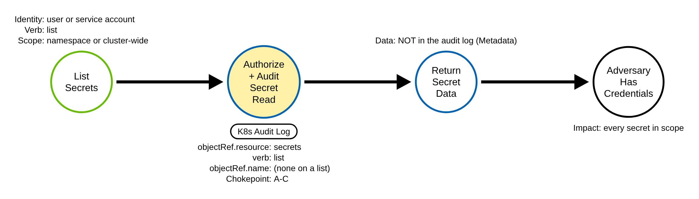
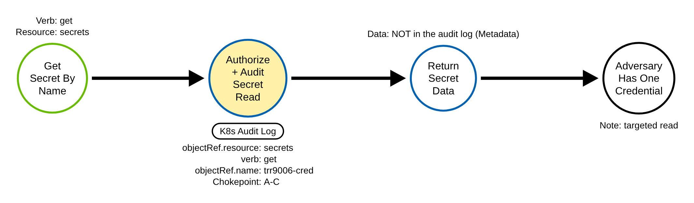
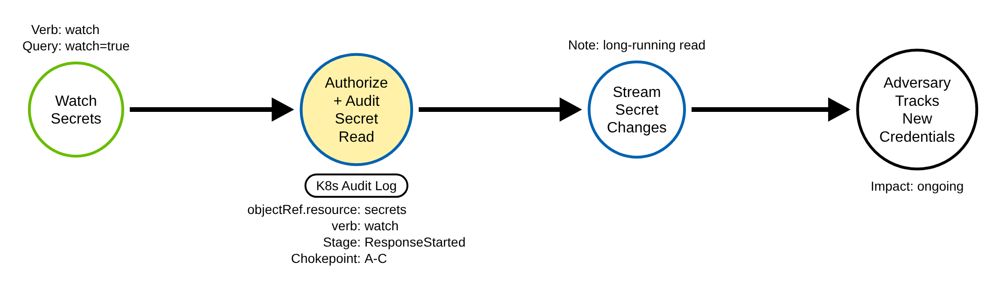
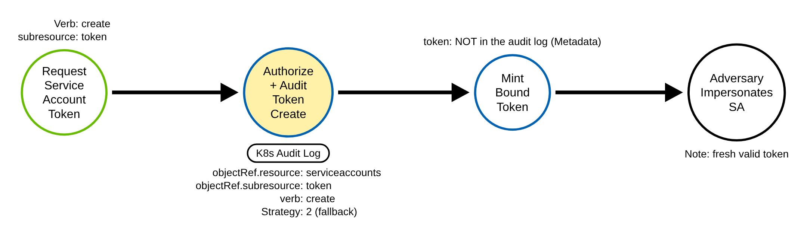
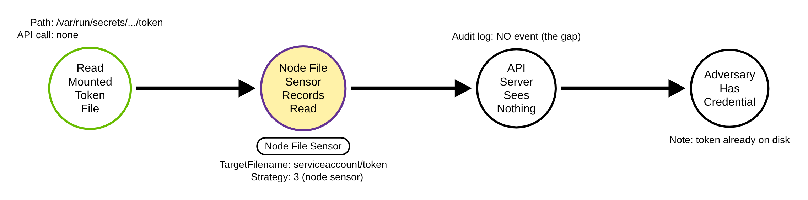

# Unsecured Credentials: Container API (Kubernetes)

> Prose uses Simplified Technical English (ASD-STE100) where practical.
> API paths, resource names, verbs, field names, and ATT&CK IDs are technical
> names.

## Metadata

| Key          | Value |
|--------------|-------|
| ID           | TRR9006 |
| External IDs | T1552.007 |
| Tactics      | Credential Access |
| Platforms    | Kubernetes |
| Contributors | det-eng |
| Status       | draft |

### Scope Statement

This TRR covers credential access through the **Kubernetes Container API**:
reading Secret objects (get, list, watch), minting service-account tokens with
the TokenRequest API, and reading an already-mounted service-account token off a
container or node filesystem.

This TRR does not cover these related actions:

- Gaining command execution inside a container to reach a credential. ATT&CK
  T1609 (TRR9002) covers exec; exec is the carrier, not the secret read.
- Escaping to the host. ATT&CK T1611 (TRR9007) covers it.
- Reading cloud instance-metadata or managed-identity credentials from a pod (the
  IMDS path). That is a different T1552 sub-technique and a cloud technique.
- Harvesting credentials through the Docker daemon API (the Docker half of
  T1552.007). This report covers Kubernetes only.
- Decrypting Secrets at rest in etcd.

Microsoft's Threat Matrix for Kubernetes aligns this report with its Credential
Access techniques "List K8S secrets" and "Access container service account."

## Technique Overview

Kubernetes stores sensitive values — passwords, TLS keys, API tokens, registry
pull credentials — as Secret objects in the API server, and it can mint
short-lived identity tokens on demand through the TokenRequest API. These are
normal, needed features: applications read their own Secrets, and components ask
for tokens all day long.

An adversary who has obtained any credential that can reach the API server — most
often the service-account token that Kubernetes mounts into almost every pod by
default — uses those same features to harvest credentials. With read access to
Secrets they dump every password and key in a namespace, or the whole cluster, in
one request. With permission on the `serviceaccounts/token` subresource they mint
a fresh token for a more powerful service account and impersonate it. And even
with no API permission at all, code inside a pod simply reads the token file that
Kubernetes already mounted onto the container's disk. Each path looks like
ordinary platform traffic; the difference is in who does it, from where, with
which client, and against which credential.

## Technical Background

### Secrets and the three read verbs

Secrets are namespaced objects in the core API group (`apiGroup ""`, resource
`secrets`, `apiVersion v1`). They are read three ways, and the API server records
the verb it derived from the HTTP request:

- A `GET` on `/api/v1/namespaces/<ns>/secrets/<name>` is recorded as `verb: get`,
  with `objectRef.name` set.
- A collection `GET` on `/api/v1/namespaces/<ns>/secrets`, or cluster-wide
  `/api/v1/secrets`, is recorded as `verb: list`. It carries
  `objectRef.namespace` (empty for cluster-wide) but **no** `objectRef.name`.
- The same URL with `?watch=true` is recorded as `verb: watch`.

In every case `objectRef.resource` is `secrets`. A verb-agnostic rule on that
resource is the invariant for all three.

### Metadata level is sufficient and safe

At `Metadata` level the event carries `verb`, `objectRef`
(resource/namespace/name), `user.username`/`groups`, `sourceIPs`, `userAgent`,
`requestURI`, and `responseStatus.code` (200 for a read that succeeded, 403 for
one authorization refused). `Metadata` does **not** record a request or response
body — which for Secrets is exactly right. The `RequestResponse` level would copy
the Secret's base64 data straight into the audit log, turning the log itself into
a credential store. So Secrets must be logged at `Metadata`, never
`RequestResponse`.

### The TokenRequest API

The TokenRequest API mints a bound service-account token: a `POST` to
`/api/v1/namespaces/<ns>/serviceaccounts/<name>/token`, recorded as `verb:
create`, `objectRef.resource: serviceaccounts`, `objectRef.subresource: token`,
`objectRef.name: <sa>`. The response carries the signed token, so, like Secrets,
this must never be logged at `RequestResponse`. `Metadata` is enough to fire a
rule; `Request` level adds the requested `audiences` and `boundObjectRef` for
triage. The kubelet and the controller manager mint pod and component tokens
constantly, so a detection must exclude those system identities.

### The gap — the already-mounted token

Kubernetes auto-mounts a service-account token into almost every pod. It lives on
the container filesystem at
`/var/run/secrets/kubernetes.io/serviceaccount/token`, and on the node under
`/var/lib/kubelet/pods/<uid>/volumes/kubernetes.io~projected/*/token`. Reading it
is an ordinary `open()`/`read()` on local disk. No request reaches the API
server, so **no audit event of any kind is written**. The API-server chokepoint
sees every path except this one.

### Why the technique works

Kubernetes cannot tell a legitimate Secret read from a malicious one; RBAC is the
only preventive control. And the default of auto-mounting a token into every pod
means a single compromised workload almost always starts with a usable API
credential already on disk. A detection must use context — who, from where, with
which client, against which namespace — and a node sensor for the one path the
audit log cannot see.

## Procedures

| Procedure | ID | Name | Entry point |
|-----------|----|------|-------------|
| A | TRR9006.K8S.A | List Secrets | `list secrets` |
| B | TRR9006.K8S.B | Get a specific Secret | `get secrets/<name>` |
| C | TRR9006.K8S.C | Watch Secrets | `watch secrets` |
| D | TRR9006.K8S.D | Mint a token via TokenRequest | `create serviceaccounts/token` |
| E | TRR9006.K8S.E | Read a mounted token off disk | local `open()`/`read()` (no API call) |

> A tool is not a procedure. `kubectl`, `client-go`, a Python client, and `curl`
> all send the same read. They are the same procedure.

**Reading the DDMs.** Green borders are operations the client performs. Blue
borders are operations the API server performs. Purple borders are operations on
the node. Black borders are the abstract effect. The pill on a node names the
telemetry that records it. A shaded node is the primary detection opportunity for
that procedure.

### Procedure A: List Secrets  (`TRR9006.K8S.A`)

The adversary lists the Secrets in a namespace, or cluster-wide, and reads every
one.

- **Prerequisites:** `list` on `secrets` in the namespace (or cluster-wide).
- **Mechanics:** one request returns every Secret in scope.
- **Impact:** bulk credential theft.
- **Tools on this path:** `kubectl get secrets`, `client-go`, any client.

#### Detection Data Model — `TRR9006.K8S.A`

Source: [`ddms/trr9006_k8s_a.json`](ddms/trr9006_k8s_a.json) (Arrows app format).

**DDM summary.** The shaded node is the API server's authorize-and-audit of the
Secret read (`objectRef.resource: secrets`, `verb: list`), the chokepoint for A,
B, and C. A `list` event carries `objectRef.namespace` but no `objectRef.name`,
which is why a validator gates this technique on the namespace, not the name.

### Procedure B: Get a specific Secret  (`TRR9006.K8S.B`)

The adversary reads one named Secret.

- **Prerequisites:** `get` on that Secret.
- **Mechanics:** a targeted single-object read.
- **Impact:** one credential, precisely.
- **Tools on this path:** `kubectl get secret <name>`, any client.

#### Detection Data Model — `TRR9006.K8S.B`

Source: [`ddms/trr9006_k8s_b.json`](ddms/trr9006_k8s_b.json) (Arrows app format).

**DDM summary.** Same chokepoint audit event, `verb: get`, with `objectRef.name`
set. The SigmaHQ enumeration rule matches `verb: list` only, so it misses this
targeted read; the chokepoint here matches all three verbs.

### Procedure C: Watch Secrets  (`TRR9006.K8S.C`)

The adversary opens a streaming watch on Secrets and receives each one and every
change.

- **Prerequisites:** `watch` on `secrets`.
- **Mechanics:** a long-running read; the event is written at `ResponseStarted`.
- **Impact:** bulk theft plus ongoing tracking of new credentials.
- **Tools on this path:** `kubectl get secrets --watch`, informers, any client.

#### Detection Data Model — `TRR9006.K8S.C`

Source: [`ddms/trr9006_k8s_c.json`](ddms/trr9006_k8s_c.json) (Arrows app format).

**DDM summary.** Same chokepoint, `verb: watch`. The event is emitted at
`ResponseStarted`, so dropping the `RequestReceived` stage does not lose it. A
list-only or create-only rule misses the watch; the chokepoint catches it.

### Procedure D: Mint a token via TokenRequest  (`TRR9006.K8S.D`)

The adversary mints a fresh token for a service account they can reach, and
impersonates it.

- **Prerequisites:** `create` on the `serviceaccounts/token` subresource for the
  target service account.
- **Mechanics:** a `POST` to the token subresource returns a signed, bound token.
- **Impact:** a valid credential for another identity, often more powerful.
- **Tools on this path:** `kubectl create token`, the TokenRequest API directly.

#### Detection Data Model — `TRR9006.K8S.D`

Source: [`ddms/trr9006_k8s_d.json`](ddms/trr9006_k8s_d.json) (Arrows app format).

**DDM summary.** This procedure has its own anchor, a different resource and edge
than a Secret read: `objectRef.resource: serviceaccounts`, `subresource: token`,
`verb: create`. So the Secret-read chokepoint does not see it; it needs its own
rule (Strategy 2). The signed token is in the response, so the rule must stay at
`Metadata`.

### Procedure E: Read a mounted token off disk — the gap  (`TRR9006.K8S.E`)

The adversary reads the service-account token that Kubernetes already mounted into
the pod, straight off the container filesystem.

- **Prerequisites:** code execution inside a pod that mounts a token (the default).
- **Mechanics:** a local `open()`/`read()` of the token file. No API call.
- **Impact:** a usable API credential, with no API-server trace of the read.
- **Tools on this path:** `cat`, any program that reads the file.

#### Detection Data Model — `TRR9006.K8S.E`

Source: [`ddms/trr9006_k8s_e.json`](ddms/trr9006_k8s_e.json) (Arrows app format).

**DDM summary.** There is no audit event. The read is visible only to a node
runtime or file sensor watching the token path (the shaded node), or by
detection-by-absence: an identity authenticates to the API server with a token for
which no `get secret` and no TokenRequest `create` event exists, so the token must
have come from a file read.

## Detection Strategy

Compare the five DDMs. Procedures A, B, and C all read a Secret through the API
server, so each leaves the same kind of audit event — one chokepoint rule covers
all three. Procedure D is a different resource and edge (a token mint), so it
needs its own fallback rule. Procedure E never reaches the API server, so no audit
rule can see it; a node sensor, or detection-by-absence, covers it.

**Telemetry requirement.** The audit policy must record the core group `secrets`
for `get`/`list`/`watch`, and `serviceaccounts/token` for `create`, at
**Metadata** level — never `Request` or `RequestResponse`, which would write the
Secret data and the signed token into the log. Put these targeted rules above any
`level: None` rule, and do not let a noise-reduction rule drop `get`/`list`/`watch`
on `secrets` for the test identity.

**Strategy 1 — chokepoint (covers A, B, C).**
Match audit events where `objectRef.resource` is `secrets` and `verb` is `get`,
`list`, or `watch`. Baseline the actor: controllers and the kubelet read Secrets
continuously. Triage on who, from where, with which client, and against which
namespace; a cluster-wide list, a read from a pod source IP, a non-`kubectl`
client, or a burst of 403s (permission probing) are high-signal.

- Sensor: API server audit log.
- Rule: `detections/sigma/T1552.007/k8s_secret_access.yml` (built).

**Strategy 2 — fallback (covers D).**
Match audit events where `objectRef.resource` is `serviceaccounts`,
`objectRef.subresource` is `token`, and `verb` is `create`, excluding the
identities that mint pod and component tokens routinely
(`system:kube-controller-manager`, `system:kube-scheduler`, every
`system:node:*`, every `system:serviceaccount:kube-system:*`). What remains is a
token mint by a human or a non-system service account — unusual.

- Sensor: API server audit log.
- Rule: `detections/sigma/T1552.007/k8s_secret_token_request.yml` (built).

**Strategy 3 — node sensor (covers E; the gap).**
Match a read of the token file on the container or node filesystem. This needs
host file-event telemetry, so it is not exercised by the audit-log validation
loop; the loop demonstrates the gap instead. Pair it with detection-by-absence.

- Sensor: a file integrity monitor, auditd, or an EDR/runtime agent on each node.
- Rule: `detections/sigma/T1552.007/linux_k8s_sa_token_read.yml` (built).

**Demonstrated gap.**
Emulate Procedure E — read a projected token file on the node, read-only — and
show the API server audit log gains no `secrets` or `serviceaccounts` event. The
audit-log chokepoint and both audit fallbacks are blind to it. This mirrors how
TRR9002 Procedure E documents the direct-kubelet gap.

**Enrichment (raises fidelity; not a primary anchor).**

- **Identity.** A Secret read or token mint from a pod service account, or from an
  identity that has not done it before, is unusual.
- **Client.** `userAgent` is `curl`, a scripting library, or `client-go`, rather
  than `kubectl` or a known operator.
- **Source.** `sourceIPs` is a pod address or outside the administration network.
- **Scope and target.** A cluster-wide list, or a read in `kube-system` or another
  sensitive namespace.
- **Refused attempts.** A burst of `responseStatus.code` 403 shows permission
  probing.

**Coverage summary.**

| Procedure | Covered by | How |
|-----------|-----------|-----|
| A | Strategy 1 (chokepoint) | `list secrets` audit event |
| B | Strategy 1 (chokepoint) | `get secrets` audit event |
| C | Strategy 1 (chokepoint) | `watch secrets` audit event |
| D | Strategy 2 (fallback) | `create serviceaccounts/token` audit event |
| E | Strategy 3 (node sensor); detection-by-absence | token file read; no audit event |

One chokepoint rule covers the three API read paths. One fallback covers token
minting. A node sensor covers the mounted-token read the API server never sees.

## Available Emulation Tests

The tests run in a lab cluster with an audit policy that records `secrets` reads
and `serviceaccounts/token` creates at `Metadata` level. The lab is a `kind`
cluster; its config and audit policy are in
[`detections/k8s/`](../../../detections/k8s/). The emulation uses a **fixed**
namespace `trr9006` and unique names (`trr9006-cred`, `trr9006-sa`), so a
validator gates on the namespace and the non-system caller — telling the
emulation's own reads apart from the controller reads that also hit the new
namespace, while a pre-emulation baseline (which has no `trr9006` namespace)
cannot pass. One script drives them all:
[`atomics/T1552.007/src/emulate.sh`](../../../atomics/T1552.007/src/emulate.sh),
with an Atomic Red Team wrapper in
[`atomics/T1552.007/T1552.007.yaml`](../../../atomics/T1552.007/T1552.007.yaml).

| Procedure | Test | Status |
|-----------|------|--------|
| TRR9006.K8S.A | `emulate.sh a` — list Secrets in the namespace. | **built** |
| TRR9006.K8S.B | `emulate.sh b` — get one Secret by name. | **built** |
| TRR9006.K8S.C | `emulate.sh c` — watch Secrets for 5 seconds. | **built** |
| TRR9006.K8S.D | `emulate.sh d` — mint a token for a throwaway service account. | **built** |
| TRR9006.K8S.E | `emulate.sh e` — read a mounted token off the node (shows no audit event). | **built** |

The Secret holds a benign literal, not a real credential; the minted token is for
a service account that holds no RBAC and expires on its own; Procedure E reads
only the first bytes of a token file, read-only.

## Detections

| Strategy | Covers | Sigma rule | Sensor |
|----------|--------|------------|--------|
| 1 (chokepoint) | A, B, C | [`detections/sigma/T1552.007/k8s_secret_access.yml`](../../../detections/sigma/T1552.007/k8s_secret_access.yml) | API server audit log |
| 2 (fallback) | D | [`detections/sigma/T1552.007/k8s_secret_token_request.yml`](../../../detections/sigma/T1552.007/k8s_secret_token_request.yml) | API server audit log |
| 3 (node sensor) | E; the gap | [`detections/sigma/T1552.007/linux_k8s_sa_token_read.yml`](../../../detections/sigma/T1552.007/linux_k8s_sa_token_read.yml) | node file-event sensor |

The Kubernetes API server loop has its own validator,
[`detections/validate_apiserver_detections.py`](../../../detections/validate_apiserver_detections.py):
it reads the API server audit log the emulation produced and asserts Strategies 1
and 2 match an event from the emulation itself (one in the `trr9006` namespace by
the non-system test identity). Strategy 3 is compiled, not match-gated: it needs
node file telemetry the audit loop does not produce, so Procedure E documents the
gap instead. The workflow
[`validate-apiserver-detections.yml`](../../../.github/workflows/validate-apiserver-detections.yml)
runs the loop on a `kind` cluster, and runs the validator as a negative control on
the audit log captured *before* the emulation (no `trr9006` namespace yet, so no
rule may pass).

Upstream: the SigmaHQ rule `kubernetes_audit_secrets_enumeration.yml` matches
`verb: list` only; propose broadening it to `get`/`list`/`watch`, plus the
TokenRequest fallback.

## References

- MITRE ATT&CK, T1552.007 Container API:
  <https://attack.mitre.org/techniques/T1552/007/>
- Kubernetes documentation, Auditing (levels, stages, event fields):
  <https://kubernetes.io/docs/tasks/debug/debug-cluster/audit/>
- Kubernetes documentation, TokenRequest v1 API:
  <https://kubernetes.io/docs/reference/kubernetes-api/authentication-resources/token-request-v1/>
- Kubernetes documentation, Projected Volumes (the mounted token path):
  <https://kubernetes.io/docs/concepts/storage/projected-volumes/>
- Kubernetes documentation, Configure Service Accounts for Pods:
  <https://kubernetes.io/docs/tasks/configure-pod-container/configure-service-account/>
- SigmaHQ rule, Kubernetes Secrets Enumeration:
  <https://github.com/SigmaHQ/sigma/blob/master/rules/application/kubernetes/audit/kubernetes_audit_secrets_enumeration.yml>
- Datadog Security Labs, the Kubernetes TokenRequest API:
  <https://securitylabs.datadoghq.com/articles/kubernetes-tokenrequest-api/>
- Microsoft Threat Matrix for Kubernetes, List K8S secrets / Access container
  service account:
  <https://microsoft.github.io/Threat-Matrix-for-Kubernetes/>
- TRR method:
  <https://github.com/tired-labs/techniques/blob/main/docs/TECHNIQUE-RESEARCH-REPORT.md>
