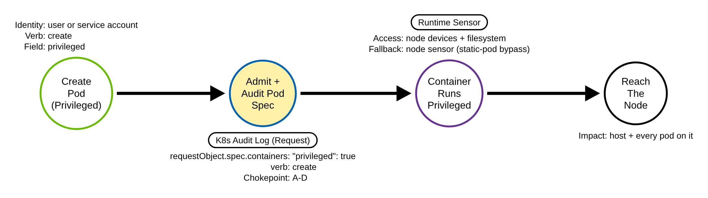
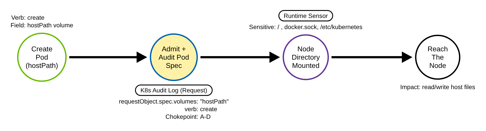
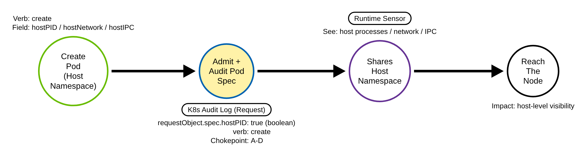
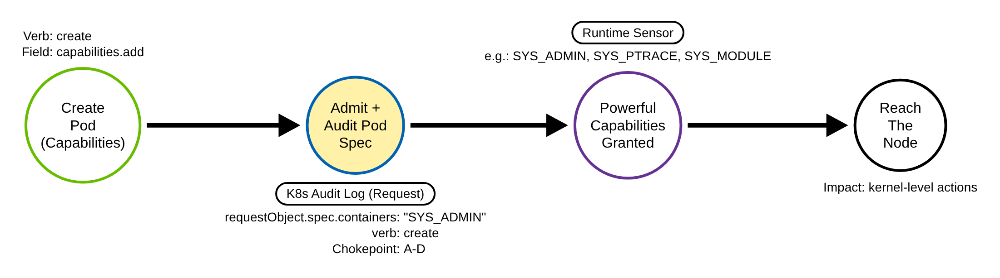
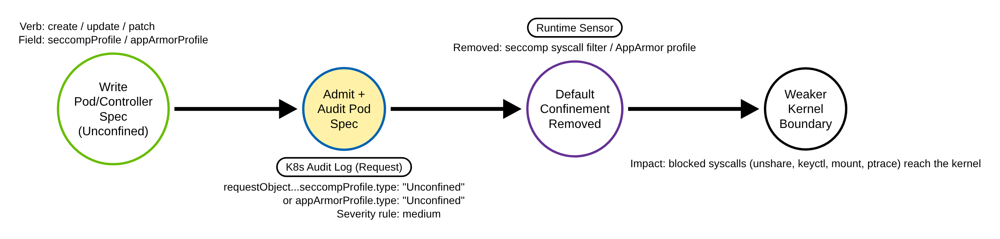

# Escape to Host via a Dangerous Pod Spec (Kubernetes)

> Prose uses Simplified Technical English (ASD-STE100) where practical.
> Field names, resource names, capability names, and ATT&CK IDs are technical
> names.

## Metadata

| Key          | Value |
|--------------|-------|
| ID           | TRR9007 |
| External IDs | T1611 |
| Tactics      | Privilege Escalation |
| Platforms    | Kubernetes |
| Contributors | det-eng |
| Status       | draft |

### Scope Statement

This TRR covers escape to the host through a **dangerous pod specification**: the
host-access fields a pod creator requests at admission time — a privileged
container, a `hostPath` volume, a host namespace (`hostPID`/`hostNetwork`/
`hostIPC`), or an added Linux capability — and, one level lower, a pod spec that
removes the runtime's default confinement: a seccomp or AppArmor profile of type
`Unconfined` (Procedure E).

This TRR does not cover these related actions:

- The in-container kernel or runtime escape once a pod is running (a `setns`,
  cgroups `release_agent`, or runc breakout). The Linux syscall atomic for T1611
  in this repository (`atomics/T1611/src/setns_namespace_join_behavioral.c`)
  covers that; it keys on syscalls, not the audit log. The two share the ATT&CK
  ID but are different platforms and different telemetry: this report is the
  Kubernetes pod-spec request, that one is the Linux syscall.
- Command execution into an existing privileged pod. ATT&CK T1609 (TRR9002)
  covers exec; a command does not grant host access, a dangerous spec does.
- Persistence through a static pod. ATT&CK T1543.005 (TRR9003) covers that. Here
  a static pod is only the clearest API-server-bypass *delivery* of a dangerous
  spec, and the overlap is deliberate — the same node sensor is the fallback for
  both.

`hostPort`, `runAsUser: 0`, and `allowPrivilegeEscalation` are weaker Pod
Security violations that enrich a finding but are not themselves host escape, so
they are enrichment, not chokepoint fields. `Unconfined` is not a host escape by itself
either, but it is a procedure (E), not enrichment. It removes a whole kernel-level layer
(the syscall filter or the AppArmor profile) that the escape paths of T1611 must pass, and
it is its own Pod Security Baseline check. It has its own medium rule (Strategy 4), apart
from the high host-access rules.

## Technique Overview

Kubernetes runs each workload in a container that is meant to be walled off from
the machine — the node — it runs on. This technique is an adversary who can
create workloads asking, at creation time, for a pod that tears that wall down.
The dangerous settings all live in the pod's own specification: mark the
container "privileged"; let it share the node's process, network, or IPC
namespace; mount a sensitive node directory into the container with a `hostPath`
volume (the root `/`, the Docker socket, `/etc/kubernetes`, or the kubelet
directory); or grant it powerful Linux capabilities (`SYS_ADMIN`, `SYS_PTRACE`,
`SYS_MODULE`).

A pod with any of these can reach the node itself and, from there, every other
pod on it. The adversary never needs a kernel exploit — Kubernetes hands over the
host because the pod spec politely asked. Because the request to create such a
pod goes through the API server, the audit log records the full pod specification,
so the dangerous request can be caught at the moment it is made. The audit log has
to record the spec for this to work, though: a cluster that logs only metadata
cannot see the dangerous fields, and there a sensor on the node is the only thing
that sees the privileged container.

## Technical Background

### The dangerous fields are in the request body

The dangerous fields are part of the Kubernetes PodSpec and are carried in the
API request body. They map to the Pod Security Standards "privileged" and
"baseline" violations: `securityContext.privileged`, `hostPID`/`hostNetwork`/
`hostIPC`, `hostPath` volumes, and added capabilities are exactly the fields the
Baseline profile forbids. PodSecurityPolicy was removed in v1.25 and replaced by
the Pod Security Admission controller, which is label-driven per namespace and
off by default on an unlabeled namespace — so on a default cluster these pods are
admitted.

### Why the audit level matters

The detection telemetry is the API server audit log. The submitted pod
specification appears in the audit event as the `requestObject` field **only at
audit level `Request` or `RequestResponse`**. At `Metadata` level — the level of
the OpenShift Default audit profile and of the k3s hardening-guide starter policy
— `requestObject` is absent, so a rule that keys on spec fields has nothing to
match. The audit policies that EKS (its Best Practices Guide), AKS (Microsoft
Learn) and the GCE kube-up script (which the EKS user guide links) publish log pod
and workload writes at `RequestResponse`, so there the body is in the record. One
exception: at `Request` or higher a server-side apply patch with a YAML body leaves
no record at all, so neither a grader nor a chokepoint sees it
([RULE_DEFECTS K23](../../../detections/RULE_DEFECTS.md#k23-apply-patches-with-a-yaml-body-no-audit-record-at-request-level-or-higher)).
The offline policy simulator shows the levels on the sidecar cases: every positive of
`k8s_podspec_host_access` fires under those three policies and under the OpenShift
WriteRequestBodies profile, and none fires under the OpenShift Default profile or
the k3s starter policy
([`detections/k8s/policy_coverage.json`](../../../detections/k8s/policy_coverage.json),
from [`detections/k8s_policy_coverage.py`](../../../detections/k8s_policy_coverage.py);
the policy texts and their sources are in
[`detections/k8s/provider-policies/`](../../../detections/k8s/provider-policies/SOURCES.md);
[RULE_DEFECTS KTBD-A3](../../../detections/RULE_DEFECTS.md#ktbd-a3-body-graders-are-blind-under-the-openshift-default-profile-and-the-k3s-starter-policy)).
A published policy is not a capture: whether each provider runs it unchanged is
unverified. `Request` level is
sufficient: `requestObject` is the client-submitted body, which already contains
every adversary-set field. Because it is the request body, it is logged **even
when admission rejects the pod** (a 403), so the chokepoint also catches blocked
attempts.

### How the fields appear to a rule

The det-eng validator flattens an audit event the way any log store does: nested
objects become dotted field names, and arrays become JSON text. So the fields
split into two kinds, matched two ways:

- **Top-level booleans.** `requestObject.spec.hostPID`, `hostNetwork`, and
  `hostIPC` stay real booleans. A rule matches them with `: true`, which a Sigma
  backend compiles to an equality that a stored boolean satisfies.
- **JSON-string arrays.** `requestObject.spec.containers`, `initContainers`,
  `ephemeralContainers`, and `volumes` become JSON text. A rule matches
  `"privileged": true` with `|contains` and lists both the spaced (request-body)
  and compact (Go) forms so the rule is portable. Matching `"privileged": true`,
  not the bare key, is deliberate: it does not match a benign
  `"privileged": false`. A capability is matched with `|re` only inside a
  capabilities `"add"` list, read element by element (whole JSON strings, or `null`,
  which the API server decodes as an empty name), so a `]` inside an earlier element
  does not end the list early; a hostPath matches only
  as a volume source key (`"hostPath":\s*\{`). A bare substring would also match a
  container named `syslog`, an env value, a `drop` list or a volume named
  `hostpath`. `ALL` grants every capability and is on the list. The API server
  does not validate capability names, and the runtimes normalise them: containerd
  upper-cases each added name (`"CAP_"+ToUpper`) and tests `ALL` with
  `EqualFold`; CRI-O does the same and also keeps a `CAP_` prefix in any case. So
  `sys_admin`, `all` and `Cap_Sys_Admin` grant the capability, and the rule
  matches the names case-insensitively (`|re|i`) with an optional `CAP_` prefix.

A pod created through a workload controller puts the same fields one level
deeper, under `requestObject.spec.template.spec.*` (and, for a CronJob,
`requestObject.spec.jobTemplate.spec.template.spec.*`).

### Why the technique works

The control a dangerous pod defeats is container isolation itself. The control
the detection relies on is that the API server sees and records the request
before the workload runs. The gap is the one delivery that skips the API server.

## Procedures

| Procedure | ID | Name | Dangerous field |
|-----------|----|------|-----------------|
| A | TRR9007.K8S.A | Privileged container | `securityContext.privileged: true` |
| B | TRR9007.K8S.B | hostPath mount of a sensitive node directory | `volumes[].hostPath` |
| C | TRR9007.K8S.C | Host namespace | `hostPID`/`hostNetwork`/`hostIPC: true` |
| D | TRR9007.K8S.D | Added dangerous capabilities | `securityContext.capabilities.add` |
| E | TRR9007.K8S.E | Seccomp or AppArmor confinement removed | `securityContext.seccompProfile` / `appArmorProfile` `type: Unconfined` |

> A delivery mechanism is not a procedure. The same dangerous field can arrive as
> a direct pod, through a workload controller, as a static pod, or by a JSON patch
> (`kubectl patch --type=json`) of any of those. These are delivery variants,
> covered by the chokepoint plus the fallbacks, not new procedures — consistent
> with this repository's "a tool is not a procedure" rule. The JSON-patch delivery
> is graded by the same rules (`requestObject` is the operation list, not the
> merged object; closed RULE_DEFECTS K18).

**Reading the DDMs.** Green borders are operations the client performs. Blue
borders are operations the API server performs. Purple borders are operations on
the node (the container runtime). Black borders are the abstract effect. The pill
on a node names the telemetry that records it. A shaded node is the primary
detection opportunity; here it is the API server's admission audit of the pod
spec, shared by all five procedures.

### Procedure A: Privileged container  (`TRR9007.K8S.A`)

The adversary creates a pod whose container is `privileged`. A privileged
container runs with almost all host access.

- **Prerequisites:** `create` on `pods` in a namespace that admits the pod.
- **Mechanics:** the container gets the node's devices and can reach its
  filesystem.
- **Impact:** full reach to the node and every pod on it.
- **Tools on this path:** `kubectl apply`, `kubectl run --privileged`, any client.

#### Detection Data Model — `TRR9007.K8S.A`

Source: [`ddms/trr9007_k8s_a.json`](ddms/trr9007_k8s_a.json) (Arrows app format).

**DDM summary.** The shaded node is the API server's admit-and-audit of the pod
spec, at `Request` level, where `requestObject.spec.containers` carries
`"privileged": true`. This is the chokepoint for Procedures A to D; Procedure E has
its own medium rule on the same event. The node runtime (purple) is the fallback
sensor for the delivery that skips the API server.

### Procedure B: hostPath mount of a sensitive node directory  (`TRR9007.K8S.B`)

The adversary mounts a sensitive node directory into the container — the root
`/`, the Docker socket, `/etc/kubernetes`, or the kubelet directory.

- **Prerequisites:** `create` on `pods`.
- **Mechanics:** the container reads and writes host files through the mount.
- **Impact:** host file access; the Docker socket or the kubelet directory is a
  direct path to control the node.
- **Tools on this path:** `kubectl apply`, any client.

#### Detection Data Model — `TRR9007.K8S.B`

Source: [`ddms/trr9007_k8s_b.json`](ddms/trr9007_k8s_b.json) (Arrows app format).

**DDM summary.** Same chokepoint audit event; the tell is
`requestObject.spec.volumes` containing `"hostPath"`. The sensitive-path literals
(`"path": "/"`, `"/var/run/docker.sock"`, `"/etc/kubernetes"`,
`"/var/lib/kubelet"`) grade the severity.

### Procedure C: Host namespace  (`TRR9007.K8S.C`)

The adversary sets `hostPID`, `hostNetwork`, or `hostIPC`, so the container shares
the node's process, network, or IPC namespace.

- **Prerequisites:** `create` on `pods`.
- **Mechanics:** the container sees host processes, host network, or host IPC.
- **Impact:** host-level visibility and a path to other processes and sockets.
- **Tools on this path:** `kubectl apply`, any client.

#### Detection Data Model — `TRR9007.K8S.C`

Source: [`ddms/trr9007_k8s_c.json`](ddms/trr9007_k8s_c.json) (Arrows app format).

**DDM summary.** Same chokepoint; the tell is a top-level boolean,
`requestObject.spec.hostPID: true` (or `hostNetwork`/`hostIPC`), matched by
equality, not inside the containers blob.

### Procedure D: Added dangerous capabilities  (`TRR9007.K8S.D`)

The adversary adds powerful Linux capabilities to the container — `SYS_ADMIN`,
`SYS_PTRACE`, `SYS_MODULE`, and others.

- **Prerequisites:** `create` on `pods`.
- **Mechanics:** the capability grants a specific host-level power without the
  full `privileged` flag.
- **Impact:** kernel-level actions; `SYS_ADMIN` is close to privileged,
  `SYS_MODULE` loads kernel modules, `SYS_PTRACE` traces host processes.
- **Tools on this path:** `kubectl apply`, any client.

#### Detection Data Model — `TRR9007.K8S.D`

Source: [`ddms/trr9007_k8s_d.json`](ddms/trr9007_k8s_d.json) (Arrows app format).

**DDM summary.** Same chokepoint; the tell is a capability name inside
`requestObject.spec.containers`, for example `"SYS_ADMIN"`.

### Procedure E: Seccomp or AppArmor confinement removed  (`TRR9007.K8S.E`)

The adversary sets the pod's or a container's `seccompProfile` or `appArmorProfile`
to `type: Unconfined`, so the container runtime does not apply its default syscall
filter or AppArmor profile. Calls that the default profiles block (`unshare`,
`keyctl`, `mount`, `ptrace` and others) then reach the kernel. This does not give the
pod the host by itself; with a capability or a kernel bug it opens the escape paths
that ATT&CK T1611 names. It is a weaker boundary, not a direct escape, so a separate
rule grades it at level **medium**, below the host-access rules.

- **Prerequisites:** `create` (or an update/patch) on `pods` or a workload controller,
  in a namespace that Pod Security Admission does not hold at Baseline (Baseline forbids
  both settings).
- **Mechanics:** the pod-spec fields `seccompProfile.type` (since v1.19) and
  `appArmorProfile.type` (GA in v1.30), at the pod level or in a container, init
  container or ephemeral container. The older annotations also appear:
  `seccomp.security.alpha.kubernetes.io/pod` (no effect since v1.27; up to v1.26 the
  API server copied it to the `seccompProfile` field when it admitted the pod) and
  `container.apparmor.security.beta.kubernetes.io/<container>` (still copied to the
  field when the pod is admitted, after the audit record of the request is written).
- **Impact:** a weaker kernel boundary for every container the setting covers.
- **Tools on this path:** `kubectl apply`, `kubectl patch --type=json`, `kubectl debug`
  with a custom profile, any client.

#### Detection Data Model — `TRR9007.K8S.E`

Source: [`ddms/trr9007_k8s_e.json`](ddms/trr9007_k8s_e.json) (Arrows app format).

**DDM summary.** Same request body; the tell is a profile object of type
`Unconfined` in `requestObject` (a pod, a container, or a controller template). A
separate rule grades it at level medium, below the host-access rules.

## Detection Strategy

Compare the five DDMs. Every procedure puts its dangerous field in the pod spec,
and the pod spec is the request body the API server records at `Request` level.
So the chokepoint is one admission-time rule that fires on a pod write whose
`requestObject.spec` carries any host-access field (Procedures A to D). Procedure E
reads the same event, but `Unconfined` is a weaker boundary, so a separate medium rule
grades it (Strategy 4). Two fallbacks cover the two deliveries that the pod-level
chokepoint does not catch cleanly: a workload controller (where the real create is the
controller object), and a static pod (where there is no API event at all).

**Telemetry requirement.** The audit policy must log `pods` (and
`pods/ephemeralcontainers`) and the workload controller resources for the write
verbs at **`Request`** level, so `requestObject` is present. `Metadata` level
makes every rule here blind. Put the `Request` rules first, and never let a broad
`None` rule for `pods/status` or a `pods` group shadow them.

**Strategy 1 — chokepoint (covers A–D, direct pods).**
Match a pod write (`objectRef.resource: pods`, verb `create`/`update`/`patch`)
whose `requestObject.spec` has a privileged container, a `hostPath` volume, a host
namespace, or a dangerous capability. This also catches a privileged ephemeral
container and a rejected (403) attempt. A status write (`pods/status`) is filtered: its
status strategy keeps the stored spec, so it cannot add host access. From kubectl v1.36
(the CI pin), a default `kubectl debug` adds `SYS_PTRACE` to its debug container: to the
ephemeral container (a `pods/ephemeralcontainers` patch), and to the container of a
`--copy-to` pod copy (a `pods` create). So this strategy also fires on routine debugging
where that patch or that create is logged at `Request`. Whether it must is an open human
decision
([RULE_DEFECTS K34](../../../detections/RULE_DEFECTS.md#k34-k8s_podspec_host_access-a-default-kubectl-debug-from-kubectl-v136-adds-sys_ptrace); see the
[Kubernetes version notes](../../../detections/README.md#kubernetes-version-notes)).

- Sensor: API server audit log (`Request` level).
- Rule: `detections/sigma/T1611/k8s_podspec_host_access.yml` (built).

**Strategy 2 — controller fallback.**
Match a workload controller write (Deployment, DaemonSet, StatefulSet, ReplicaSet,
ReplicationController, Job, CronJob) whose embedded Pod template requests host
access. A pod created through a controller has the fields one (or, for a CronJob,
two) levels deeper, and the eventual pod create is by the controller service
account after admission. This rule catches the adversary's own create, with the
real identity and name. A privileged Job or CronJob also matches the TRR9005
chokepoint — the same write, two lenses; dedup by `auditID`. A status write (for example
the DaemonSet controller's update of `daemonsets/status`) is filtered, as in Strategy 1.

- Sensor: API server audit log (`Request` level).
- Rule: `detections/sigma/T1611/k8s_podspec_controller_host_access.yml` (built).

**Strategy 3 — node sensor.**
A node runtime sensor sees the running container regardless of how it was
delivered, and it covers the one case the audit rules cannot: a `Metadata`-only
audit policy, where `requestObject` is absent and every spec-based rule is blind.
Reuse the TRR9003 chokepoint (`k8s_cri_static_pod_start.yml`), which catches any
pod the kubelet runs from a non-API source (`config.source: file`/`http`); a real
runtime agent (Falco "Launch Privileged Container", Tetragon, an EDR) additionally
sees the privileged, host-namespace, or host-mount container.

- Sensor: a node runtime sensor (CRI pod sandboxes; a runtime agent for the
  security context).

**Strategy 4 — confinement removed (the Procedure E rule, level medium).**
This is the rule that raises Procedure E, a level below the host-access rules, which do
not fire on `Unconfined`. It fires on a pod or workload-controller write whose spec sets a
seccomp or AppArmor profile of type `Unconfined` (Procedure E) — at the pod level or in
any container, init container or ephemeral container, in a controller template or a
CronJob job template, and through the legacy annotations. It is kept apart from the
host-access rules on purpose: `Unconfined` weakens the kernel boundary but does not hand
over the host by itself, and it has benign users (CI runners, Docker-in-Docker builders,
some node agents), so folding it into the high rules would make them noisier and change
their benign scores. Level medium. One common benign user is named in the rule: Cilium's
default Helm values (seen in v1.16.0, v1.17.6 and v1.18.2, rendered for Kubernetes
v1.30 and later) set the pod-level `appArmorProfile` (and, in v1.18, `seccompProfile`)
to `Unconfined` on the `cilium`, `cilium-envoy` and `cilium-node-init` DaemonSets in
`kube-system`, so each helm install or upgrade and each agent pod create by
`system:serviceaccount:kube-system:daemon-set-controller` fires. Baseline them by exact
DaemonSet name, image and identity, as the host-access rules do for the CNI. The benign
corpus has no Cilium pod or DaemonSet write yet, so its score of 0 does not measure
this. A status write (`*/status`) is filtered: a controller's status update carries the
whole object, but the status strategy keeps the stored spec, so it cannot remove
confinement. A patch body is the client's raw bytes, so a profile object can hold a key
that the API server drops with a warning. Inside the profile object the rule skips whole
strings and nested objects two levels deep (the TRR9008 grammar). So such a key before
`type` does not hide `Unconfined`; a key nested three levels deep does (K33).

- Sensor: API server audit log (`Request` level).
- Rule: `detections/sigma/T1611/k8s_podspec_confinement_disabled.yml` (built).

**The JSON-patch delivery is graded.**
A `kubectl patch --type=json` logs `requestObject` as the operation list, not the merged
object, so the plain `requestObject.spec.*` matches miss it. All three rules add
`requestObject|re` branches that read the operation list. There are three kinds of branch:

- a value branch: an operation that targets the pod template, the ephemeral containers
  or the document root (`"path": ""`, which replaces the whole object), with a dangerous
  field set in its value;
- a leaf branch: an operation whose path's last segment is the dangerous field, with the
  value in the same operation in either key order (kubectl sorts the keys; a raw client
  may not);
- a copy or move branch: a copy or move into such a path (its value comes from another
  field).

A list index in a path (for example `capabilities/add/<index>`) is any JSON-pointer
token, because the API server's JSON patch library reads `+0`, `-0` and `-1` as indexes.
Between two keys of one operation, the match skips whole JSON strings and nested objects
two levels deep (the grammar of the TRR9008 JSON-patch rules). So an extra key that the
API server ignores (a warning only, in the default `Warn` field validation) does not hide
the operation. A key nested three levels deep does hide it, as in TRR9008
([RULE_DEFECTS K33](../../../detections/RULE_DEFECTS.md#k33-json-text-skip-grammars-a-key-nested-three-levels-deep-splits-an-operation)).
A whole profile object written at a profile path is read as two
halves: an operation path that ends in `seccompProfile` or `appArmorProfile`, and an
operation value whose own `type` is `Unconfined`. So an ignored operation key at any depth
does not split it; the price is a rare false positive when one patch joins a profile path
with an unrelated `{"type": "Unconfined"}` map in another operation. The branches do
not read the operation name, so a remediation patch whose `test` operation asserts the
old dangerous value also fires (a documented false positive). This closed RULE_DEFECTS
K18. kubectl debug sends a strategic-merge patch, which the `ephemeralContainers`
selections already read; a JSON patch of
`pods/ephemeralcontainers` comes from `kubectl patch --subresource=ephemeralcontainers
--type=json` or another client. The `jp` emulation sends both JSON patches, and its
ephemeral container also sets seccomp `Unconfined`, so the validator gates the JSON-patch
branches of all three rules live (rows `9007 K18 ctrl`, `9007 K18 eph`, `9007 E jp`).

**The static-pod delivery is covered, with a caveat.**
A static pod runs on the node directly, but the kubelet then registers a mirror
pod so the API shows it, and that mirror create is audited — attributed to the
node identity (`system:node:<node>`) and, at `Request` level, carrying the full
spec. The chokepoint has no identity filter, so it matches that mirror create: the
sidecar case `mirror-create-privileged-static-pod` proves it on a `system:node`
pods-create that carries the spec. That is a weaker signal than a direct user create:
it looks like a kubelet action, so triage on the node identity together with the
dangerous spec, and confirm with the node sensor that the privileged container is
really running. The `emulate_k8s.sh gap` test writes the static pod, polls up to 60 s for
the kubelet's mirror pod `trr9007-escape-static-<node>`, and fails if it never registers;
the `9007 static` validator entry gates the pod-spec chokepoint on that mirror create (a
`create pods` with a `trr9007-escape-static-` name and a `system:node:` caller, in the
gap procedure's ledger window), so a `system:node` create is now isolated and proven.

**Demonstrated gap — the Request-level dependency.**
The real blind spot is the audit level, not the delivery. Under a `Metadata`-only
policy — the OpenShift Default audit profile, the k3s hardening-guide starter policy
(see "Why the audit level matters"; the published EKS, AKS and GCE kube-up policies
log pod writes at `RequestResponse`) — the `pods` create event is
present but `requestObject` is absent, so the chokepoint and the controller
fallback cannot see the dangerous fields at all, even for an ordinary
API-created privileged pod. The node sensor is then the only thing that sees the
privileged container. This is why the lab policy records `pods` and the workload
controllers at `Request` level; a cluster that caps audit at `Metadata` must lean
on the node sensor for this technique.

**Enrichment (raises fidelity; not a primary anchor).**

- **Sensitive hostPath.** A mount of `/`, `/var/run/docker.sock`,
  `/etc/kubernetes`, or `/var/lib/kubelet` is a direct node-control path.
- **Identity and source.** A dangerous pod from a pod service account, or an
  identity that has not created such a pod before, is unusual.
- **Combination.** Privileged plus `hostPID` plus a root `hostPath` together is a
  near-certain escape setup.

**Coverage summary.**

| Procedure / delivery | Covered by | How |
|----------------------|-----------|-----|
| A, B, C, D (direct pod) | Strategy 1 (chokepoint) | pod write with a dangerous `requestObject.spec` field |
| Any, through a controller | Strategy 2 (fallback) | controller write with a dangerous template |
| E (pod or controller) | Strategy 4 (medium) | a seccomp or AppArmor profile of type `Unconfined` in `requestObject` |
| Any, by a JSON patch | Strategies 1, 2, 4 (JSON-patch branches) | an operation sets a dangerous field at a template, ephemeral-container or root path, or copies or moves a value into one |
| Any, as a static pod | Strategy 1 (via the mirror create) + Strategy 3 | `system:node` pods-create with the spec; node sensor confirms the running pod |
| Any, under a `Metadata`-only policy | gap (no repository rule) | `requestObject` absent; only a runtime agent's privileged-container rule sees the running container. `k8s_cri_static_pod_start` sees only a pod with `config.source` `file`/`http` |

One chokepoint rule covers the four host-access paths for a direct pod and the
static-pod delivery (through the kubelet's mirror create). One fallback covers the
controller delivery. One medium rule (Strategy 4) covers Procedure E on a pod, a
controller template and a CronJob job template. All three rules grade the JSON-patch
delivery. Under a `Metadata`-only policy no rule in this repository sees an API-created
dangerous pod; a runtime agent is the only view.

## Available Emulation Tests

The tests run in a lab cluster with an audit policy that records `pods` and the
workload controllers at `Request` level, and a node runtime sensor for the gap.
The lab is a `kind` cluster; its config and audit policy are in
[`detections/k8s/`](../../../detections/k8s/). Every object is named with the
unique prefix `trr9007-`, so a validator matches the emulation's own events and
the baseline privileged pods a kind cluster starts (kube-proxy, kindnet, the
control plane) cannot be confused for it. Every container only runs `sleep 3600`:
the host access is requested but never used. One script drives them all:
[`atomics/T1611/src/emulate_k8s.sh`](../../../atomics/T1611/src/emulate_k8s.sh),
with the pod manifests beside it and the Atomic Red Team wrappers in
[`atomics/T1611/T1611.yaml`](../../../atomics/T1611/T1611.yaml) (alongside the
Linux setns test for the same technique).

| Procedure / delivery | Test | Status |
|----------------------|------|--------|
| TRR9007.K8S.A | `emulate_k8s.sh a` — a privileged container. | **built** |
| TRR9007.K8S.B | `emulate_k8s.sh b` — a `hostPath` mount of the node root. | **built** |
| TRR9007.K8S.C | `emulate_k8s.sh c` — host namespaces (`hostPID` + `hostIPC`). | **built** |
| TRR9007.K8S.D | `emulate_k8s.sh d` — added `SYS_ADMIN` and `SYS_PTRACE`. | **built** |
| TRR9007.K8S.E | `emulate_k8s.sh e` — a pod with a pod-level seccomp `Unconfined`, a pod with a container AppArmor `Unconfined`, and a Deployment whose template sets seccomp `Unconfined` (one object per setting; all only sleep). | **built** |
| controller delivery | `emulate_k8s.sh ctrl` — a Deployment with a privileged template. | **built** |
| JSON-patch delivery | `emulate_k8s.sh jp` — a Deployment made privileged by a `kubectl patch --type=json`, and a privileged ephemeral container that also sets seccomp `Unconfined`, added to a pod by a JSON patch (gates the JSON-patch branches of all three rules live; K18). | **built** |
| static-pod delivery | `emulate_k8s.sh gap` — a dangerous static pod on the node; the node sensor sees the running pod, and the script polls up to 60 s for the kubelet's `system:node` mirror create (the `9007 static` chokepoint gate), failing if it never registers. | **built** |

## Detections

| Strategy | Covers | Sigma rule | Sensor |
|----------|--------|------------|--------|
| 1 (chokepoint) | A, B, C, D (direct pod) | [`detections/sigma/T1611/k8s_podspec_host_access.yml`](../../../detections/sigma/T1611/k8s_podspec_host_access.yml) | API server audit log (Request) |
| 2 (fallback) | controller delivery | [`detections/sigma/T1611/k8s_podspec_controller_host_access.yml`](../../../detections/sigma/T1611/k8s_podspec_controller_host_access.yml) | API server audit log (Request) |
| 3 (node sensor) | static-pod delivery only (`config.source` `file`/`http`); not an API-created pod under a `Metadata`-only policy | [`detections/sigma/T1543.005/k8s_cri_static_pod_start.yml`](../../../detections/sigma/T1543.005/k8s_cri_static_pod_start.yml) (TRR9003) | node runtime sensor |
| 4 (confinement, medium) | E (pod and controller) | [`detections/sigma/T1611/k8s_podspec_confinement_disabled.yml`](../../../detections/sigma/T1611/k8s_podspec_confinement_disabled.yml) | API server audit log (Request) |

The Kubernetes API server loop has its own validator,
[`detections/validate_apiserver_detections.py`](../../../detections/validate_apiserver_detections.py):
it reads the API server audit log the emulation produced and asserts Strategies 1,
2 and 4 match an event from the emulation itself (one naming a `trr9007-` object). The
Procedure E rows gate on the exact object (each pod and the Deployment proves its own
record), and the JSON-patch rows gate on the patch record whose `requestObject` is the
operation list.
A `system:node` mirror create that carries the spec matches Strategy 1 (sidecar cases
`mirror-create-privileged-static-pod` and `static-pod-mirror-create-escape`). The
`9007 static` entry isolates it: `create pods`, a `trr9007-escape-static-` name, a
`system:node:` caller, in the gap procedure's ledger window.
Strategy 3 is the TRR9003 CRI rule, validated by its own loop. The workflow
[`validate-apiserver-detections.yml`](../../../.github/workflows/validate-apiserver-detections.yml)
runs the loop on a `kind` cluster and runs the validator as a negative control on
the audit log captured *before* the emulation (which contains the baseline
privileged pods but no `trr9007-` object, so no rule may pass).

Upstream: Elastic ships one pods-only rule per field (privileged pod, `hostPID`,
`hostIPC`, `hostNetwork`, sensitive `hostPath`, excessive capabilities), Falco's
k8saudit ruleset has pod-only rules for privileged, sensitive mounts and the three host
namespaces, Splunk has privileged pod and host network, SigmaHQ has privileged and
`hostPath` rules, and Panther's `panther-analysis` has pod-create rules for privileged,
`hostPath`, the three host namespaces and dangerous capabilities. None combines all four dangerous-field paths with the
controller-template fallback in one Sigma pair. Prior emulation: Stratus Red Team
`k8s.privilege-escalation.privileged-pod` and `k8s.privilege-escalation.hostpath-volume`
(Procedures A and B), and Atomic Red Team T1611 test 1 ("Deploy container using nsenter
container escape", a `hostPID` privileged pod: A and C).
Propose the chokepoint plus the controller rule as an improvement.

For Procedure E (confinement removed), a search of SigmaHQ, Elastic, Splunk ESCU, the
Falco `k8saudit` ruleset, Panther's `panther-analysis` (commit `4d78f77`, 2026-10-09),
Stratus Red Team and Atomic Red Team found no Kubernetes-audit rule that flags
`seccompProfile`/`appArmorProfile` of type `Unconfined` in a pod spec. Falco's `k8saudit`
ships privileged / hostNetwork / hostPID / hostIPC pod rules but none for confinement.
No file in `panther-analysis` names seccomp, AppArmor or `Unconfined`; its nearest rule
is `Kubernetes.Pod.Privileged.Created` (`k8s_privileged_pod_created.py`), which reads
only `securityContext.privileged` on a pod create. Elastic's AppArmor rules
(`defense_evasion_apparmor_profile_compilation.toml` and siblings) key on Linux host
telemetry (endpoint/auditd), not the API-server audit log. The nearest existing control
is preventive, not a detection: the Pod Security Standards **Baseline** profile forbids
both settings (`pod-security-admission` `check_appArmorProfile.go` and
`check_seccompProfile_baseline.go` allow only `RuntimeDefault`, `Localhost` or
undefined). The medium confinement rule is a detection backstop for clusters that do not
enforce Baseline.

## References

- MITRE ATT&CK, T1611 Escape to Host:
  <https://attack.mitre.org/techniques/T1611/>
- Kubernetes documentation, Pod Security Standards (privileged/baseline fields):
  <https://kubernetes.io/docs/concepts/security/pod-security-standards/>
- Kubernetes documentation, Pod Security Admission:
  <https://kubernetes.io/docs/concepts/security/pod-security-admission/>
- Kubernetes documentation, Auditing (levels, stages, `requestObject`):
  <https://kubernetes.io/docs/tasks/debug/debug-cluster/audit/>
- Kubernetes documentation, Security Context for a Pod or Container:
  <https://kubernetes.io/docs/tasks/configure-pod-container/security-context/>
- Kubernetes documentation, Restrict a Container's Syscalls with seccomp:
  <https://kubernetes.io/docs/tutorials/security/seccomp/>
- Kubernetes documentation, Restrict a Container's Access to Resources with AppArmor:
  <https://kubernetes.io/docs/tutorials/security/apparmor/>
- Elastic rule, Kubernetes Pod Created With HostNetwork:
  <https://www.elastic.co/guide/en/security/current/kubernetes-pod-created-with-hostnetwork.html>
- Microsoft Threat Matrix for Kubernetes, Privileged container:
  <https://microsoft.github.io/Threat-Matrix-for-Kubernetes/>
- TRR method:
  <https://github.com/tired-labs/techniques/blob/main/docs/TECHNIQUE-RESEARCH-REPORT.md>
