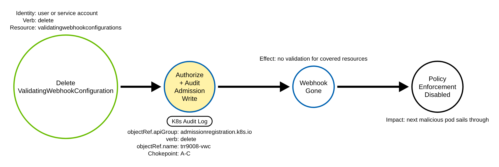
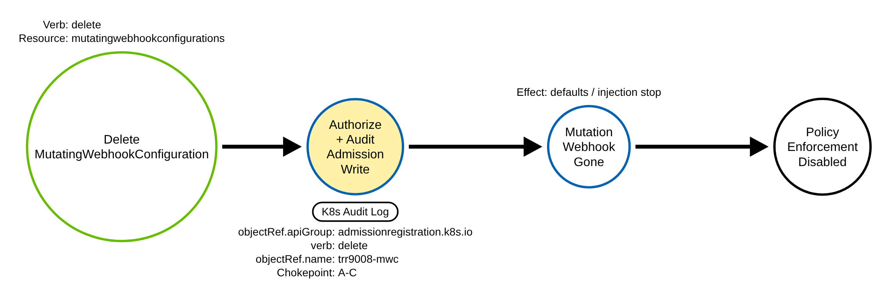
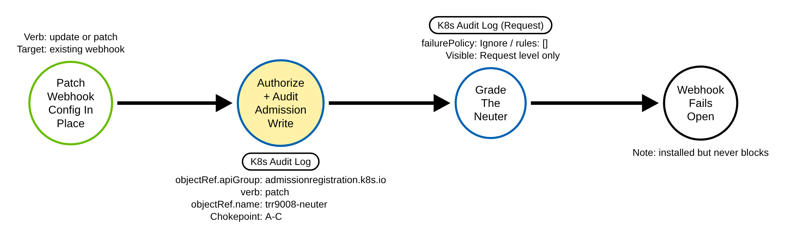
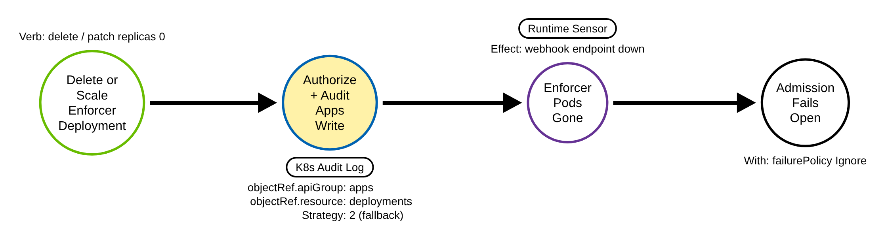

# Disabling Admission Control (Kubernetes)

> Prose uses Simplified Technical English (ASD-STE100) where practical.
> API group names, resource names, verbs, field names, and ATT&CK IDs are
> technical names.

## Metadata

| Key          | Value |
|--------------|-------|
| ID           | TRR9008 |
| External IDs | T1685 |
| Tactics      | Defense Impairment |
| Platforms    | Kubernetes |
| Contributors | det-eng |
| Status       | draft |

### Scope Statement

This TRR covers Defense Impairment through **disabling dynamic admission control**:
removing or disarming the admission webhooks and CEL policies that enforce
Kubernetes security policy, and removing the workload that serves them.

This TRR does not cover these related actions:

- Creating a *malicious* admission webhook (a mutating webhook that injects a
  sidecar, or a webhook that exfiltrates every admitted object). That is
  persistence (Event Triggered Execution), a different technique, and a
  candidate for a separate report. This report covers only the disabling verbs
  on existing admission objects.
- The RBAC grant that lets an adversary write admission objects. TRR9004
  (T1098.006) detects the grant; this report detects the use. An attacker
  usually needs the grant first, so the two are correlated but distinct.

> ATT&CK has no Kubernetes-specific defense-impairment sub-technique, and T1685
> (Disable or Modify Tools) lists Containers among its platforms, so it is the
> correct and defensible mapping for neutering the policy engine. This report
> co-exists with the repository's Linux T1685 report (io_uring
> telemetry-evasion); a TRR is platform-scoped.

## Technique Overview

Kubernetes enforces most of its runtime security policy through dynamic admission
control. Before any create, update, or delete is stored, the API server sends it
to the admission webhooks registered in two cluster-scoped objects, a
ValidatingWebhookConfiguration and a MutatingWebhookConfiguration. These webhooks
are how OPA/Gatekeeper, Kyverno, image-signature verifiers, and Falco admission
paths say "no" to a dangerous pod, an unsigned image, or a privilege grab. The
same API group now also holds the CEL ValidatingAdmissionPolicy and its binding.

An adversary who has gained write access to these objects does not need an
exploit to get past the policy engine. They turn it off. They delete the webhook
configuration so nothing validates admission; they leave it in place but neuter
it, setting failurePolicy to Ignore so an outage is silently allowed, or emptying
the rules so it never fires; or they leave admission alone and remove the enforcer
itself, deleting or scaling the Gatekeeper, Kyverno, or Falco workload to zero so
the webhook endpoint is gone. After any of these, the next malicious pod, the next
unsigned image, the next privileged workload sails through. It is a one-request
defense-impairment step that clears the way for everything else.

## Technical Background

### The objects and the knobs

A ValidatingWebhookConfiguration or MutatingWebhookConfiguration is a
cluster-scoped object in admissionregistration.k8s.io/v1. Each carries a webhooks
list; each webhook has a clientConfig (the service or URL to call), rules (which
apiGroups, apiVersions, resources, and operations trigger it), namespaceSelector
and objectSelector (label selectors that further gate it), and failurePolicy (Fail
or Ignore, default Fail). When the API server cannot reach the webhook, Fail
rejects the request (fail-closed) and Ignore allows it (fail-open). Every neuter
is a knob on this object: failurePolicy to Ignore plus a dead endpoint allows
everything; an empty rules list or an impossible selector means the webhook never
fires. The CEL ValidatingAdmissionPolicy and ValidatingAdmissionPolicyBinding live
in the same API group, so one group-scoped rule is the invariant across webhook
and policy objects.

### The audit shape, and the two levels

Every disabling path is a write to the admissionregistration.k8s.io group. The
HTTP method maps to the audit verb: DELETE (single) to delete, DELETE (collection)
to deletecollection, PUT to update, PATCH to patch. There is no replace audit verb.
Webhook configurations are cluster-scoped, so the audit event carries
objectRef.name with an empty objectRef.namespace; the gate for an emulation is the
name, not the namespace. A delete is fully described at Metadata level. A neuter
via update or patch is not: at Metadata you see that a webhook config changed but
not that failurePolicy became Ignore or rules became empty. Grading the neuter needs
the requestObject, which exists only at Request level.

### Removing the enforcer is a different edge

Deleting or scaling the policy engine's own workload is an apps-group write, not an
admissionregistration one. A `kubectl patch` of spec.replicas to 0 is on the
deployments resource. A `kubectl scale` uses the deployments/scale subresource,
which an audit policy must list explicitly (as deployments/scale) to capture with a
body, because Kubernetes audit resource matching is exact. The shipped policy
(`detections/k8s/audit-policy-apiserver.yaml`) lists deployments/scale,
statefulsets/scale and replicasets/scale at Request. A JSON patch
(`kubectl patch --type=json`) carries an ops array, not a spec, so a scale to zero
is an op on /spec/replicas. Deleting the engine's whole namespace removes its
workloads too: the API server records the actor's namespace delete, and then the
namespace controller deletes the workloads with one deletecollection per resource
type.

### Why the technique works

Admission control is the gate that stops dangerous configuration from being stored.
It is itself ordinary Kubernetes configuration, protected only by RBAC. An
identity that can write admission objects can remove the gate. A detection must see
the write and, for a neuter, read the request body; and a node sensor must cover
the control-plane bypass the API server never sees.

## Procedures

| Procedure | ID | Name | Entry point |
|-----------|----|------|-------------|
| A | TRR9008.K8S.A | Delete a ValidatingWebhookConfiguration | `delete validatingwebhookconfigurations` |
| B | TRR9008.K8S.B | Delete a MutatingWebhookConfiguration | `delete mutatingwebhookconfigurations` |
| C | TRR9008.K8S.C | Neuter a webhook configuration in place | `update`/`patch` a webhook config |
| D | TRR9008.K8S.D | Remove the enforcer's workload | `delete`/scale a Deployment or DaemonSet |

> A tool is not a procedure. `kubectl`, a client library, Helm, and a raw HTTP
> client all send the same admission write. They are the same procedure.

**Reading the DDMs.** Green borders are operations the client performs. Blue
borders are operations the API server performs. Purple borders are operations on
the node. Black borders are the abstract effect. The pill names the telemetry; the
`Key: value` lines are what a rule matches; a shaded node is the primary detection
opportunity.

### Procedure A: Delete a ValidatingWebhookConfiguration  (`TRR9008.K8S.A`)

The adversary deletes the object that registers the validating webhooks, so nothing
validates admission for the resources it covered.

- **Prerequisites:** `delete` on `validatingwebhookconfigurations` (cluster-scoped).
- **Mechanics:** a single DELETE removes the enforcement surface.
- **Impact:** policy validation stops for the covered resources.
- **Tools on this path:** `kubectl delete`, any client.

#### Detection Data Model — `TRR9008.K8S.A`

Source: [`ddms/trr9008_k8s_a.json`](ddms/trr9008_k8s_a.json) (Arrows app format).

**DDM summary.** The shaded node is the API server's authorize-and-audit of the
admission write (`objectRef.apiGroup: admissionregistration.k8s.io`, a disabling
verb), the chokepoint for A, B, and C. A delete is fully described at Metadata.

### Procedure B: Delete a MutatingWebhookConfiguration  (`TRR9008.K8S.B`)

The adversary deletes the mutating webhook configuration, so sidecar injection and
defaulting stop.

- **Prerequisites:** `delete` on `mutatingwebhookconfigurations`.
- **Mechanics:** a single DELETE.
- **Impact:** mutation policy stops.
- **Tools on this path:** `kubectl delete`, any client.

#### Detection Data Model — `TRR9008.K8S.B`

Source: [`ddms/trr9008_k8s_b.json`](ddms/trr9008_k8s_b.json) (Arrows app format).

**DDM summary.** Same chokepoint audit event; only the resource is
`mutatingwebhookconfigurations`.

### Procedure C: Neuter a webhook configuration in place  (`TRR9008.K8S.C`)

The adversary leaves the webhook config in place but disarms it, setting
failurePolicy to Ignore (fail-open) or emptying the rules so it never fires.

- **Prerequisites:** `update` or `patch` on the webhook config.
- **Mechanics:** an in-place edit; the object still exists, so a delete-watcher
  misses it.
- **Impact:** the webhook is installed but blocks nothing.
- **Tools on this path:** `kubectl replace`/`apply`/`patch`, any client.

#### Detection Data Model — `TRR9008.K8S.C`

Source: [`ddms/trr9008_k8s_c.json`](ddms/trr9008_k8s_c.json) (Arrows app format).

**DDM summary.** Same chokepoint, verb `update` or `patch`. The disarming field
(failurePolicy Ignore, rules []) is in `requestObject` and needs Request level. A
patch body is logged raw and keeps `"rules": []`, or `"rules": null` for a
strategic merge patch (the `kubectl patch` default). A PUT is logged as the
decoded, defaulted object re-encoded; `rules` is `omitempty`, so an emptied list
leaves no `rules` key, and the grader matches a webhook whose `clientConfig` is
followed directly by `failurePolicy`. That test assumes the API server's Go field
order reaches the SIEM; a pipeline that sorts keys makes every update match. A
JSON patch carries only the ops array, and the grader reads it for an operation
that sets `/webhooks/N/failurePolicy` to Ignore or removes or empties
`/webhooks/N/rules`; for an operation on the whole list, a whole webhook or its
`matchConditions` whose value fails open or adds the literal `false`; and for an
operation on the whole list or a whole webhook that leaves no non-empty `rules`
list. A `matchConditions` expression that is the literal `false` is graded too.
A selector that matches nothing, an always-false expression that is not the
literal `false`, and a JSON merge patch that replaces the list with a webhook
without `rules` cannot be told from a legitimate edit; they fire the chokepoint
only.

### Procedure D: Remove the enforcer's workload  (`TRR9008.K8S.D`)

The adversary deletes or scales to zero the Deployment or DaemonSet that serves the
webhook, or deletes the engine's namespace, so the endpoint is gone.

- **Prerequisites:** `delete` or `patch`/`update` on the policy engine's
  Deployment/DaemonSet (or its scale subresource), or `delete` on its namespace.
- **Mechanics:** with failurePolicy already Ignore, admission then fails open.
- **Impact:** enforcement stops without touching the webhook config.
- **Tools on this path:** `kubectl delete`/`scale`/`patch`, any client.

#### Detection Data Model — `TRR9008.K8S.D`

Source: [`ddms/trr9008_k8s_d.json`](ddms/trr9008_k8s_d.json) (Arrows app format).

**DDM summary.** This is a different edge, an apps-group write, so it has its own
rule (Strategy 2). The node also sees the enforcer pods disappear. Correlate the
workload removal with the policy engine's namespace or app labels.

## Detection Strategy

Compare the four DDMs. Procedures A, B, and C all write the admission API group, so
each leaves the same kind of audit event — one chokepoint rule covers all three.
Procedure D is a different edge (an apps-group write) and needs its own rule. A
node sensor covers the control-plane bypass the API server never sees.

**Telemetry requirement.** The audit policy must record the
admissionregistration.k8s.io group for the write verbs at **Request** level, so the
neuter's requestObject is visible, and the apps group at Request (already recorded)
for Procedure D. Put the admission rule above the catch-all. Baseline the actor,
not the object.

**Strategy 1 — chokepoint (covers A, B, C).**
Match audit events where `objectRef.apiGroup` is `admissionregistration.k8s.io` and
`verb` is `delete`, `deletecollection`, `update`, or `patch`. create is excluded
(that is persistence). Baseline the policy engine's own controller, GitOps/Helm,
and cluster-upgrade tooling by `user.username`.

- Sensor: API server audit log.
- Rule: `detections/sigma/T1685/k8s_admission_webhook_disabled.yml` (built).

**Strategy 2 — severity (grades C; needs Request level).**
On top of the chokepoint, match a webhook write whose `requestObject.webhooks` sets
failurePolicy to Ignore or an empty rules list. This needs Request level.

- Sensor: API server audit log at Request level.
- Rule: `detections/sigma/T1685/k8s_admission_webhook_neutered.yml` (built).

**Strategy 3 — enforcer removal (covers D).**
Match an apps-group write that deletes a Deployment/DaemonSet (verb delete or
deletecollection), or scales one to zero: requestObject.spec.replicas 0 on the
resource or on its scale subresource, or a JSON-patch op that sets /spec/replicas
to 0 or copies or moves a value into it. The namespace controller's teardown
deletecollection is filtered; the rule matches the delete of the engine's default
namespace (gatekeeper-system, kyverno, falco) instead. Correlate with the policy
engine's namespace or app labels.

- Sensor: API server audit log.
- Rule: `detections/sigma/T1685/k8s_security_tool_workload_removed.yml` (built).

**Demonstrated gap — the control-plane bypass.**
An adversary with control-plane node access can disable admission without any
admissionregistration write: edit the kube-apiserver static manifest to drop the
ValidatingAdmissionWebhook/MutatingAdmissionWebhook plugins, or tamper with the
webhook TLS material on disk so calls fail (fail-open if any webhook is Ignore).
None of that is an API write, so the chokepoint and the grading rule are blind. A
node file-integrity sensor on `/etc/kubernetes/manifests/kube-apiserver.yaml` and
the webhook cert paths covers it, and the CRI sensor sees the enforcer pods vanish.
The lab demonstrates the gap read-only, by showing the apiserver manifest path on
the node and noting no admissionregistration audit event follows an edit there.

**Coverage summary.**

| Procedure | Covered by | How |
|-----------|-----------|-----|
| A | Strategy 1 (chokepoint) | delete `validatingwebhookconfigurations` |
| B | Strategy 1 (chokepoint) | delete `mutatingwebhookconfigurations` |
| C | Strategy 1; graded by Strategy 2 | `update`/`patch` webhook config; failurePolicy Ignore / rules [] |
| D | Strategy 3 (fallback) | delete or scale-to-zero the enforcer Deployment/DaemonSet |

One chokepoint rule covers the three admission-config paths. A severity rule grades
the neuter. A fallback covers the enforcer-workload removal.

## Available Emulation Tests

The tests run in a lab cluster with the shared audit policy (now recording the
admission group at Request level). The lab is a `kind` cluster; its config and audit
policy are in [`detections/k8s/`](../../../detections/k8s/). Every object is named
`trr9008-*`, and every webhook is a no-op (failurePolicy Ignore, rules scoped to a
bogus apiGroup) that cannot affect a real admission request. One script drives them:
[`atomics/T1685/src/emulate_k8s.sh`](../../../atomics/T1685/src/emulate_k8s.sh),
with Atomic Red Team wrappers in
[`atomics/T1685/T1685.yaml`](../../../atomics/T1685/T1685.yaml)
(alongside the Linux io_uring test for the same technique).

| Procedure | Test | Status |
|-----------|------|--------|
| TRR9008.K8S.A | `emulate_k8s.sh a` — apply then delete a no-op ValidatingWebhookConfiguration. | **built** |
| TRR9008.K8S.B | `emulate_k8s.sh b` — apply then delete a no-op MutatingWebhookConfiguration. | **built** |
| TRR9008.K8S.C | `emulate_k8s.sh c` — neuter a webhook config (failurePolicy Ignore, rules []). | **built** |
| TRR9008.K8S.D | `emulate_k8s.sh d` — create a pause Deployment, scale it to zero with `kubectl scale` and with a patch, delete it. | **built** |

## Detections

| Strategy | Covers | Sigma rule | Sensor |
|----------|--------|------------|--------|
| 1 (chokepoint) | A, B, C | [`detections/sigma/T1685/k8s_admission_webhook_disabled.yml`](../../../detections/sigma/T1685/k8s_admission_webhook_disabled.yml) | API server audit log |
| 2 (severity) | grades C | [`detections/sigma/T1685/k8s_admission_webhook_neutered.yml`](../../../detections/sigma/T1685/k8s_admission_webhook_neutered.yml) | API server audit log (Request) |
| 3 (fallback) | D | [`detections/sigma/T1685/k8s_security_tool_workload_removed.yml`](../../../detections/sigma/T1685/k8s_security_tool_workload_removed.yml) | API server audit log |

The validator
[`detections/validate_apiserver_detections.py`](../../../detections/validate_apiserver_detections.py)
reads the API server audit log the emulation produced and asserts each rule matches
an event naming a `trr9008-` object. The workflow
[`validate-apiserver-detections.yml`](../../../.github/workflows/validate-apiserver-detections.yml)
runs the loop on a `kind` cluster, with a negative control on the pre-emulation log.

Upstream: the SigmaHQ rule `kubernetes_audit_change_admission_controller.yml`
covers webhook configs but lists a phantom `replace` verb, cannot grade a neuter
(no requestObject), and has no enforcer-workload edge. Propose the corrected
chokepoint plus the neuter grader and the workload-removal rule.

## References

- MITRE ATT&CK, T1685 Disable or Modify Tools:
  <https://attack.mitre.org/techniques/T1685/>
- Kubernetes documentation, Dynamic Admission Control (webhook configs,
  failurePolicy, rules, selectors, clientConfig):
  <https://kubernetes.io/docs/reference/access-authn-authz/extensible-admission-controllers/>
- Kubernetes documentation, Validating Admission Policy (CEL, GA in 1.30):
  <https://kubernetes.io/docs/reference/access-authn-authz/validating-admission-policy/>
- Kubernetes documentation, Auditing (levels, stages, verb mapping):
  <https://kubernetes.io/docs/tasks/debug/debug-cluster/audit/>
- SigmaHQ rule, Kubernetes Admission Controller Modification:
  <https://github.com/SigmaHQ/sigma/blob/master/rules/application/kubernetes/audit/kubernetes_audit_change_admission_controller.yml>
- Microsoft Threat Matrix for Kubernetes:
  <https://microsoft.github.io/Threat-Matrix-for-Kubernetes/>
- TRR method:
  <https://github.com/tired-labs/techniques/blob/main/docs/TECHNIQUE-RESEARCH-REPORT.md>
