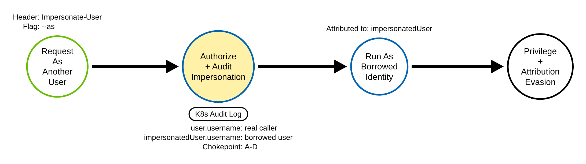
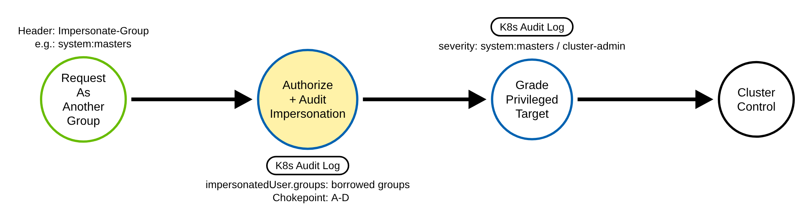
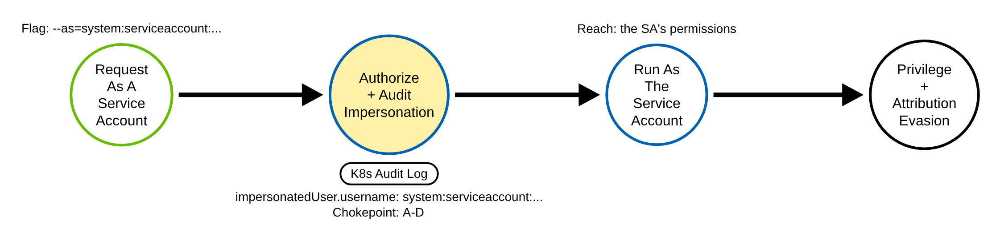
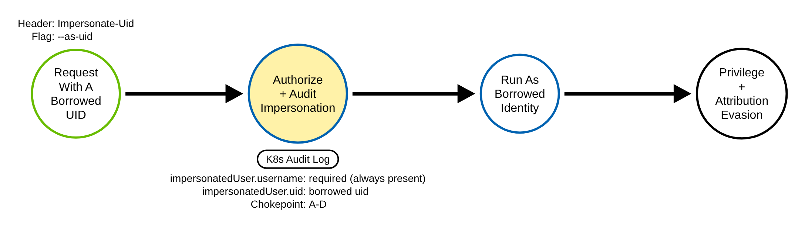

# User Impersonation (Kubernetes)

> Prose uses Simplified Technical English (ASD-STE100) where practical.
> Header names, resource names, verbs, field names, and ATT&CK IDs are technical
> names.

## Metadata

| Key          | Value |
|--------------|-------|
| ID           | TRR9009 |
| External IDs | T1134 |
| Tactics      | Defense Evasion, Privilege Escalation |
| Platforms    | Kubernetes |
| Contributors | det-eng |
| Status       | draft |

### Scope Statement

This TRR covers the **use** of Kubernetes user impersonation: making an API
request as another user, group, or service account by way of the RBAC
`impersonate` verb and the Impersonate-User / Impersonate-Group / Impersonate-Uid
/ Impersonate-Extra headers.

This TRR does not cover the **grant** of impersonate rights. TRR9004 (T1098.006)
detects an RBAC write whose rules carry the `impersonate` verb; its rule
`k8s_rbac_privileged_grant.yml` already matches that. Detecting the grant plus the
use gives the full kill-chain; this report owns the use.

> ATT&CK mapping caveat: T1134 (Access Token Manipulation) is officially a Windows
> technique and has no Containers platform or Kubernetes sub-technique. It is,
> however, the best available ATT&CK ID for an identity-swap and
> attribution-evasion primitive, and Elastic's prebuilt Kubernetes rule tags the
> same behavior as T1134 under both Defense Evasion and Privilege Escalation. The
> platform fit is imperfect; the tactics are right.

## Technique Overview

Kubernetes lets a privileged client act as someone else. A request can carry an
Impersonate-User header (and optional Impersonate-Group, Impersonate-Uid, and
Impersonate-Extra headers); the API server authenticates the real caller, checks
that the caller has the RBAC permission to impersonate, then runs the request as
the impersonated identity. This is a legitimate feature. The Kubernetes Dashboard
uses it to act as the logged-in user; a "sudo for Kubernetes" tool uses it for
break-glass; some gateways pass the signed-in user through to the API server with
it.

An adversary who holds the impersonate permission uses the same feature to act as a
more powerful identity, up to system:masters or cluster-admin, without ever holding
that identity's credentials. The action runs with the borrowed identity's access,
and in most downstream views it is attributed to the borrowed identity, not the
real caller. So impersonation both escalates privilege and evades attribution. The
difference between a good impersonation and a bad one is who the real caller is,
from where, and whose identity they borrowed.

## Technical Background

### How impersonation works, and what the audit log records

A client sets the impersonation headers. Impersonate-User is mandatory for every
variant; Impersonate-Group, Impersonate-Uid, and Impersonate-Extra all require it.
The API server authorizes the REAL caller's `impersonate` permission, on the users,
groups, or serviceaccounts resource in the core API group (and uid / userextras in
authentication.k8s.io), then swaps identity and authorizes the actual request as
the impersonated user.

The audit event records both identities: `user` is the real caller, and
`impersonatedUser` is the borrowed identity. `impersonatedUser.username` is always
present on an impersonated request; `impersonatedUser.groups`, `.uid`, and `.extra`
appear when those headers are set. The verb and objectRef are those of whatever
action followed. The authorization annotations record the decision (allow or
forbid). `impersonatedUser` is a top-level audit field at Metadata level, so the
chokepoint fires at Metadata; Request level is not needed.

### The invariant

Every impersonation variant sets Impersonate-User, so every impersonated request
carries `impersonatedUser.username`. The presence of that field, independent of the
verb, resource, or outcome, is the one node every path passes through.

### Why the technique works, and why there is no node sensor

Impersonation is a designed delegation feature, and the only preventive control is
RBAC on the impersonate verb. A detection must use context: the real caller, the
borrowed identity, and whether the borrowed identity is powerful. There is no node
or runtime artifact of an impersonation and no API-server bypass: it is implemented
wholly inside the API server. So the audit log is the sole sensor. If audit is off,
or the request is logged at level None, coverage is zero.

## Procedures

| Procedure | ID | Name | Entry point |
|-----------|----|------|-------------|
| A | TRR9009.K8S.A | Impersonate a user | Impersonate-User header (`--as`) |
| B | TRR9009.K8S.B | Impersonate a group | Impersonate-Group header (`--as-group`) |
| C | TRR9009.K8S.C | Impersonate a service account | `--as=system:serviceaccount:...` |
| D | TRR9009.K8S.D | Impersonate a uid or extras | Impersonate-Uid / Impersonate-Extra |

> A tool is not a procedure. `kubectl --as`, a client library, the Dashboard, and a
> raw HTTP client with the impersonation headers all produce the same audit shape.

**Reading the DDMs.** Green borders are operations the client performs. Blue borders
are operations the API server performs. Black borders are the abstract effect. The
pill names the telemetry; the `Key: value` lines are what a rule matches; a shaded
node is the primary detection opportunity, the same one for every procedure: the
API server's audit of the impersonated request.

### Procedure A: Impersonate a user  (`TRR9009.K8S.A`)

The adversary makes a request as another user.

- **Prerequisites:** the `impersonate` verb on the `users` resource.
- **Mechanics:** the request runs with the borrowed user's access.
- **Impact:** privilege escalation and attribution evasion.
- **Tools on this path:** `kubectl --as`, any client.

#### Detection Data Model — `TRR9009.K8S.A`

Source: [`ddms/trr9009_k8s_a.json`](ddms/trr9009_k8s_a.json) (Arrows app format).

**DDM summary.** The shaded node is the API server's authorize-and-audit of the
impersonated request. The event carries `user.username` (the real caller) and
`impersonatedUser.username` (the borrowed user) — the chokepoint for A to D.

### Procedure B: Impersonate a group  (`TRR9009.K8S.B`)

The adversary borrows a group, for example system:masters, which grants
cluster-admin.

- **Prerequisites:** the `impersonate` verb on the `groups` resource.
- **Mechanics:** the request runs with the borrowed group's access.
- **Impact:** immediate cluster control if the group is privileged.
- **Tools on this path:** `kubectl --as --as-group`, any client.

#### Detection Data Model — `TRR9009.K8S.B`

Source: [`ddms/trr9009_k8s_b.json`](ddms/trr9009_k8s_b.json) (Arrows app format).

**DDM summary.** Same chokepoint; the borrowed groups are in
`impersonatedUser.groups`. A privileged group (system:masters, cluster-admin) is
the severity signal.

### Procedure C: Impersonate a service account  (`TRR9009.K8S.C`)

The adversary borrows a service account, to reach its permissions.

- **Prerequisites:** the `impersonate` verb on the `serviceaccounts` resource.
- **Mechanics:** the username is `system:serviceaccount:<ns>:<name>`.
- **Impact:** the borrowed service account's access, often a powerful operator SA.
- **Tools on this path:** `kubectl --as=system:serviceaccount:...`, any client.

#### Detection Data Model — `TRR9009.K8S.C`

Source: [`ddms/trr9009_k8s_c.json`](ddms/trr9009_k8s_c.json) (Arrows app format).

**DDM summary.** Same chokepoint; `impersonatedUser.username` is the service account
name. A kube-system service account is the severity signal.

### Procedure D: Impersonate a uid or extras  (`TRR9009.K8S.D`)

The adversary also borrows a uid or extra attributes, which some authorizers use.

- **Prerequisites:** the `impersonate` verb on the uid / userextras resources.
- **Mechanics:** Impersonate-User is still mandatory, so the username is present.
- **Impact:** the same as A, with extra identity attributes.
- **Tools on this path:** `kubectl --as --as-uid`, a raw client for extras.

#### Detection Data Model — `TRR9009.K8S.D`

Source: [`ddms/trr9009_k8s_d.json`](ddms/trr9009_k8s_d.json) (Arrows app format).

**DDM summary.** Same chokepoint; `impersonatedUser.username` is always present, so
the presence rule fires regardless of the uid or extras.

## Detection Strategy

Compare the four DDMs. Every procedure produces an audit event that carries
`impersonatedUser`. So the chokepoint is one presence rule, and a severity rule
grades the borrowed identity.

**Telemetry requirement.** The audit policy must record the impersonated request at
Metadata level or higher. The shared policy's catch-all Metadata rule already does,
and the impersonated reads here are not dropped by any None rule. No policy change
is needed.

**Strategy 1 — chokepoint (covers A–D).**
Match any audit event that carries `impersonatedUser.username`. This is stronger
than the upstream Elastic rule, which matches only a hard-coded list of privileged
impersonated identities and only when the request was allowed: that misses an
arbitrary borrowed user, an unlisted-but-powerful service account, and a denied
probe. Baseline benign impersonators by the REAL actor (`user.username`,
`user.groups`): the Dashboard and other UIs, kubectl-sudo, GitOps/CI, and gateways.

- Sensor: API server audit log.
- Rule: `detections/sigma/T1134/k8s_impersonation.yml` (built).

**Strategy 2 — severity (grades A–D).**
On top of the chokepoint, match when the borrowed identity is powerful: a group of
system:masters, cluster-admin, or system:cluster-admins; a user of system:admin,
cluster-admin, or system:kube-controller-manager; or a kube-system service account.
An unlisted but powerful target is still caught by the base rule.

- Sensor: API server audit log.
- Rule: `detections/sigma/T1134/k8s_impersonation_privileged.yml` (built).

**Demonstrated gap — forbidden impersonation.**
The upstream rules fire only when the borrowed identity is on a known-privileged
list AND the request was allowed. Emulate a forbidden impersonation — read secrets
as a throwaway user that has no rights — and the request is denied
(decision=forbid), but `impersonatedUser` is still stamped. The presence chokepoint
catches it; an allow-list-plus-decision=allow rule does not. This is the
demonstration that the invariant anchor beats target-list matching.

**Coverage summary.**

| Procedure | Covered by | How |
|-----------|-----------|-----|
| A | Strategy 1; graded by Strategy 2 | `impersonatedUser.username` present (a user) |
| B | Strategy 1; graded by Strategy 2 | `impersonatedUser.groups` (a group) |
| C | Strategy 1; graded by Strategy 2 | `impersonatedUser.username` is a service account |
| D | Strategy 1 | `impersonatedUser.username` present (with uid/extras) |

One presence rule covers every path. One severity rule grades the borrowed
identity. There is no node-sensor fallback: the audit log is the sole sensor.

## Available Emulation Tests

The tests run in a lab cluster with the shared audit policy. The lab is a `kind`
cluster; its config and audit policy are in
[`detections/k8s/`](../../../detections/k8s/). Every borrowed identity carries the
token `trr9009`, so a validator matches the emulation's own events; every request
is a read, and the service account impersonated in Procedure C holds no RBAC. One
script drives them:
[`atomics/T1134/src/emulate.sh`](../../../atomics/T1134/src/emulate.sh), with Atomic
Red Team wrappers in [`atomics/T1134/T1134.yaml`](../../../atomics/T1134/T1134.yaml).

| Procedure | Test | Status |
|-----------|------|--------|
| TRR9009.K8S.A | `emulate.sh a` — list namespaces impersonating a throwaway user. | **built** |
| TRR9009.K8S.B | `emulate.sh b` — impersonate a throwaway group and system:masters (severity). | **built** |
| TRR9009.K8S.C | `emulate.sh c` — impersonate a throwaway service account with no RBAC. | **built** |
| TRR9009.K8S.D | `emulate.sh d` — impersonate a user and a uid. | **built** |

## Detections

| Strategy | Covers | Sigma rule | Sensor |
|----------|--------|------------|--------|
| 1 (chokepoint) | A, B, C, D | [`detections/sigma/T1134/k8s_impersonation.yml`](../../../detections/sigma/T1134/k8s_impersonation.yml) | API server audit log |
| 2 (severity) | grades A–D | [`detections/sigma/T1134/k8s_impersonation_privileged.yml`](../../../detections/sigma/T1134/k8s_impersonation_privileged.yml) | API server audit log |

The validator
[`detections/validate_apiserver_detections.py`](../../../detections/validate_apiserver_detections.py)
reads the API server audit log the emulation produced and asserts each rule matches
an event whose `impersonatedUser` carries the `trr9009` marker. The workflow
[`validate-apiserver-detections.yml`](../../../.github/workflows/validate-apiserver-detections.yml)
runs the loop on a `kind` cluster, with a negative control on the pre-emulation log.

Upstream: Elastic's rule matches a privileged allow-list with decision=allow.
Propose a presence-based chokepoint that catches an arbitrary borrowed identity and
a denied probe, with the privileged list as a severity layer.

## References

- MITRE ATT&CK, T1134 Access Token Manipulation:
  <https://attack.mitre.org/techniques/T1134/>
- Kubernetes documentation, User Impersonation (headers, the impersonate verb,
  `--as`/`--as-group`/`--as-uid`):
  <https://kubernetes.io/docs/reference/access-authn-authz/user-impersonation/>
- Kubernetes documentation, Auditing (the audit event `user` and `impersonatedUser`
  fields):
  <https://kubernetes.io/docs/tasks/debug/debug-cluster/audit/>
- Elastic rule, Kubernetes API Request Impersonating Privileged Identity:
  <https://www.elastic.co/guide/en/security/current/kubernetes-api-request-impersonating-privileged-identity.html>
- Red Hat, "sudo for Kubernetes" (the impersonate verb, restricting the target):
  <https://www.redhat.com/en/blog/sudo-kubernetes>
- TRR method:
  <https://github.com/tired-labs/techniques/blob/main/docs/TECHNIQUE-RESEARCH-REPORT.md>
