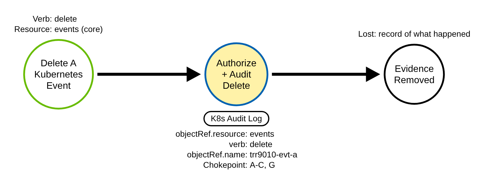
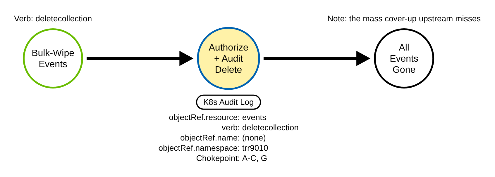
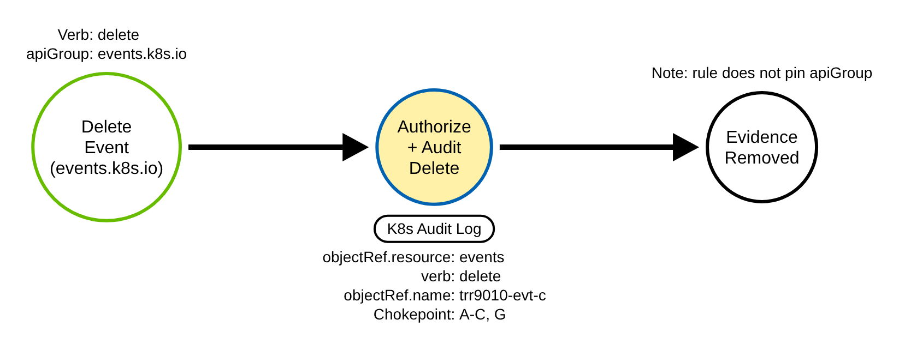
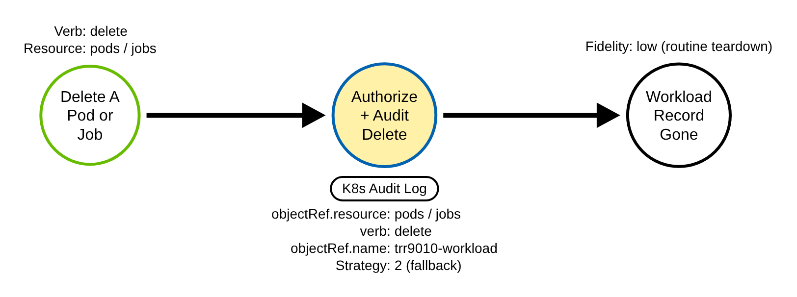
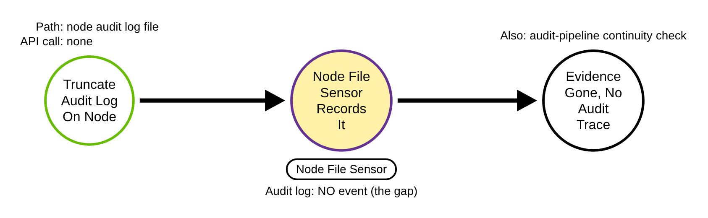
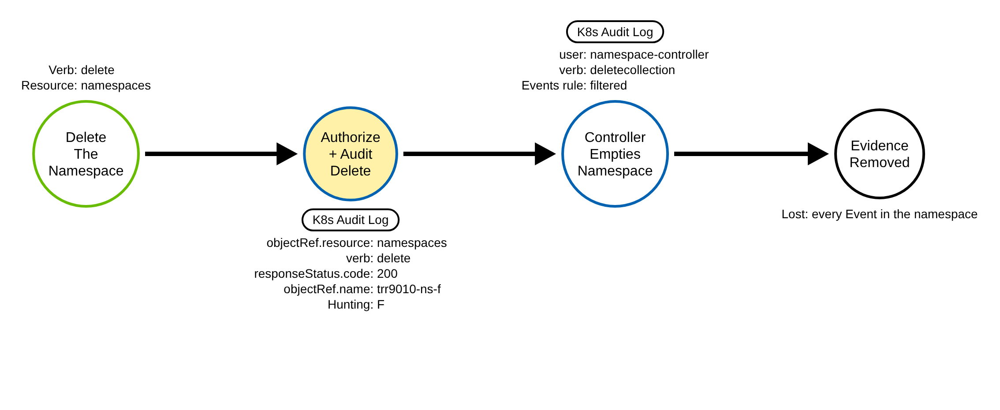
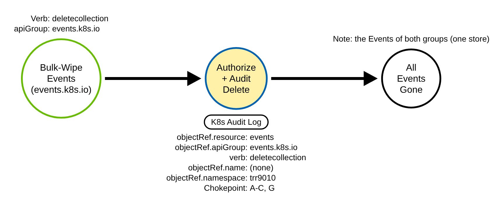

# Indicator Removal (Kubernetes)

> Prose uses Simplified Technical English (ASD-STE100) where practical.
> Resource names, verbs, field names, and ATT&CK IDs are technical names.

## Metadata

| Key          | Value |
|--------------|-------|
| ID           | TRR9010 |
| External IDs | T1070, T1070.004 |
| Tactics      | Stealth |
| Platforms    | Kubernetes |
| Contributors | det-eng |
| Status       | draft |

### Scope Statement

This TRR covers Stealth through **indicator removal**: destroying the
records of what happened in a cluster. It covers deleting Kubernetes Events (the
cluster's own activity record), deleting the Pods and Jobs that ran, and clearing
the API server audit log on the node.

This TRR does not cover these related actions:

- Creating a Job or CronJob to run code. TRR9005 (T1053.007) covers that; deleting
  a Job here is the inverse — removing the record, not creating one.
- Command execution in a container (T1609) or a dangerous pod spec (T1611). Deleting
  a pod to remove evidence is distinct from running one.

> ATT&CK maps this to T1070 (Indicator Removal, Stealth); Containers is a
> platform of the parent with no container sub-technique. Clearing the audit log
> file on the node (Procedure E) maps to T1070.004 (File Deletion), whose v20
> platforms are ESXi, Linux, macOS and Windows; no rule here covers Procedure E. The
> Events rule does not carry T1070.004: an Event is an API object, not a file
> (Elastic's "Kubernetes Events Deleted" rule tags T1070.004 anyway).

## Technique Overview

Kubernetes keeps its own running record of what happens. Events note that a pod was
scheduled, an image was pulled, a probe failed, or a policy denied a request. When
responders investigate an intrusion, these records are part of the story. So is the
existence of the pod that ran the adversary's code, and the API server audit log
itself.

An adversary who has done their work deletes the evidence. They delete the Events
that mention their activity, or wipe a whole namespace's Events at once. They delete
the Pod and the Job that ran their container, so the workload record is gone. And if
they reach the control-plane node, they truncate the audit log file, which erases
the record of everything — a step the API server itself cannot see, because it is a
local file operation, not an API call. The defensive goal is to notice the API-level
deletions, and to lean on a node sensor for the one path the audit log cannot
record.

## Technical Background

### Events, and the two API groups

Kubernetes Events are namespaced objects. They exist in two API groups that hold the
same objects: the core group (resource `events`, apiGroup empty) and events.k8s.io
(resource `events`). A single delete is a DELETE on one Event; a bulk wipe is a
collection DELETE, recorded as the `deletecollection` verb. In both groups the audit
event records `objectRef.resource` as `events`, so a rule that does not pin the
apiGroup covers both.

### Routine turnover is not a delete

Events do not pile up forever. The API server expires them at the etcd storage
layer, governed by the event-ttl (default one hour). That expiry is not an API
DELETE and writes no audit event. So on a quiet cluster the baseline of
delete/deletecollection on Events is near zero — a genuine delete stands out. The
kube-system controllers create Events but do not delete them.

### What the audit log records, and what it cannot

A delete or deletecollection on Events is described at Metadata level well enough to
fire the rule: the verb, the resource, the namespace, the name (a deletecollection has
no single name), the identity, and the result. Only `Request` level records the
DeleteOptions body, where `kubectl delete --dry-run=server` puts its dry run, so the
shared lab policy logs these deletes at `Request`. A delete is audited even when the
object does not exist — the request is recorded with its objectRef and a 404 — so the
telemetry exists whether or not the Event was still there. The one thing the audit log
cannot record is a node-local operation: truncating the audit log file or disabling the
audit sink is a filesystem action, not an API call, so it leaves no audit event at all.

### Why the technique works

The records are ordinary Kubernetes objects and a local log file. An identity that
can delete Events, or reach the node's filesystem, can destroy them. A detection
must see the API-level deletions and, for the node-local path, rely on a file
sensor and a continuity check on the audit pipeline.

## Procedures

| Procedure | ID | Name | Entry point |
|-----------|----|------|-------------|
| A | TRR9010.K8S.A | Delete a single Event (core group) | `delete events` |
| B | TRR9010.K8S.B | Bulk-wipe Events (deletecollection, core group) | `deletecollection events` |
| C | TRR9010.K8S.C | Delete an Event (events.k8s.io group) | `delete events` (events.k8s.io) |
| D | TRR9010.K8S.D | Delete a Pod or Job (workload record) | `delete pods`/`jobs` |
| E | TRR9010.K8S.E | Clear the audit log on the node | node filesystem (no API call) |
| F | TRR9010.K8S.F | Delete a whole namespace | `delete namespaces` |
| G | TRR9010.K8S.G | Bulk-wipe Events (deletecollection, events.k8s.io group) | `deletecollection events` (events.k8s.io) |

> A tool is not a procedure. `kubectl delete`, a client library, and a raw HTTP
> client all produce the same audit shape.

**Reading the DDMs.** Green borders are operations the client performs. Blue borders
are operations the API server performs. Purple borders are operations on the node.
Black borders are the abstract effect. The pill names the telemetry; the
`Key: value` lines are what a rule matches; a shaded node is the primary detection
opportunity.

### Procedure A: Delete a single Event — core group  (`TRR9010.K8S.A`)

The adversary deletes one Event that mentions their activity.

- **Prerequisites:** `delete` on `events` in the namespace.
- **Mechanics:** a single DELETE.
- **Impact:** one record of activity is gone.
- **Tools on this path:** `kubectl delete event`, any client. `kubectl delete events
  --all` is this path once per Event: it lists the Events, then deletes each one by
  name (kubectl v1.36.4 `delete.go`, `DeleteResult`).

#### Detection Data Model — `TRR9010.K8S.A`

Source: [`ddms/trr9010_k8s_a.json`](ddms/trr9010_k8s_a.json) (Arrows app format).

**DDM summary.** The shaded node is the API server's authorize-and-audit of the
delete (`objectRef.resource: events`, verb `delete` or `deletecollection`), the chokepoint
for A, B, C and G.

### Procedure B: Bulk-wipe Events — deletecollection, core group  (`TRR9010.K8S.B`)

The adversary wipes a whole namespace's Events in one request.

- **Prerequisites:** `deletecollection` on `events` in the core group.
- **Mechanics:** a collection DELETE; no single objectRef.name.
- **Impact:** the mass cover-up — every Event in the namespace is gone.
- **Tools on this path:** a collection DELETE on `/api/v1/namespaces/<ns>/events`
  (a raw HTTP client, `kubectl delete --raw`, client-go `DeleteCollection`). `kubectl
  delete events --all` does not send it: it sends a list and one delete per Event
  (Procedure A).

#### Detection Data Model — `TRR9010.K8S.B`

Source: [`ddms/trr9010_k8s_b.json`](ddms/trr9010_k8s_b.json) (Arrows app format).

**DDM summary.** Same chokepoint, verb `deletecollection`. The event has no
`objectRef.name`, so the detection must match the verb, not a single object. The
upstream SigmaHQ rule matches `delete` only and misses this bulk wipe.

### Procedure C: Delete an Event — events.k8s.io group  (`TRR9010.K8S.C`)

The adversary deletes an Event in the second API group.

- **Prerequisites:** `delete` on `events` in events.k8s.io.
- **Mechanics:** the same object, a different group.
- **Impact:** one record gone; a rule that pins the core group would miss it.
- **Tools on this path:** `kubectl delete events.events.k8s.io`, any client.
  `kubectl delete events.events.k8s.io --all` is this path once per Event (a list,
  then one delete per Event).

#### Detection Data Model — `TRR9010.K8S.C`

Source: [`ddms/trr9010_k8s_c.json`](ddms/trr9010_k8s_c.json) (Arrows app format).

**DDM summary.** Same chokepoint; `objectRef.apiGroup` is `events.k8s.io`. The rule
does not pin the apiGroup, so it covers both groups.

### Procedure D: Delete a Pod or Job — workload record  (`TRR9010.K8S.D`)

The adversary deletes the Pod (and the Job) that ran their code.

- **Prerequisites:** `delete` on `pods` (or `jobs`).
- **Mechanics:** a routine-looking teardown.
- **Impact:** the record of what ran is gone.
- **Tools on this path:** `kubectl delete pod`/`job`, any client.

#### Detection Data Model — `TRR9010.K8S.D`

Source: [`ddms/trr9010_k8s_d.json`](ddms/trr9010_k8s_d.json) (Arrows app format).

**DDM summary.** A different resource, a separate rule (Strategy 2). Pod and Job
deletion is routine, so this is low fidelity — a correlation anchor, the inverse of
TRR9005 (Job creation for execution), not a standalone alert.

### Procedure E: Clear the audit log on the node — the gap  (`TRR9010.K8S.E`)

The adversary truncates the audit log file on the control-plane node, or disables
the audit sink.

- **Prerequisites:** control-plane node filesystem access.
- **Mechanics:** a local file operation; no API call.
- **Impact:** the record of everything is erased, with no audit event.
- **Tools on this path:** a shell on the node.

#### Detection Data Model — `TRR9010.K8S.E`

Source: [`ddms/trr9010_k8s_e.json`](ddms/trr9010_k8s_e.json) (Arrows app format).

**DDM summary.** There is no audit event. The read-and-truncate is visible only to a
node file sensor watching the audit log path, and to a continuity check on the audit
pipeline — an unexplained gap or a truncation of the log is itself the signal.

### Procedure F: Delete a whole namespace  (`TRR9010.K8S.F`)

The adversary deletes the namespace that holds their activity. Every Event in it (and
every workload record) goes with it.

- **Prerequisites:** `delete` on `namespaces`.
- **Mechanics:** one DELETE of the namespace. The API server sets it Terminating and
  answers 200; the namespace controller then empties it, with one `deletecollection`
  per resource type (core Events and events.k8s.io Events among them), and finalizes it.
- **Impact:** every record in the namespace is gone, and the Events are deleted by
  the namespace controller, not by the actor.
- **Tools on this path:** `kubectl delete namespace`, any client.

#### Detection Data Model — `TRR9010.K8S.F`

Source: [`ddms/trr9010_k8s_f.json`](ddms/trr9010_k8s_f.json) (Arrows app format).

**DDM summary.** The shaded node is the actor's own record: an accepted `delete` of
`namespaces` (`responseStatus.code` 200). The namespace controller's sweep that
follows is filtered by the Events chokepoint as teardown, because every namespace
deletion makes it. A namespace delete is routine (CI preview environments, tenant
teardown), so this is a hunting signal (Strategy 4), not an alert.

### Procedure G: Bulk-wipe Events — deletecollection, events.k8s.io group  (`TRR9010.K8S.G`)

The adversary wipes a whole namespace's Events in one request through the second API
group.

- **Prerequisites:** `deletecollection` on `events` in events.k8s.io. RBAC checks the
  API group: a rule that grants it in the core group only (`apiGroups: [""]`) does not
  grant G, and a rule for events.k8s.io only does not grant B.
- **Mechanics:** a collection DELETE on
  `/apis/events.k8s.io/v1/namespaces/<ns>/events`; no single objectRef.name. The two
  groups serve the same Event objects from one store, so the wipe removes every Event
  in the namespace, whichever group created it.
- **Impact:** the mass cover-up of B, through the group that a rule or an audit policy
  rule that names only the core group does not see.
- **Tools on this path:** a collection DELETE (a raw HTTP client, `kubectl delete
  --raw`, client-go `DeleteCollection` on the events.k8s.io/v1 client). `kubectl delete
  events.events.k8s.io --all` does not send it: it sends a list and one delete per Event
  (Procedure C).

#### Detection Data Model — `TRR9010.K8S.G`

Source: [`ddms/trr9010_k8s_g.json`](ddms/trr9010_k8s_g.json) (Arrows app format).

**DDM summary.** Same chokepoint as B: verb `deletecollection` and no
`objectRef.name`, with `objectRef.apiGroup` `events.k8s.io`. G is to B what C is to
A: the same request through the second group. It is a procedure of its own because the
group changes the RBAC rule that permits the request and the audit policy rule that
sets its level (a policy rule names its group). The rule matches the verb and does not
pin the apiGroup, so it covers G.

## Detection Strategy

Compare the seven DDMs. Procedures A, B, C and G all delete Events, so each leaves the
same kind of audit event — one chokepoint rule covers all four. Procedure D is a
different resource and a low-fidelity fallback. Procedure E never reaches the API
server, so no audit rule can see it; a node sensor covers it. Procedure F deletes the
Events through the namespace controller, so its only actor record is the namespace
delete, which a low-level hunting rule matches.

**Telemetry requirement.** The audit policy must record delete and deletecollection
on `events` at Metadata level or higher; Metadata is enough for the rules to fire. The
dry-run filters need the DeleteOptions body, which only `Request` level records, so
the shared policy logs delete and deletecollection of pods, Events (core and
events.k8s.io), namespaces and the workload controllers at `Request`. A delete's
`requestObject` is DeleteOptions only (propagationPolicy, gracePeriodSeconds,
preconditions, dryRun), with no object body and no secret data. The `events` None rule
is scoped to reads only, so deletes are not dropped.

**Strategy 1 — chokepoint (covers A, B, C, G).**
Match audit events where `objectRef.resource` is `events` and `verb` is `delete` or
`deletecollection`. Do not pin the apiGroup (so events.k8s.io is covered) and do not
match `delete` only (so the bulk `deletecollection` wipe is covered). Filter one
request: the namespace controller's `deletecollection` of the Events of a namespace
being deleted (`system:serviceaccount:kube-system:namespace-controller`), which every
namespace teardown makes. The filter reads only the identity and the verb, so a
deletecollection sent with a token of that service account is filtered too
([RULE_DEFECTS KTBD-E1](../../../detections/RULE_DEFECTS.md#ktbd-e1-namespace-teardown-filters-trust-the-namespace-controllers-name)).
Filter a server-side dry run when the record holds the
DeleteOptions body (`dryRun: ["All"]`, Request level); the query form is not trusted for
a delete, because with a body the API server ignores the query. A delete or
deletecollection with no body whose query holds `?dryRun=All` is a dry run too, but it
still fires ([RULE_DEFECTS K36](../../../detections/RULE_DEFECTS.md#k36-delete-dry-run-filters-read-only-the-body-a-query-only-dry-run-fires)). Baseline the other
system identities and any event-exporter service accounts by `user.username`.

- Sensor: API server audit log.
- Rule: `detections/sigma/T1070/k8s_events_deleted.yml` (built).

**Strategy 2 — workload-record fallback (covers D).**
Match a delete or deletecollection of Pods or Jobs (the namespace controller's
teardown sweep is filtered, and so is a server-side dry run whose DeleteOptions body
the record holds; a delete with no body whose query holds `?dryRun=All` still fires,
[RULE_DEFECTS K36](../../../detections/RULE_DEFECTS.md#k36-delete-dry-run-filters-read-only-the-body-a-query-only-dry-run-fires)). This is low fidelity; use it for correlation only
— the same identity that also deleted Events, a deletion in a sensitive namespace,
or a Job whose creation the identity made.

- Sensor: API server audit log.
- Rule: `detections/sigma/T1070/k8s_workload_deleted_evidence.yml` (built).

**Strategy 3 — node sensor (covers E; the gap).**
Watch the audit log path on the node for write, truncate, or unlink, and the
kube-apiserver static-pod manifest for changes to the audit flags; and run a
continuity check on the audit pipeline. No API event exists for this path.

- Sensor: a node file-integrity or runtime agent, plus an audit-pipeline heartbeat.

**Strategy 4 — namespace-delete hunting (covers F).**
Match an accepted `delete` of `namespaces` (`responseStatus.code` 200 or 202; a
refused delete destroys nothing). Filter the garbage collector, which deletes a
namespace only when its owner was deleted (that owner's delete is the actor's own
record), and a server-side dry run, which the API server authorizes, admits and
answers with 200 but does not persist: `dryRun: ["All"]` in the DeleteOptions body,
or `?dryRun=All` in `requestURI` (the whole parameter) only when the record holds no
request body (with a body the API server reads DeleteOptions from it and ignores the
query; RULE_DEFECTS K14). The first `?` starts the query and Go `net/url` splits it at
`&`, so `dryRun=All` in the value of another parameter (`?note=?dryRun=All`) is not a dry
run, and the query form counts only when the URI holds at most 100 `&` (Go `net/url`
reads no parameter of a query that has more than 10,000). `kubectl delete
--dry-run=server` sends the body form, which only a `Request`-level record holds, so
at `Metadata` that dry run still fires; the shared lab policy logs namespace deletes
at `Request`, so there it is filtered. The namespace controller does not make this
request: it finalizes a namespace with an update of `namespaces/finalize`. A
namespace delete is routine, so
baseline the identities that delete namespaces by design (CI deployers, GitOps
controllers, tenant operators), and correlate a hit with the same actor's other
writes.

- Sensor: API server audit log (Metadata is enough to fire; `Request` to filter a
  kubectl dry run).
- Rule: `detections/sigma/T1070/k8s_namespace_deleted.yml` (built, level low).

**Demonstrated gap.**
Clearing or truncating the audit log file on the node (Procedure E) destroys
evidence with no API call, so the API server writes no audit event — the audit layer
is structurally blind to it. This is the inverse of the TRR9002 and TRR9006 Procedure
E gaps: same lesson, a different layer. The lab demonstrates it read-only, by showing
the audit log path on the node and noting that a truncation there emits no API event.

Deleting a whole namespace (Procedure F) destroys its Events, but the Events are then
deleted by the namespace controller, not by the actor, and the chokepoint filters that
sweep. The actor's own record is the `delete` of `namespaces`, which the Strategy 4
hunting rule matches (case `namespace-delete-payments` in its sidecar is the record
that the chokepoint's case `namespace-delete-known-miss` once recorded as a miss). A
namespace delete is routine and its record does not show why, so that rule is for
hunting and correlation, not an alert.

**Coverage summary.**

| Procedure | Covered by | How |
|-----------|-----------|-----|
| A | Strategy 1 (chokepoint) | `delete events` (core) |
| B | Strategy 1 (chokepoint) | `deletecollection events` (core-group bulk wipe) |
| C | Strategy 1 (chokepoint) | `delete events` (events.k8s.io) |
| D | Strategy 2 (fallback) | `delete pods`/`jobs` |
| E | Strategy 3 (node sensor); the gap | audit-log file cleared; no audit event |
| F | Strategy 4 (hunting) | accepted `delete namespaces` |
| G | Strategy 1 (chokepoint) | `deletecollection events` (events.k8s.io bulk wipe) |

One chokepoint rule covers every API-level event deletion that the actor makes, except
a deletecollection sent with a namespace-controller credential
([RULE_DEFECTS KTBD-E1](../../../detections/RULE_DEFECTS.md#ktbd-e1-namespace-teardown-filters-trust-the-namespace-controllers-name)); an
Events wipe through a namespace delete is matched by the hunting rule on the actor's
namespace delete. A low-fidelity fallback
covers workload-record deletion. A hunting rule covers the actor's namespace delete
(Procedure F). A node sensor covers the audit-log clearing the API server never sees.

## Available Emulation Tests

The tests run in a lab cluster with the shared audit policy. The lab is a `kind`
cluster; its config and audit policy are in
[`detections/k8s/`](../../../detections/k8s/). Everything happens in a throwaway
namespace `trr9010` with uniquely named objects, so a validator matches the
emulation's own events. One script drives them:
[`atomics/T1070/src/emulate.sh`](../../../atomics/T1070/src/emulate.sh), with Atomic
Red Team wrappers in [`atomics/T1070/T1070.yaml`](../../../atomics/T1070/T1070.yaml).

| Procedure | Test | Status |
|-----------|------|--------|
| TRR9010.K8S.A | `emulate.sh a` — create and delete a core v1 Event. | **built** |
| TRR9010.K8S.B | `emulate.sh b` — bulk-wipe Events with a collection DELETE on `/api/v1` (core group). | **built** |
| TRR9010.K8S.C | `emulate.sh c` — create and delete an events.k8s.io Event. | **built** |
| TRR9010.K8S.D | `emulate.sh d` — create and delete a busybox pod. | **built** |
| TRR9010.K8S.E | `emulate.sh gap` — show the audit log path on the node (read-only). | **built** |
| TRR9010.K8S.F | `emulate.sh f` — create namespace `trr9010-ns-f` with an Event, then delete the namespace. | **built** |
| TRR9010.K8S.G | `emulate.sh g` — create a core Event and an events.k8s.io Event, bulk-wipe the Events with a collection DELETE through events.k8s.io (`kubectl delete --raw`), then check that both Events are gone. | **built** |

`emulate.sh dryrun` is a control, not a procedure. It creates namespace
`trr9010-dryrun-ns` with an Event, a pod and a suspended Job, sends `kubectl delete
--dry-run=server` for the Event (core group, then events.k8s.io), the pod, the Job and
the namespace, and a deletecollection of the namespace's Events (core group, then
events.k8s.io) and of its pods
(`kubectl delete --raw` of the collection URL with a DeleteOptions body that holds
`dryRun: ["All"]`). Then it checks that every object is still there and that the pod
is not being deleted. A server-side dry run deletes nothing, so the three rules must
match none of these records.

## Detections

| Strategy | Covers | Sigma rule | Sensor |
|----------|--------|------------|--------|
| 1 (chokepoint) | A, B, C, G | [`detections/sigma/T1070/k8s_events_deleted.yml`](../../../detections/sigma/T1070/k8s_events_deleted.yml) | API server audit log |
| 2 (fallback) | D | [`detections/sigma/T1070/k8s_workload_deleted_evidence.yml`](../../../detections/sigma/T1070/k8s_workload_deleted_evidence.yml) | API server audit log |
| 3 (node sensor) | E; the gap | none at the audit-log layer, by design | node file-integrity sensor |
| 4 (hunting) | F | [`detections/sigma/T1070/k8s_namespace_deleted.yml`](../../../detections/sigma/T1070/k8s_namespace_deleted.yml) | API server audit log |

The validator
[`detections/validate_apiserver_detections.py`](../../../detections/validate_apiserver_detections.py)
reads the API server audit log the emulation produced and asserts Strategies 1, 2 and
4 match a record of each procedure's own: the accepted (200) delete of Event
`trr9010-evt-a` (A, core group) and `trr9010-evt-c` (C, events.k8s.io), the bulk
deletecollection in the `trr9010` namespace by a caller that is not a `system:`
identity, in the core group (B) and in events.k8s.io (G), the pod delete (D) and the delete of
namespace `trr9010-ns-f` (F). A 404 delete does not count, so the emulation creates each
Event first; each Event names an `involvedObject` (or `regarding`) in its own namespace,
because the API server's Event validation refuses one outside `default` that does not.
With the emulation ledger, its must-not-match checks (`MISS_MANIFEST`) also assert that
none of the three rules matches a dry-run delete of the `dryrun` control, that each
dry-run shape has a record, so a skipped control fails too, and that each rule fires on
the same record once its dry-run marker is removed, so the quiet comes from the dry-run
filter.
The workflow
[`validate-apiserver-detections.yml`](../../../.github/workflows/validate-apiserver-detections.yml)
runs the loop on a `kind` cluster, with a negative control on the pre-emulation log.

Upstream: the SigmaHQ rule `kubernetes_audit_events_deleted.yml` matches `delete`
only and misses the bulk `deletecollection` wipe; so does Elastic's native "Kubernetes
Events Deleted", while its AKS variant (`defense_evasion_azure_aks_events_deleted.toml`)
already matches `deletecollection`. Propose widening the verb list to `delete` and
`deletecollection`.

## References

- MITRE ATT&CK, T1070 Indicator Removal:
  <https://attack.mitre.org/techniques/T1070/>
- MITRE ATT&CK, T1070.004 Indicator Removal: File Deletion:
  <https://attack.mitre.org/techniques/T1070/004/>
- Kubernetes documentation, Auditing (levels, stages, verb mapping, `deletecollection`):
  <https://kubernetes.io/docs/tasks/debug/debug-cluster/audit/>
- Kubernetes documentation, API Concepts (delete vs deletecollection):
  <https://kubernetes.io/docs/reference/using-api/api-concepts/>
- SigmaHQ rule, Kubernetes Events Deleted:
  <https://github.com/SigmaHQ/sigma/blob/master/rules/application/kubernetes/audit/kubernetes_audit_events_deleted.yml>
- Elastic rule, Kubernetes Events Deleted (maps T1070 + T1070.004):
  <https://www.elastic.co/docs/reference/security/prebuilt-rules/rules/integrations/kubernetes/defense_evasion_events_deleted>
- Microsoft Threat Matrix for Kubernetes, Delete K8S events:
  <https://microsoft.github.io/Threat-Matrix-for-Kubernetes/techniques/Delete%20K8S%20events/>
- TRR method:
  <https://github.com/tired-labs/techniques/blob/main/docs/TECHNIQUE-RESEARCH-REPORT.md>
