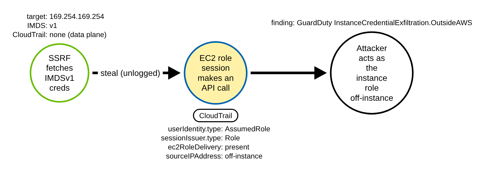
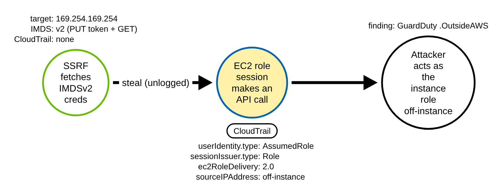
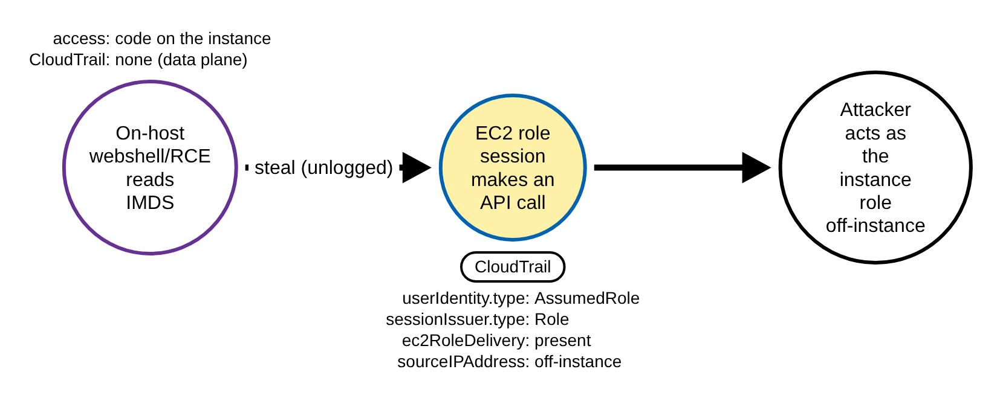
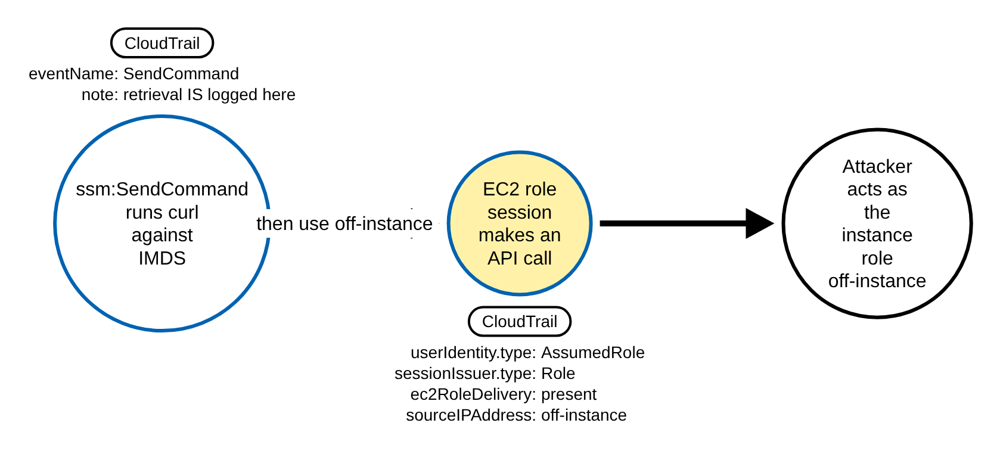
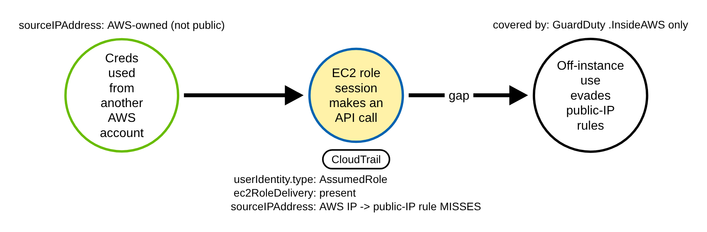

# EC2 Instance Metadata Credential Theft Used Off-Instance (AWS)

> Prose uses Simplified Technical English (ASD-STE100) where practical.
> AWS service names, API names, CloudTrail field names, and ATT&CK IDs are
> technical names.

## Metadata

| Key          | Value |
|--------------|-------|
| ID           | TRR9011 |
| External IDs | T1552.005 |
| Tactics      | Credential Access |
| Platforms    | AWS |
| Contributors | det-eng |
| Status       | draft |

### Scope Statement

This TRR covers the **external** path to EC2 instance-role credentials: an
adversary who reaches the Instance Metadata Service (IMDS) from outside the host —
through a server-side request forgery (SSRF) in an internet-facing application — or
on the host, steals the instance role credentials, and then **uses them
off-instance**.

The novel, detectable contribution is the **off-instance use**, not the theft. The
pure on-instance retrieval of IMDS credentials is already emulated by Stratus Red
Team (`aws.credential-access.ec2-steal-instance-credentials`, which retrieves via
`ssm:SendCommand`) and Atomic Red Team (`T1552.005`, which reads IMDSv2 to a file).
Neither emulates the SSRF acquisition vector, and neither exercises the control-plane
chokepoint this report keys on: an EC2 instance-role session making API calls from a
source the instance does not own.

## Technique Overview

Every EC2 instance can ask a link-local service at `169.254.169.254` for the
temporary AWS credentials of the IAM role attached to it. This is how software on the
instance gets AWS permissions without a stored key. The credentials are short-lived
and are rotated for you, so for normal workloads this is safer than a long-term key.

The weakness is that anything that can make the instance send an HTTP request to
`169.254.169.254` can read those credentials. The classic way in from outside is an
SSRF bug in a web application on the instance: the attacker makes the application
fetch the metadata URL and return the role credentials. Once the attacker has the
credentials, they can use them from their own machine, anywhere on the internet. They
are now acting as the instance's role, with whatever the role can do — often far more
than the vulnerable application needed.

The theft itself is invisible to AWS: the metadata service is link-local, not an AWS
API, so no CloudTrail event records the fetch. The first time AWS sees anything is
when the stolen credentials are **used** to call an AWS API. That call carries a tell:
the credentials belong to an EC2 instance role, but the call comes from an IP address
the instance does not own.

## Technical Background

### What an instance-role call looks like in CloudTrail

When code uses instance-role credentials, CloudTrail records the call with a
`userIdentity` of type `AssumedRole`. Three things mark it as an EC2 instance role:

- `userIdentity.type` is `AssumedRole`;
- `userIdentity.sessionContext.sessionIssuer.type` is `Role`; and
- the session was delivered by IMDS. The decisive in-record marker is
  `userIdentity.sessionContext.ec2RoleDelivery`: present only for IMDS-delivered
  instance-role sessions, with value `1.0` (IMDSv1) or `2.0` (IMDSv2). As a fallback
  when that field is absent (older records, role chaining, ECS task roles), the role
  session name is the instance ID, so `userIdentity.arn` ends `.../i-<instanceid>` and
  `userIdentity.principalId` is `AROA...:i-<instanceid>`.

These three are **provenance, not a detection**. They are true of essentially every
benign instance-role API call, so on their own they match ~100% of normal fleet
activity.

### The discriminator is the source, and it needs enrichment

What separates theft-and-use from normal use is the source. Legitimate instance-role
calls come from the instance itself — its private IP, its Elastic IP, or the account's
NAT-gateway IP. Stolen credentials used off-instance come from somewhere else: a
public attacker IP (the **OutsideAWS** case), or another AWS account (the
**InsideAWS** case).

Whether a `sourceIPAddress` is "the instance's own" **cannot be decided from a single
CloudTrail record** — it has to be joined against the instance's known IPs, the
account's Elastic IPs, and the NAT/egress gateways. AWS GuardDuty does this join
natively and ML-models the remote host, emitting
`UnauthorizedAccess:IAMUser/InstanceCredentialExfiltration.OutsideAWS` and
`.InsideAWS`. GuardDuty is therefore the authoritative signal. A provider-agnostic
Sigma/CloudTrail rule can only **approximate** the discriminator with an allowlist of
the account's own egress CIDRs — which is exactly what the detection here does, as a
backstop to GuardDuty.

### Why the technique works

IMDS hands out powerful credentials to anything that can make the instance issue one
HTTP request, and the retrieval leaves no API trace. The credentials are valid from
anywhere until they expire. Enforcing IMDSv2 (session tokens) raises the bar for a
plain SSRF but does not close it, and does nothing once the credentials are off the
box. The only durable control-plane signal is the off-instance use, so a detection
must key on the instance-role session identity and test the source against what the
instance owns.

## Procedures

| Procedure | ID | Name | Entry point |
|-----------|----|------|-------------|
| A | TRR9011.AWS.A | SSRF to IMDSv1, then off-instance use | SSRF GET `169.254.169.254` |
| B | TRR9011.AWS.B | SSRF to IMDSv2, then off-instance use | SSRF PUT token + GET |
| C | TRR9011.AWS.C | On-host IMDS read, then off-instance use | webshell/RCE reads IMDS |
| D | TRR9011.AWS.D | Retrieval via SSM, then off-instance use | `ssm:SendCommand` curl |
| E | TRR9011.AWS.E | Off-instance use from another AWS account | InsideAWS variant |

> A tool is not a procedure. `aws-cli`, boto3, a custom SigV4 client, and SSRF
> tooling that reuses the stolen credentials all send the same off-instance API call.
> They are the same procedure.

**Reading the DDMs.** Green borders are operations the client/attacker performs. Blue
borders are operations the AWS control plane performs (CloudTrail). Purple borders are
operations on the instance/host. Black borders are the abstract effect. The pill names
the telemetry; the `Key: value` lines are what a rule matches; a shaded node is the
primary detection opportunity. The off-instance-use audit event is the shared
chokepoint for A–E.

### Procedure A: SSRF to IMDSv1, then off-instance use  (`TRR9011.AWS.A`)

The adversary exploits an SSRF bug to make the internet-facing app issue a plain GET
to `http://169.254.169.254/latest/meta-data/iam/security-credentials/<role>`, reads the
returned role credentials, and uses them from their own machine.

- **Prerequisites:** an SSRF primitive that can issue a GET; IMDSv1 enabled (no token).
- **Mechanics:** retrieval is a data-plane fetch and leaves no CloudTrail; the first
  off-instance API call (typically `sts:GetCallerIdentity`) is the first logged event.
- **Impact:** the attacker acts as the instance role from off-instance.
- **Tools on this path:** any SSRF exploit plus any AWS client.

#### Detection Data Model — `TRR9011.AWS.A`

Source: [`ddms/trr9011_aws_a.json`](ddms/trr9011_aws_a.json) (Arrows app format).

**DDM summary.** The shaded node is the off-instance-use CloudTrail event
(`userIdentity.type` AssumedRole, `sessionIssuer.type` Role, `ec2RoleDelivery` 1.0,
`sourceIPAddress` off-instance) — the chokepoint for A–D. The steal edge is unlogged.

### Procedure B: SSRF to IMDSv2, then off-instance use  (`TRR9011.AWS.B`)

A full-featured SSRF (one that can set an HTTP method and a custom header) forges the
IMDSv2 token request (`PUT /latest/api/token`) then the credential GET with the
`X-aws-ec2-metadata-token` header, and uses the credentials off-instance.

- **Prerequisites:** an SSRF that can set method and headers (narrower than A).
- **Mechanics:** same unlogged retrieval; off-instance use carries `ec2RoleDelivery`
  `2.0`.
- **Impact:** same as A.
- **Tools on this path:** request-smuggling / gopher SSRF plus any AWS client.

#### Detection Data Model — `TRR9011.AWS.B`

Source: [`ddms/trr9011_aws_b.json`](ddms/trr9011_aws_b.json) (Arrows app format).

**DDM summary.** Same chokepoint; only `ec2RoleDelivery` differs (`2.0`). Most basic
SSRFs cannot reach IMDSv2, so this is a narrower subset of A.

### Procedure C: On-host IMDS read, then off-instance use  (`TRR9011.AWS.C`)

A process already on the instance (a webshell, RCE, or a compromised dependency) reads
IMDS directly, as Atomic Red Team T1552.005 does, then exfiltrates the credentials and
uses them off-instance.

- **Prerequisites:** code execution on the instance.
- **Mechanics:** the retrieval is still a data-plane fetch (no CloudTrail); the
  off-instance use is the same chokepoint.
- **Impact:** same as A.
- **Tools on this path:** any on-host command plus any AWS client.

#### Detection Data Model — `TRR9011.AWS.C`

Source: [`ddms/trr9011_aws_c.json`](ddms/trr9011_aws_c.json) (Arrows app format).

**DDM summary.** The retrieval actor is on the host (purple) rather than an SSRF, but
the logged chokepoint is identical.

### Procedure D: Retrieval via SSM, then off-instance use  (`TRR9011.AWS.D`)

An operator with SSM rights runs `curl 169.254.169.254/.../security-credentials/<role>`
through `ssm:SendCommand` (AWS-RunShellScript), then uses the credentials off-instance.
This is what Stratus Red Team's `ec2-steal-instance-credentials` does.

- **Prerequisites:** `ssm:SendCommand` on the instance.
- **Mechanics:** here the retrieval **is** logged — `ssm:SendCommand` +
  `ssm:GetCommandInvocation` are a second, distinct anchor — and the off-instance use
  is the same chokepoint.
- **Impact:** same as A.
- **Tools on this path:** `aws ssm send-command`, Stratus.

#### Detection Data Model — `TRR9011.AWS.D`

Source: [`ddms/trr9011_aws_d.json`](ddms/trr9011_aws_d.json) (Arrows app format).

**DDM summary.** The retrieval node here carries a CloudTrail pill (`SendCommand`), a
second detection opportunity unique to this path; the off-instance use is still the
primary chokepoint.

### Procedure E: Off-instance use from another AWS account  (`TRR9011.AWS.E`)

The stolen credentials are used from EC2 in a **different AWS account** rather than a
public IP. The chokepoint identity signature is present, but `sourceIPAddress` is an
AWS-owned address, so a public-IP approximation misses it.

- **Prerequisites:** attacker infrastructure inside AWS.
- **Mechanics:** same identity signature; AWS-owned source IP.
- **Impact:** evades CloudTrail-only public-IP rules.
- **Covered by:** GuardDuty `InstanceCredentialExfiltration.InsideAWS`.

#### Detection Data Model — `TRR9011.AWS.E`

Source: [`ddms/trr9011_aws_e.json`](ddms/trr9011_aws_e.json) (Arrows app format).

**DDM summary.** Same chokepoint identity, but the source IP is AWS-owned — a gap for
a CloudTrail-only public-IP rule, closed only by GuardDuty's enriched `.InsideAWS`
finding.

## Detection Strategy

Compare the DDMs. The credential theft leaves no API trace in every procedure, so the
only control-plane signal is the off-instance **use**, which is one audit event shape
across A–E. The source-IP test is the discriminator, and it needs enrichment.

**Telemetry requirement.** A CloudTrail trail (or Event history) capturing management
events. `sts:GetCallerIdentity` and most read APIs are management events, so no data-
event config is needed for the use leg. GuardDuty enabled in the account/region for the
authoritative enriched findings.

**Strategy 1 — chokepoint (covers A, B, C, D).**
Match CloudTrail events where the session is an EC2 instance role
(`userIdentity.type` AssumedRole, `sessionIssuer.type` Role, and `ec2RoleDelivery`
present **or** `userIdentity.arn` carries `/i-<instanceid>`) **and** `sourceIPAddress`
is not in the account's own egress allowlist (RFC1918 plus the NAT/EIP/gateway CIDRs
you baseline). This approximates the off-instance test that GuardDuty does natively.

- Sensor: CloudTrail. Enriched authority: GuardDuty
  `InstanceCredentialExfiltration.OutsideAWS`.
- Rule: [`detections/sigma/T1552.005/aws_imds_creds_used_off_instance.yml`](../../../detections/sigma/T1552.005/aws_imds_creds_used_off_instance.yml) (built).

**Enrichment (not required).** The first off-instance call is usually
`sts:GetCallerIdentity` (whoami); treat that as a high-signal first event.

**Demonstrated gaps.**

- **The theft itself** (SSRF or on-host GET/PUT to `169.254.169.254`) emits no
  CloudTrail. Only host/VPC telemetry sees it — in practice EDR/eBPF or app/WAF SSRF
  detection, since VPC Flow Logs rarely capture link-local traffic.
- **InsideAWS use** (Procedure E): the source IP is AWS-owned, so the public-IP
  approximation misses it; GuardDuty `.InsideAWS` covers it.
- **Role chaining:** one `sts:AssumeRole` hop drops both `ec2RoleDelivery` and the
  `/i-` session name; the attacker is exposed for just that one call.
- **Data-plane-only use** (e.g. only `s3:GetObject`) needs CloudTrail data events,
  which are off by default.

**Coverage summary.**

| Procedure | Covered by | How |
|-----------|-----------|-----|
| A | Strategy 1 | off-instance use, `ec2RoleDelivery` 1.0 |
| B | Strategy 1 | off-instance use, `ec2RoleDelivery` 2.0 |
| C | Strategy 1 | off-instance use (on-host retrieval unlogged) |
| D | Strategy 1 (+ SSM retrieval anchor) | off-instance use; `SendCommand` also logged |
| E | GuardDuty `.InsideAWS` only | AWS-owned source IP evades the public-IP approximation |

## Available Emulation Tests

Cloud attacks have no free live target, so the emulation has two halves. The
runnable half is an Atomic-Red-Team-style test
([`atomics/T1552.005/src/emulate.sh`](../../../atomics/T1552.005/src/emulate.sh), with
wrappers in [`atomics/T1552.005/T1552.005.yaml`](../../../atomics/T1552.005/T1552.005.yaml))
that performs the real off-instance use in **your own AWS account** and is **not run in
CI** (it needs credentials and an instance). The proven half is a pair of committed,
schema-faithful CloudTrail fixtures
([`detections/cloud/fixtures/trr9011/`](../../../detections/cloud/fixtures/trr9011/))
that the CI validator runs the rule over. Every object is named `trr9011-*`, the source
IPs are RFC 5737 TEST-NET addresses, and the account is the AWS documentation account
`123456789012`.

| Procedure | Test | Status |
|-----------|------|--------|
| TRR9011.AWS.A | `emulate.sh a` — off-instance `GetCallerIdentity` with an IMDSv1-delivered session (fixture: `ec2RoleDelivery` 1.0, public source IP). | **built** |
| TRR9011.AWS.B | `emulate.sh b` — off-instance recon with an IMDSv2-delivered session (fixture: `ec2RoleDelivery` 2.0). | **built** |
| TRR9011.AWS.C | documented — on-host retrieval then off-instance use (same chokepoint as A/B). | backlog |
| TRR9011.AWS.D | documented — SSM retrieval then off-instance use (Stratus parity). | backlog |
| TRR9011.AWS.E | documented gap — InsideAWS use; GuardDuty `.InsideAWS`. | backlog |

## Detections

| Strategy | Covers | Sigma rule | Sensor |
|----------|--------|------------|--------|
| 1 (chokepoint) | A, B, C, D | [`detections/sigma/T1552.005/aws_imds_creds_used_off_instance.yml`](../../../detections/sigma/T1552.005/aws_imds_creds_used_off_instance.yml) | CloudTrail (+ GuardDuty) |

The validator
[`detections/validate_cloud_detections.py`](../../../detections/validate_cloud_detections.py)
runs the rule over the recorded attack fixture (it must fire, and the match must carry
the `trr9011-` marker) and over the benign baseline (it must fire on nothing). The
benign baseline is hard: it is the same instance role doing the same `GetCallerIdentity`
from the account's own NAT egress IP, so the pass proves the rule keys on the
off-instance source and not on the identity alone.

Prior detection art (Elastic's "EC2 Instance Console Login via Assumed Role" and the
new-source `GetCallerIdentity` rules) keys on the `/i-<instanceid>` session name,
confirming the approach; neither keys on `ec2RoleDelivery` nor pairs the SSRF-retrieval
and off-instance-use with an emulation and a synthetic-log fixture.

## References

- MITRE ATT&CK, T1552.005 Unsecured Credentials: Cloud Instance Metadata API:
  <https://attack.mitre.org/techniques/T1552/005/>
- AWS, CloudTrail userIdentity element (type, sessionContext, sessionIssuer):
  <https://docs.aws.amazon.com/awscloudtrail/latest/userguide/cloudtrail-event-reference-user-identity.html>
- AWS, GuardDuty IAM finding types (InstanceCredentialExfiltration.OutsideAWS /
  .InsideAWS): <https://docs.aws.amazon.com/guardduty/latest/ug/guardduty_finding-types-iam.html>
- AWS, Transition to IMDSv2 (the `ec2:RoleDelivery` condition key, 1.0 vs 2.0):
  <https://docs.aws.amazon.com/AWSEC2/latest/UserGuide/instance-metadata-transition-to-version-2.html>
- Stratus Red Team, aws.credential-access.ec2-steal-instance-credentials:
  <https://stratus-red-team.cloud/attack-techniques/AWS/aws.credential-access.ec2-steal-instance-credentials/>
- TRR method:
  <https://github.com/tired-labs/techniques/blob/main/docs/TECHNIQUE-RESEARCH-REPORT.md>
