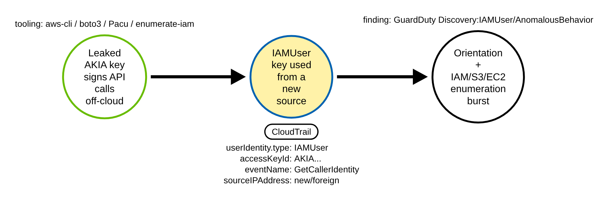
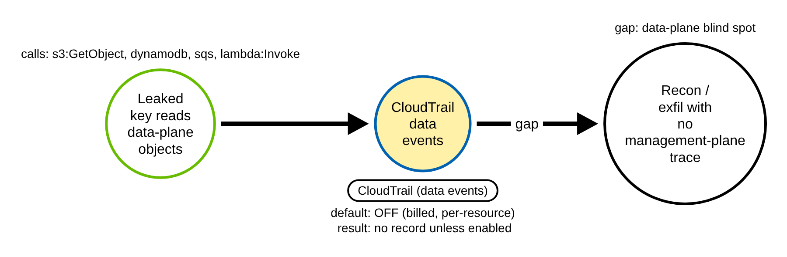
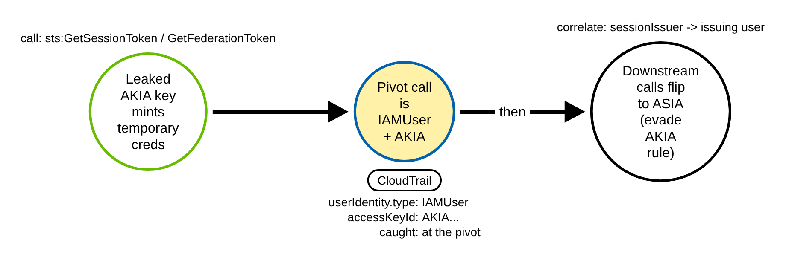

# Initial Access with a Leaked Long-Term Access Key (AWS)

> Prose uses Simplified Technical English (ASD-STE100) where practical.
> AWS service names, API names, CloudTrail field names, and ATT&CK IDs are
> technical names.

## Metadata

| Key          | Value |
|--------------|-------|
| ID           | TRR9012 |
| External IDs | T1078.004 |
| Tactics      | Initial Access |
| Platforms    | AWS |
| Contributors | det-eng |
| Status       | draft |

### Scope Statement

This TRR covers **using a leaked long-term IAM-user access key** (an `AKIA...` key +
secret) from outside the account for initial access and reconnaissance. It is the
programmatic, SigV4 path — the attacker configures the key in a client and calls the
AWS API — not a console login.

It does not cover creating or backdooring an access key (that is persistence — Stratus
`aws.persistence.iam-backdoor-user` and ART's "Create Access Key"); it covers the
*use* of one already leaked. The enumeration burst it keys on overlaps Stratus
`aws.discovery.ec2-enumerate-from-instance`, but that runs under an **EC2 instance
role** (`AssumedRole`, `ASIA` key) — the inverse identity — so neither Stratus nor ART
exercises the `IAMUser`+`AKIA`-from-a-foreign-source signature this report detects.

## Technique Overview

Long-term IAM-user access keys are a pair of strings — an access key ID that begins
`AKIA` and a secret — that never expire until someone rotates them. They end up in
public GitHub repos, in container images, in CI logs, in pastes, and in client-side
code. An attacker who finds one can use it immediately, from anywhere, with no MFA,
and with exactly the permissions of the user it belongs to.

What a leaked key is used for at first is remarkably consistent. The attacker confirms
the key works and learns whose it is — `sts:GetCallerIdentity`, the "who am I" call —
and then enumerates the account: list the users and roles, read the full IAM
authorization detail, list the S3 buckets, describe the EC2 instances. This
orientation-and-enumeration burst, from a source that key has never been used from
before, is the initial-access signature.

## Technical Background

### The identity signature in CloudTrail

A call signed by a long-term IAM-user key is recorded with `userIdentity.type`
`IAMUser` and an `accessKeyId` beginning `AKIA` (the matching `principalId` begins
`AIDA`). That static pair is the first discriminator: it is **not** an assumed role
(`AssumedRole`, `ASIA`), a federated session (`FederatedUser`), or the account root.
AWS notes `accessKeyId` "might not be present, or might be displayed as an empty
string" on some events, so a robust rule falls back to `type` `IAMUser` with a
`principalId` beginning `AIDA`.

The identity pair alone is noisy — plenty of legitimate automation uses long-term
keys. The signal is the **behaviour on top of it**: the key is used from a
source (`sourceIPAddress` / `userAgent`) it has not been seen from before, opening with
`sts:GetCallerIdentity` and continuing into an enumeration burst
(`iam:GetAccountAuthorizationDetails`, `ListUsers`, `ListRoles`, `GetAccountSummary`,
`GetUser`, `ListAttachedUserPolicies`, `ListAccessKeys`, `s3:ListBuckets`,
`ec2:DescribeInstances`), often with a spray of `AccessDenied` as the attacker probes
what the key can do. The Procedure C pivot (`sts:GetSessionToken` /
`GetFederationToken`) is signed by the leaked key too, so it is in the same verb set
the rule watches. The rule matches each such call from a foreign source; the "burst"
is expressed as the stateful new-source overlay in production, not in the single-event
rule, so a lone `GetCallerIdentity` from an unknown IP will fire until that overlay is
added.

### Stateless vs. stateful

"A source this key has never used before" is a **stateful** condition — it needs a
first-seen baseline of `accessKeyId -> {sourceIPAddress, ASN, userAgent}`. A single
CloudTrail record cannot express it. A stateless Sigma rule can only approximate it
with an allowlist of the organisation's known-good egress (corporate NAT, VPN, CI/CD
runner ranges), and must be paired in production with a first-seen / new-terms overlay
(Elastic `new_terms`, Sigma correlation, or SIEM aggregation). `sts:GetCallerIdentity`
is extremely high-volume on its own — every SDK and Terraform run calls it — so it is
only meaningful paired with the new-source approximation and the enumeration burst.

### Why the technique works

Long-term keys do not expire, carry the full standing permission of the user, and are
accepted from anywhere with no second factor. The credential itself is the whole
authentication. The only initial-access signal is the pattern of its first use, so a
detection must key on the identity class, the orientation/enumeration verbs, and the
newness of the source.

## Procedures

| Procedure | ID | Name | Entry point |
|-----------|----|------|-------------|
| A | TRR9012.AWS.A | Direct API use + enumeration | SigV4 call with the `AKIA` key |
| B | TRR9012.AWS.B | Data-plane recon with the key | `s3:GetObject`, `dynamodb`, ... |
| C | TRR9012.AWS.C | STS pivot to temporary creds | `sts:GetSessionToken`/`GetFederationToken` |

> A tool is not a procedure. `aws-cli`, boto3, custom SigV4 scripts, `enumerate-iam`,
> Pacu, CloudFox, and TruffleHog key-validation all send the same API calls under the
> same identity. They are the same procedure (A); only the `userAgent` differs.

**Reading the DDMs.** Green borders are operations the attacker performs. Blue borders
are operations the AWS control plane records (CloudTrail). Black borders are the
abstract effect. The pill names the telemetry; the `Key: value` lines are what a rule
matches; a shaded node is the primary detection opportunity.

### Procedure A: Direct API use and enumeration  (`TRR9012.AWS.A`)

The attacker configures the leaked key and calls the AWS API from off-cloud: a `whoami`
then an IAM/S3/EC2 enumeration burst.

- **Prerequisites:** a valid, un-rotated `AKIA` key + secret.
- **Mechanics:** each call is a CloudTrail management event (`IAMUser`, `AKIA`,
  `readOnly` true) from a new source.
- **Impact:** the attacker maps the account and the key's permissions.
- **Tools on this path:** `aws-cli`, boto3, `enumerate-iam`, Pacu, CloudFox.

#### Detection Data Model — `TRR9012.AWS.A`

Source: [`ddms/trr9012_aws_a.json`](ddms/trr9012_aws_a.json) (Arrows app format).

**DDM summary.** The shaded node is the CloudTrail event for the key used from a new
source (`userIdentity.type` IAMUser, `accessKeyId` AKIA, orientation/enumeration
`eventName`). This is the chokepoint.

### Procedure B: Data-plane recon with the key  (`TRR9012.AWS.B`)

The same key is used for data-plane operations — `s3:GetObject`/`ListObjects`,
`dynamodb:GetItem`, `sqs:ReceiveMessage`, `lambda:InvokeFunction` — instead of (or
after) management enumeration.

- **Prerequisites:** the key has data-plane permissions.
- **Mechanics:** these are CloudTrail **data events**, off by default and billed.
- **Impact:** recon/exfil with no management-plane trace if data events are off.

#### Detection Data Model — `TRR9012.AWS.B`

Source: [`ddms/trr9012_aws_b.json`](ddms/trr9012_aws_b.json) (Arrows app format).

**DDM summary.** The shaded node is the data-event record that does not exist unless
data events are enabled for that resource — a blind spot, not a chokepoint.

### Procedure C: STS pivot to temporary credentials  (`TRR9012.AWS.C`)

The leaked key calls `sts:GetSessionToken` or `GetFederationToken` to mint temporary
credentials, then the attacker operates under those to blend in.

- **Prerequisites:** the key may call STS.
- **Mechanics:** the pivot call itself is `IAMUser`+`AKIA`, so the chokepoint catches
  the initial misuse; downstream calls flip to `ASIA`/`FederatedUser` and evade an
  AKIA-only rule.
- **Impact:** downstream activity is harder to attribute to the leaked key.

#### Detection Data Model — `TRR9012.AWS.C`

Source: [`ddms/trr9012_aws_c.json`](ddms/trr9012_aws_c.json) (Arrows app format).

**DDM summary.** The shaded node is the pivot call (caught, IAMUser+AKIA); downstream
`ASIA` activity needs `sessionContext.sessionIssuer` correlation back to the key.

## Detection Strategy

Compare the DDMs. Procedure A is the reliably-logged chokepoint. B is a data-event
blind spot. C is caught at the pivot and evades downstream.

**Telemetry requirement.** A multi-region organization CloudTrail trail delivering
management events, with read-only management events not filtered out by event
selectors. Data events enabled on sensitive resources to cover B.

**Strategy 1 — chokepoint (covers A; catches the C pivot).**
Match CloudTrail events where `userIdentity.type` is `IAMUser` and `accessKeyId` begins
`AKIA`, the `eventName` is an orientation or enumeration verb, and `sourceIPAddress` is
not in the organisation's known-good egress allowlist. Temporary creds (`ASIA`,
`AssumedRole`, `FederatedUser`) and root are excluded. Pair with a first-seen/new-terms
overlay in production.

- Sensor: CloudTrail. Enriched authority: GuardDuty `UnauthorizedAccess:IAMUser/*`,
  `Discovery:IAMUser/AnomalousBehavior`.
- Rule: [`detections/sigma/T1078.004/aws_leaked_access_key_recon.yml`](../../../detections/sigma/T1078.004/aws_leaked_access_key_recon.yml) (built).

**Demonstrated gaps.** Procedure B (data-plane-only use) needs data events; Procedure C
downstream flips to `ASIA` (correlate via `sessionIssuer`); `userAgent` is spoofable so
it is never keyed on alone; a key used from the org's own egress (compromised host
behind the same NAT) defeats the new-source approximation.

**Coverage summary.**

| Procedure | Covered by | How |
|-----------|-----------|-----|
| A | Strategy 1 | IAMUser + AKIA, orientation/enum, new source |
| B | — (gap) | data events (off by default) |
| C | Strategy 1 at the pivot | the GetSessionToken/GetFederationToken call is IAMUser+AKIA |

## Available Emulation Tests

The runnable half
([`atomics/T1078.004/src/emulate.sh`](../../../atomics/T1078.004/src/emulate.sh),
wrappers in [`atomics/T1078.004/T1078.004.yaml`](../../../atomics/T1078.004/T1078.004.yaml))
performs the real orientation + enumeration calls in **your own AWS account** with a
throwaway low-privilege key, and is **not run in CI**. The proven half is a pair of
committed CloudTrail fixtures
([`detections/cloud/fixtures/trr9012/`](../../../detections/cloud/fixtures/trr9012/)):
an attack burst (whoami + enumeration + a denied probe on `AKIATRR9012EXAMPLE01` from a
TEST-NET IP) and a hard benign baseline (an EC2 instance role doing the same whoami,
and a legitimate `AKIA` key doing the same whoami from the org's allowlisted egress).

| Procedure | Test | Status |
|-----------|------|--------|
| TRR9012.AWS.A | `emulate.sh a` — `GetCallerIdentity` then IAM/S3 enumeration with a long-term key. | **built** |
| TRR9012.AWS.B | documented gap — data-plane use (needs data events). | backlog |
| TRR9012.AWS.C | `emulate.sh c` — `sts:GetSessionToken` pivot with the key. | backlog |

## Detections

| Strategy | Covers | Sigma rule | Sensor |
|----------|--------|------------|--------|
| 1 (chokepoint) | A, C-pivot | [`detections/sigma/T1078.004/aws_leaked_access_key_recon.yml`](../../../detections/sigma/T1078.004/aws_leaked_access_key_recon.yml) | CloudTrail (+ GuardDuty) |

The validator
[`detections/validate_cloud_detections.py`](../../../detections/validate_cloud_detections.py)
runs the rule over the attack burst (all records must fire and carry the
`trr9012-leaked-key-user` marker) and the benign baseline (nothing fires). The benign
baseline includes a legitimate `AKIA` key doing the same `GetCallerIdentity` from the
allowlisted egress, so the pass proves the rule keys on the foreign source and not on
the identity class alone.

Nearest public rules each cover only a slice: SigmaHQ
`aws_sts_getcalleridentity_trufflehog.yml` keys only on `userAgent` containing
`TruffleHog` (trivially spoofed); `aws_root_account_usage.yml` is root-scoped;
`aws_sts_getsessiontoken_misuse.yml` is the Procedure-C pivot only. No public rule keys
on the UA-agnostic composite (IAMUser + AKIA + new source + whoami/enumeration).

## References

- MITRE ATT&CK, T1078.004 Valid Accounts: Cloud Accounts:
  <https://attack.mitre.org/techniques/T1078/004/>
- AWS, STS GetAccessKeyInfo (AKIA = long-term, ASIA = temporary):
  <https://docs.aws.amazon.com/STS/latest/APIReference/API_GetAccessKeyInfo.html>
- AWS, CloudTrail userIdentity element (type, accessKeyId caveat):
  <https://docs.aws.amazon.com/awscloudtrail/latest/userguide/cloudtrail-event-reference-user-identity.html>
- Rapid7, Crimson Collective (leaked-key validation with GetCallerIdentity, then
  enumeration): <https://www.rapid7.com/blog/post/tr-crimson-collective-a-new-threat-group-observed-operating-in-the-cloud/>
- Stratus Red Team, aws.discovery.ec2-enumerate-from-instance (the enumeration burst,
  inverse identity):
  <https://stratus-red-team.cloud/attack-techniques/AWS/aws.discovery.ec2-enumerate-from-instance/>
- TRR method:
  <https://github.com/tired-labs/techniques/blob/main/docs/TECHNIQUE-RESEARCH-REPORT.md>
