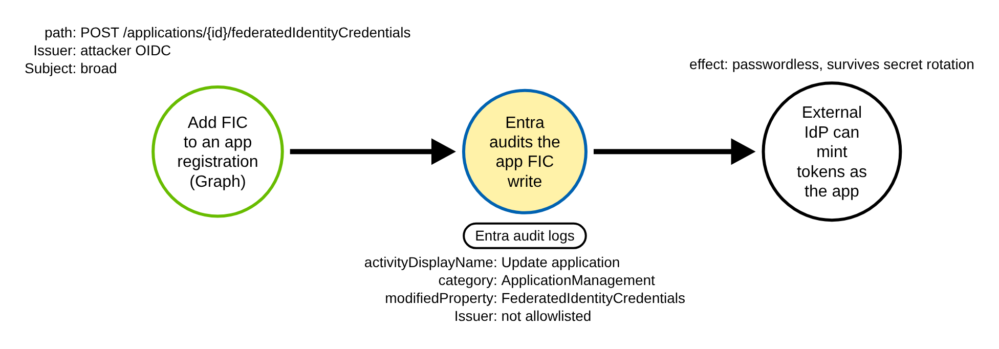
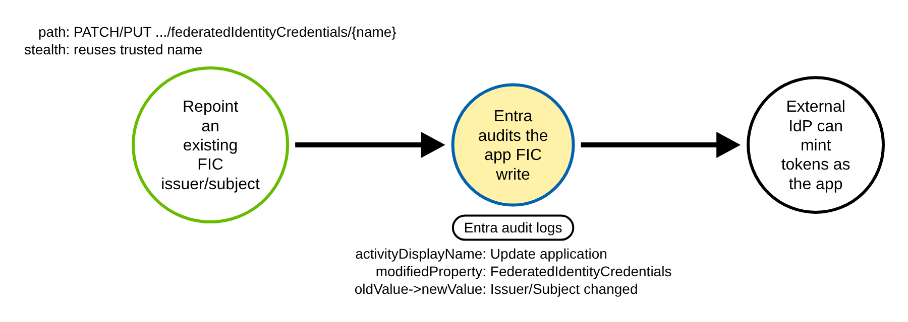
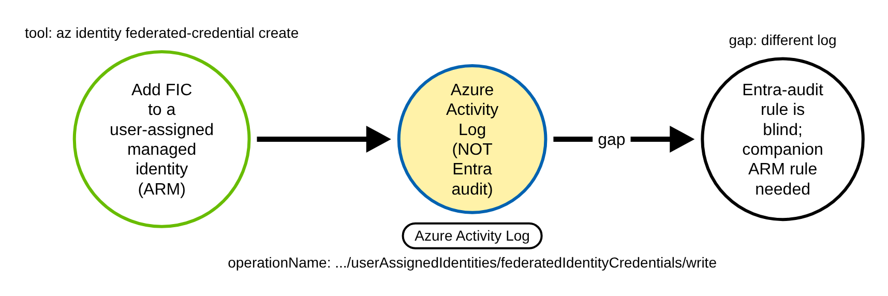
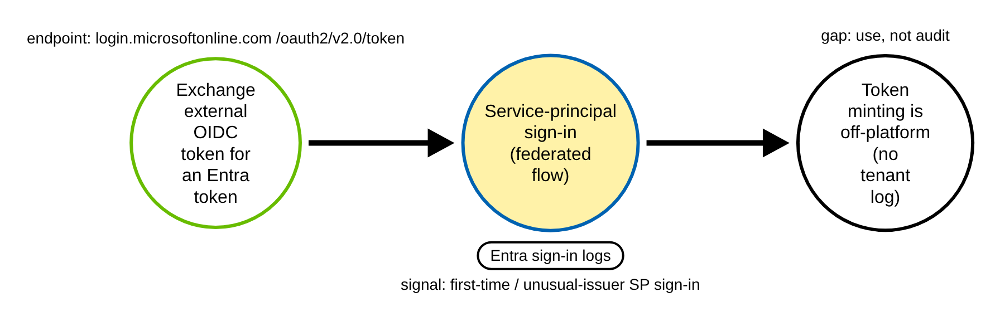

# Federated Identity Credential Backdoor on an Entra Application (Azure)

> Prose uses Simplified Technical English (ASD-STE100) where practical.
> Microsoft Entra / Graph object names, audit field names, and ATT&CK IDs are
> technical names.

## Metadata

| Key          | Value |
|--------------|-------|
| ID           | TRR9013 |
| External IDs | T1098.001 |
| Tactics      | Persistence |
| Platforms    | Azure |
| Contributors | det-eng |
| Status       | draft |

### Scope Statement

This TRR covers adding or repointing a **federated identity credential (FIC)** on a
Microsoft Entra **application** or **service principal** so that an external OIDC
issuer — an attacker-controlled CI issuer, or GitHub Actions in an unexpected repo —
can obtain tokens as that identity. The credential is passwordless and survives secret
rotation.

It is deliberately the **detection-focused** member of the cloud set. Stratus Red Team
already emulates the FIC action on a *managed identity*
(`azure.persistence.backdoor-managed-identity-fic`), and that variant lands in the
Azure Activity Log, a different log from the Entra application-FIC chokepoint. This
report's novelty is therefore the **application/service-principal FIC detection** on
the Entra audit log (which Stratus does not emulate and no Atomic Red Team test
covers — a repo search for `federatedIdentityCredentials` in atomic-red-team returns
nothing), plus a companion rule for the managed-identity variant. It does not cover the
client-secret / certificate credential-add variant of T1098.001, which is a separate,
well-covered activity.

## Technique Overview

Workload identity federation lets a workload outside Azure prove who it is with an
OIDC token from its own identity provider — GitHub Actions, GitLab, another cloud —
and exchange it for an Entra token, with no stored secret. The trust is configured by
attaching a *federated identity credential* to an Entra app (or service principal): it
names the external issuer, the subject (which repo/branch/environment is allowed), and
the audience.

An attacker who can edit an app's credentials does not need to steal a secret. They
add a federated identity credential that trusts an issuer they control, or repoint an
existing one, and from then on they can mint Entra tokens as that app from outside the
tenant. It is passwordless, it is not affected by rotating the app's client secret, and
to a defender glancing at the app it looks like one more federation entry.

## Technical Background

### What the write looks like in the Entra audit log

Adding or changing a FIC on an app registration through Microsoft Graph
(`POST /applications/{id}/federatedIdentityCredentials`, and the `az ad app
federated-credential`, `New-MgApplicationFederatedIdentityCredential`, Terraform, and
portal paths that all map to it) is recorded in the Entra ID audit log as a generic app
update. The structural invariant is one event: `properties.category`
`ApplicationManagement`, `properties.loggedByService` `Core Directory`,
`properties.result` `success`, and at least one
`properties.targetResources[].modifiedProperties[]` whose `displayName` is
`FederatedIdentityCredentials`. That exact modified-property name is what separates the
FIC variant from a client-secret or certificate add (which logs as "Update application
- Certificates and secrets management", modified property `KeyDescription` /
`PasswordCredentials`). Keying on `activityDisplayName` "Update application" alone is far
too noisy — it fires for redirect-URI, API-permission, and display-name changes too.

### The semantic discriminator

The structural event fires on **legitimate** CI onboarding too, so it is not an alert
on its own. The discriminator is inside `modifiedProperties.newValue`, which is a
JSON-encoded string holding the resulting FIC array (PascalCase keys `Id`, `Name`,
`Audiences`, `Issuer`, `Subject`): the alert condition is that `Issuer` is **not** on
the tenant's approved-issuer allowlist (or, for the repoint path, that an existing
credential's `oldValue -> newValue` changes `Issuer`/`Subject`, or broadens the
`Subject`). A detection must parse the issuer out of that string and compare it to the
allowlist.

### Not one log, and not one object

The "one converging event" is scoped to the application/service-principal object write.
Two things fall outside it: a FIC written directly to the **service-principal** object
carries `targetResources[].type` `ServicePrincipal` rather than `Application` (so a
rule must not hard-require `Application`); and a FIC on a **user-assigned managed
identity** is written through Azure Resource Manager and lands in the **Azure Activity
Log** (`Microsoft.ManagedIdentity/userAssignedIdentities/federatedIdentityCredentials/
write`), not the Entra audit log at all. The second needs a separate rule. The **use**
of the backdoor (the token exchange at `login.microsoftonline.com`) appears only in
service-principal sign-in logs.

## Procedures

| Procedure | ID | Name | Entry point |
|-----------|----|------|-------------|
| A | TRR9013.AZR.A | Add a FIC to an app registration | Graph `POST .../federatedIdentityCredentials` |
| B | TRR9013.AZR.B | Repoint an existing app FIC | Graph `PATCH/PUT .../federatedIdentityCredentials/{name}` |
| C | TRR9013.AZR.C | Add a FIC to a managed identity | ARM `.../federatedIdentityCredentials/write` |
| D | TRR9013.AZR.D | Use the backdoor (token exchange) | `login.microsoftonline.com /oauth2/v2.0/token` |

> A tool is not a procedure. The Graph API, `az ad app federated-credential`,
> `New-MgApplicationFederatedIdentityCredential`, the portal, and Terraform all write
> the same app FIC. They are the same procedure (A).

**Reading the DDMs.** Green borders are operations the client/attacker performs. Blue
borders are operations the control plane records (Entra audit log, Azure Activity Log,
or sign-in logs). Black borders are the abstract effect. The pill names the telemetry;
the `Key: value` lines are what a rule matches; a shaded node is the primary detection
opportunity.

### Procedure A: Add a FIC to an app registration  (`TRR9013.AZR.A`)

The adversary attaches a federated identity credential to an app, trusting an issuer
they control, with a broad subject.

- **Prerequisites:** permission to update the app's credentials.
- **Mechanics:** one Graph write; logged as "Update application" + modified property
  `FederatedIdentityCredentials`.
- **Impact:** an external OIDC workload can mint tokens as the app.

#### Detection Data Model — `TRR9013.AZR.A`

Source: [`ddms/trr9013_azr_a.json`](ddms/trr9013_azr_a.json) (Arrows app format).

**DDM summary.** The shaded node is the Entra audit event (`category`
ApplicationManagement, `loggedByService` Core Directory, modified property
`FederatedIdentityCredentials`, issuer not allowlisted) — the chokepoint for A and B.

### Procedure B: Repoint an existing app FIC  (`TRR9013.AZR.B`)

The adversary edits an existing credential's issuer or subject in place, reusing a
trusted-looking name.

- **Prerequisites:** the same credential-write permission.
- **Mechanics:** same chokepoint event; `oldValue -> newValue` shows the
  issuer/subject change rather than a first add.
- **Impact:** stealthier — the credential name looks familiar.

#### Detection Data Model — `TRR9013.AZR.B`

Source: [`ddms/trr9013_azr_b.json`](ddms/trr9013_azr_b.json) (Arrows app format).

**DDM summary.** Same chokepoint; the `oldValue -> newValue` delta is the signal.

### Procedure C: Add a FIC to a managed identity  (`TRR9013.AZR.C`)

The adversary attaches the FIC to a user-assigned managed identity through ARM.

- **Prerequisites:** write on the managed identity.
- **Mechanics:** logged in the **Azure Activity Log**, not the Entra audit log.
- **Impact:** same trust, different telemetry — the app-FIC rule is blind to it.

#### Detection Data Model — `TRR9013.AZR.C`

Source: [`ddms/trr9013_azr_c.json`](ddms/trr9013_azr_c.json) (Arrows app format).

**DDM summary.** The shaded node is the Azure Activity Log operation
`.../federatedIdentityCredentials/write` — a second chokepoint on a second log,
covered by the companion rule.

### Procedure D: Use the backdoor (token exchange)  (`TRR9013.AZR.D`)

The adversary exchanges an external OIDC token for an Entra access token.

- **Prerequisites:** a FIC already in place.
- **Mechanics:** the token exchange surfaces in service-principal sign-in logs
  (federated flow); the attacker's OIDC metadata and minting are off-platform.
- **Impact:** the adversary acts as the app, with no audit-log write.

#### Detection Data Model — `TRR9013.AZR.D`

Source: [`ddms/trr9013_azr_d.json`](ddms/trr9013_azr_d.json) (Arrows app format).

**DDM summary.** The shaded node is the SP sign-in (federated flow, unusual issuer) —
a separate detection signal; the token minting is off-platform and unlogged.

## Detection Strategy

Compare the DDMs. A and B converge on one Entra audit event. C is a different log. D is
a different log again (sign-in), and the minting is off-platform.

**Telemetry requirement.** Entra ID audit logs routed via Diagnostic Settings to Log
Analytics/Sentinel or an Event Hub (Graph retention is only 7–30 days). Azure Activity
Log for Procedure C. Service-principal sign-in logs for Procedure D.

**Strategy 1 — chokepoint (covers A, B).**
Match Entra audit events with `properties.category` `ApplicationManagement`,
`loggedByService` `Core Directory`, `result` `success`, and a modified property
`FederatedIdentityCredentials`, where an FIC **issuer that is not on the approved-issuer
allowlist is present**. The rule expresses this as a regex for an `Issuer:
"https://<host>` whose host is not approved, **not** as "suppress when an approved
issuer appears anywhere" — the latter fails open on any app that already holds a
legitimate FIC (its approved issuer sits in `oldValue`). This covers Procedure B
(a repoint **to** an unapproved issuer makes that issuer appear in `newValue`). Match
the modified property over any element (not index 0), and do not hard-require
`targetResources.type` `Application` (a service-principal-object FIC is
`ServicePrincipal`). Caveat: the matched text spans `oldValue` and `newValue`, so
repointing or removing an already-present unapproved issuer (a benign remediation) can
also fire; a decode-and-parse pipeline that reads only `newValue` avoids this.

- Sensor: Entra ID audit log.
- Rule: [`detections/sigma/T1098.001/entra_app_federated_credential_backdoor.yml`](../../../detections/sigma/T1098.001/entra_app_federated_credential_backdoor.yml) (built).

**Strategy 2 — managed-identity variant (covers C).**
Match the Azure Activity Log Administrative operation
`Microsoft.ManagedIdentity/userAssignedIdentities/federatedIdentityCredentials/write`,
case-insensitively: storage and Event Hub exports carry `operationName` in upper case, and
their top-level `category` can hold the operation type (`Write`) instead of
`Administrative` (MS Learn, "Azure Activity Log event schema"). ARM logs a `Start` and a
`Success` record for each write; the rule drops the `Start` record, so one write raises one
alert, and a refused write (`Failure`) still fires.

- Sensor: Azure Activity Log.
- Rule: [`detections/sigma/T1098.001/azure_managed_identity_federated_credential_backdoor.yml`](../../../detections/sigma/T1098.001/azure_managed_identity_federated_credential_backdoor.yml) (built).

**Demonstrated gaps.** Procedure D (use) is in sign-in logs, not audit; an attacker who
targets the service-principal object (not the app) still hits Strategy 1 if the rule
does not hard-require `Application`; GitHub's 2026 immutable-subject cutover (numeric
IDs) can drift name-based subject allowlists.

**Coverage summary.**

| Procedure | Covered by | How |
|-----------|-----------|-----|
| A | Strategy 1 | Entra audit, modified property FederatedIdentityCredentials, issuer not allowlisted |
| B | Strategy 1 | same event; `oldValue -> newValue` issuer/subject change |
| C | Strategy 2 | Azure Activity Log `.../federatedIdentityCredentials/write` |
| D | — (gap) | SP sign-in logs (federated flow); minting off-platform |

## Available Emulation Tests

The runnable half
([`atomics/T1098.001/src/emulate_entra.sh`](../../../atomics/T1098.001/src/emulate_entra.sh),
wrappers in [`atomics/T1098.001/T1098.001.yaml`](../../../atomics/T1098.001/T1098.001.yaml))
adds a no-op FIC to a throwaway app registration (Procedure A) and a managed identity
(Procedure C) in **your own tenant** and cleans up, guarded by `TRR9013_LIVE=1`; it is
**not run in CI**. The proven half is committed Entra-audit and Azure-Activity-Log
fixtures ([`detections/cloud/fixtures/trr9013/`](../../../detections/cloud/fixtures/trr9013/)):
an attack FIC with an attacker-controlled issuer (`oidc.trr9013-attacker.example.com`)
and a benign FIC with the allowlisted GitHub Actions issuer, which hits the same
structural chokepoint and differs only on the issuer.

| Procedure | Test | Status |
|-----------|------|--------|
| TRR9013.AZR.A | `emulate_entra.sh a` — add a FIC to a throwaway app with an unapproved issuer. | **built** |
| TRR9013.AZR.B | documented — repoint an existing FIC's issuer/subject. | backlog |
| TRR9013.AZR.C | `emulate_entra.sh c` — add a FIC to a throwaway user-assigned managed identity. | **built** |
| TRR9013.AZR.D | documented gap — token exchange; SP sign-in logs. | backlog |

## Detections

| Strategy | Covers | Sigma rule | Sensor |
|----------|--------|------------|--------|
| 1 (chokepoint) | A, B | [`detections/sigma/T1098.001/entra_app_federated_credential_backdoor.yml`](../../../detections/sigma/T1098.001/entra_app_federated_credential_backdoor.yml) | Entra ID audit log |
| 2 (variant) | C | [`detections/sigma/T1098.001/azure_managed_identity_federated_credential_backdoor.yml`](../../../detections/sigma/T1098.001/azure_managed_identity_federated_credential_backdoor.yml) | Azure Activity Log |

The validator
[`detections/validate_cloud_detections.py`](../../../detections/validate_cloud_detections.py)
runs each rule over its attack fixture (must fire, carrying the `trr9013-` marker) and
its benign baseline (must fire on nothing). For Strategy 1 the benign baseline is a
legitimate GitHub-Actions FIC — same structural event, allowlisted issuer — so the pass
proves the rule keys on the issuer and not on the FIC write alone.

Prior detection art is vendor-only: Elastic "Entra ID Federated Identity Credential
Modified" (`498e4094-60e7-11f0-8847-f661ea17fbcd`) and Datadog `def-000-y2u`. There is
no open-source emulation of the application-FIC path and no ART atomic for FIC/OIDC.

## References

- MITRE ATT&CK, T1098.001 Account Manipulation: Additional Cloud Credentials:
  <https://attack.mitre.org/techniques/T1098/001/>
- Microsoft, federatedIdentityCredential resource (issuer, subject, audiences):
  <https://learn.microsoft.com/graph/api/resources/federatedidentitycredential?view=graph-rest-1.0>
- Microsoft, Configure a trust (workload identity federation):
  <https://learn.microsoft.com/entra/workload-id/workload-identity-federation-create-trust>
- Microsoft, directoryAudit / modifiedProperty schema:
  <https://learn.microsoft.com/graph/api/resources/directoryaudit?view=graph-rest-1.0>
- Elastic, Entra ID Federated Identity Credential Modified rule:
  <https://github.com/elastic/detection-rules/blob/main/rules/integrations/azure/persistence_entra_id_federated_identity_credential_modified.toml>
- Stratus Red Team, azure.persistence.backdoor-managed-identity-fic:
  <https://github.com/DataDog/stratus-red-team/blob/main/v2/internal/attacktechniques/azure/persistence/backdoor-managed-identity-fic/main.go>
- TRR method:
  <https://github.com/tired-labs/techniques/blob/main/docs/TECHNIQUE-RESEARCH-REPORT.md>
