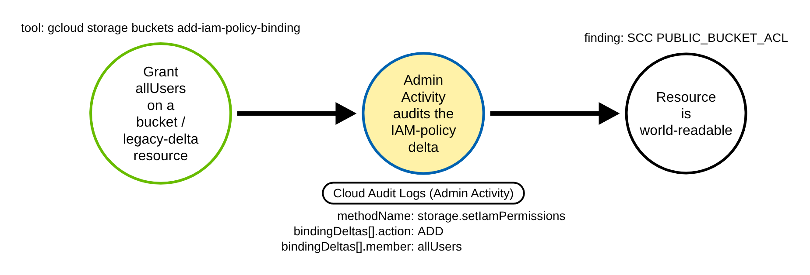
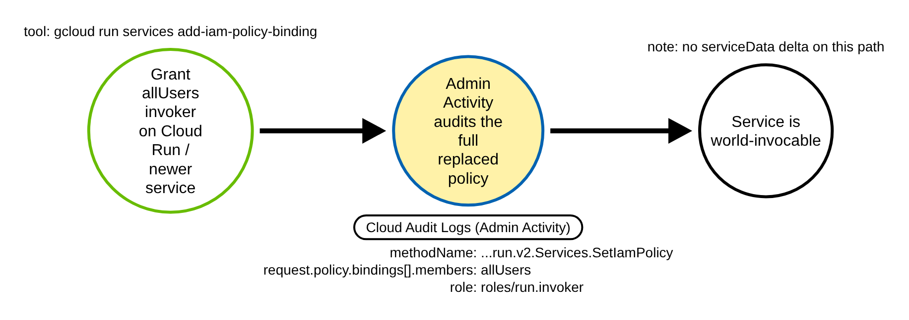
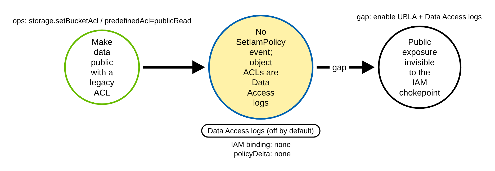

# Public IAM Exposure via allUsers / allAuthenticatedUsers (GCP)

> Prose uses Simplified Technical English (ASD-STE100) where practical.
> GCP service names, API method names, Cloud Audit Log field names, and ATT&CK IDs
> are technical names.

## Metadata

| Key          | Value |
|--------------|-------|
| ID           | TRR9014 |
| External IDs | T1098.003 |
| Tactics      | Persistence |
| Platforms    | GCP |
| Contributors | det-eng |
| Status       | draft |

### Scope Statement

This TRR covers granting an IAM role to the public pseudo-principals **`allUsers`**
(anyone on the internet, unauthenticated) or **`allAuthenticatedUsers`** (any Google
account), which exposes a GCP resource to the world. Its contribution is a **single
cross-service chokepoint** that unifies the two distinct audit-log shapes and both
public principals across GCS buckets, Cloud Run/Functions, Pub/Sub, Secret Manager,
Artifact Registry, service accounts, and project/folder/org IAM.

No Stratus Red Team technique grants a public principal (its nearest techniques add a
*specific* external account), and Atomic Red Team's T1098.003 is Azure-AD-only, so this
is unemulated in both frameworks. It does not cover sharing a resource with one named
external account (that is the Stratus `share-compute-*` / `invite-external-user`
family).

## Technique Overview

GCP IAM has two special members that mean "the public": `allUsers` (everyone,
including anonymous callers) and `allAuthenticatedUsers` (anyone with a Google
account). Binding a role to one of these on a resource makes that resource reachable
from the whole internet — a world-readable storage bucket, a world-invocable Cloud Run
service, a public dataset, a public container registry.

An attacker who can set a resource's IAM policy does not need to move data or add their
own account. They add `allUsers` (or `allAuthenticatedUsers`) with a useful role —
`roles/storage.objectViewer` on a bucket, `roles/run.invoker` on a service — and the
resource is exposed, quietly, to anyone. It is a one-call persistence/collection-setup
step that needs no further attacker infrastructure.

## Technical Background

### One technique, two audit-log shapes

Every public grant is an IAM-policy write recorded in the Cloud Audit **Admin
Activity** log (an `ADMIN_WRITE` operation, on by default and free). But the record
comes in two shapes, and a rule must handle both:

- **Delta path** (GCS and legacy IAM-delta services). The method is often *not*
  `*.setIamPolicy`: GCS uses `storage.setIamPermissions`. The added member is at
  `protoPayload.serviceData.policyDelta.bindingDeltas[]` with `action` `ADD`, `role`,
  and a **singular** `member`.
- **Request path** (Cloud Run/Functions, Secret Manager, Artifact Registry, service
  accounts). The method is `google.cloud.<svc>.v#.<Resource>.SetIamPolicy`
  (e.g. `google.cloud.run.v2.Services.SetIamPolicy`). These emit **no** `serviceData`
  delta; the member is in the **plural** `protoPayload.request.policy.bindings[].members[]`,
  which carries the full replaced policy.

So the method is matched as a family (suffix `setIamPolicy` or `setIamPermissions`,
case-insensitively) and the public principal is looked for over **both** field shapes.

### Why the two shapes matter for fidelity

The delta path has `action` `ADD`, so it says a member was *newly* granted — high
fidelity. The request path carries the whole resulting policy, so an `allUsers` seen
there might be a pre-existing binding merely re-submitted during an unrelated policy
rewrite — it can over-fire. Prefer the delta when present; on the request path, diff
against the prior policy or accept the lower fidelity.

### Why the technique works

IAM exposes the public pseudo-principals as ordinary members, and the grant is just
another IAM-policy write that any identity with `setIamPolicy` on the resource can
make. The control-plane write is logged by default, which is the detection's strength —
but the actual public *data access* afterwards is only in Data Access logs, which are
off by default, so the control-plane log proves the grant, not that anyone used it.

## Procedures

| Procedure | ID | Name | Entry point |
|-----------|----|------|-------------|
| A | TRR9014.GCP.A | Public grant via the delta path | `storage.setIamPermissions` / `SetIamPolicy` + `bindingDeltas` |
| B | TRR9014.GCP.B | Public grant via the request path | `*.Services.SetIamPolicy` + `request.policy.bindings` |
| C | TRR9014.GCP.C | Public exposure without an IAM binding | legacy ACLs / invoker-IAM disable / BigQuery access |

> A tool is not a procedure. `gcloud ... add-iam-policy-binding`, `gsutil iam ch`, the
> REST `setIamPolicy`, Terraform `google_*_iam_member`, and the Console all write the
> same IAM policy. They are the same procedure.

**Reading the DDMs.** Green borders are operations the attacker performs. Blue borders
are operations the GCP control plane records (Cloud Audit Logs). Black borders are the
abstract effect. The pill names the telemetry; the `Key: value` lines are what a rule
matches; a shaded node is the primary detection opportunity.

### Procedure A: Public grant via the delta path  (`TRR9014.GCP.A`)

The adversary grants `allUsers`/`allAuthenticatedUsers` on a GCS bucket (or project,
Pub/Sub, folder/org) — services that emit a policy delta.

- **Prerequisites:** `setIamPolicy` on the resource.
- **Mechanics:** Admin Activity log; `methodName` `storage.setIamPermissions` (GCS) or
  `SetIamPolicy`; `bindingDeltas[]` with `action` `ADD`, `member` the public principal.
- **Impact:** the resource is world-readable/accessible.

#### Detection Data Model — `TRR9014.GCP.A`

Source: [`ddms/trr9014_gcp_a.json`](ddms/trr9014_gcp_a.json) (Arrows app format).

**DDM summary.** The shaded node is the Admin Activity event with a `policyDelta`
`ADD` of a public member — the chokepoint for A, and (via the other field shape) B.

### Procedure B: Public grant via the request path  (`TRR9014.GCP.B`)

The adversary grants `allUsers` `roles/run.invoker` on a Cloud Run service (or
Functions, Secret Manager, Artifact Registry, a service account) — services that carry
the full policy in the request and emit no delta.

- **Prerequisites:** `setIamPolicy` on the resource.
- **Mechanics:** Admin Activity log; `methodName` `google.cloud.run.v2.Services.SetIamPolicy`;
  `request.policy.bindings[].members[]` contains the public principal.
- **Impact:** the service is world-invocable.

#### Detection Data Model — `TRR9014.GCP.B`

Source: [`ddms/trr9014_gcp_b.json`](ddms/trr9014_gcp_b.json) (Arrows app format).

**DDM summary.** The same chokepoint, read from `request.policy.bindings[].members`
instead of a delta; no `serviceData` delta exists on this path.

### Procedure C: Public exposure without an IAM binding  (`TRR9014.GCP.C`)

The adversary exposes data without any `allUsers` IAM binding: a legacy GCS ACL
(`storage.setBucketAcl`, object `predefinedAcl` `publicRead`), a Cloud Run
`--no-invoker-iam-check` (`UpdateService`), or a BigQuery dataset access entry with
`specialGroup` `allAuthenticatedUsers`.

- **Prerequisites:** the relevant write permission.
- **Mechanics:** none of these emit a set-IAM-policy event or a `policyDelta` member;
  object-level ACL/data operations are Data Access logs (off by default).
- **Impact:** public exposure invisible to the IAM chokepoint.

#### Detection Data Model — `TRR9014.GCP.C`

Source: [`ddms/trr9014_gcp_c.json`](ddms/trr9014_gcp_c.json) (Arrows app format).

**DDM summary.** The shaded node shows there is no set-IAM-policy event — a gap closed
only by enabling Uniform Bucket-Level Access plus Data Access logs, and by companion
rules for `UpdateService` and BigQuery dataset writes.

## Detection Strategy

Compare the DDMs. A and B are the same IAM-policy-write chokepoint in two field shapes.
C is a family of non-IAM exposures that the chokepoint cannot see.

**Telemetry requirement.** Cloud Audit Logs Admin Activity (on by default, free) for A
and B. Data Access logs (off by default) for the public *reads*, and for the GCS-ACL
part of C.

**Strategy 1 — chokepoint (covers A, B).**
Match Admin Activity events whose `protoPayload.methodName` ends (case-insensitively)
`setiampolicy` or `setiampermissions`, and where `allUsers` or `allAuthenticatedUsers`
appears either in `protoPayload.serviceData.policyDelta.bindingDeltas` (delta path) or
`protoPayload.request.policy.bindings` (request path). Prefer the delta (`action` `ADD`)
when present; allowlist intentionally-public resources by `resourceName` + role.

- Sensor: Cloud Audit Logs (Admin Activity). Enriched: SCC `PUBLIC_BUCKET_ACL` /
  `PUBLIC_IAM_POLICY`.
- Rule: [`detections/sigma/T1098.003/gcp_public_iam_member_grant.yml`](../../../detections/sigma/T1098.003/gcp_public_iam_member_grant.yml) (built).

**Demonstrated gaps (companion rules, not this chokepoint).** Legacy GCS ACLs; Cloud
Run `--no-invoker-iam-check` (`google.cloud.run.v2.Services.UpdateService` with the
invoker-iam-disabled annotation); BigQuery legacy dataset access (`DatasetService.*`
with `specialGroup` `allAuthenticatedUsers` — BigQuery supports only
`allAuthenticatedUsers`, never `allUsers`, at the dataset level). The public *data
access* that follows the grant is in Data Access logs, off by default.

**Coverage summary.**

| Procedure | Covered by | How |
|-----------|-----------|-----|
| A | Strategy 1 | `policyDelta.bindingDeltas` ADD of `allUsers`/`allAuthenticatedUsers` |
| B | Strategy 1 | `request.policy.bindings[].members` contains a public principal |
| C | — (gaps) | legacy ACLs / `UpdateService` invoker-disable / BigQuery access; Data Access logs |

## Available Emulation Tests

The runnable half
([`atomics/T1098.003/src/emulate.sh`](../../../atomics/T1098.003/src/emulate.sh),
wrappers in [`atomics/T1098.003/T1098.003.yaml`](../../../atomics/T1098.003/T1098.003.yaml))
grants and then revokes `allUsers` on a throwaway bucket / Cloud Run service in **your
own project**, guarded by `TRR9014_LIVE=1`; it is **not run in CI**. The proven half is
committed Cloud Audit Log fixtures
([`detections/cloud/fixtures/trr9014/`](../../../detections/cloud/fixtures/trr9014/)):
an attack set (a GCS `allUsers` delta grant and a Cloud Run `allUsers` request grant)
and a benign baseline (the same methods/roles/resource granting a *specific* internal
user and a *specific* service account).

| Procedure | Test | Status |
|-----------|------|--------|
| TRR9014.GCP.A | `emulate.sh a` — grant `allUsers` `objectViewer` on a throwaway bucket, then revoke. | **built** |
| TRR9014.GCP.B | `emulate.sh b` — grant `allUsers` `run.invoker` on a throwaway service, then revoke. | **built** |
| TRR9014.GCP.C | documented gaps — legacy ACL / invoker-disable / BigQuery access. | backlog |

## Detections

| Strategy | Covers | Sigma rule | Sensor |
|----------|--------|------------|--------|
| 1 (chokepoint) | A, B | [`detections/sigma/T1098.003/gcp_public_iam_member_grant.yml`](../../../detections/sigma/T1098.003/gcp_public_iam_member_grant.yml) | Cloud Audit Logs (Admin Activity) |

The validator
[`detections/validate_cloud_detections.py`](../../../detections/validate_cloud_detections.py)
runs the rule over the attack set (both the GCS delta grant and the Cloud Run request
grant must fire, carrying the `trr9014-public-exposure-demo` marker) and the benign
baseline (nothing fires). The benign baseline is byte-for-byte the attack except the
member value (a specific user / service account instead of a public principal), so the
pass proves the rule keys on the public principal and not on the method or resource.

Existing production detections (Elastic, Datadog, Panther, Powerpipe) are single-service
and several fire on *any* policy modification; this rule unifies both log shapes and
both public principals in one rule.

## References

- MITRE ATT&CK, T1098.003 Account Manipulation: Additional Cloud Roles:
  <https://attack.mitre.org/techniques/T1098/003/>
- GCP, Cloud Audit Logs (Admin Activity, ADMIN_WRITE):
  <https://cloud.google.com/iam/docs/audit-logging>
- GCP, Making data public (allUsers / allAuthenticatedUsers on GCS):
  <https://cloud.google.com/storage/docs/access-control/making-data-public>
- GCP, Allowing public access to a Cloud Run service (`allUsers` `run.invoker`):
  <https://cloud.google.com/run/docs/authenticating/public>
- google/iam/v1 policy.proto (BindingDelta.member singular vs Binding.members repeated):
  <https://github.com/googleapis/googleapis/blob/master/google/iam/v1/policy.proto>
- TRR method:
  <https://github.com/tired-labs/techniques/blob/main/docs/TECHNIQUE-RESEARCH-REPORT.md>
