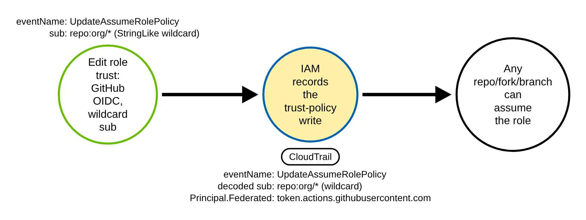
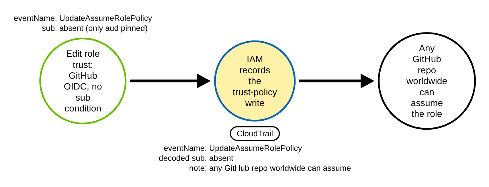
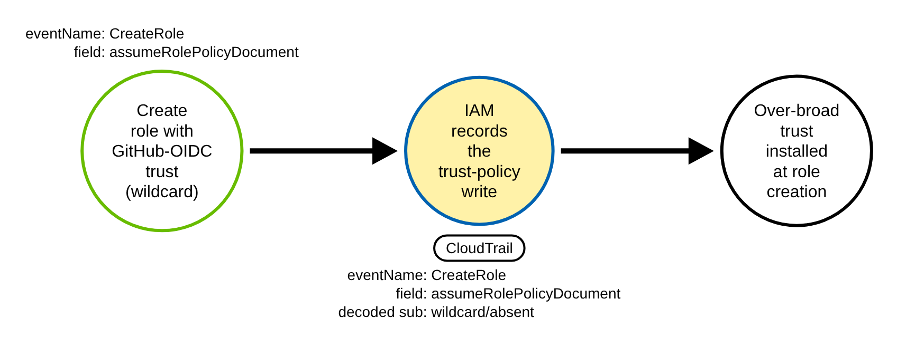
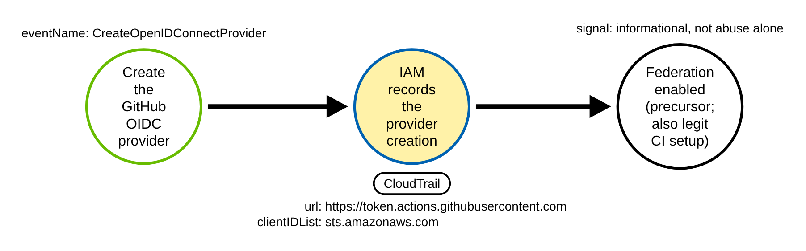
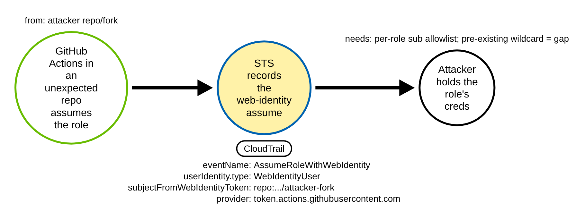

# GitHub Actions OIDC Role-Trust Abuse (AWS)

> Prose uses Simplified Technical English (ASD-STE100) where practical.
> AWS service names, API names, CloudTrail field names, OIDC claim names, and ATT&CK
> IDs are technical names.

## Metadata

| Key          | Value |
|--------------|-------|
| ID           | TRR9015 |
| External IDs | T1098.001 |
| Tactics      | Persistence |
| Platforms    | AWS |
| Contributors | det-eng |
| Status       | draft |

### Scope Statement

This TRR covers installing or weakening an IAM role **trust policy** so that the GitHub
Actions OIDC provider can assume the role from an unintended workflow — a fork, an
unexpected branch, or any repository — giving an external CI system AWS credentials.
It is the AWS side of the OIDC/CI federation story, the counterpart of TRR9013 (Entra
federated identity credentials).

It is genuinely unemulated: Stratus Red Team's closest technique,
`aws.persistence.iam-backdoor-role`, uses the same `iam:UpdateAssumeRolePolicy` write
but trusts an external **AWS account** principal, not a GitHub-OIDC federated provider
with an over-broad subject; Atomic Red Team has no atomic for an OIDC web-identity
trust. This report covers the **grant** (the strongest chokepoint) and documents the
**use** path and its gaps. It does not cover cross-account `sts:AssumeRole` trust
backdoors (the Stratus technique) or IAM Roles Anywhere / `GetFederationToken`
federation.

## Technique Overview

To let a GitHub Actions workflow get AWS credentials without a stored key, you register
GitHub as an OIDC identity provider and create an IAM role whose trust policy accepts a
token from `token.actions.githubusercontent.com`. The trust policy is supposed to pin
**who** may assume the role: the `sub` (subject) claim says exactly which
repository, branch, tag, or environment is allowed, and the `aud` (audience) is pinned
to `sts.amazonaws.com`.

The abuse is in that pin. If the trust policy allows a wildcard subject — `repo:org/*`,
or any repo, or no subject condition at all — then any GitHub repository (including a
fork an attacker controls, or a pull-request workflow) can present a valid GitHub OIDC
token and assume the role. The attacker never needs a stored secret or a password: they
push a workflow to a repository they control and receive the role's AWS credentials.

The decisive event is the trust-policy write. Installing or widening the trust is an IAM
management action that AWS logs by default, and the policy it writes shows the wildcard
plainly. That makes the grant the strongest place to detect the technique — before the
trust is ever used.

## Technical Background

### Where the trust policy appears in CloudTrail

Two IAM management events carry the trust policy: `iam:UpdateAssumeRolePolicy` (editing
an existing role) carries it in `requestParameters.policyDocument`, and `iam:CreateRole`
(creating a role) carries it in `requestParameters.assumeRolePolicyDocument`. Both are
recorded by a default trail with no data-event configuration. The precursor
`iam:CreateOpenIDConnectProvider` registers the GitHub provider once per account.

The trust policy in those fields is a **URL-encoded** JSON string. A rule must either
URL-decode and parse it, or match it as text. The issuer host
`token.actions.githubusercontent.com` is convenient because it is percent-encoding-
invariant (letters and dots are not encoded), so it is found in both raw and encoded
bodies.

### What makes a trust "over-broad"

Inside the decoded policy, a GitHub-OIDC statement has `Principal.Federated` ending
`:oidc-provider/token.actions.githubusercontent.com` and `Action`
`sts:AssumeRoleWithWebIdentity`. The trust is over-broad when any of these hold:

- the subject condition `token.actions.githubusercontent.com:sub` uses a wildcard
  (`*`) in the org/repo/ref position (a `StringLike` such as `repo:org/*`). A wildcard
  before any segment that pins one repository (`repo:org/*`, `repo:*`, or a customized
  subject-claim template such as `repository_owner_id:1234567:*`) lets other
  repositories, forks included, assume the role. A wildcard after a pinned repository
  (`repo:org/app:ref:refs/tags/v*`, `repo:org/app:*`, the immutable form
  `repo:org@1/app@2:*`, or `repository_id:7654321:*` in a customized template) lets only
  that repository's other branches, tags, environments or pull requests assume it, which
  is narrower (formats: GitHub Docs, "OpenID Connect reference");
- there is **no** GitHub-OIDC scoping claim at all (only `aud`, or no `Condition`) —
  AWS warns this lets any GitHub repository in the world assume the role. A trust
  scoped by another claim instead of `sub` (e.g. `:repository` or `:environment`) is
  **not** over-broad, so the detection treats any scoping claim as scoped; or
- the audience `token.actions.githubusercontent.com:aud` is not pinned with
  `StringEquals` to `sts.amazonaws.com`.

A correctly-scoped trust pins the subject with `StringEquals` to an exact
`repo:ORG/REPO:ref:refs/...` or `:environment:NAME` and pins the audience.

### The use path, and why the grant is still better

Contrary to a common belief, the **use** event (`sts:AssumeRoleWithWebIdentity`, on
`sts.amazonaws.com`) does record the subject — `responseElements.subjectFromWebIdentityToken`
holds the decoded `sub`, with `responseElements.provider` the issuer and
`userIdentity.type` `WebIdentityUser`. But flagging a use as "unexpected" needs a
maintained per-role allowlist of authorized subjects, and the worst case — an attacker
using a trust that was *already* over-broad before they arrived — emits no grant event
in the account at all and a use event that looks valid. So the grant is the stronger,
baseline-free chokepoint, and the use path is a fallback that needs state.

## Procedures

| Procedure | ID | Name | Entry point |
|-----------|----|------|-------------|
| A | TRR9015.AWS.A | Over-broad sub grant (wildcard) | `iam:UpdateAssumeRolePolicy` |
| B | TRR9015.AWS.B | Missing-condition grant (no sub) | `iam:UpdateAssumeRolePolicy` |
| C | TRR9015.AWS.C | Create-time grant | `iam:CreateRole` |
| D | TRR9015.AWS.D | Create the GitHub OIDC provider | `iam:CreateOpenIDConnectProvider` |
| E | TRR9015.AWS.E | Use of the federated trust | `sts:AssumeRoleWithWebIdentity` |

> A tool is not a procedure. The AWS CLI, Terraform, CloudFormation, and the Console
> all write the same trust policy; they are the same procedure.

**Reading the DDMs.** Green borders are operations the client/attacker performs. Blue
borders are operations the AWS control plane records (CloudTrail). Black borders are
the abstract effect. The pill names the telemetry; the `Key: value` lines are what a
rule matches; a shaded node is the primary detection opportunity.

### Procedure A: Over-broad sub grant (wildcard)  (`TRR9015.AWS.A`)

The adversary edits a role's trust policy to trust GitHub OIDC with a wildcard subject.

- **Prerequisites:** `iam:UpdateAssumeRolePolicy` on the role.
- **Mechanics:** the decoded `policyDocument` has a `StringLike` sub like `repo:org/*`.
- **Impact:** any repo/fork/branch can assume the role.

#### Detection Data Model — `TRR9015.AWS.A`

Source: [`ddms/trr9015_aws_a.json`](ddms/trr9015_aws_a.json) (Arrows app format).

**DDM summary.** The shaded node is the IAM trust-policy write (chokepoint for A, B,
C): `eventSource` `iam.amazonaws.com`, the GitHub OIDC federated principal, a
wildcard/absent sub.

### Procedure B: Missing-condition grant (no sub)  (`TRR9015.AWS.B`)

The adversary writes a trust with the GitHub OIDC principal but no subject condition.

- **Prerequisites:** `iam:UpdateAssumeRolePolicy`.
- **Mechanics:** only `aud` is pinned, or there is no `Condition` at all — the broadest
  form.
- **Impact:** any GitHub repository worldwide can assume the role.

#### Detection Data Model — `TRR9015.AWS.B`

Source: [`ddms/trr9015_aws_b.json`](ddms/trr9015_aws_b.json) (Arrows app format).

**DDM summary.** Same chokepoint; the signal is the **absence** of a sub condition.

### Procedure C: Create-time grant  (`TRR9015.AWS.C`)

The adversary bakes the over-broad trust into a new role at creation.

- **Prerequisites:** `iam:CreateRole`.
- **Mechanics:** the trust is in `assumeRolePolicyDocument` instead of `policyDocument`;
  the same decode-and-match logic applies.
- **Impact:** same as A/B, installed in one call.

#### Detection Data Model — `TRR9015.AWS.C`

Source: [`ddms/trr9015_aws_c.json`](ddms/trr9015_aws_c.json) (Arrows app format).

**DDM summary.** Same chokepoint, read from `iam:CreateRole` /
`assumeRolePolicyDocument`.

### Procedure D: Create the GitHub OIDC provider  (`TRR9015.AWS.D`)

The adversary registers `token.actions.githubusercontent.com` as an OIDC provider.

- **Prerequisites:** `iam:CreateOpenIDConnectProvider`.
- **Mechanics:** `requestParameters.url` is the GitHub issuer, `clientIDList` is
  `sts.amazonaws.com`.
- **Impact:** federation is enabled — a precursor, also done by legitimate CI setup.

#### Detection Data Model — `TRR9015.AWS.D`

Source: [`ddms/trr9015_aws_d.json`](ddms/trr9015_aws_d.json) (Arrows app format).

**DDM summary.** The shaded node is the provider-creation event — an informational
precursor, not abuse on its own.

### Procedure E: Use of the federated trust  (`TRR9015.AWS.E`)

A GitHub Actions workflow in an unexpected repository assumes the role.

- **Prerequisites:** a trust (over-broad, or one the attacker's repo matches).
- **Mechanics:** `sts:AssumeRoleWithWebIdentity` records
  `subjectFromWebIdentityToken` (the sub), `provider`, and `userIdentity.type`
  `WebIdentityUser`.
- **Impact:** the attacker holds the role's credentials. Flagging this needs a per-role
  sub allowlist; a pre-existing over-broad trust leaves no grant event — the gap.

#### Detection Data Model — `TRR9015.AWS.E`

Source: [`ddms/trr9015_aws_e.json`](ddms/trr9015_aws_e.json) (Arrows app format).

**DDM summary.** The shaded node is the use event; the sub is present but judging it
"unexpected" needs a baseline — a partial gap, and a full blind spot when no grant
event exists.

## Detection Strategy

Compare the DDMs. A, B, and C converge on the trust-policy write — the strongest
chokepoint, readable before any use and needing no baseline. D is a precursor. E is the
use path, which needs a per-role sub allowlist.

**Telemetry requirement.** A CloudTrail trail capturing management events (default). No
data events needed. To read the policy precisely, URL-decode and JSON-parse it in the
log pipeline.

**Strategy 1 — grant chokepoint (covers A, B, C).**
Match `iam:UpdateAssumeRolePolicy`/`iam:CreateRole` whose trust policy (in
`policyDocument` or `assumeRolePolicyDocument`) trusts `token.actions.githubusercontent.com`
and is over-broad: a wildcard **inside the sub value**, or **no GitHub-OIDC scoping
claim at all** (no `sub`, `repository`, `environment`, ...). The shipped rule is a
regex approximation over the URL-encoded text (the wildcard check is scoped to the sub
value, and any scoping claim counts as scoped), so a trust pinned by `sub`, or scoped
by `:repository`/`:environment`, is suppressed. It is **not** serialization-independent
— a JSON array, extra whitespace, or an unexpected key order can change the match — and
it does **not** test the audience pin (absence of a literal `aud":"sts` substring is not
evidence of an unpinned aud). A production pipeline should URL-decode and JSON-parse the
trust policy to judge the sub and aud precisely.

The wildcard is graded by position. A wildcard before any `repo:` or `repository_id:`
segment with a fixed value (an org-wide or any-repository sub), and a trust with no
scoping claim, fire the high rule. A wildcard after a pinned repository fires a separate
low rule, so one write raises one alert.

- Sensor: CloudTrail.
- Rule (high): [`detections/sigma/T1098.001/aws_github_oidc_role_trust_abuse.yml`](../../../detections/sigma/T1098.001/aws_github_oidc_role_trust_abuse.yml) (built).
- Rule (low): [`detections/sigma/T1098.001/aws_github_oidc_role_trust_ref_wildcard.yml`](../../../detections/sigma/T1098.001/aws_github_oidc_role_trust_ref_wildcard.yml) (built).

**Demonstrated gaps.** Procedure D is a precursor (informational); Procedure E needs a
per-role sub allowlist; a pre-existing over-broad trust leaves no grant event; a sub
pinned to a repo the attacker actually controls is not wildcard-shaped and is not
flagged; a customized template that pins the repository through another claim (a
`repo_property_*` custom property) is graded high, because the regex knows only the
`repo:` and `repository_id:` pins (decode-and-parse to disambiguate).

**Coverage summary.**

| Procedure | Covered by | How |
|-----------|-----------|-----|
| A | Strategy 1 | wildcard sub in the trust policy (high before a repository pin, low after it) |
| B | Strategy 1 | no GitHub-OIDC sub condition (or unpinned aud) |
| C | Strategy 1 | same as A and B, at role creation (`assumeRolePolicyDocument`) |
| D | precursor | `iam:CreateOpenIDConnectProvider` (informational) |
| E | — (needs baseline / gap) | `sts:AssumeRoleWithWebIdentity` sub not on a per-role allowlist |

## Available Emulation Tests

The runnable half
([`atomics/T1098.001/src/emulate_aws_oidc.sh`](../../../atomics/T1098.001/src/emulate_aws_oidc.sh),
wrappers in [`atomics/T1098.001/T1098.001.yaml`](../../../atomics/T1098.001/T1098.001.yaml))
creates a throwaway IAM role with an over-broad GitHub-OIDC trust in **your own
account** and deletes it, guarded by `TRR9015_LIVE=1`; it is **not run in CI**. The
proven half is committed CloudTrail fixtures
([`detections/cloud/fixtures/trr9015/`](../../../detections/cloud/fixtures/trr9015/)):
an attack set (a wildcard-sub grant, a missing-sub grant, a create-time grant, and a
ref-wildcard grant on a pinned repository) and a benign baseline (a correctly-scoped
`StringEquals` trust, and the OIDC-provider creation precursor, which must not fire).
Provenance: the live emulation runs one `iam create-role` with the sub
`repo:trr9015-example/*:*`, which is the shape of the create-time record. The records
are documentation-derived, not captured: no emulation step writes the
`UpdateAssumeRolePolicy` grants, the missing-sub grant, or the ref-wildcard grant (role
`trr9015-github-release`, sub `repo:trr9015-example/deploy:*`). The ref-wildcard record
is the only attack record of the low rule; its sub format is from GitHub Docs ("OpenID
Connect reference").

| Procedure | Test | Status |
|-----------|------|--------|
| TRR9015.AWS.A | `emulate_aws_oidc.sh a` — update a role trust to a wildcard GitHub-OIDC sub. | **built** |
| TRR9015.AWS.B | documented — missing-sub grant. | backlog |
| TRR9015.AWS.C | documented — create-time grant via `iam:CreateRole`. | backlog |
| TRR9015.AWS.D | documented — create the OIDC provider (precursor). | backlog |
| TRR9015.AWS.E | documented gap — use via `sts:AssumeRoleWithWebIdentity`. | backlog |

## Detections

| Strategy | Covers | Sigma rule | Sensor |
|----------|--------|------------|--------|
| 1 (grant chokepoint) | A, B, C | [`detections/sigma/T1098.001/aws_github_oidc_role_trust_abuse.yml`](../../../detections/sigma/T1098.001/aws_github_oidc_role_trust_abuse.yml) | CloudTrail |
| 1 (ref wildcard on a pinned repository, low) | A, C | [`detections/sigma/T1098.001/aws_github_oidc_role_trust_ref_wildcard.yml`](../../../detections/sigma/T1098.001/aws_github_oidc_role_trust_ref_wildcard.yml) | CloudTrail |

The validator
[`detections/validate_cloud_detections.py`](../../../detections/validate_cloud_detections.py)
runs each rule over the attack set (the high rule must fire on the three over-broad
grants and the low rule on the ref-wildcard grant, each carrying a `trr9015-` marker)
and the benign baseline (nothing fires). The baseline is four records: a
correctly-scoped `StringEquals` trust, the OIDC-provider creation precursor, a trust
whose `aud` is a JSON array, and a trust scoped by `:repository` with no `sub` — the
last two are the false-positive cases the review surfaced. The pass demonstrates the
rule separates these from the over-broad grants **for this fixture's serialization**;
it does not prove serialization-independent soundness (a differently-encoded policy can
still fool the substring approximation), which is why a decode-and-parse pipeline is
recommended for production.

Prior art is pre-deploy IaC static analysis (which flags the identical marker in
Terraform), not CloudTrail runtime detection; Stratus `aws.persistence.iam-backdoor-role`
shares the `UpdateAssumeRolePolicy` event but trusts a cross-account principal.

## References

- MITRE ATT&CK, T1098.001 Account Manipulation: Additional Cloud Credentials:
  <https://attack.mitre.org/techniques/T1098/001/>
- GitHub, Configuring OpenID Connect in Amazon Web Services:
  <https://docs.github.com/actions/deployment/security-hardening-your-deployments/configuring-openid-connect-in-amazon-web-services>
- AWS, Create a role for OIDC (web identity) federation:
  <https://docs.aws.amazon.com/IAM/latest/UserGuide/id_roles_create_for-idp_oidc.html>
- Stratus Red Team, aws.persistence.iam-backdoor-role (shares the grant event, trusts a
  cross-account principal):
  <https://github.com/DataDog/stratus-red-team/blob/main/v2/internal/attacktechniques/aws/persistence/iam-backdoor-role/main.go>
- TRR method:
  <https://github.com/tired-labs/techniques/blob/main/docs/TECHNIQUE-RESEARCH-REPORT.md>
