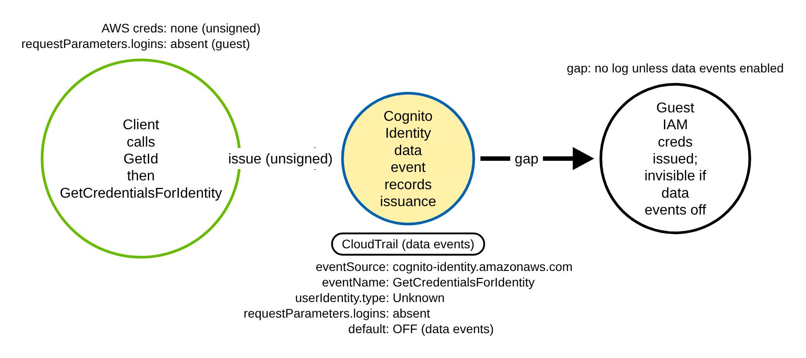
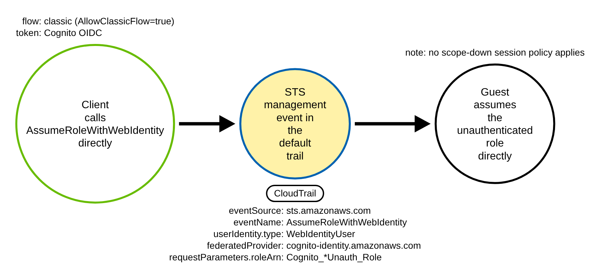
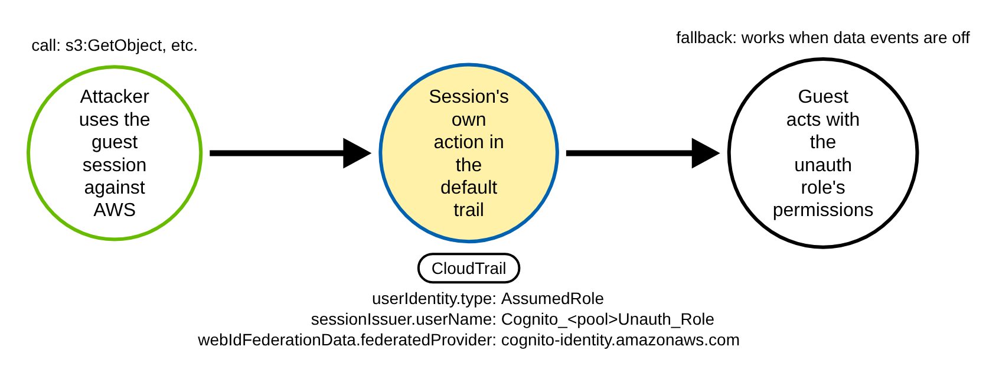
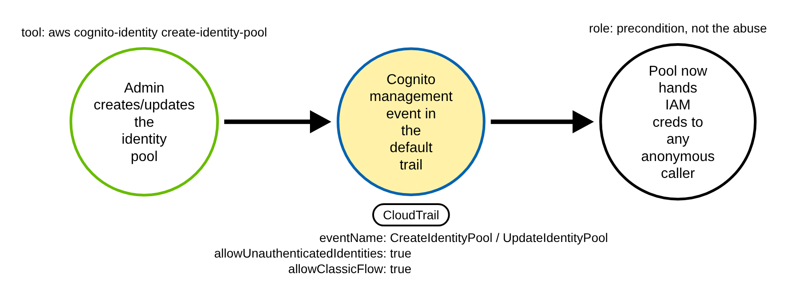
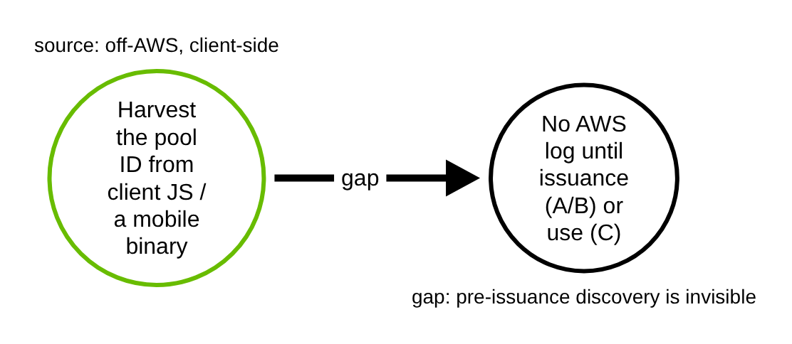

# AWS Cognito Unauthenticated Identity Pool Abuse (AWS)

> Prose uses Simplified Technical English (ASD-STE100) where practical.
> AWS service names, Cognito and STS API names, CloudTrail field names, and
> ATT&CK IDs are technical names.

## Metadata

| Key          | Value |
|--------------|-------|
| ID           | TRR9016 |
| External IDs | T1078.004 |
| Tactics      | Initial Access |
| Platforms    | AWS (Amazon Cognito) |
| Contributors | det-eng |
| Status       | draft |

### Scope Statement

This TRR covers the abuse of an Amazon Cognito **identity pool** that allows
**unauthenticated (guest)** access. A pool with `AllowUnauthenticatedIdentities=true`
hands short-lived AWS IAM credentials to any caller on the internet, with no sign-in
and no AWS account. An adversary harvests the public pool ID, requests guest
credentials, and then acts as the pool's unauthenticated IAM role. This is an
**initial access** vector: the entry is the credential issuance itself, not a stolen
key or a phished session.

The novel, detectable contribution is the **full issuance-and-use chain across both
Cognito flows**, keyed on the **default trail** so coverage survives the Cognito
data events being off. Neither Stratus Red Team nor Atomic Red Team has any Cognito
identity-pool coverage (a repository code search finds zero hits for
`GetCredentialsForIdentity` or `AllowUnauthenticatedIdentities` in either project), so
there is no overlapping technique ID to disclose. On the detection side Elastic ships
one prebuilt rule (rule id `c61fee20-4d00-4b39-a6e6-acddcc4433e2`, `new_terms`) that
covers **only** the enhanced-flow issuance data event and keys on
`userIdentity.type:"Unknown"` alone. This TRR goes further: the classic-flow
`sts:AssumeRoleWithWebIdentity` default-trail path, the downstream `AssumedRole`
session correlation that still works when data events are off, the
`requestParameters.logins`-absent refinement that removes authenticated-login false
positives, and correlation with the enabling pool-configuration event.

## Technique Overview

Amazon Cognito identity pools exchange an identity for temporary AWS credentials. A
pool can be configured to accept **unauthenticated** identities. When it is, Cognito
gives any anonymous caller a short-lived session for the pool's "unauthenticated
role" — an IAM role the pool owner chose for guests. This is a real, supported
feature. Public web and mobile apps use it so a first-time visitor can read public
content or send anonymous analytics before signing in.

The weakness is permission scope, not the feature. The guest role is attached to the
account, and whatever the role can do, an anonymous caller can do. If the role is
over-permissioned — it can read a private S3 bucket, list a DynamoDB table, or call
other services — then the pool hands that access to anyone who knows the pool ID. The
pool ID is **not a secret**: it ships in client-side JavaScript and in mobile app
binaries, so an adversary harvests it by reading the page source or unpacking the app.

With the pool ID the adversary needs no AWS account and no stored key. They call
`cognito-identity` to mint a guest identity and request credentials, then use the
returned session against AWS. From the account's point of view, an outsider is now
acting as an internal IAM role.

## Technical Background

### Where the technique is logged, and where it is not

Cognito issuance splits across two CloudTrail surfaces, and the observable surface
depends on which flow the pool uses.

- **Cognito Identity issuance (`cognito-identity.amazonaws.com`)** — `GetId`,
  `GetCredentialsForIdentity`, and `GetOpenIdToken` are CloudTrail **data events**
  (`eventCategory` `Data`, `managementEvent` `false`). They are **off by default** and
  billable. They appear only when an advanced event selector with `eventCategory=Data`
  and `resources.type=AWS::Cognito::IdentityPool` is configured on the trail. Without
  that selector, the enhanced-flow issuance produces **no log at all**.
- **AWS STS (`sts.amazonaws.com`)** — `AssumeRoleWithWebIdentity` (classic flow) and
  the downstream `AssumedRole` session actions are **management events**, present in
  the **default trail**. These survive when the Cognito data events are off.

### The anonymous caller marker, and the real discriminator

On the Cognito data event the anonymous caller is marked by
`userIdentity.type` `"Unknown"` (the literal string). `GetId` and
`GetCredentialsForIdentity` are public, **unsigned** APIs (`authtype` `none` in AWS's
own service model), so AWS cannot attribute an IAM principal. For the anonymous caller
the `userIdentity` object contains **only** `{"type":"Unknown"}` — there is no
`accountId`, no `accessKeyId`, no `principalId`, and no `arn`.

`userIdentity.type` alone is **not** the guest discriminator. An authenticated
federated login calls the **same** API and, because the request is still unsigned,
**also** shows `userIdentity.type` `"Unknown"` — confirmed by AWS's own published
example. The precise discriminator is `requestParameters.logins`:

- **absent or empty** → guest issuance (the abuse);
- **present** (a map keyed by a provider domain, e.g.
  `cognito-idp.<region>.amazonaws.com/<userpool>`) → authenticated federated login
  (benign).

Keying on `userIdentity.type` alone — as Elastic's shipped rule does — therefore
leaks a false positive on every authenticated login. The `logins`-absent refinement is
required, not optional.

Narrow issuance to `GetCredentialsForIdentity`. `GetId` only mints an `identityId` and
`GetOpenIdToken` only mints an OIDC token; neither issues AWS credentials. Treat them
as correlated precursors, not as issuance.

### Encoding gotchas on the issuance event

- On `GetCredentialsForIdentity` the pool is **not** in `requestParameters` — there is
  no `requestParameters.identityPoolId` on this event. The pool appears **only** in the
  top-level `resources[]` array (`resources[].type` `AWS::Cognito::IdentityPool`,
  `resources[].ARN`). Scope the pool from there, matched as an array
  (`resources|contains` or `resources.0.ARN`), not as a scalar. On `GetId` the pool is
  instead `requestParameters.identityPoolId`.
- `requestParameters.identityId` is `region:guid`
  (e.g. `us-east-1:trr9016-a1b2-4c3d-8e9f-0a1b2c3d4e5f`).
- `requestParameters.logins` is an object/map with dynamic provider-domain keys. A
  rule must treat "absent/empty" as both a missing key and an empty `{}`, and "present"
  as any arbitrary nested key — the provider set cannot be enumerated. CloudTrail
  records the provider **key**, not the raw token, so key on presence of a provider
  key, not its value.
- `responseElements.credentials` records `accessKeyId`, `sessionToken`, and
  `expiration` (the `secretKey` is omitted), so issuance **can** be correlated to the
  downstream session by the issued `accessKeyId`. `readOnly` is `false`
  (`GetCredentialsForIdentity` mints credentials).
- Success is the **absence** of an `errorCode` field in raw CloudTrail; Elastic's
  `event.outcome:success` is an ECS derivation.

### Classic flow is the more observable flow

In the **enhanced (simplified)** flow — the default — Cognito performs the internal
`sts:AssumeRole` with an automatic scope-down session policy **as its own service
principal**. That call is not in the customer trail. Only the two Cognito data events
record the enhanced-flow issuance, and they are off by default.

In the **classic (basic)** flow — only available when `AllowClassicFlow=true` — the
client calls `sts:AssumeRoleWithWebIdentity` **directly**. That is a management event
in the default trail: `userIdentity.type` `"WebIdentityUser"`,
`userIdentity.identityProvider` `cognito-identity.amazonaws.com`, and
`requestParameters.roleArn` pointing at the unauthenticated role. No scope-down session
policy applies, so the full unauth-role permissions are reachable. The less-secure flow
is therefore the **more observable** one.

### Downstream session provenance, and the `amr` trap

Whatever flow issued the session, its own actions are logged in the default trail with
`userIdentity.type` `"AssumedRole"`. The marker is
`userIdentity.sessionContext.sessionIssuer.userName`, the assumed role name. Cognito's
default naming is `Cognito_<poolname>Unauth_Role` (also seen: `GuestAccessRole`). For
web-identity sessions `userIdentity.sessionContext.webIdFederationData.federatedProvider`
is `cognito-identity.amazonaws.com`. A renamed unauth role defeats a hardcoded regex,
so the role-name match needs a site-specific baseline.

Do **not** key a CloudTrail rule on `amr`. The hypothesis's `amr`
(`unauthenticated`/`authenticated`) is **not** a CloudTrail field. It exists only in the
OIDC token and as the IAM trust-policy condition key `cognito-identity.amazonaws.com:amr`.
The CloudTrail-visible provenance is `federatedProvider` and `identityProvider`, not
`amr`.

## Procedures

| Procedure | ID | Name | Logged surface |
|-----------|----|------|----------------|
| A | TRR9016.AWS.A | Enhanced-flow guest issuance (default) | Cognito data event (off by default) |
| B | TRR9016.AWS.B | Classic-flow guest issuance | STS management event (default trail) |
| C | TRR9016.AWS.C | Downstream use of guest credentials | `AssumedRole` session (default trail) |
| D | TRR9016.AWS.D | Enabling misconfiguration (precondition) | Cognito management event (default trail) |
| E | TRR9016.AWS.E | Pool-ID discovery / off-AWS enumeration | none (blind spot) |

> A tool is not a procedure. The AWS CLI, boto3, `aws-sdk-js`, and Pacu's `cognito__enum`
> / `cognito__attack` modules all send the same issuance and use calls. They are the
> same procedure.

**Reading the DDMs.** Green borders are operations the client/attacker performs. Blue
borders are operations the AWS control plane performs (CloudTrail). Black borders are
the abstract effect. The pill names the telemetry; the `Key: value` lines are what a
rule matches; a shaded node is the primary detection opportunity. Unlike a single-event
technique, the chokepoint here **moves with the flow**: the Cognito data event (A), the
STS management event (B), or the downstream `AssumedRole` session (C).

### Procedure A: Enhanced-flow guest issuance (default)  (`TRR9016.AWS.A`)

The client holds zero AWS credentials. It calls `GetId` (mints a guest `identityId`,
no `logins`) then `GetCredentialsForIdentity` (the `identityId`, no `logins`). Cognito
performs the internal `sts:AssumeRole` with an automatic scope-down policy and returns
temporary credentials. This is the default flow.

- **Prerequisites:** a pool with `AllowUnauthenticatedIdentities=true`; the public pool
  ID.
- **Mechanics:** the only CloudTrail evidence is the two Cognito Identity **data
  events**, each with `userIdentity` `{"type":"Unknown"}`. The internal `sts:AssumeRole`
  is a Cognito service-principal call and is not in the customer trail.
- **Impact:** the attacker holds a guest session for the unauthenticated role.
- **Tools on this path:** any unsigned HTTP client, the AWS CLI, boto3, Amplify.

#### Detection Data Model — `TRR9016.AWS.A`

Source: [`ddms/trr9016_aws_a.json`](ddms/trr9016_aws_a.json) (Arrows app format).

**DDM summary.** The shaded node is the Cognito data event `GetCredentialsForIdentity`
(`eventSource` `cognito-identity.amazonaws.com`, `userIdentity.type` `Unknown`,
`requestParameters.logins` **absent**, pool in `resources[].ARN`). This event is a
CloudTrail **data event, off by default**. When the account does not enable Cognito
data events, this procedure is a **detection gap** — issuance is invisible and
detection falls back to Procedure C or the issued `accessKeyId`. No committed rule keys
on this surface; it is documented, because the guest-vs-authenticated discriminator
(`logins` absent) needs a field-mapping pipeline to express.

### Procedure B: Classic-flow guest issuance  (`TRR9016.AWS.B`)

The pool has `AllowClassicFlow=true`. The client calls `GetId` then `GetOpenIdToken`
(Cognito data events, off by default), then calls `sts:AssumeRoleWithWebIdentity`
**directly** against STS with the OIDC token.

- **Prerequisites:** a pool with unauthenticated identities **and**
  `AllowClassicFlow=true`; the public pool ID.
- **Mechanics:** the STS call is a **management event in the default trail**. No
  scope-down session policy applies, so the full unauth-role permissions are reachable.
- **Impact:** same guest session, with broader reach than the enhanced flow.
- **Tools on this path:** any AWS client that performs the classic flow.

#### Detection Data Model — `TRR9016.AWS.B`

Source: [`ddms/trr9016_aws_b.json`](ddms/trr9016_aws_b.json) (Arrows app format).

**DDM summary.** The shaded node is the STS management event
`AssumeRoleWithWebIdentity` (`eventSource` `sts.amazonaws.com`, `userIdentity.type`
`WebIdentityUser`, `userIdentity.identityProvider` `cognito-identity.amazonaws.com`,
`requestParameters.roleArn` the `Cognito_*Unauth_Role`). This is the only issuance
evidence a default trail carries, and it is **not** a gap. The same Cognito provenance
appears on the resulting session as
`sessionContext.webIdFederationData.federatedProvider`. Covered by the classic-flow
branch of `aws_cognito_unauthenticated_identity_use`.

### Procedure C: Downstream use of guest credentials  (`TRR9016.AWS.C`)

The attacker uses the temporary session against AWS — for example `s3:GetObject` on an
over-permissioned bucket, or `sts:GetCallerIdentity` to orient. This path is identical
for both flows.

- **Prerequisites:** a guest session from A or B.
- **Mechanics:** the session's own actions are logged in the **default trail** as
  `userIdentity.type` `AssumedRole`, with
  `sessionContext.sessionIssuer.userName` the unauthenticated role.
- **Impact:** whatever the unauthenticated role can do.
- **Tools on this path:** any AWS client.

#### Detection Data Model — `TRR9016.AWS.C`

Source: [`ddms/trr9016_aws_c.json`](ddms/trr9016_aws_c.json) (Arrows app format).

**DDM summary.** The shaded node is any default-trail event whose
`userIdentity.type` is `AssumedRole` and whose
`sessionContext.sessionIssuer.userName` matches the pool's unauthenticated role
(default pattern `Cognito_<pool>Unauth_Role`), corroborated by
`sessionContext.webIdFederationData.federatedProvider`
`cognito-identity.amazonaws.com`. This is the fallback detection surface when the
Procedure A data events are off. Covered by the downstream branch of
`aws_cognito_unauthenticated_identity_use`. A renamed unauth role is missed until the
site-specific name is added.

### Procedure D: Enabling misconfiguration (precondition)  (`TRR9016.AWS.D`)

An operator (or a compromised principal) creates or updates a pool so it accepts guests.
This is the precondition that turns on the exposure, not the abuse itself.

- **Prerequisites:** `cognito-identity:CreateIdentityPool` / `UpdateIdentityPool` /
  `SetIdentityPoolRoles`.
- **Mechanics:** a **management event in the default trail** carries
  `requestParameters.allowUnauthenticatedIdentities` `true` (the root precondition) and,
  often, `requestParameters.allowClassicFlow` `true` (which removes the automatic guest
  scope-down ceiling). The unauth-role trust policy pairs a `Federated`
  `cognito-identity.amazonaws.com` principal with the condition
  `ForAnyValue:StringLike cognito-identity.amazonaws.com:amr = unauthenticated`.
- **Impact:** none on its own; it creates the surface A/B/C abuse.
- **Tools on this path:** the AWS CLI, console, IaC.

#### Detection Data Model — `TRR9016.AWS.D`

Source: [`ddms/trr9016_aws_d.json`](ddms/trr9016_aws_d.json) (Arrows app format).

**DDM summary.** The shaded node is the Cognito management event `CreateIdentityPool`
(or `UpdateIdentityPool`) with `requestParameters.allowUnauthenticatedIdentities`
`true` and `requestParameters.allowClassicFlow` `true`. This is a posture/precondition
signal, not an intrusion. Correlating it with A/B/C raises confidence. Covered by
`aws_cognito_identity_pool_unauth_enabled`.

### Procedure E: Pool-ID discovery / off-AWS enumeration  (`TRR9016.AWS.E`)

The adversary harvests the public identity-pool ID from client-side JavaScript or a
mobile app binary, and may probe `GetId` from off-AWS before issuance.

- **Prerequisites:** access to the app's client code.
- **Mechanics:** reading a page source, unpacking an APK, or inspecting network calls
  leaves **no AWS CloudTrail record**. Detection only begins at the issuance event
  (A/B) or the downstream use (C).
- **Impact:** the attacker learns the pool ID — the only input the abuse needs.
- **Tools on this path:** a browser, a decompiler, Pacu's `cognito__enum`.

#### Detection Data Model — `TRR9016.AWS.E`

Source: [`ddms/trr9016_aws_e.json`](ddms/trr9016_aws_e.json) (Arrows app format).

**DDM summary.** There is no shaded node. Harvesting the pool ID from client JavaScript
or a mobile binary, and any pre-issuance `GetId` attempted from off-AWS, produce **no
control-plane log**. This is a **detection gap** — a documented blind spot. The first
observable event is the issuance (A/B) or the downstream use (C).

## Available Emulation Tests

Cloud attacks have no free live target, so the emulation has two halves. The runnable
half is an Atomic-Red-Team-style test
([`atomics/T1078.004/src/emulate_aws_cognito.sh`](../../../atomics/T1078.004/src/emulate_aws_cognito.sh),
with wrappers in [`atomics/T1078.004/T1078.004.yaml`](../../../atomics/T1078.004/T1078.004.yaml))
that performs the real issuance-and-use chain in **your own AWS account** and is **not
run in CI** (it needs a pool you control). The proven half is a pair of committed,
schema-faithful CloudTrail fixtures
([`detections/cloud/fixtures/trr9016/`](../../../detections/cloud/fixtures/trr9016/))
that the CI validator runs the rules over. Every object is named `trr9016-*`, the public
source IP is an RFC 5737 TEST-NET address, the benign source IP is RFC 1918 egress, and
the account is the AWS documentation account `123456789012`.

The attack fixture carries three events — the classic-flow `AssumeRoleWithWebIdentity`
(B), the downstream `AssumedRole` `GetCallerIdentity` (C), and the enabling
`CreateIdentityPool` (D). The benign baseline carries the close negatives: an
`AssumedRole` session issued by a non-guest application role
(`trr9016-app-backend-role`, no `Unauth`), an `AssumeRoleWithWebIdentity` from a
different web-identity provider (`token.actions.githubusercontent.com`, not Cognito), and
a `CreateIdentityPool` with `allowUnauthenticatedIdentities=false`.

| Procedure | Test | Status |
|-----------|------|--------|
| TRR9016.AWS.A | documented — enhanced-flow issuance is a Cognito data event, off by default; the guest discriminator (`logins` absent) needs a field-mapping pipeline. | **gap** |
| TRR9016.AWS.B | `emulate_aws_cognito.sh b` — classic-flow `AssumeRoleWithWebIdentity` to the unauth role (fixture: `WebIdentityUser`, `identityProvider` cognito, `roleArn` `Cognito_*Unauth_Role`). | **built** |
| TRR9016.AWS.C | `emulate_aws_cognito.sh c` — downstream `AssumedRole` use (fixture: `sessionIssuer.userName` `Cognito_trr9016PoolUnauth_Role`, public source IP). | **built** |
| TRR9016.AWS.D | `emulate_aws_cognito.sh d` — `CreateIdentityPool` with `allowUnauthenticatedIdentities=true` (fixture). | **built** |
| TRR9016.AWS.E | documented gap — pool-ID discovery leaves no CloudTrail record. | **gap** |

## Detection Strategy

Compare the DDMs. The chokepoint moves with the flow, so coverage is built on the
**default trail** first — the surface that survives the Cognito data events being off —
and the enhanced-flow data event is documented as a gap.

**Telemetry requirement.** A CloudTrail trail (or Event history) capturing management
events covers Procedures B, C, and D. Procedure A additionally requires an advanced
event selector with `eventCategory=Data` and `resources.type=AWS::Cognito::IdentityPool`;
without it, enhanced-flow issuance is invisible.

**Strategy 1 — unauthenticated use (covers B and C).**
Match CloudTrail events where either (a) `userIdentity.type` is `AssumedRole` and
`sessionContext.sessionIssuer.userName` contains the Cognito unauth-role marker
(`Unauth`); or (b) `eventName` is `AssumeRoleWithWebIdentity`, `userIdentity.identityProvider`
is `cognito-identity.amazonaws.com`, **and** `requestParameters.roleArn` contains the
unauth-role marker. Branch (a) is the downstream use (C); branch (b) is the classic-flow
issuance (B).

- Sensor: CloudTrail (default trail).
- Rule: [`detections/sigma/T1078.004/aws_cognito_unauthenticated_identity_use.yml`](../../../detections/sigma/T1078.004/aws_cognito_unauthenticated_identity_use.yml) (built).

**Strategy 2 — enabling misconfiguration (covers D).**
Match `eventSource` `cognito-identity.amazonaws.com`, `eventName` in
{`CreateIdentityPool`, `UpdateIdentityPool`}, and
`requestParameters.allowUnauthenticatedIdentities` `true`.

- Sensor: CloudTrail (default trail).
- Rule: [`detections/sigma/T1078.004/aws_cognito_identity_pool_unauth_enabled.yml`](../../../detections/sigma/T1078.004/aws_cognito_identity_pool_unauth_enabled.yml) (built).

**The hard negative control.** Benign anonymous guest access emits byte-for-byte
identical issuance events, continuously, for many apps. The benign fixture is a strong,
close negative: an `AssumedRole` session issued by `trr9016-app-backend-role` (a
non-guest role, so no `Unauth` match), an `AssumeRoleWithWebIdentity` from the GitHub
OIDC provider (not Cognito), and a pool created with
`allowUnauthenticatedIdentities=false`. A pass proves the rules key on the unauth-role
marker and the Cognito provenance, not on the shape alone.

**Demonstrated gaps.**

- **Enhanced-flow issuance (Procedure A)** is a Cognito data event, off by default, and
  no committed rule keys on it. The guest discriminator is `requestParameters.logins`
  absent — a map test that needs a field-mapping pipeline. Without data events,
  detection falls back to Strategy 1.
- **Renamed unauth role** defeats the `Unauth` marker on both the downstream and
  classic-flow branches; baseline and add the site-specific role name.
- **Legitimate guest access** matches Strategy 1 wherever a pool genuinely offers
  guests; pair with a first-seen overlay (new pool, new source IP/ASN, unexpected
  `userAgent`) before alerting.
- **Pool-ID discovery (Procedure E)** leaves no control-plane record.

## Detections

| Strategy | Covers | Sigma rule | Sensor |
|----------|--------|------------|--------|
| 1 (unauthenticated use) | B, C | [`detections/sigma/T1078.004/aws_cognito_unauthenticated_identity_use.yml`](../../../detections/sigma/T1078.004/aws_cognito_unauthenticated_identity_use.yml) | CloudTrail |
| 2 (enabling config) | D | [`detections/sigma/T1078.004/aws_cognito_identity_pool_unauth_enabled.yml`](../../../detections/sigma/T1078.004/aws_cognito_identity_pool_unauth_enabled.yml) | CloudTrail |

The validator
[`detections/validate_cloud_detections.py`](../../../detections/validate_cloud_detections.py)
runs each rule over the recorded attack fixture (it must fire, and the match must carry
the `trr9016-` marker) and over the benign baseline (it must fire on nothing). The
benign baseline is the hard part: a Cognito-issued session for a non-guest role, a
non-Cognito web-identity assumption, and a guest-disabled pool create — so the pass
proves the rules key on the unauthenticated marker, not on Cognito activity alone.

The idea is not new to vendors: Elastic ships "AWS Cognito Unauthenticated Identity
Pool Credentials Issued" (rule id `c61fee20-4d00-4b39-a6e6-acddcc4433e2`), and
TrailDiscover catalogs the `GetCredentialsForIdentity` and `GetId` events. The
contribution here is narrower and specific: default-trail coverage of the classic-flow
and downstream surfaces that Elastic's data-event rule does not touch, the
`logins`-absent refinement that removes its authenticated-login false positives, and a
runnable emulation with recorded CloudTrail fixtures — which neither Stratus Red Team
nor Atomic Red Team ships for Cognito at all.

## References

- MITRE ATT&CK, T1078.004 Valid Accounts: Cloud Accounts:
  <https://attack.mitre.org/techniques/T1078/004/>
- AWS, Understanding Amazon Cognito CloudTrail entries (example `GetId` /
  `GetCredentialsForIdentity` records, `userIdentity` `{"type":"Unknown"}`):
  <https://docs.aws.amazon.com/cognito/latest/developerguide/understanding-amazon-cognito-entries.html>
- AWS, CloudTrail userIdentity element (type enum, `sessionContext.sessionIssuer`,
  `webIdFederationData.federatedProvider`):
  <https://docs.aws.amazon.com/awscloudtrail/latest/userguide/cloudtrail-event-reference-user-identity.html>
- AWS, GetCredentialsForIdentity API reference (public, unsigned; no IAM policy
  evaluation at issuance):
  <https://docs.aws.amazon.com/cognitoidentity/latest/APIReference/API_GetCredentialsForIdentity.html>
- AWS, CreateIdentityPool API reference (`AllowUnauthenticatedIdentities`,
  `AllowClassicFlow`):
  <https://docs.aws.amazon.com/cognitoidentity/latest/APIReference/API_CreateIdentityPool.html>
- AWS, botocore Cognito Identity service model (`authtype` `none` for the issuance
  APIs):
  <https://github.com/boto/botocore/blob/develop/botocore/data/cognito-identity/2014-06-30/service-2.json>
- Elastic, AWS Cognito Unauthenticated Identity Pool Credentials Issued (prior art,
  data-event, type-only):
  <https://www.elastic.co/guide/en/security/current/aws-cognito-unauthenticated-identity-pool-credentials-issued.html>
- hackingthe.cloud, Overpermissioned AWS Cognito Identity Pools:
  <https://hackingthe.cloud/aws/exploitation/cognito_identity_pools/>
- TrailDiscover, CognitoIdentity events (`GetCredentialsForIdentity`, `GetId`):
  <https://traildiscover.cloud/>
- Rhino Security Labs, Pacu (`cognito__enum` / `cognito__attack` modules):
  <https://github.com/RhinoSecurityLabs/pacu>
- Stratus Red Team, AWS attack techniques (no Cognito coverage — novelty
  disambiguation): <https://stratus-red-team.cloud/attack-techniques/AWS/>
- Atomic Red Team, T1078.004 (no Cognito atomics — novelty disambiguation):
  <https://github.com/redcanaryco/atomic-red-team/blob/master/atomics/T1078.004/T1078.004.md>
- TRR method:
  <https://github.com/tired-labs/techniques/blob/main/docs/TECHNIQUE-RESEARCH-REPORT.md>
