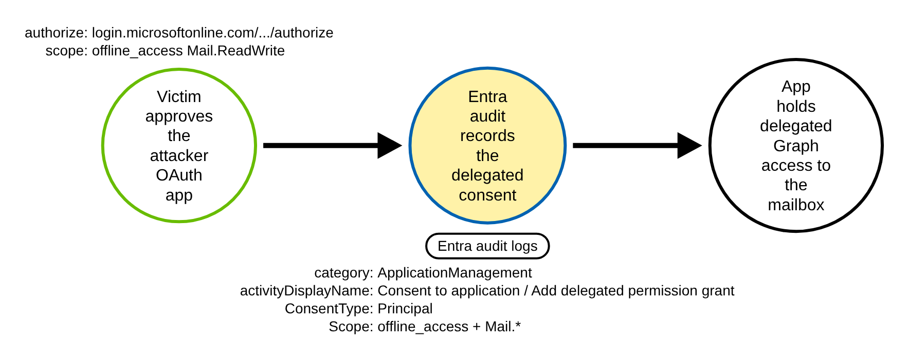
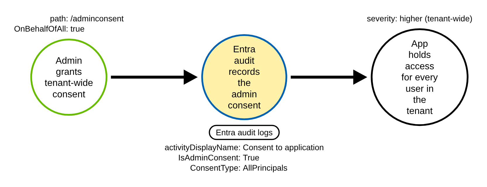
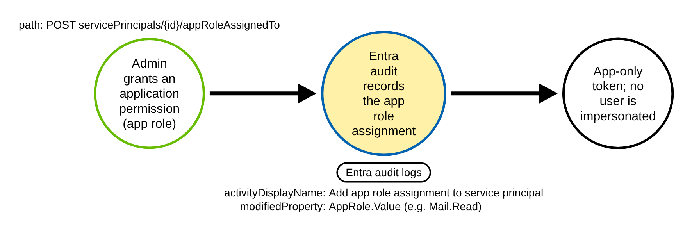
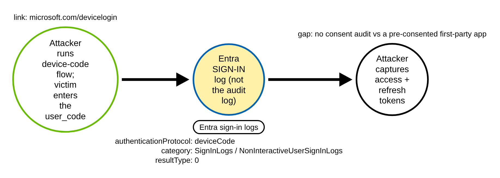
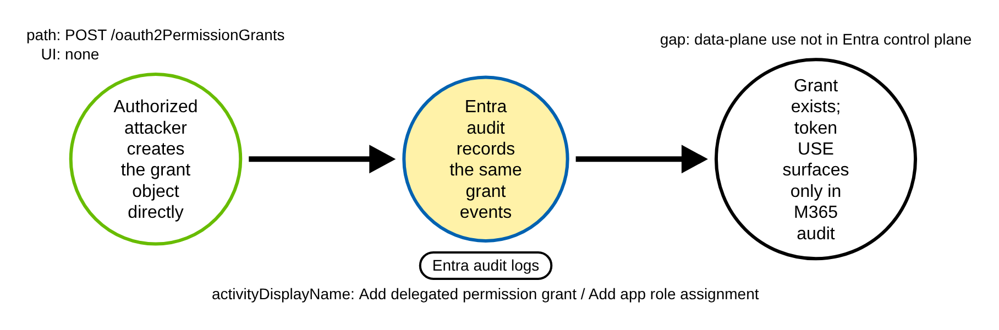

# Entra Illicit OAuth Consent Grant and Device-Code Phishing (Azure)

> Prose uses Simplified Technical English (ASD-STE100) where practical.
> Microsoft Entra / Graph object names, audit and sign-in field names, OAuth
> scope names, and ATT&CK IDs are technical names.

## Metadata

| Key          | Value |
|--------------|-------|
| ID           | TRR9017 |
| External IDs | T1528, T1566.002 |
| Tactics      | Credential Access |
| Platforms    | Azure / Microsoft Entra ID |
| Contributors | det-eng |
| Status       | draft |

### Scope Statement

This TRR covers two loosely-coupled ways an adversary steals an OAuth access or
refresh token in Microsoft Entra ID without stealing a password: an **illicit
consent / permission grant** to an application the adversary controls, and
**device-code phishing**. Both end with the adversary holding a token that acts
as a user or as an app, with whatever the granted scope allows — often mailbox
and file access.

The novel, detectable contribution is the **adversary-emulation and committed CI
fixtures** for T1528, not the detection idea. The detection logic is well-trodden
(Microsoft security-operations guidance; Azure Sentinel `SuspiciousOAuthApp_*`
and role-grant rules; Elastic's illicit-consent rule; Splunk's device-code rule).
What is missing upstream is a runnable test and a recorded log. Neither Stratus
Red Team nor Atomic Red Team emulates this. Atomic Red Team ships two T1528
atomics, and both are Azure Functions code-injection to read a Functions
managed-identity token — unrelated to consent; its Azure-AD, Office-365 and
Google-Workspace indexes list T1528 only as a `[CONTRIBUTE A TEST]` placeholder.
Stratus Red Team has no consent or device-code technique; its adjacent Entra
techniques (`entra-id.persistence.backdoor-application`,
`backdoor-application-sp`) add a **client secret** to an app or service principal
(T1098.001), which is a different activity than creating an
`oauth2PermissionGrant` or `appRoleAssignment`, and `backdoor-managed-identity-fic`
is the subject of TRR9013.

## Technique Overview

A Microsoft Entra application does not need the user's password to read the
user's data. It asks the user (or an admin) to **consent** to a set of OAuth
scopes, such as `Mail.ReadWrite` or `Files.ReadWrite.All`. After consent, Entra
issues the application access and refresh tokens for those scopes. This is the
normal way third-party apps integrate.

Illicit consent abuses that flow. The adversary registers an application, then
sends the victim an OAuth authorize URL that asks for high-value scopes plus
`offline_access` (which adds a long-lived refresh token). If the victim approves,
the adversary's app holds a token that reads the victim's mail and files from
anywhere — no password, and multi-factor authentication does not help, because
the user already authenticated before the consent screen. An admin who approves
tenant-wide consent grants that access for **every** user at once.

Device-code phishing takes a different route to the same prize. The OAuth 2.0
device authorization grant is built for input-constrained devices (a smart TV, a
headless CLI). The adversary starts the device flow, gets a `user_code` and the
`microsoft.com/devicelogin` URL, and sends them to the victim. The victim enters
the code and authenticates. The adversary polls the token endpoint and captures
the resulting access and refresh tokens. The victim sees a normal Microsoft login
page, so the lure is convincing.

The two techniques leave traces in **two different log streams**. Illicit consent
writes an Entra **audit** event. Device-code phishing writes an Entra **sign-in**
event. They are not one chokepoint, and a detection must watch both.

## Technical Background

### What the grant looks like in the Entra audit log

The Entra ID activity logs reach this repo as the Azure Monitor diagnostic
stream (`product: azure`): the Microsoft Graph `directoryAudit` and `signIn`
objects wrapped in a diagnostic envelope with `resourceId`
`/tenants/{tid}/providers/Microsoft.aadiam` and a top-level `category`. Field
casing is **camelCase** on this ingestion path (`properties.targetResources`,
`modifiedProperties`, `displayName`, `newValue`), matching the TRR9013 fixtures;
the Graph / PowerShell export uses PascalCase instead.

Every logged grant procedure converges on one successful audit event. The
structural gate is:

- top-level `category` is `AuditLogs` (the diagnostic log-category router);
- `properties.category` is `ApplicationManagement`;
- `properties.loggedByService` is `Core Directory`;
- `properties.result` is `success`; and
- `properties.activityDisplayName` is one of exactly three operations —
  `Consent to application`, `Add delegated permission grant`, or `Add app role
  assignment to service principal` (the canonical literal has **no** "the").

The target of the grant is the application's service principal, so
`properties.targetResources[].type` is `ServicePrincipal` — a rule must not
hard-require `Application`.

### The discriminator is the granted scope

The structural gate alone fires on routine single-sign-on consent and on every
legitimate app onboarding, so it is a funnel, not a detection. The discriminator
is the granted scope or role, carried inside
`properties.targetResources[].modifiedProperties[]`. Read these **by
`displayName`, never by array index** — the array order is not stable across
tenants. The relevant names are:

- `ConsentAction.Permissions` — the delegated grant detail;
- `ConsentContext.IsAdminConsent` — `"True"` (admin / tenant-wide) or `"False"`
  (end-user);
- `ConsentContext.OnBehalfOfAll` — `"True"` on a tenant-wide grant;
- `DelegatedPermissionGrant.Scope` and `DelegatedPermissionGrant.ConsentType` —
  on `Add delegated permission grant`; and
- `AppRole.Value` — the application permission on `Add app role assignment to
  service principal`.

A grant is high-risk when its scope list contains `offline_access` together with
a data scope (`Mail.Read`, `Mail.ReadWrite`, `Mail.Send`, `MailboxSettings.*`,
`Files.Read.All`, `Files.ReadWrite.All`, `Sites.ReadWrite.All`, `Chat.Read*`,
`EWS.AccessAsUser.All`, `full_access_as_app`), or any `*.ReadWrite.All`,
`RoleManagement.ReadWrite.Directory` or `AppRoleAssignment.ReadWrite.All`, or
when the consent is tenant-wide (`ConsentType` `AllPrincipals` /
`IsAdminConsent` `True`).

### Encoding gotcha: the scope list is a double-encoded string

`modifiedProperties[].newValue` for `ConsentAction.Permissions` is a **JSON
string whose body is a bracketed grant list**, for example
`"[] => [[Id: grantA, ClientId: ..., PrincipalId: ..., ResourceId: ...,
ConsentType: Principal, Scope: offline_access Mail.ReadWrite Files.ReadWrite.All
User.Read, ...]]; "`. To parse it a pipeline must trim the wrapping quotes, then
regex `ConsentType:\s*([^,\]]+)` and `Scope:\s*([^,\]]+)`. The `Scope` list is
**space-separated**, not a JSON array. Scalar `newValue` fields are themselves
quoted strings (`"\"True\""`, `"\"False\""`), so a comparison must trim the quotes
too.

### What device-code phishing looks like in the sign-in log

Device-code phishing is **not** in the audit log. It is a separate signal in the
Entra sign-in logs:

- top-level `category` is `SignInLogs` or `NonInteractiveUserSignInLogs`;
- `properties.authenticationProtocol` is `deviceCode`;
- the sign-in succeeds (`properties.status.errorCode` `0` / `resultType` `"0"`);
  and
- `properties.originalTransferMethod` is `deviceCodeFlow` (a second predicate).

Device-code sign-ins land **predominantly in `NonInteractiveUserSignInLogs`**, so
a rule must union both tables (`SigninLogs` + `AADNonInteractiveUserSignInLogs`)
or it misses them.

### Why the technique works

The grant leaves a clean audit event, but the grant also looks like every
legitimate integration, so the only honest discriminator is the scope. Device
code is a legitimate protocol, so its presence alone is noisy. And both the audit
event and the sign-in event record the **grant or the authentication**, not the
later **use** of the token: mailbox and file reads through the granted Graph token
surface in the Microsoft 365 / Exchange Online Unified Audit Log (the data plane),
out of band from the Entra control plane.

## Procedures

| Procedure | ID | Name | Logged where |
|-----------|----|------|--------------|
| A | TRR9017.AZR.A | End-user (delegated) illicit consent | Entra audit |
| B | TRR9017.AZR.B | Admin / tenant-wide (AllPrincipals) consent | Entra audit |
| C | TRR9017.AZR.C | Application-permission (app role) grant to a service principal | Entra audit |
| D | TRR9017.AZR.D | Device-code phishing (token capture) | Entra sign-in |
| E | TRR9017.AZR.E | Direct Graph creation of the grant object | Entra audit |

> A tool is not a procedure. The Graph API, `az ad app permission grant`, the
> Microsoft Graph PowerShell cmdlets, and the Entra portal all write the same
> consent grant. They are the same procedure.

**Reading the DDMs.** Green borders are operations the client/attacker performs.
Blue borders are operations the Entra control plane records (audit log or sign-in
log). Black borders are the abstract effect. The pill names the telemetry; the
`Key: value` lines are what a rule matches; a shaded node is the primary detection
opportunity. The consent/grant audit event is the shared chokepoint for A, B, C
and E; Procedure D has its own chokepoint in the sign-in log.

### Procedure A: End-user (delegated) illicit consent  (`TRR9017.AZR.A`)

The victim clicks an attacker OAuth authorize URL
(`login.microsoftonline.com/common/oauth2/v2.0/authorize?...&scope=offline_access
Mail.ReadWrite ...`) and approves. This is classic consent phishing.

- **Prerequisites:** a registered attacker application; a victim who approves the
  consent screen.
- **Mechanics:** logged as audit `Consent to application`
  (`ConsentContext.IsAdminConsent` `False`) plus `Add delegated permission grant`
  (`DelegatedPermissionGrant.ConsentType` `Principal`). The granted scope carries
  `offline_access` with a data scope.
- **Impact:** the app reads the single victim's mail and files, with a long-lived
  refresh token.

#### Detection Data Model — `TRR9017.AZR.A`

Source: [`ddms/trr9017_azr_a.json`](ddms/trr9017_azr_a.json) (Arrows app format).

**DDM summary.** The shaded node is the Entra audit event (`properties.category`
ApplicationManagement, `loggedByService` Core Directory, `activityDisplayName`
`Consent to application` / `Add delegated permission grant`), whose
`targetResources[].modifiedProperties[]` `ConsentAction.Permissions` /
`DelegatedPermissionGrant.Scope` carries `offline_access` plus `Mail.ReadWrite`
and `Files.ReadWrite.All` with `ConsentType` `Principal`. This is the chokepoint
for A, B, C and E.

### Procedure B: Admin / tenant-wide (AllPrincipals) consent  (`TRR9017.AZR.B`)

A compromised or social-engineered admin grants tenant-wide consent (the
`/adminconsent` endpoint or the portal "Grant admin consent" button), on behalf of
all users.

- **Prerequisites:** an identity that can grant admin consent.
- **Mechanics:** the same audit events, but with
  `ConsentContext.IsAdminConsent` `True`, `ConsentContext.OnBehalfOfAll` `True`,
  and `DelegatedPermissionGrant.ConsentType` `AllPrincipals`.
  `ConsentAction.Reason` may read `Risky application detected`.
- **Impact:** the app reads mail and files for **every** user in the tenant.

#### Detection Data Model — `TRR9017.AZR.B`

Source: [`ddms/trr9017_azr_b.json`](ddms/trr9017_azr_b.json) (Arrows app format).

**DDM summary.** Same shaded audit chokepoint as A; the signal that raises
severity is `ConsentType` `AllPrincipals` / `IsAdminConsent` `True` /
`OnBehalfOfAll` `True`. The consent rule matches it structurally through the
`ConsentType: AllPrincipals` token.

### Procedure C: Application-permission (app role) grant to a service principal  (`TRR9017.AZR.C`)

An admin or a compromised privileged identity grants an **application permission**
(an app role) to the app's service principal — through Graph
`POST .../servicePrincipals/{id}/appRoleAssignedTo` or the portal. The resulting
token is app-only; no user is impersonated.

- **Prerequisites:** an identity that can assign app roles.
- **Mechanics:** logged as audit `Add app role assignment to service principal`,
  with `modifiedProperties[].displayName` `AppRole.Value` naming the application
  permission (for example `Mail.Read` as an app-only permission).
- **Impact:** the app reads mail or files tenant-wide with its own identity, with
  no user sign-in needed afterward.

#### Detection Data Model — `TRR9017.AZR.C`

Source: [`ddms/trr9017_azr_c.json`](ddms/trr9017_azr_c.json) (Arrows app format).

**DDM summary.** The shaded node is the audit event
`activityDisplayName` `Add app role assignment to service principal`, whose
`modifiedProperties[]` `AppRole.Value` carries a sensitive application permission.
It is the same audit chokepoint, matched on the app-role value rather than a
delegated scope list.

### Procedure D: Device-code phishing (token capture)  (`TRR9017.AZR.D`)

The attacker starts the OAuth 2.0 device-authorization grant, sends the victim the
`user_code` and the `microsoft.com/devicelogin` link, lets the victim
authenticate, then polls the token endpoint and captures the access and refresh
tokens.

- **Prerequisites:** a public client the attacker can drive the device flow with —
  often a **pre-consented first-party app** such as Microsoft Azure CLI
  (`04b07795-8ddb-461a-bbee-02f9e1bf7b46`), Microsoft Graph PowerShell
  (`14d82eec-204b-4c2f-b7e8-296a70dab67e`) or Office
  (`29d9ed98-a469-4536-ade2-f981bc1d605e`).
- **Mechanics:** logged **only** in the sign-in logs —
  `properties.authenticationProtocol` `deviceCode`, `resultType` `0`, the client
  `appDisplayName`/`appId`, the victim UPN, and the attacker IP. This record lands
  mostly in `NonInteractiveUserSignInLogs`, followed by refresh-token
  (non-interactive) sign-ins.
- **Impact:** the attacker holds the victim's tokens for the client app's scopes.

#### Detection Data Model — `TRR9017.AZR.D`

Source: [`ddms/trr9017_azr_d.json`](ddms/trr9017_azr_d.json) (Arrows app format).

**DDM summary.** The shaded node is the **sign-in** event (category
`SignInLogs` / `NonInteractiveUserSignInLogs`,
`properties.authenticationProtocol` `deviceCode`, `originalTransferMethod`
`deviceCodeFlow`, success) — a different log from A–C, E. **Partial gap:** when the
abused client is a pre-consented first-party app, there is **no** new
`Consent to application` audit event, so the device-code sign-in record is the only
control-plane trace of the phish.

### Procedure E: Direct Graph creation of the grant object  (`TRR9017.AZR.E`)

An attacker who already holds a privileged token creates the
`oauth2PermissionGrant` (`POST /oauth2PermissionGrants`) or the
`appRoleAssignment` directly through Graph, with no interactive consent screen.

- **Prerequisites:** a privileged token that can write grants.
- **Mechanics:** still logged as the same audit `Add delegated permission grant`
  or `Add app role assignment to service principal` events — this is **not** a gap
  at the grant. The gap is the downstream **use** of the token (reading mail or
  files via Graph), which is a data-plane action in the M365 / Exchange Online
  Unified Audit Log, not the Entra audit or sign-in logs.
- **Impact:** the grant appears with no user approval and no device-code sign-in.

#### Detection Data Model — `TRR9017.AZR.E`

Source: [`ddms/trr9017_azr_e.json`](ddms/trr9017_azr_e.json) (Arrows app format).

**DDM summary.** The shaded node is the same audit chokepoint as A–C, reached
with no interactive UI; `initiatedBy` is the attacker's own privileged identity
rather than a victim. The token's later use is the blind spot and is shown as an
unlogged (data-plane) edge.

## Available Emulation Tests

Cloud attacks have no free live target, so the emulation has two halves. The
runnable half is an Atomic-Red-Team-style test
([`atomics/T1528/src/emulate_entra_consent.sh`](../../../atomics/T1528/src/emulate_entra_consent.sh),
with wrappers in [`atomics/T1528/T1528.yaml`](../../../atomics/T1528/T1528.yaml))
that performs the real consent grant and/or device-code flow in **your own Entra
tenant** and is **not run in CI** (it needs a tenant, an app registration, and a
test user). The proven half is a set of committed, schema-faithful fixtures
([`detections/cloud/fixtures/trr9017/`](../../../detections/cloud/fixtures/trr9017/))
that the CI validator runs the rules over. Every object is named `trr9017-*`, the
record ids carry the `_TRR9017` suffix, the attacker source IP is the RFC 5737
TEST-NET address `203.0.113.66`, and the benign source IP is `198.51.100.23`.

| Procedure | Test | Status |
|-----------|------|--------|
| TRR9017.AZR.A | `emulate_entra_consent.sh a` — end-user delegated consent to high-privilege scopes (fixtures: `attack.json` / `benign.json`). | **built** |
| TRR9017.AZR.B | documented — admin tenant-wide (AllPrincipals) consent; same audit chokepoint, higher severity. | backlog |
| TRR9017.AZR.C | documented — app-role (application permission) grant to a service principal; same audit chokepoint. | backlog |
| TRR9017.AZR.D | `emulate_entra_consent.sh d` — device-code sign-in (fixtures: `attack_signin.json` / `benign_signin.json`). | **built** |
| TRR9017.AZR.E | documented — direct Graph creation of the grant; token use is an M365 data-plane gap. | backlog |

## Detection Strategy

Compare the DDMs. A, B, C and E converge on one Entra **audit** event, separated
from benign consent only by the granted scope or role. D is a separate signal in
the Entra **sign-in** log. The two signals are loosely coupled: alert on each
independently, and correlate them by user + app + time window for high-confidence
illicit-consent-then-use.

**Telemetry requirement.** Entra ID audit and sign-in logs routed through
Diagnostic Settings to Log Analytics / Sentinel or an Event Hub — they are not
retained long or queryable at scale by default, and `authenticationProtocol` is
fully populated only with Entra ID P1/P2.

**Strategy 1 — consent/grant chokepoint (covers A, B, C, E).**
Match the structural gate (`properties.category` `ApplicationManagement`,
`loggedByService` `Core Directory`, `result` `success`, `activityDisplayName` one
of the three grant operations) **and** a high-privilege scope or role token inside
`properties.targetResources`. The rule matches the scope tokens as text with
`|contains` (the `newValue` is the double-encoded, space-separated string above),
which is a coarse match: a production pipeline should decode the string, parse the
`Scope` list, match the modified property by `displayName`, and apply a known-good
app-ID allowlist.

- Sensor: Entra ID audit log.
- Rule: [`detections/sigma/T1528/entra_illicit_oauth_consent_grant.yml`](../../../detections/sigma/T1528/entra_illicit_oauth_consent_grant.yml) (built).

**Strategy 2 — device-code sign-in (covers D).**
Match sign-in events whose top-level `category` is `SignInLogs` or
`NonInteractiveUserSignInLogs` **and** `properties.authenticationProtocol` is
`deviceCode`. The category union is required, because device-code sign-ins land
mostly in the non-interactive table.

- Sensor: Entra ID sign-in log.
- Rule: [`detections/sigma/T1528/entra_device_code_authentication.yml`](../../../detections/sigma/T1528/entra_device_code_authentication.yml) (built).

**Hard negative controls.** The Strategy 1 benign baseline is the **same**
`Consent to application` structural event to `trr9017-sso-app`, but with low-risk
SSO scopes (`openid profile email User.Read`) — so a pass proves the rule keys on
the high-privilege scope, not on the consent event alone. The Strategy 2 benign
baseline is a `NonInteractiveUserSignInLogs` record for the **same** Azure CLI app
and user, but with `authenticationProtocol` `none` (an ordinary refresh / silent
sign-in) — so a pass proves the rule keys on `deviceCode`, not on the
non-interactive sign-in alone.

**Demonstrated gaps and limits.**

- **Token use, not grant.** Mail and file reads through the granted Graph token
  appear in the M365 / Exchange Online Unified Audit Log, not the Entra control
  plane. This is the Procedure E blind spot.
- **Pre-consented first-party device code (Procedure D).** Against Azure CLI /
  Graph PowerShell / Office there is no new consent audit event — only the
  device-code sign-in and later refresh sign-ins.
- **RSC consent.** Resource-specific consent is logged as
  `Grant contextual consent to application` under `properties.category`
  `GroupManagement`, so it evades the `ApplicationManagement` gate.
- **False positives.** The structural gate matches a large volume of benign SSO
  and onboarding. Even the high-privilege marker fires on legitimate
  backup/migration/CRM/security SaaS that request `offline_access` with mailbox or
  file scopes, and on legitimate admin AllPrincipals grants — allowlist known app
  IDs and layer first-seen / initiator-risk. Device code is legitimate for
  input-constrained devices, so baseline it per app and user.

**Coverage summary.**

| Procedure | Covered by | How |
|-----------|-----------|-----|
| A | Strategy 1 | audit grant event; `offline_access` + `Mail.*`/`Files.*`, `ConsentType` Principal |
| B | Strategy 1 | same event; `ConsentType` AllPrincipals / `IsAdminConsent` True |
| C | Strategy 1 | `Add app role assignment to service principal`; `AppRole.Value` |
| D | Strategy 2 | sign-in `authenticationProtocol` deviceCode (union both tables) |
| E | Strategy 1 (grant); gap at token use | same audit grant event; use is M365 data plane |

## Detections

| Strategy | Covers | Sigma rule | Sensor |
|----------|--------|------------|--------|
| 1 (consent/grant chokepoint) | A, B, C, E | [`detections/sigma/T1528/entra_illicit_oauth_consent_grant.yml`](../../../detections/sigma/T1528/entra_illicit_oauth_consent_grant.yml) | Entra ID audit log |
| 2 (device-code sign-in) | D | [`detections/sigma/T1528/entra_device_code_authentication.yml`](../../../detections/sigma/T1528/entra_device_code_authentication.yml) | Entra ID sign-in log |

The validator
[`detections/validate_cloud_detections.py`](../../../detections/validate_cloud_detections.py)
runs each rule over its attack fixture (it must fire, and the match must carry the
`trr9017`/`_TRR9017` marker) and over its benign baseline (it must fire on
nothing). Strategy 1 runs over `attack.json` (high-privilege consent) and
`benign.json` (low-risk SSO consent); Strategy 2 runs over `attack_signin.json`
(device-code) and `benign_signin.json` (a non-device-code non-interactive
sign-in). Each benign baseline hits the same structural shape as its attack and
differs only on the discriminating field, so the passes prove the rules key on the
scope and on `deviceCode`, not on the grant or sign-in event alone.

Prior detection art is vendor-only and well established: Microsoft's
security-operations-applications guidance, Azure Sentinel's
`SuspiciousOAuthApp_OfflineAccess` / `MaliciousOAuthApp_*` /
`AzureADRoleManagementPermissionGrant` analytics, Elastic's
illicit-consent-grant rule, and Splunk's `azure_ad_device_code_authentication`.
The contribution here is the runnable emulation and the committed CI fixtures for
T1528, which neither Stratus Red Team nor Atomic Red Team ships.

## References

- MITRE ATT&CK, T1528 Steal Application Access Token:
  <https://attack.mitre.org/techniques/T1528/>
- MITRE ATT&CK, T1566.002 Phishing: Spearphishing Link:
  <https://attack.mitre.org/techniques/T1566/002/>
- Microsoft, Review permissions granted to apps — Entra audit activities
  (Core Directory / ApplicationManagement; the three grant operations):
  <https://learn.microsoft.com/entra/identity/enterprise-apps/app-perms-audit-logs>
- Microsoft, Microsoft Entra security operations for applications
  (`DelegatedPermissionGrant.Scope`, `ConsentContext.IsAdminConsent`,
  `AppRole.Value`; device code in the sign-in log):
  <https://learn.microsoft.com/entra/architecture/security-operations-applications>
- Microsoft, AuditLogs table reference (OperationName, ActivityDisplayName,
  Category, LoggedByService, Result, TargetResources, InitiatedBy):
  <https://learn.microsoft.com/azure/azure-monitor/reference/tables/auditlogs>
- Microsoft, SigninLogs table reference (AuthenticationProtocol enum, including
  `deviceCode`): <https://learn.microsoft.com/azure/azure-monitor/reference/tables/signinlogs>
- Microsoft, signIn resource (`authenticationProtocol`, `originalTransferMethod`
  `deviceCodeFlow`): <https://learn.microsoft.com/graph/api/resources/signin?view=graph-rest-beta>
- Microsoft, oAuth2PermissionGrant resource (`consentType` AllPrincipals /
  Principal, space-separated `scope`):
  <https://learn.microsoft.com/graph/api/resources/oauth2permissiongrant?view=graph-rest-1.0>
- Atomic Red Team, T1528 Steal Application Access Token (consent / device-code is
  only a `[CONTRIBUTE A TEST]` placeholder):
  <https://github.com/redcanaryco/atomic-red-team/blob/master/atomics/T1528/T1528.md>
- Stratus Red Team, attack-technique registry (no consent or device-code
  technique):
  <https://github.com/DataDog/stratus-red-team/blob/main/v2/internal/attacktechniques/main.go>
- TRR method:
  <https://github.com/tired-labs/techniques/blob/main/docs/TECHNIQUE-RESEARCH-REPORT.md>
