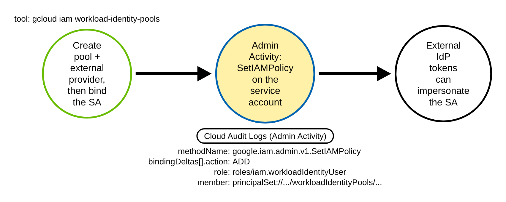
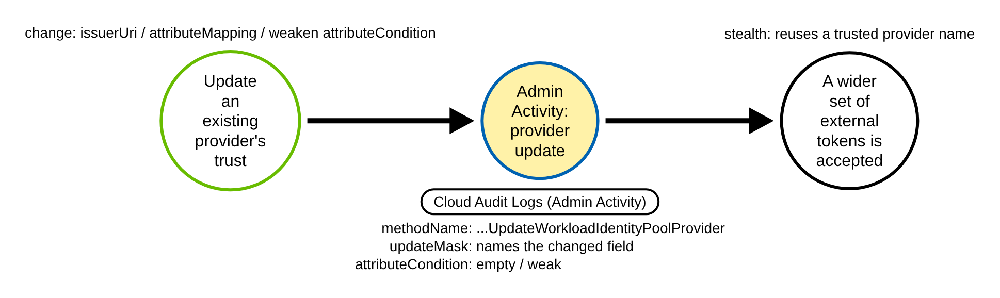
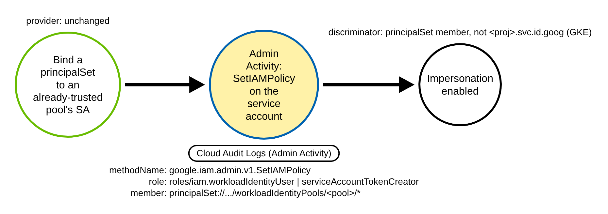
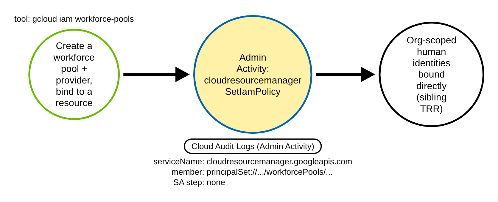
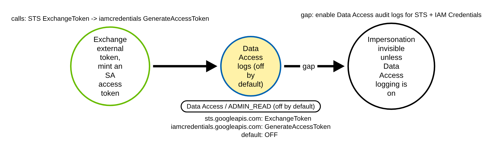

# GCP Workload Identity Federation Abuse (GCP)

> Prose uses Simplified Technical English (ASD-STE100) where practical.
> GCP service names, IAM API and method names, Cloud Audit Log field names, and
> ATT&CK IDs are technical names.

## Metadata

| Key          | Value |
|--------------|-------|
| ID           | TRR9018 |
| External IDs | T1098.001, T1199 |
| Tactics      | Persistence, Privilege Escalation |
| Platforms    | GCP |
| Contributors | det-eng |
| Status       | draft |

### Scope Statement

This TRR covers **Workload Identity Federation (WIF) backdoors** in Google Cloud: an
adversary with IAM write rights trusts an **external** identity source (an OIDC issuer,
an AWS account, or a SAML IdP) and then binds a federated `principalSet` to a service
account, so an identity the adversary controls outside GCP can impersonate that service
account. The result is durable persistence and often privilege escalation, with no new
service-account key and no stored credential.

The report keys on the two **install** chokepoints, both always-on Admin Activity audit
events under `protoPayload.serviceName` `iam.googleapis.com`:

- the **provider trust** — `CreateWorkloadIdentityPoolProvider` /
  `UpdateWorkloadIdentityPoolProvider`; and
- the **`principalSet` → service-account binding** — `google.iam.admin.v1.SetIAMPolicy`
  whose policy delta adds `roles/iam.workloadIdentityUser` (or
  `roles/iam.serviceAccountTokenCreator`) to a `/workloadIdentityPools/` member.

The novel, detectable contribution is this **external-federation discriminator** —
the `principalSet://…/workloadIdentityPools/…` member and the no-`attributeCondition`
provider — not the `SetIAMPolicy` call in the abstract. Stratus Red Team has **no** WIF
pool/provider technique at all; its nearest neighbour,
`gcp.persistence.backdoor-service-account-policy`, calls the same
`google.iam.admin.v1.SetIAMPolicy` method but grants `roles/iam.serviceAccountTokenCreator`
to a **Google user** member (`user:…@gmail.com`), not `roles/iam.workloadIdentityUser`
and not a `principalSet`, so a rule keyed on the WIF member does not fire on it and the
provider-trust half is wholly uncovered. Atomic Red Team's `T1098.001` ships three tests
(two Entra, one AWS access key) and **zero** GCP coverage. The emulation, the recorded
Cloud Audit Log fixtures, and both detections here are therefore new content.

## Technique Overview

Workload Identity Federation lets an identity that lives **outside** Google Cloud — a
GitHub Actions job, an AWS role, an Azure workload, any OIDC or SAML subject — act as a
GCP service account without a downloaded service-account key. This is the recommended
way to give CI/CD and multi-cloud workloads GCP access, because there is no long-lived
secret to leak.

The trust is built in two parts. First, a **workload identity pool** holds one or more
**providers**, and each provider names the external issuer to trust (`oidc.issuerUri`,
`aws.accountId`, or `saml.idpMetadataXml`), a map from external token claims to Google
attributes (`attributeMapping`), and an optional CEL guard (`attributeCondition`) that
restricts **which** external tokens are accepted. Second, an IAM policy binding on a
service account grants a **`principalSet`** (every identity the pool admits) or a
single **`principal`** (one external subject) the role `roles/iam.workloadIdentityUser`,
which allows that external identity to impersonate the service account.

An adversary abuses this by pointing the trust at an issuer or subject **they** control
and binding it to a privileged service account. If the provider has no
`attributeCondition`, any token the mapping matches is admitted. The backdoor needs no
key, survives key rotation, and blends in with the routine CI/CD onboarding that creates
structurally identical trust and bindings every day. The strongest, stealthiest variant
only **loosens an existing** provider's condition or adds one binding to an
already-trusted pool, so nothing new "appears" in the project at a glance.

## Technical Background

### The two install chokepoints

Both chokepoints are **Admin Activity** Cloud Audit Logs
(`cloudaudit.googleapis.com%2Factivity`), which are **always on**, cannot be disabled,
and are free. Both carry `protoPayload.@type`
`type.googleapis.com/google.cloud.audit.AuditLog` and
`protoPayload.serviceName` `iam.googleapis.com`.

**Provider trust (A/B).** `protoPayload.methodName` is
`google.iam.v1.WorkloadIdentityPools.CreateWorkloadIdentityPoolProvider` or
`…UpdateWorkloadIdentityPoolProvider`. The trust evidence lives in
`protoPayload.request.workloadIdentityPoolProvider`:

- `oidc.issuerUri` (OIDC trust), `aws.accountId` (AWS trust), or `saml.idpMetadataXml`
  (SAML trust) — the presence of any one names the external identity source;
- `attributeMapping` — a string→string map (for example
  `{"google.subject":"assertion.sub"}`); an over-broad map widens who can impersonate;
- `attributeCondition` — a CEL string. The **empty string `""` or an absent key means
  no restriction**: every token the mapping matches is admitted. This is the dangerous
  case and the field the benign fixture flips.

On `Update`, `protoPayload.request.updateMask` names the changed fields (for example
`attributeCondition,oidc.issuerUri`), which is how a **loosening** of an existing
provider is caught.

**Binding (A/C).** `protoPayload.methodName` is exactly
`google.iam.admin.v1.SetIAMPolicy` (capitalised `IAM`) on a service-account resource.
The newly granted principal appears in two places:

- the authoritative **delta** at
  `protoPayload.serviceData.policyDelta.bindingDeltas[]`
  (`@type` `type.googleapis.com/google.iam.v1.logging.AuditData`), as one element
  `{ "action": "ADD", "role": "roles/iam.workloadIdentityUser", "member":
  "principalSet://iam.googleapis.com/projects/<PROJECT_NUMBER>/locations/global/workloadIdentityPools/<pool>/*" }`;
  and
- the **full submitted policy** at `protoPayload.request.policy.bindings[].members[]`.

A detection **must key on the delta**, not the request policy: the request policy
carries every pre-existing member, so it cannot prove a grant is new and inflates false
positives.

### The discriminator

The gate marker for the binding is tight because impersonation is impossible without a
`principalSet` (or `principal`) → service-account binding. Within one
`bindingDeltas` element: `action` is `ADD`, `role` is `roles/iam.workloadIdentityUser`
or `roles/iam.serviceAccountTokenCreator`, and `member` contains
`/workloadIdentityPools/`.

The **single** field that separates the attack from the benign baseline is `member`.
Benign **GKE Workload Identity** issues the same method, role, and action, but its member
is `serviceAccount:<project-id>.svc.id.goog[<namespace>/<ksa>]` — project **ID**, no
`principalSet`, no `/workloadIdentityPools/`. The attack member is
`principalSet://iam.googleapis.com/projects/<project-number>/…/workloadIdentityPools/…`
— project **number**, external federation reaching the service account. A single-subject
backdoor uses the singular scheme `principal://…/workloadIdentityPools/<pool>/subject/`,
which still contains `/workloadIdentityPools/` and so is still caught.

### Encoding gotchas

- `logName` is URL-encoded — match the literal
  `cloudaudit.googleapis.com%2Factivity` (percent-encoded `%2F`), not a decoded slash.
- `bindingDeltas` is a nested **array**, and one `SetIAMPolicy` may carry several
  deltas (some benign). The three sub-conditions (`action`, `role`, `member`) must
  co-occur on the **same** element. The binding rule uses a regex bounded to a single
  `{…}` element, one value per order of the three parts (portable: no lookahead), so a
  `REMOVE`, or an unrelated `ADD` elsewhere in the policy, does not fire. On a structured backend, evaluate the array element-wise.
- The delta may also appear under `protoPayload.metadata` in some entries rather than
  `protoPayload.serviceData` — evaluate both paths.
- `member` prefix hazard: `principalSet://` contains the substring `principal`; use an
  anchored prefix so `principal://` and `principalSet://` are both matched and not
  confused.
- `attributeCondition` is a CEL string; treat empty-string **and** absent-key as the
  "no restriction" case. A populated condition references `assertion.*`.
- Provider create/update are **long-running operations (LRO)**: each emits two Admin
  Activity entries — a begin entry (`operation.first == true`) that carries the request
  body, and an end entry (`operation.last == true`) that often omits it. Read the begin
  entry and dedupe against the end entry.

### Why the technique works

The trust is built from ordinary, always-logged IAM operations that CI/CD teams run
daily, so the backdoor hides in legitimate onboarding noise. It needs no downloaded key
and survives key rotation. The only durable control-plane signal is the **install** —
the provider trust and the binding — because the actual **use** of the backdoor (the STS
token exchange and the `GenerateAccessToken` impersonation) is logged only as Data
Access / `ADMIN_READ`, which is **off by default**.

## Procedures

| Procedure | ID | Name | Entry point |
|-----------|----|------|-------------|
| A | TRR9018.GCP.A | Full from-scratch backdoor: pool + provider + binding | `CreateWorkloadIdentityPoolProvider` + `SetIAMPolicy` |
| B | TRR9018.GCP.B | Loosen an existing provider's trust | `UpdateWorkloadIdentityPoolProvider` |
| C | TRR9018.GCP.C | Bind a `principalSet` to an already-trusted pool's SA | `SetIAMPolicy` |
| D | TRR9018.GCP.D | Workforce-pool variant (direct resource binding) | `CreateWorkforcePoolProvider` + `SetIamPolicy` |
| E | TRR9018.GCP.E | Data-plane use of the backdoor (impersonation) | `ExchangeToken` → `GenerateAccessToken` |

> A tool is not a procedure. `gcloud`, the Terraform Google provider, a raw REST call,
> and any IaC that issues the same `SetIAMPolicy` or provider write are the same
> procedure. Group by the logged method and the member/role, not the client.

**Reading the DDMs.** Green borders are operations the adversary or client performs. Blue
borders are operations the GCP control plane records (Cloud Audit Logs). Black borders
are the abstract effect. The pill names the telemetry; the `Key: value` lines are what a
rule matches; a shaded node is the primary detection opportunity. The provider-trust and
the `principalSet`→SA binding are the two shared install chokepoints for A–C.

### Procedure A: Full from-scratch backdoor — pool + provider + binding  (`TRR9018.GCP.A`)

The adversary creates a new workload identity pool, adds an external provider that trusts
an issuer they control, then runs `SetIAMPolicy` on a target service account to add a
`principalSet` member with `roles/iam.workloadIdentityUser`. All three steps are Admin
Activity and are logged by default.

- **Prerequisites:** `roles/owner`, or `roles/iam.workloadIdentityPoolAdmin` **plus** a
  separate `iam.serviceAccounts.setIamPolicy` grant on the service account (pool admin
  alone does not include SA `setIamPolicy`).
- **Mechanics:** the provider write is an LRO (two entries; read `operation.first`); the
  binding delta is the authoritative record of the new grant.
- **Impact:** an external identity can now impersonate the service account.
- **Covered by:** **both** rules — the provider rule (trust leg) and the binding rule
  (impersonation leg).

#### Detection Data Model — `TRR9018.GCP.A`

Source: [`ddms/trr9018_gcp_a.json`](ddms/trr9018_gcp_a.json) (Arrows app format).

**DDM summary.** The shaded node is the `google.iam.admin.v1.SetIAMPolicy` audit event
whose `serviceData.policyDelta.bindingDeltas[]` adds `action` `ADD`, `role`
`roles/iam.workloadIdentityUser`, and a `principalSet://…/workloadIdentityPools/…` member
— the impersonation chokepoint. It is preceded by the
`CreateWorkloadIdentityPoolProvider` trust node (`request.workloadIdentityPoolProvider.oidc.issuerUri`
set, `attributeCondition` empty), the second detection opportunity on this path.

### Procedure B: Loosen an existing provider's trust  (`TRR9018.GCP.B`)

The stealthiest variant. The adversary runs `UpdateWorkloadIdentityPoolProvider` on a
real, legitimate-looking provider and changes `oidc.issuerUri`, broadens
`attributeMapping`, or blanks `attributeCondition`. No service account is touched if the
pool already has a binding, so nothing new appears beside the edited provider.

- **Prerequisites:** `iam.workloadIdentityPoolProviders.update` on the provider.
- **Mechanics:** `protoPayload.request.updateMask` names the changed fields; the begin
  (`operation.first`) entry carries the request body.
- **Impact:** widens who can federate into an already-bound service account.
- **Covered by:** the provider rule
  (`gcp_workload_identity_pool_provider_created`) — it fires on a `Create` or `Update`
  that carries a trust block and no `attributeCondition`, and on an `Update` whose
  `updateMask` touches `attributeCondition` and leaves it empty (a field-masked update
  sends no trust block).

#### Detection Data Model — `TRR9018.GCP.B`

Source: [`ddms/trr9018_gcp_b.json`](ddms/trr9018_gcp_b.json) (Arrows app format).

**DDM summary.** The shaded node is an `UpdateWorkloadIdentityPoolProvider` audit event;
`protoPayload.request.updateMask` names the loosened field and
`request.workloadIdentityPoolProvider.attributeCondition` is empty or removed. The
provider rule matches **`Create` or `Update`**, so it fires on this path too; no committed
fixture carries an `Update`, so Procedure B's coverage is proven through the recorded
`Create` provider fixture, which carries an empty `attributeCondition` (`""`), while its
benign twin carries `assertion.repository=='trr9018-corp/deploy'` and is suppressed. The
rule's sidecar cases add a field-masked `Update` (`updateMask` `attributeCondition`, an
empty condition, no trust block) that fires, and a tightening `Update` that is suppressed;
their shape follows the IAM API v1 `providers.patch` method (required `updateMask`).

### Procedure C: Bind a principalSet to an already-trusted pool's SA  (`TRR9018.GCP.C`)

No provider change. The adversary runs `SetIAMPolicy` on a service account to add
`principalSet://…/workloadIdentityPools/<existing-pool>/*` (or a `/attribute.X/Y` or
`/subject/` scope) with `roles/iam.workloadIdentityUser` or
`roles/iam.serviceAccountTokenCreator`. This structurally overlaps Stratus Red Team's
`backdoor-service-account-policy` on the method, but the member type and role differ.

- **Prerequisites:** `iam.serviceAccounts.setIamPolicy` on the target SA.
- **Mechanics:** the binding delta is the only install evidence; there is no provider
  event to correlate with.
- **Impact:** a new external identity can impersonate the SA.
- **Covered by:** the binding rule
  (`gcp_workload_identity_federation_sa_binding`).

#### Detection Data Model — `TRR9018.GCP.C`

Source: [`ddms/trr9018_gcp_c.json`](ddms/trr9018_gcp_c.json) (Arrows app format).

**DDM summary.** The shaded node is the `google.iam.admin.v1.SetIAMPolicy` event whose
`bindingDeltas[]` adds a `principalSet://…/workloadIdentityPools/…` (or
`principal://…/subject/…`) member with a workload-identity role. The decisive field is
`member`: the attack uses a `principalSet`/`principal` with `/workloadIdentityPools/` and
a project **number**, whereas benign GKE Workload Identity uses
`serviceAccount:<project-id>.svc.id.goog[<ns>/<ksa>]` (project **ID**).

### Procedure D: Workforce-pool variant (direct resource binding)  (`TRR9018.GCP.D`)

An **adjacent, sibling** technique. The adversary creates a **workforce** pool and
provider (org-scoped human identities, `google.iam.admin.v1.WorkforcePools.*`) that
trusts an attacker IdP, then binds `principalSet://iam.googleapis.com/locations/global/workforcePools/<pool>/*`
**directly** to a project, folder, or org role via `SetIamPolicy` under
`protoPayload.serviceName` `cloudresourcemanager.googleapis.com`. There is no service
account and no `workloadIdentityUser` step.

- **Prerequisites:** workforce-pool admin plus resource-level `setIamPolicy`.
- **Mechanics:** the resource binding surfaces under
  `cloudresourcemanager.googleapis.com` with method `SetIamPolicy` (not the
  `google.iam.admin.v1.SetIAMPolicy` these rules key on) and a `workforcePools` member.
- **Impact:** external human identities get a resource role directly.
- **Covered by:** neither of the two `workloadIdentityPools` rules — documented as a
  sibling TRR; a separate `cloudresourcemanager` / `workforcePools` rule is needed.

#### Detection Data Model — `TRR9018.GCP.D`

Source: [`ddms/trr9018_gcp_d.json`](ddms/trr9018_gcp_d.json) (Arrows app format).

**DDM summary.** The shaded node is a `cloudresourcemanager.googleapis.com` `SetIamPolicy`
whose delta binds a `principalSet://…/workforcePools/<pool>/*` member to a project, folder,
or org role. It is a **sibling**, **not** covered by this TRR's two rules: the service and
method differ (`cloudresourcemanager` `SetIamPolicy`, not `google.iam.admin.v1.SetIAMPolicy`)
and the member is `workforcePools`, not `workloadIdentityPools`.

### Procedure E: Data-plane use of the backdoor (impersonation)  (`TRR9018.GCP.E`)

Once the trust exists, the external identity exchanges its token for Google credentials:
`sts.googleapis.com`
`google.identity.sts.v1.SecurityTokenService.ExchangeToken` (grant type
`urn:ietf:params:oauth:grant-type:token-exchange`), then optionally
`iamcredentials.googleapis.com` `GenerateAccessToken` for the impersonated service
account.

- **Prerequisites:** an installed backdoor (A–C) and an external token.
- **Mechanics:** `ExchangeToken` carries the federated principal in
  `protoPayload.metadata.mapped_principal`; `GenerateAccessToken` carries the
  `principal://…/workloadIdentityPools/…/subject/…` in
  `authenticationInfo.principalSubject`.
- **Impact:** the adversary now holds live impersonation credentials.
- **Covered by:** nothing here — **detection gap**.

#### Detection Data Model — `TRR9018.GCP.E`

Source: [`ddms/trr9018_gcp_e.json`](ddms/trr9018_gcp_e.json) (Arrows app format).

**DDM summary.** The nodes are the `sts.googleapis.com` `ExchangeToken` and the
`iamcredentials.googleapis.com` `GenerateAccessToken` events — the actual impersonation.
**Both are Data Access / `ADMIN_READ` and OFF BY DEFAULT**, so there is no control-plane
log of the use unless Data Access audit logging is explicitly enabled for STS and IAM
Credentials. This is a gap: TRR9018 detects the **install**, not the ongoing use.

## Available Emulation Tests

Cloud attacks have no free live target, so the emulation has two halves. The runnable
half is an Atomic-Red-Team-style test
([`atomics/T1098.001/src/emulate_gcp_wif.sh`](../../../atomics/T1098.001/src/emulate_gcp_wif.sh),
with wrappers in
[`atomics/T1098.001/T1098.001.yaml`](../../../atomics/T1098.001/T1098.001.yaml)) that
creates a **throwaway** workload identity pool, an OIDC provider, and a `principalSet`
binding in **your own GCP project** (guarded by `TRR9018_LIVE=1`, cleaned up after), and
is **not run in CI** — it needs an authenticated `gcloud` and a project. The proven half
is a pair of committed, schema-faithful Cloud Audit Log fixtures
([`detections/cloud/fixtures/trr9018/`](../../../detections/cloud/fixtures/trr9018/))
that the CI validator runs the rules over. Every object is named `trr9018-*`, the actor
is `mallory@example.com`, the source IP is the RFC 5737 TEST-NET address `198.51.100.23`,
and the external `principalSet` uses the documentation project number `123456789012`.

| Procedure | Test | Status |
|-----------|------|--------|
| TRR9018.GCP.A | `emulate_gcp_wif.sh a` — full backdoor; fixture carries both the `SetIAMPolicy` `principalSet` binding and the `CreateWorkloadIdentityPoolProvider` with empty `attributeCondition`. | **built** |
| TRR9018.GCP.B | `emulate_gcp_wif.sh b` — loosen an existing provider (`UpdateWorkloadIdentityPoolProvider` + `updateMask`). The provider rule covers `Create` **or** `Update`, but no committed fixture carries an `Update`; coverage is proven through the recorded `Create` provider fixture (empty `attributeCondition`). | documented |
| TRR9018.GCP.C | `emulate_gcp_wif.sh c` — bind a `principalSet` to an already-trusted pool's SA (the same `SetIAMPolicy` binding fixture). | **built** |
| TRR9018.GCP.D | `emulate_gcp_wif.sh d` — documented workforce-pool sibling; `cloudresourcemanager` `SetIamPolicy`, not covered by these two rules. | backlog |
| TRR9018.GCP.E | `emulate_gcp_wif.sh e` — documented gap; STS `ExchangeToken` + `GenerateAccessToken` are Data Access / `ADMIN_READ`, off by default. | gap |

## Detection Strategy

Compare the DDMs. The install converges on two always-on Admin Activity shapes — the
provider trust and the `principalSet`→SA binding — and the two rules key on those two
chokepoints. The actual use (E) is off by default, so the strategy is to catch the
install, then enrich.

**Telemetry requirement.** Cloud Audit Logs Admin Activity for `iam.googleapis.com`
(always on, free). Data Access / `ADMIN_READ` for `sts.googleapis.com` and
`iamcredentials.googleapis.com` is needed only for Procedure E and is off by default.

**Strategy 1 — binding chokepoint (covers A, C).**
Match `protoPayload.serviceName` `iam.googleapis.com` and `protoPayload.methodName`
`google.iam.admin.v1.SetIAMPolicy` where one `serviceData.policyDelta.bindingDeltas`
element has `action` `ADD`, `role` in
{`roles/iam.workloadIdentityUser`, `roles/iam.serviceAccountTokenCreator`}, and a
`member` containing `/workloadIdentityPools/` — matched with a regex bounded to one `{…}`
element, one value per order of the three parts (portable: no lookahead), so the three
conditions co-occur. This catches both the set form
`principalSet://` and the single-subject form `principal://`.

- Sensor: Cloud Audit Logs (Admin Activity).
- Rule: [`detections/sigma/T1098.001/gcp_workload_identity_federation_sa_binding.yml`](../../../detections/sigma/T1098.001/gcp_workload_identity_federation_sa_binding.yml) (built).

**Strategy 2 — provider-trust companion (covers A, B).**
Match `protoPayload.serviceName` `iam.googleapis.com` and `protoPayload.methodName`
`CreateWorkloadIdentityPoolProvider` or `UpdateWorkloadIdentityPoolProvider` (the
`operation.first` entry) whose request carries a trust block (`oidc`, `aws`, `saml` or
`x509`), or an `Update` whose `updateMask` touches `attributeCondition`, suppressed when
`protoPayload.request.workloadIdentityPoolProvider.attributeCondition` is non-empty. This
flags providers created or loosened with no restriction on which external tokens are
admitted. The rule does not evaluate CEL, so a vacuous non-empty condition is suppressed.

- Sensor: Cloud Audit Logs (Admin Activity).
- Rule: [`detections/sigma/T1098.001/gcp_workload_identity_pool_provider_created.yml`](../../../detections/sigma/T1098.001/gcp_workload_identity_pool_provider_created.yml) (built).

**The hard negative control.** The benign binding fixture is **GKE Workload Identity**:
the same `google.iam.admin.v1.SetIAMPolicy`, the same `roles/iam.workloadIdentityUser`,
the same `action` `ADD` — differing from the attack in the one field the rule keys on, the
`member`, which is `serviceAccount:trr9018-prod.svc.id.goog[deploy/deployer-ksa]` (project
ID, no `principalSet`, no `/workloadIdentityPools/`); the benign record also carries a
different (legitimate CI) actor and caller IP, as a real GKE binding would. The benign provider fixture is the same
`CreateWorkloadIdentityPoolProvider` but with a real `attributeCondition`
(`assertion.repository=='trr9018-corp/deploy'`). A pass on these proves the rules key on
the external-federation discriminator, not on the method or role alone.

**Limits.**

- **Install, not use.** Procedure E (STS `ExchangeToken` + `GenerateAccessToken`) is
  Data Access / `ADMIN_READ`, off by default — the ongoing impersonation is invisible
  unless Data Access logging is enabled.
- **Workforce pools (D)** surface under `cloudresourcemanager.googleapis.com`
  `SetIamPolicy` with a `workforcePools` member and are not covered by these two
  `workloadIdentityPools` rules — a separate rule is needed.
- **Pre-existing over-broad federation.** A pool/provider and binding that already exist
  (set up before monitoring, or legitimately) emit no new install event; the adversary
  who merely **uses** such a path trips nothing here.
- **Not malicious-only.** Legitimate CI/CD onboarding (GitHub Actions, GitLab, AWS/Azure
  OIDC, Terraform IaC) creates structurally identical providers and bindings. Both
  strategies isolate "an external pool identity was bound to an SA," not "maliciously
  bound." Enrich with the `issuerUri`, the `attributeCondition`, a wildcard `/*`
  `principalSet`, the actor and IP, and the privilege of the target SA before paging.

## Detections

| Strategy | Covers | Sigma rule | Sensor |
|----------|--------|------------|--------|
| 1 (binding chokepoint) | A, C | [`detections/sigma/T1098.001/gcp_workload_identity_federation_sa_binding.yml`](../../../detections/sigma/T1098.001/gcp_workload_identity_federation_sa_binding.yml) | Cloud Audit Logs (Admin Activity) |
| 2 (provider trust) | A, B | [`detections/sigma/T1098.001/gcp_workload_identity_pool_provider_created.yml`](../../../detections/sigma/T1098.001/gcp_workload_identity_pool_provider_created.yml) | Cloud Audit Logs (Admin Activity) |

The validator
[`detections/validate_cloud_detections.py`](../../../detections/validate_cloud_detections.py)
runs each rule over the recorded attack fixture (it must fire, and the match must carry
the `trr9018-` marker) and over the benign baseline (it must fire on nothing). The
benign baseline is hard: it is the same `SetIAMPolicy` with the same role and action, and
the same `CreateWorkloadIdentityPoolProvider`, so the pass proves the binding rule keys
on the `principalSet`/`workloadIdentityPools` member and the provider rule keys on the
missing `attributeCondition` — not on the method alone.

The install-detection idea is partly trodden by vendors (Panther's
`gcp_workload_identity_pool_created_or_updated` rule keys on the same provider methods).
The contribution here is narrower and specific: the external-federation **member/role**
discriminator for the binding, paired with a runnable emulation and recorded Cloud Audit
Log fixtures for the full WIF-backdoor chain — which neither Stratus Red Team nor Atomic
Red Team ships.

## References

- MITRE ATT&CK, T1098.001 Account Manipulation: Additional Cloud Credentials:
  <https://attack.mitre.org/techniques/T1098/001/>
- MITRE ATT&CK, T1199 Trusted Relationship:
  <https://attack.mitre.org/techniques/T1199/>
- Google Cloud, Workload Identity Federation:
  <https://cloud.google.com/iam/docs/workload-identity-federation>
- Google Cloud, IAM audit logging (method catalog, serviceName `iam.googleapis.com`,
  `CreateWorkloadIdentityPoolProvider` / `SetIAMPolicy` as ADMIN_WRITE):
  <https://cloud.google.com/iam/docs/audit-logging>
- Google Cloud, Principal identifiers (`principal://` vs `principalSet://`,
  `workloadIdentityPools` member format):
  <https://cloud.google.com/iam/docs/principal-identifiers>
- Panther Labs, GCP Workload Identity Pool created or updated (production rule + sample
  logs): <https://github.com/panther-labs/panther-analysis/blob/develop/rules/gcp_audit_rules/gcp_workload_identity_pool_created_or_updated.yml>
- HackTricks Cloud, GCP Workload Identity Federation persistence (logged methods, the
  `principalSet` binding, required permissions):
  <https://github.com/HackTricks-wiki/hacktricks-cloud/blob/master/src/pentesting-cloud/gcp-security/gcp-persistence/gcp-workload-identity-federation-persistence.md>
- HackTricks Cloud, GCP Workload Identity Federation privilege escalation (STS
  `ExchangeToken` / `GenerateAccessToken` Data Access logging status):
  <https://github.com/HackTricks-wiki/hacktricks-cloud/blob/master/src/pentesting-cloud/gcp-security/gcp-privilege-escalation/gcp-workload-identity-federation-privesc.md>
- Stratus Red Team, gcp.persistence.backdoor-service-account-policy (partial method
  overlap, different member/role):
  <https://stratus-red-team.cloud/attack-techniques/GCP/gcp.persistence.backdoor-service-account-policy/>
- Atomic Red Team, T1098.001 (no GCP coverage):
  <https://github.com/redcanaryco/atomic-red-team/blob/master/atomics/T1098.001/T1098.001.yaml>
- TRR method:
  <https://github.com/tired-labs/techniques/blob/main/docs/TECHNIQUE-RESEARCH-REPORT.md>
