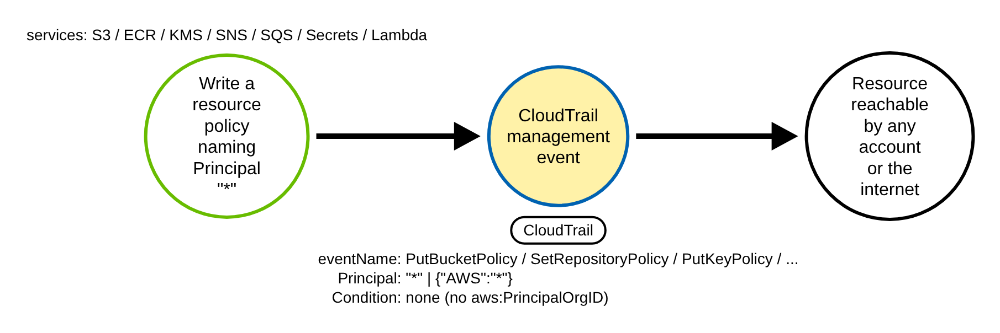
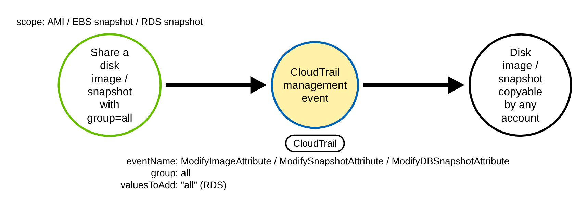
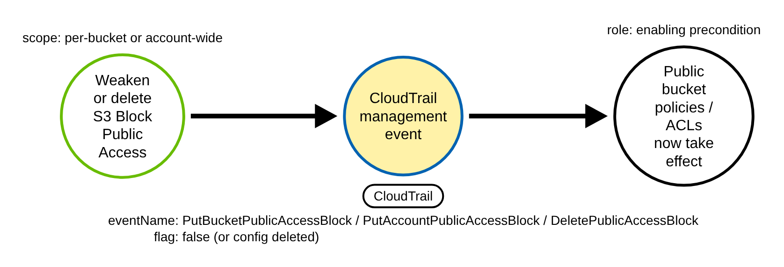
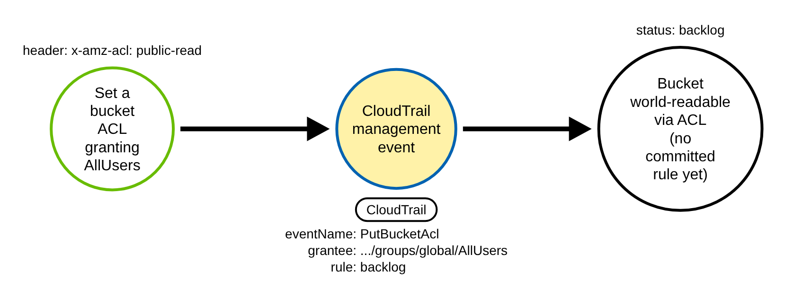
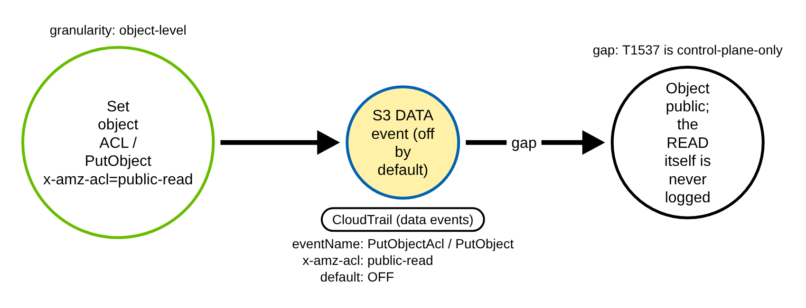

# AWS Public and Cross-Account Resource Exposure (AWS)

> Prose uses Simplified Technical English (ASD-STE100) where practical.
> AWS service names, API names, CloudTrail field names, and ATT&CK IDs are
> technical names.

## Metadata

| Key          | Value |
|--------------|-------|
| ID           | TRR9019 |
| External IDs | T1537 |
| Tactics      | Exfiltration |
| Platforms    | AWS |
| Contributors | det-eng |
| Status       | draft |

### Scope Statement

This TRR covers **public and cross-account exposure of an AWS resource** through a
control-plane write: an operator (or an adversary with the right permission) attaches a
resource-based policy, shares a disk image or snapshot, or removes a guardrail so that the
resource becomes readable by any AWS account or by the whole internet. The exfiltration is
the later, unlogged read of the exposed data — so the only durable control-plane signal is
the **exposure act**, which is what this report keys on.

The novel, detectable contribution is the **unification of the _public_ exposure shape**
(`Principal "*"` / `{"AWS":"*"}` / snapshot `group=all` / `valuesToAdd "all"`) across many
services, plus the Block-Public-Access weakening family. Stratus Red Team exercises only the
**account-to-account** variants of the same APIs — `aws.exfiltration.s3-backdoor-bucket-policy`
grants a named foreign account (`arn:aws:iam::<acct>:root`), and `aws.exfiltration.ec2-share-ami`,
`aws.exfiltration.ec2-share-ebs-snapshot`, and `aws.exfiltration.rds-share-snapshot` all share to a
specific numbered account, never `group=all` / `"all"`. The one public case Stratus already
ships is `aws.persistence.lambda-backdoor-function` (`AddPermission` with `Principal "*"`, no
`SourceArn`). Atomic Red Team ships **no** T1537 atomics at all. The genuinely new ground is the
public form of S3 bucket policy and of AMI / EBS / RDS snapshot sharing, the ECR / KMS / SNS /
SQS / Secrets Manager policy surfaces, and the whole S3 Block-Public-Access family — none of
which Stratus or Atomic Red Team covers. The enabling misconfiguration is frequently tracked as
T1098 (Account Manipulation), and Block-Public-Access removal as T1686.001 (Disable or Modify System
Firewall: Cloud Firewall); the paired Sigma rules tag those secondary IDs.

## Technique Overview

An AWS resource can be made reachable from outside its own account in one write. The simplest
way is a **resource-based policy** — a JSON document attached to the resource that says who may
use it. If a statement has `Effect "Allow"` and `Principal "*"`, and no condition narrows who
`"*"` means, then any principal on the internet is allowed. A second way does not use a policy
at all: EC2 AMIs and EBS snapshots, and RDS and Aurora snapshots, carry a **share attribute**;
adding the special group `all` makes a copy of the underlying data retrievable by **every AWS
account**. A third way is to remove a guardrail: S3 **Block Public Access** (BPA) overrides any
public bucket policy or ACL, so an adversary who wants a public policy to actually take effect
first turns BPA off.

All of these writes are normal administrative APIs. They are used every day for legitimate
public datasets, static-website buckets, community AMIs, and cross-account data sharing inside
an organization. What marks the malicious use is the **grantee** and the **absence of a scope**:
a wildcard principal with no narrowing condition, or the literal public group `all`.

The exposure write is logged. The thing the adversary is after — the actual read of the data by
the foreign account or by the internet — is **not** logged in the victim account. The read
happens against the exposed resource from somewhere else, and AWS writes no CloudTrail event for
it in the account that owns the resource. T1537 is therefore **control-plane-only detectable**:
a defender sees the moment of exposure, never the exfiltration itself.

## Technical Background

### The log shape

Every procedure in scope is a successful, mutating, management-plane API call. In CloudTrail each
one carries `eventType "AwsApiCall"`, `managementEvent true`, `eventCategory "Management"`,
`readOnly false`, and **no** `errorCode` (success). These are **default-logged** management
events: they appear in CloudTrail Event history for 90 days with no trail configured, but a trail
(or CloudTrail Lake / EventBridge) is needed for durable detection. No data-event selector is
needed for the exposure writes — with one exception, the object-level path (Procedure E), which is
a data event and is off by default.

The coarse gate is `eventSource` in the exposure set — `s3.amazonaws.com`, `ec2.amazonaws.com`,
`lambda.amazonaws.com`, `ecr.amazonaws.com`, `sns.amazonaws.com`, `sqs.amazonaws.com`,
`kms.amazonaws.com`, `secretsmanager.amazonaws.com`, `rds.amazonaws.com` — and `eventName` in the
resource-policy / share / guardrail write set.

### The discriminator

The field that separates attack from benign is the **grantee token with no effective scope**:

- **Policy writes (Family A):** a `Statement` with `Effect "Allow"` and `Principal` equal to the
  string `"*"` **or** the object `{"AWS":"*"}` (both shapes mean public — the committed rule
  matches both), **and** none of the scoping condition keys `aws:PrincipalOrgID`,
  `aws:PrincipalAccount`, `aws:SourceArn`, `aws:SourceAccount`, `aws:SourceOwner`,
  `aws:SourceVpce`/`aws:SourceVpc` or `kms:CallerAccount` present **in that same statement**. A
  wildcard principal that **is** scoped by one of those keys is effectively private and must not
  fire. Scope is judged per statement: the S3 User Guide ("Blocking public access" > "The meaning of
  'public'") says a policy with fixed-principal grants becomes public "if you add a public
  statement to the policy", so a scoped statement (the SNS default `AWS:SourceOwner` statement, the
  EBS `kms:CallerAccount` key-policy statement) does not hide an unconditioned public `Allow` next
  to it. A grant to a *named*
  12-digit foreign account (`{"AWS":"arn:aws:iam::<acct>:root"}`) is cross-account exposure too,
  but telling a hostile account from a legitimate partner needs an organization-account allowlist
  that a stateless rule cannot carry — so the committed rule covers only the **public** (`*`)
  shape, and named-foreign-account detection is left to a production pipeline with that allowlist
  (see Detection Strategy).
- **Share attributes (Family B):** the literal lowercase token `all` in the add-list —
  `launchPermission.add.items[].group` (AMI), `createVolumePermission.add.items[].group` (EBS
  snapshot), or `valuesToAdd` containing `"all"` when `attributeName` is `restore` (RDS / Aurora).
  A share to a named account carries a `userId` (EC2) or a 12-digit account ID (RDS) instead of
  `all`.
- **Guardrail removal (Family C):** any flag in `PublicAccessBlockConfiguration` set to `false`,
  or a delete of the configuration (which removes all four controls at once). The API action is
  `DeletePublicAccessBlock`, but CloudTrail logs it under a different event name: the S3 User Guide
  ("Logging Amazon S3 API calls using AWS CloudTrail") gives `DeleteAccountPublicAccessBlock` for
  the account level, and the bucket-level delete follows the same convention
  (`DeleteBucketPublicAccessBlock`).

The committed benign baseline is a **close negative control**: it is the same
`s3.amazonaws.com` / `PutBucketPolicy` / `Effect "Allow"` / `Principal "*"` / `readOnly false`
success event, suppressed **only** by an `aws:PrincipalOrgID` condition on the statement. The
absence of that scoping condition is the one discriminating field.

### Encoding gotchas

The policy document is carried differently per service, and this asymmetry is the crux of the
rule:

- **S3 `PutBucketPolicy`:** `requestParameters.bucketPolicy` is a **nested JSON object** — navigate
  it directly as structured JSON.
- **ECR `SetRepositoryPolicy`:** `requestParameters.policyText` is an **escaped JSON string**.
- **KMS `PutKeyPolicy`:** `requestParameters.policy` is an **escaped JSON string**.
- **SNS `SetTopicAttributes`:** `requestParameters.attributeValue` is an **escaped JSON string**
  (when `attributeName` is `Policy`).
- **SQS `SetQueueAttributes`:** `requestParameters.attributes.Policy` is an **escaped JSON string**.
- **Secrets Manager `PutResourcePolicy`:** `requestParameters.resourcePolicy` is an **escaped JSON
  string**.
- **Lambda `AddPermission...`:** the principal is a **top-level field**,
  `requestParameters.principal` (string `"*"` or a foreign account ID), and
  `responseElements.statement` is an **escaped JSON string**.

A production pipeline must JSON-decode the five escaped-string policies before matching, and treat
the S3 `bucketPolicy` as the one raw object. Two more gotchas: the Lambda `eventName` is
**versioned** — `AddPermission20150331v2` (and the legacy `AddPermission20150331`), never a plain
`AddPermission`, so match by **prefix**. And S3 Block-Public-Access uses **PascalCase** keys
(`BlockPublicAcls`, `IgnorePublicAcls`, `BlockPublicPolicy`, `RestrictPublicBuckets`), unlike the
camelCase elsewhere.

## Procedures

| Procedure | ID | Name | Entry point |
|-----------|----|------|-------------|
| A | TRR9019.AWS.A | Public / foreign resource-based policy write | policy write naming `Principal "*"`, no condition |
| B | TRR9019.AWS.B | Public disk-image / snapshot share | share attribute add `group=all` / `valuesToAdd "all"` |
| C | TRR9019.AWS.C | Block Public Access disabled or deleted | BPA flag `false` or `DeleteBucketPublicAccessBlock` / `DeleteAccountPublicAccessBlock` |
| D | TRR9019.AWS.D | Public bucket ACL (AllUsers) | `PutBucketAcl` grantee `.../groups/global/AllUsers` |
| E | TRR9019.AWS.E | Object-level ACL / data-plane exposure | `PutObjectAcl` / `PutObject` `x-amz-acl=public-read` |

> A tool is not a procedure. The AWS console, `aws-cli`, an SDK, or infrastructure-as-code all
> send the same resource-policy write. They are the same procedure.

**Reading the DDMs.** Green borders are operations the client / adversary performs. Blue borders
are operations the AWS control plane performs (CloudTrail). Black borders are the abstract effect.
The pill names the telemetry; the `Key: value` lines are what a rule matches; a shaded node is the
primary detection opportunity. The exposure-write audit event is the shared chokepoint for A–D;
Procedure E has no default control-plane log.

### Procedure A: Public / foreign resource-based policy write  (`TRR9019.AWS.A`)

The adversary attaches a resource-based policy whose statement grants `Effect "Allow"` to the
public principal with no scoping condition. The same shape is reached across seven services, each
with its own field path and encoding:

- **S3** — `PutBucketPolicy`, `requestParameters.bucketPolicy` (nested JSON object).
- **ECR** — `SetRepositoryPolicy`, `requestParameters.policyText` (escaped JSON string), with
  `repositoryName` / `registryId`.
- **KMS** — `PutKeyPolicy`, `requestParameters.policy` (escaped JSON string), `policyName "default"`,
  `keyId`.
- **SNS** — `SetTopicAttributes`, `requestParameters.attributeValue` (escaped JSON string) when
  `attributeName` is `Policy`, with `topicArn`.
- **SQS** — `SetQueueAttributes`, `requestParameters.attributes.Policy` (escaped JSON string), with
  `queueUrl`.
- **Secrets Manager** — `PutResourcePolicy`, `requestParameters.resourcePolicy` (escaped JSON
  string), with `secretId` and `blockPublicPolicy false`.
- **Lambda** — `AddPermission20150331v2` (prefix `AddPermission`), `requestParameters.principal`
  `"*"` (public; the committed rule keys on the wildcard, not a named foreign account),
  `action lambda:InvokeFunction`, `functionName`, `statementId`, with no `sourceArn` or
  `principalOrgID`; `responseElements.statement` is an escaped JSON string.

- **Prerequisites:** permission to write the resource policy (for example `s3:PutBucketPolicy`,
  `lambda:AddPermission`).
- **Mechanics:** one mutating management call writes the grant; the public read of the data that
  follows is never logged in this account.
- **Impact:** the resource is reachable by any account or by the internet.

#### Detection Data Model — `TRR9019.AWS.A`

Source: [`ddms/trr9019_aws_a.json`](ddms/trr9019_aws_a.json) (Arrows app format).

**DDM summary.** The shaded node is the CloudTrail management event (`eventName`
`PutBucketPolicy` / `SetRepositoryPolicy` / `PutKeyPolicy` / …, `Principal "*"` or `{"AWS":"*"}`,
Condition none). It is the chokepoint for the whole policy family; the differences between
services are only where the policy document sits and whether it is a nested object or an escaped
string. The later public read of the data is unlogged.

### Procedure B: Public disk-image / snapshot share  (`TRR9019.AWS.B`)

The adversary shares a disk image or snapshot with the public group so that any AWS account can
copy the underlying data. Three services carry this as a distinct attribute:

- **EC2 AMI** — `ModifyImageAttribute`, `attributeType launchPermission`,
  `requestParameters.launchPermission.add.items[].group "all"` (foreign-account variant uses
  `.userId`), with `imageId`.
- **EC2 EBS snapshot** — `ModifySnapshotAttribute`, `attributeType createVolumePermission`,
  `requestParameters.createVolumePermission.add.items[].group "all"` (foreign: `.userId`), with
  `snapshotId`.
- **RDS / Aurora snapshot** — `ModifyDBSnapshotAttribute` (Aurora:
  `ModifyDBClusterSnapshotAttribute`), `requestParameters.attributeName "restore"`,
  `requestParameters.valuesToAdd` containing `"all"` (foreign: a 12-digit accountId), with
  `dBSnapshotIdentifier`.

- **Prerequisites:** permission to modify the image / snapshot attribute, and an unencrypted image
  / snapshot (encrypted EBS snapshots and Marketplace-coded AMIs cannot be made public; such calls
  fail with an `errorCode` and must not fire).
- **Mechanics:** the `remove` direction (`launchPermission.remove`, `valuesToRemove`) is a
  de-exposure and is intentionally excluded.
- **Impact:** a copy of the data is retrievable by every AWS account on earth.

#### Detection Data Model — `TRR9019.AWS.B`

Source: [`ddms/trr9019_aws_b.json`](ddms/trr9019_aws_b.json) (Arrows app format).

**DDM summary.** The shaded node is the CloudTrail management event (`eventName`
`ModifyImageAttribute` / `ModifySnapshotAttribute` / `ModifyDBSnapshotAttribute`, `group "all"`,
`valuesToAdd "all"` for RDS). The discriminator vs a benign partner-account share is the literal
`all` rather than a numbered `userId` / account ID.

### Procedure C: Block Public Access disabled or deleted  (`TRR9019.AWS.C`)

The adversary weakens or removes S3 Block Public Access so that a public bucket policy or ACL can
actually take effect. While BPA is on, a public policy is silently ineffective; turning BPA off is
the enabling precondition for exposure and, on its own, a strong signal. Three events carry it, all
default-logged management events under `s3.amazonaws.com` / `s3-control.amazonaws.com`:

- `PutBucketPublicAccessBlock` (per-bucket) — at least one of the four
  `PublicAccessBlockConfiguration` controls set to `false`.
- `PutAccountPublicAccessBlock` (account-wide — blast radius is every bucket) — same test.
- `DeleteBucketPublicAccessBlock` / `DeleteAccountPublicAccessBlock` (the CloudTrail event names
  of the `DeletePublicAccessBlock` API action at bucket and account level) — removes the
  configuration entirely, turning all four controls off; `requestParameters` is just the bucket
  name (or account), so the match is unconditional. The committed rule also matches the API-action
  name `DeletePublicAccessBlock`, because no recorded bucket-level delete confirms its event name.

A `Put*` call that sets all four controls to `true` is a hardening action and is excluded (the
benign control).

- **Prerequisites:** `s3:PutBucketPublicAccessBlock` or `s3:PutAccountPublicAccessBlock`. The
  delete operations need the same permissions as the put operations; there is no separate delete
  permission (S3 User Guide, "Blocking public access to your Amazon S3 storage").
- **Mechanics:** pairs naturally with a Procedure A `PutBucketPolicy` to complete the exposure.
- **Impact:** the guardrail that overrides public policies and ACLs is removed.

#### Detection Data Model — `TRR9019.AWS.C`

Source: [`ddms/trr9019_aws_c.json`](ddms/trr9019_aws_c.json) (Arrows app format).

**DDM summary.** The shaded node is the CloudTrail management event (`eventName`
`PutBucketPublicAccessBlock` / `PutAccountPublicAccessBlock` / `DeleteBucketPublicAccessBlock` /
`DeleteAccountPublicAccessBlock`, a `PublicAccessBlockConfiguration` flag `false` or the config
deleted). The DDM source still labels the delete with the API-action name
`DeletePublicAccessBlock`. Its role is the enabling precondition: once BPA is off, public bucket
policies and ACLs take effect.

### Procedure D: Public bucket ACL (AllUsers)  (`TRR9019.AWS.D`)

The adversary makes a bucket world-readable through its ACL rather than through a policy:
`PutBucketAcl` with a grantee URI of `http://acs.amazonaws.com/groups/global/AllUsers` (or
`AuthenticatedUsers`), or an `x-amz-acl` header of `public-read` / `public-read-write`. This is a
**default-logged management event** under `s3.amazonaws.com`, so it is observable. This TRR does not
build a rule for it; [TRR9021](../../trr9021/aws/README.md) does, as its Procedure A.

- **Prerequisites:** `s3:PutBucketAcl`, and an ownership / BPA state that still honors ACLs.
- **Mechanics:** reaches the same world-readable effect as Procedure A by a different field shape.
- **Impact:** the bucket is readable by anyone.

#### Detection Data Model — `TRR9019.AWS.D`

Source: [`ddms/trr9019_aws_d.json`](ddms/trr9019_aws_d.json) (Arrows app format).

**DDM summary.** The shaded node is the CloudTrail management event (`eventName` `PutBucketAcl`,
grantee `.../groups/global/AllUsers`). The telemetry exists and is default-logged, but no rule in
this TRR keys on it, so the node is marked **backlog** here; TRR9021 builds the rule.

### Procedure E: Object-level ACL / data-plane exposure  (`TRR9019.AWS.E`)

The adversary exposes individual objects rather than the bucket: `PutObjectAcl`, or `PutObject`
with `x-amz-acl=public-read`. This is an **S3 data event**, which is **off by default** — with no
data-event selector configured, the exposure write produces **no CloudTrail record at all**. And as
with every other procedure, the actual public **read** of the object generates no CloudTrail event
in the victim account. This is a **detection gap**, inherent to T1537 being control-plane-only.

- **Prerequisites:** `s3:PutObjectAcl` / `s3:PutObject`, typically under an already-permissive
  bucket.
- **Mechanics:** object granularity evades a bucket-policy or bucket-ACL rule.
- **Impact:** the object is public; neither the grant (without data events) nor the read is
  visible by default.

#### Detection Data Model — `TRR9019.AWS.E`

Source: [`ddms/trr9019_aws_e.json`](ddms/trr9019_aws_e.json) (Arrows app format).

**DDM summary.** The shaded node is an S3 **data** event (`eventName` `PutObjectAcl` / `PutObject`,
`x-amz-acl public-read`, default **OFF**). With data events disabled there is no control-plane log,
and the public read itself is never logged — so this is a **gap**, closed only by enabling S3
data-event selectors (and even then the read stays invisible).

## Available Emulation Tests

Cloud attacks have no free live target, so the emulation has two halves. The runnable half is an
Atomic-Red-Team-style test
([`atomics/T1537/src/emulate_aws_public_exposure.sh`](../../../atomics/T1537/src/emulate_aws_public_exposure.sh),
with wrappers in [`atomics/T1537/T1537.yaml`](../../../atomics/T1537/T1537.yaml)) that performs one
throwaway exposure in **your own AWS account** and immediately reverts it (guarded by
`TRR9019_LIVE=1`); it is **not run in CI** because it needs AWS credentials and a resource to
expose. The proven half is a pair of committed, schema-faithful CloudTrail fixtures
([`detections/cloud/fixtures/trr9019/`](../../../detections/cloud/fixtures/trr9019/)) that the CI
validator runs the rules over. Every object is named `trr9019-*`, the public source IP is the RFC
5737 TEST-NET address `198.51.100.23`, the benign source IP is an RFC 1918 egress address, and the
account is the AWS documentation account `123456789012`.

| Procedure | Test | Status |
|-----------|------|--------|
| TRR9019.AWS.A | `emulate_aws_public_exposure.sh a` — public resource-based policy (fixture: S3 `PutBucketPolicy` `Principal "*"` + Lambda `AddPermission20150331v2` `principal "*"`). | **built** |
| TRR9019.AWS.B | `emulate_aws_public_exposure.sh b` — public disk-image / snapshot share (fixture: `ModifyImageAttribute` `group "all"`). | **built** |
| TRR9019.AWS.C | `emulate_aws_public_exposure.sh c` — disable S3 Block Public Access (fixture: `PutBucketPublicAccessBlock` all flags `false`). | **built** |
| TRR9019.AWS.D | documented here — public bucket ACL (`PutBucketAcl` AllUsers); [TRR9021](../../trr9021/aws/README.md) builds its rule as TRR9021 Procedure A (`detections/sigma/T1537/aws_s3_bucket_acl_made_public.yml`). | built in TRR9021 |
| TRR9019.AWS.E | documented gap — object-level ACL / `PutObject` `public-read` is an S3 data event (off by default); the public read is never logged. | gap |

## Detection Strategy

Compare the DDMs. The exfiltration leaves no API trace in every procedure, so the only
control-plane signal is the **exposure write**. Across A–D that write is one audit-event family —
a successful, mutating, default-logged management call in the nine-service set whose payload names a
public or foreign grantee with no scoping condition. Three rules split it by field family.

**Telemetry requirement.** A CloudTrail trail (or Event history) capturing management events —
present by default, no data-event selector needed for A–D. Procedure E needs S3 data-event
selectors, which are off by default. Multi-account organizations must capture member-account trails
and pivot on `recipientAccountId`.

**Strategy 1 — resource-policy exposure (covers A).**
Match the policy-write events and fire when one statement of the policy names `Effect "Allow"` +
`Principal "*"` (or `{"AWS":"*"}`) with **no** scoping condition key in that statement
(`aws:PrincipalOrgID` / `aws:PrincipalAccount` / `aws:SourceArn` / `aws:SourceAccount` /
`aws:SourceOwner` / `aws:SourceVpce` / `aws:SourceVpc` / `kms:CallerAccount`). For Lambda, public =
`principal "*"` with no `sourceArn`. This matches the public-principal and scoping-condition tokens as text across both
the nested-object (S3) and escaped-string (ECR / KMS / SNS / SQS / Secrets Manager / Lambda)
representations.

**Strategy 2 — public snapshot / AMI share (covers B).**
Match `ModifyImageAttribute` / `ModifySnapshotAttribute` with an add-list `group "all"`, or
`ModifyDBSnapshotAttribute` / `ModifyDBClusterSnapshotAttribute` with `valuesToAdd "all"`. The
`remove` direction is excluded.

**Strategy 3 — Block Public Access weakened (covers C).**
Match `PutBucketPublicAccessBlock` / `PutAccountPublicAccessBlock` with at least one control set to
`false`, or `DeleteBucketPublicAccessBlock` / `DeleteAccountPublicAccessBlock` (and the API-action
name `DeletePublicAccessBlock`) unconditionally. A `Put*` setting all four controls to `true`
is hardening and is excluded.

**The hard negative control.** The benign baseline is the same S3 `PutBucketPolicy` /
`Principal "*"` / success event, scoped by an `aws:PrincipalOrgID` condition. Strategy 1 must stay
silent on it. That pass proves the rule keys on the **absence of a scoping condition**, not on the
wildcard principal alone — keying on `Principal "*"` + `Effect "Allow"` alone over-fires on every
org-scoped share.

**Limits and demonstrated gaps.**

- **The exfiltration itself** — the public or cross-account read of the exposed data — emits **no
  CloudTrail event** in the victim account. This TRR detects the exposure act, never the read.
- **Procedure D (bucket ACL)** is default-logged; this TRR has no rule for it, and
  [TRR9021](../../trr9021/aws/README.md) Procedure A covers it.
- **Procedure E (object ACL / data-plane)** is an S3 data event, off by default; even with data
  events on, the read stays invisible.
- **Per-statement scoping:** a policy can mix one org-scoped statement with a second unconditioned
  `Principal "*"` statement. The resource-policy rule tests each statement with a bounded,
  portable regex (no lookahead), so it fires on that mix, but it only checks that a scoping key is
  present in the public statement's `Condition`. A key with a wildcard value (a decoy condition)
  still suppresses it, a key name only in the statement's `Sid` does not, and a `Deny` that carries
  the key does not. The rule reads the statement list as JSON tokens and tests statements 1
  to 5 one by one, each on its own `Condition`, so a policy whose public `Allow` statements
  are all scoped (an SQS queue subscribed to several SNS topics) is quiet; a public `Allow` at
  statement 6 or later fires without a scope test (a false positive on purpose). A
  `Statement` that is one object rather than a list is read too. A production pipeline should
  JSON-decode the policy and evaluate each condition, and require a non-wildcard value.
- **BPA-neutralized policy writes:** a public policy while BPA is still on does not actually expose
  data. A mature pipeline correlates the Strategy 1 policy write with current BPA state — which is
  why Strategy 3 matters as the precondition.
- **Out-of-set services** with the same exposure shape are not covered: Redshift
  `AuthorizeSnapshotAccess`, EventBridge `PutPermission`, EFS / Glue / Backup resource policies,
  S3 access-point policies, and `kms:CreateGrant`. They deserve sibling rules.
- **False positives** share the structural fields: intentionally public static-website buckets and
  datasets, community / Marketplace AMIs and snapshots, CloudFront OAC/OAI policies (service
  principal `cloudfront.amazonaws.com`), SNS/SQS grants to a specific AWS service with a
  `SourceArn`, and IaC automation. Match the `Principal` value exactly (`"*"` or `{"AWS":"*"}`),
  never a loose `"*"` substring, and allowlist by resource.

## Detections

| Strategy | Covers | Sigma rule | Sensor |
|----------|--------|------------|--------|
| 1 (resource policy) | A | [`detections/sigma/T1537/aws_resource_policy_made_public.yml`](../../../detections/sigma/T1537/aws_resource_policy_made_public.yml) | CloudTrail |
| 2 (snapshot / AMI) | B | [`detections/sigma/T1537/aws_snapshot_or_ami_made_public.yml`](../../../detections/sigma/T1537/aws_snapshot_or_ami_made_public.yml) | CloudTrail |
| 3 (Block Public Access) | C | [`detections/sigma/T1537/aws_s3_block_public_access_disabled.yml`](../../../detections/sigma/T1537/aws_s3_block_public_access_disabled.yml) | CloudTrail |

The validator
[`detections/validate_cloud_detections.py`](../../../detections/validate_cloud_detections.py)
runs the rules over the recorded attack fixture (each must fire, and the match must carry the
`trr9019-` marker) and over the benign baseline (they must fire on nothing). The attack fixture
carries one event per built procedure — S3 `PutBucketPolicy` and Lambda `AddPermission20150331v2`
for A, `ModifyImageAttribute` `group "all"` for B, and `PutBucketPublicAccessBlock` all-false for C.
The benign fixture is the close negative control: the same APIs with the exposure removed — the
bucket policy scoped by `aws:PrincipalOrgID`, the Lambda grant to `s3.amazonaws.com` with a
`sourceArn`, the AMI shared to a numbered `userId`, and BPA set all-true (hardening). The pass
proves the rules key on the public grantee and the missing scope, not on the API alone.

The detection idea has prior art on the detection side (FalconForce FalconFriday "Resource Shared
with Unknown External Account"; Panther `aws_resource_made_public` / `aws_snapshot_made_public`;
airbnb StreamAlert `cloudtrail_public_resources` / `cloudtrail_snapshot_or_ami_made_public`;
Splunk security_content's open-S3 baseline; Elastic prebuilt S3 / EC2 sharing rules). The
contribution here is the paired **emulation + committed CI fixtures** for the _public_ exposure
shape across S3, Lambda, EC2 AMI/EBS and RDS, which neither Stratus Red Team (account-to-account
only, except public Lambda) nor Atomic Red Team (no T1537 atomics) ships.

## References

- MITRE ATT&CK, T1537 Transfer Data to Cloud Account:
  <https://attack.mitre.org/techniques/T1537/>
- AWS, S3 access policy language overview (bucket policies, `Principal`, `Condition`):
  <https://docs.aws.amazon.com/AmazonS3/latest/userguide/access-policy-language-overview.html>
- AWS, S3 Block Public Access ("The meaning of 'public'": per-grant evaluation and the
  non-public condition keys; the delete operations need the put permissions):
  <https://docs.aws.amazon.com/AmazonS3/latest/userguide/access-control-block-public-access.html>
- AWS, Logging Amazon S3 API calls using AWS CloudTrail (account-level event names:
  "DeletePublicAccessBlock is DeleteAccountPublicAccessBlock"):
  <https://docs.aws.amazon.com/AmazonS3/latest/userguide/cloudtrail-logging-s3-info.html>
- AWS, Lambda `AddPermission` API (resource-based policy, `Principal`, `SourceArn`):
  <https://docs.aws.amazon.com/lambda/latest/api/API_AddPermission.html>
- AWS, EC2 `ModifyImageAttribute` API (`LaunchPermission`, `group all`):
  <https://docs.aws.amazon.com/AWSEC2/latest/APIReference/API_ModifyImageAttribute.html>
- AWS, EC2 `ModifySnapshotAttribute` API (`CreateVolumePermission`, `group all`):
  <https://docs.aws.amazon.com/AWSEC2/latest/APIReference/API_ModifySnapshotAttribute.html>
- AWS, RDS `ModifyDBSnapshotAttribute` API (`restore`, `ValuesToAdd all`):
  <https://docs.aws.amazon.com/AmazonRDS/latest/APIReference/API_ModifyDBSnapshotAttribute.html>
- AWS, IAM global condition keys (`aws:PrincipalOrgID`, `aws:SourceArn`, `aws:SourceAccount`):
  <https://docs.aws.amazon.com/IAM/latest/UserGuide/reference_policies_condition-keys.html>
- Stratus Red Team, aws.exfiltration.ec2-share-ebs-snapshot (account-to-account variant):
  <https://stratus-red-team.cloud/attack-techniques/AWS/aws.exfiltration.ec2-share-ebs-snapshot/>
- Stratus Red Team, aws.persistence.lambda-backdoor-function (public Lambda overlap):
  <https://stratus-red-team.cloud/attack-techniques/AWS/aws.persistence.lambda-backdoor-function/>
- TRR method:
  <https://github.com/tired-labs/techniques/blob/main/docs/TECHNIQUE-RESEARCH-REPORT.md>
