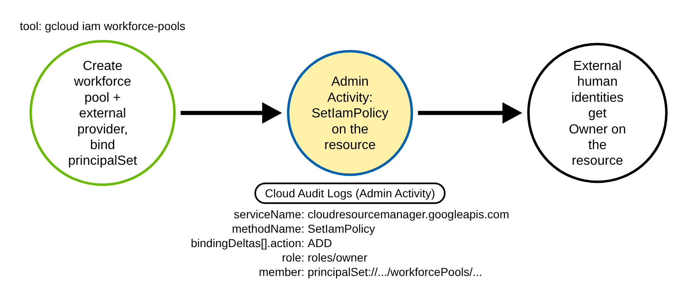
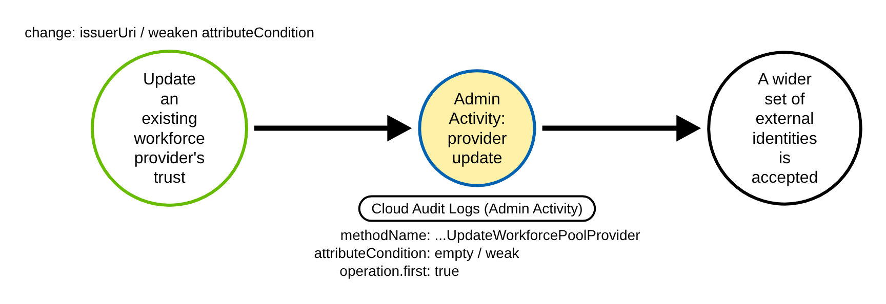
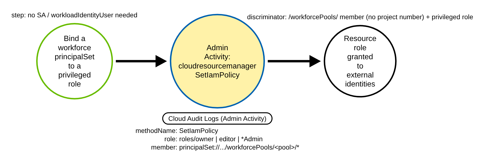
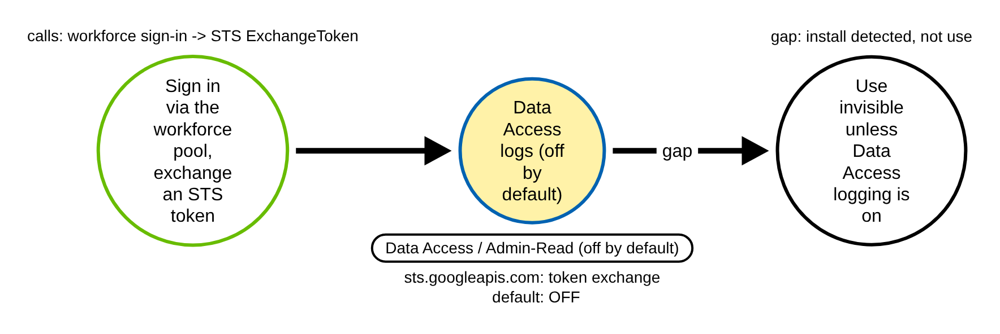

# GCP Workforce Identity Federation Abuse (GCP)

> Prose uses Simplified Technical English (ASD-STE100) where practical.
> GCP service names, IAM API and method names, Cloud Audit Log field names, and
> ATT&CK IDs are technical names.

## Metadata

| Key          | Value |
|--------------|-------|
| ID           | TRR9020 |
| External IDs | T1199, T1098.001 |
| Tactics      | Persistence, Privilege Escalation |
| Platforms    | GCP |
| Contributors | det-eng |
| Status       | draft |

### Scope Statement

This TRR covers **Workforce Identity Federation (WIF) backdoors** in Google Cloud: an
adversary with IAM write rights trusts an **external** human identity source (an OIDC
issuer or a SAML IdP) through a **workforce pool**, then binds a federated `principalSet`
**directly** to a privileged project, folder, or organization role. Workforce pools
federate **organization-scoped human identities**, not workloads, so there is **no
service account and no `roles/iam.workloadIdentityUser` step** — the external identity
gets a resource role directly. The result is durable, key-less persistence and often
privilege escalation that survives key rotation.

The report keys on the two **install** chokepoints, both always-on Admin Activity audit
events:

- the **provider trust** — `google.iam.admin.v1.WorkforcePools.CreateWorkforcePoolProvider`
  / `…UpdateWorkforcePoolProvider` under `protoPayload.serviceName` `iam.googleapis.com`; and
- the **direct resource binding** — `SetIamPolicy` under
  `protoPayload.serviceName` `cloudresourcemanager.googleapis.com` whose policy delta adds a
  privileged role to a `/workforcePools/` `principalSet`.

The novel, detectable contribution is **two discriminators**, not "a pool was created":
(a) a provider created or loosened with **no real `attributeCondition`** (every token the
mapping matches is admitted); and (b) the **direct `cloudresourcemanager` `SetIamPolicy`
binding of a `workforcePools` `principalSet` to a privileged resource role** — the actual
backdoor shape. The install-detection idea for pools is partly trodden: Panther's
`gcp_workforce_pool_created_or_updated` and `pwnera/shoc`'s `gcp_identity_federation_changed`
both flag pool/provider create/update, but **neither** keys on the `attributeCondition`,
and **neither** covers the resource binding. SigmaHQ, Elastic, Splunk, and FalconForce
ship **no** workforce-pool content at all. Stratus Red Team has **no** workforce technique;
its nearest neighbour, `gcp.persistence.backdoor-service-account-policy`, binds a **Google
user** (`user:…@gmail.com`) to a **service-account** policy — no workforce pool, no
`principalSet`, no resource binding — so a rule keyed on the workforce member does not fire
on it. Atomic Red Team ships **zero** GCP workforce / T1199 coverage. This TRR is the
realization of **TRR9018 Procedure D**, which TRR9018 scoped out and flagged as a needed
sibling. The emulation, the recorded org-level Cloud Audit Log fixtures, and both
detections here are therefore new content.

## Technique Overview

Workforce Identity Federation lets **human** users from an external identity provider —
Okta, Microsoft Entra ID, Ping, any OIDC or SAML IdP — sign in to Google Cloud without
Google accounts. The trust is **organization-scoped**, and it is the recommended way to
give a workforce access to GCP resources without provisioning Cloud Identity users.

The trust is built in two parts. First, a **workforce pool** holds one or more
**providers**, and each provider names the external issuer to trust (`oidc.issuerUri` or
`saml.idpMetadataXml`), a map from external token claims to Google attributes
(`attributeMapping`), and an optional CEL guard (`attributeCondition`) that restricts
**which** external identities are accepted. Second, an IAM policy binding grants a
**`principalSet`** (every identity the pool admits) or a single **`principal`** a role on a
project, folder, or organization.

An adversary abuses this by pointing the trust at an issuer **they** control — or by
loosening an **existing** provider's condition — and binding the pool to a privileged role
such as `roles/owner`. If the provider has no `attributeCondition`, any token the mapping
matches is admitted. The backdoor needs no key, survives key rotation, and blends in with
routine workforce onboarding, which creates structurally identical trust and bindings. The
difference from **workload** federation (TRR9018) is sharp: workforce identities are human
and org-scoped and are bound **directly to a resource role**, whereas workload identities
are machine identities bound to a **service account** through `roles/iam.workloadIdentityUser`.

## Technical Background

### The two install chokepoints

Both chokepoints are **Admin Activity** Cloud Audit Logs
(`logName` ends `cloudaudit.googleapis.com%2Factivity`, percent-encoded `%2F`), which are
**always on**, cannot be disabled, and are free. Both carry `protoPayload.@type`
`type.googleapis.com/google.cloud.audit.AuditLog`. Both legs are **ADMIN_WRITE** management
writes; this is **not** a Data Access dependency — that caveat applies only to the *use* of
the backdoor (see Procedure D).

**Provider trust (A/B).** `protoPayload.serviceName` is `iam.googleapis.com`.
`protoPayload.methodName` is
`google.iam.admin.v1.WorkforcePools.CreateWorkforcePoolProvider` or
`…UpdateWorkforcePoolProvider` (the pool-level
`…WorkforcePools.CreateWorkforcePool` / `…UpdateWorkforcePool` are the adjacent pool
methods). The trust evidence lives in `protoPayload.request.workforcePoolProvider` on the
begin entry (`protoPayload.request.@type`
`type.googleapis.com/google.iam.admin.v1.CreateWorkforcePoolProviderRequest`):

- `oidc.issuerUri` / `oidc.clientId` (OIDC trust) or `saml.idpMetadataXml` (SAML trust) —
  the presence of either names the external identity source;
- `attributeMapping` — a string→string map (OIDC must include `google.subject`, for
  example `{"google.subject":"assertion.sub"}`); an over-broad map widens who can federate;
- `attributeCondition` — a CEL string. The **empty string `""` or an absent key means no
  restriction**: every identity the mapping matches is admitted. This is the dangerous case
  and the field the benign fixture flips.

**Binding (A/C).** `protoPayload.serviceName` is `cloudresourcemanager.googleapis.com` and
`protoPayload.methodName` is `SetIamPolicy` — the bare Resource Manager form for a project,
folder, or organization, **not** the `google.iam.admin.v1.SetIAMPolicy` service-account
form that TRR9018 keys on. The newly granted principal appears in two places:

- the authoritative **delta** at
  `protoPayload.serviceData.policyDelta.bindingDeltas[]`
  (`@type` `type.googleapis.com/google.iam.v1.logging.AuditData`), as one element
  `{ "action": "ADD", "role": "roles/owner", "member":
  "principalSet://iam.googleapis.com/locations/global/workforcePools/<pool>/*" }`; and
- the **full submitted policy** at `protoPayload.request.policy.bindings[].members[]`.

A detection **must key on the delta**, not the request policy: the request policy carries
every pre-existing member, so it cannot prove a grant is new and inflates false positives.

### The discriminator

Two discriminators separate the attack from its benign twin, one per leg.

**Provider leg — the missing `attributeCondition`.** A benign provider restricts federation
with a real CEL guard that references `assertion` (for example
`assertion.hd == 'trr9020-corp.example.com' && 'fte' in assertion.groups`). The attack
provider has `attributeCondition` empty (`""`) or absent, so every external identity the
mapping matches is admitted.

**Binding leg — the privileged role to a `/workforcePools/` member.** Within one
`bindingDeltas` element: `action` is `ADD`, `member` contains `/workforcePools/`, and `role`
is privileged (`roles/owner`, `roles/editor`, or an `*Admin` role). The member formats
(Principal identifiers doc) are:

- single: `principal://iam.googleapis.com/locations/global/workforcePools/POOL_ID/subject/SUBJECT`
- group: `principalSet://iam.googleapis.com/locations/global/workforcePools/POOL_ID/group/GROUP_ID`
- attribute: `principalSet://iam.googleapis.com/locations/global/workforcePools/POOL_ID/attribute.NAME/VALUE`
- whole pool: `principalSet://iam.googleapis.com/locations/global/workforcePools/POOL_ID/*`

The workforce member is anchored at `locations/global/workforcePools/…` with **no
project or org number**. This is the clean separator from TRR9018's **workload** members,
which embed a **project number**
(`principalSet://iam.googleapis.com/projects/<NUMBER>/locations/global/workloadIdentityPools/<pool>/*`).
A rule keyed on `/workforcePools/` does not fire on `/workloadIdentityPools/` and vice-versa.

Unlike the workload binding — where the member *type* is the clean separator — legitimate
workforce federation **routinely** binds `principalSet`s to resource roles; that is the
product's purpose. The binding separator is therefore the role **privilege** (and the
whole-pool `/*` breadth as enrichment), which makes the binding rule a **medium-fidelity**
privilege heuristic, not a pure type discriminator.

### Encoding and always-on notes

- `logName` is URL-encoded — match the literal `cloudaudit.googleapis.com%2Factivity`
  (percent-encoded `%2F`), not a decoded slash.
- Workforce pools are **organization-scoped**, so Leg 1 events land in the
  **organization's** Admin Activity log (`organizations/<org>/logs/…/activity`). A
  project-only log sink misses them; an org-level aggregated sink is required. The Leg 2
  binding can be at project, folder, or org scope.
- Provider create/update are **long-running operations (LRO)**: each emits two Admin
  Activity entries — a begin entry (`operation.first == true`) that carries the request
  body, and an end entry that often omits it. Read the begin entry and dedupe against the
  end entry. The provider rule keys on `operation.first` so the end entry does not misfire
  the "no condition" branch.
- `bindingDeltas` is a nested **array**, and one `SetIamPolicy` may carry several deltas
  (some benign). The three sub-conditions (`action`, `member`, `role`) must co-occur on the
  **same** element. The binding rule uses a regex with lookaheads bounded to a single
  `{…}` element so a `REMOVE`, or an unrelated `ADD` elsewhere in the policy, does not fire.
  On a structured backend, evaluate the array element-wise.
- `member` prefix hazard: `principalSet://` contains the substring `principal`; match on
  the shared `/workforcePools/` path so both `principal://` and `principalSet://` are caught
  and not confused.
- `attributeCondition` is a CEL string; treat empty-string **and** absent-key as the "no
  restriction" case. A real condition references `assertion`.

> **Grounding residual (honest).** A *verbatim* audit-log sample showing
> `protoPayload.request.workforcePoolProvider.attributeCondition` inside a
> `CreateWorkforcePoolProvider` entry could not be retrieved (the Google docs host is
> blocked at this environment's egress proxy). The field's name and existence are grounded
> by the REST resource, the gcloud flag, and the API request type
> `google.iam.admin.v1.CreateWorkforcePoolProviderRequest`, and the request-body shape is
> grounded by strong analogy to the **proven** workload-provider path in TRR9018
> (`protoPayload.request.workloadIdentityPoolProvider.attributeCondition`). The emulation
> step must confirm the precise JSON path in Logs Explorer before the fixture is frozen.

### Why the technique works

The trust is built from ordinary, always-logged IAM and Resource Manager writes, so the
backdoor hides in legitimate workforce-onboarding noise. It needs no downloaded key and
survives key rotation. The only durable control-plane signal is the **install** — the
provider trust and the binding — because the actual **use** of the backdoor (workforce
sign-in and the STS token exchange) is logged only as Data Access / `ADMIN_READ`, which is
**off by default**.

## Procedures

| Procedure | ID | Name | Entry point |
|-----------|----|------|-------------|
| A | TRR9020.GCP.A | Full from-scratch backdoor: pool + provider + resource binding | `CreateWorkforcePoolProvider` + `SetIamPolicy` |
| B | TRR9020.GCP.B | Loosen an existing provider's trust | `UpdateWorkforcePoolProvider` |
| C | TRR9020.GCP.C | Bind a `principalSet` directly to a privileged resource role | `SetIamPolicy` |
| D | TRR9020.GCP.D | Data-plane use of the backdoor (sign-in + token exchange) | workforce sign-in → `ExchangeToken` |

> A tool is not a procedure. `gcloud`, the Terraform Google provider, a raw REST call, and
> any IaC that issues the same `SetIamPolicy` or provider write are the same procedure.
> Group by the logged method and the member/role, not the client.

**Reading the DDMs.** Green borders are operations the adversary or client performs. Blue
borders are operations the GCP control plane records (Cloud Audit Logs). Black borders are
the abstract effect. The pill names the telemetry; the `Key: value` lines are what a rule
matches; a shaded node is the primary detection opportunity. The provider trust and the
`workforcePools` resource binding are the two shared install chokepoints for A–C.

### Procedure A: Full from-scratch backdoor — pool + provider + resource binding  (`TRR9020.GCP.A`)

The adversary creates a workforce pool, adds an external provider that trusts an issuer
they control with no `attributeCondition`, then runs `SetIamPolicy` on a project, folder, or
organization to add a `workforcePools` `principalSet` with `roles/owner`. All steps are
Admin Activity and are logged by default.

- **Prerequisites:** organization-level `iam.workforcePools.create` /
  `iam.workforcePoolProviders.create` plus resource-level `…setIamPolicy` on the target
  project, folder, or org.
- **Mechanics:** the provider write is an LRO (two entries; read `operation.first`); the
  binding delta is the authoritative record of the new grant.
- **Impact:** an external human identity can now hold a privileged resource role directly.
- **Covered by:** **both** rules — the provider rule (trust leg) and the binding rule
  (backdoor leg).

#### Detection Data Model — `TRR9020.GCP.A`

Source: [`ddms/trr9020_gcp_a.json`](ddms/trr9020_gcp_a.json) (Arrows app format).

**DDM summary.** The green node bundles the adversary's three writes (create pool, add the
external provider, bind the principalSet). The shaded node is the
`cloudresourcemanager.googleapis.com` `SetIamPolicy` audit event whose
`serviceData.policyDelta.bindingDeltas[]` adds `action` `ADD`, a privileged `role` (e.g.
`roles/owner`), and a `principalSet://…/workforcePools/<pool>/*` member — the backdoor
chokepoint (the binding rule). The provider-create write on the same path
(`CreateWorkforcePoolProvider`, `oidc.issuerUri` set, empty `attributeCondition`) is a second,
independent detection opportunity that the provider rule catches — diagrammed as its own
chokepoint in Procedure B.

### Procedure B: Loosen an existing provider's trust  (`TRR9020.GCP.B`)

The stealthiest variant. The adversary runs `UpdateWorkforcePoolProvider` on a real,
legitimate-looking provider and blanks `attributeCondition` (or broadens `attributeMapping`).
No resource binding is touched if the pool already holds one, so nothing new appears beside
the edited provider.

- **Prerequisites:** `iam.workforcePoolProviders.update` on the provider.
- **Mechanics:** GCP updates are field-masked, so the begin entry (`operation.first == true`)
  carries only the changed fields plus `updateMask`. A clear of the guard sends
  `updateMask` = `attributeCondition` with an empty `attributeCondition` and no `oidc`/`saml`
  block, which is why the rule keys the Update branch on the `updateMask`, not on re-sent trust
  fields.
- **Impact:** widens who can federate into an already-bound pool.
- **Covered by:** the provider rule
  (`gcp_workforce_pool_provider_no_attribute_condition`) — it fires on `Create` with no real
  condition, and on an `Update` whose `updateMask` touches `attributeCondition` and leaves it
  empty. An update that only broadens `attributeMapping` or re-points `issuerUri` **without**
  touching the condition is **not** detected by this stateless rule (a documented limitation —
  enrich with the provider's resulting config).

#### Detection Data Model — `TRR9020.GCP.B`

Source: [`ddms/trr9020_gcp_b.json`](ddms/trr9020_gcp_b.json) (Arrows app format).

**DDM summary.** The shaded node is an `UpdateWorkforcePoolProvider` audit event on the
begin (`operation.first`) entry; `request.workforcePoolProvider.attributeCondition` is empty
or removed. The provider rule matches **`Create` or `Update`**, so it fires on this path
too; no committed fixture carries an `Update`, so Procedure B's coverage is proven through
the recorded `Create` provider fixture, which carries an empty `attributeCondition` (`""`),
while its benign twin carries
`assertion.hd == 'trr9020-corp.example.com' && 'fte' in assertion.groups` and is suppressed.

### Procedure C: Bind a principalSet directly to a privileged resource role  (`TRR9020.GCP.C`)

No provider change. The adversary runs `SetIamPolicy` on a project, folder, or organization
to add `principalSet://…/workforcePools/<existing-pool>/*` (or a `/group/<id>`,
`/attribute.NAME/VALUE`, or `/subject/` scope) with a privileged role. This structurally
overlaps TRR9014's public-IAM-grant rule on the same `cloudresourcemanager` `SetIamPolicy`
delta, but the member family and role differ.

- **Prerequisites:** `…setIamPolicy` on the target project, folder, or org.
- **Mechanics:** the binding delta is the only install evidence; there is no provider event
  to correlate with.
- **Impact:** a new external human identity holds a privileged resource role directly.
- **Covered by:** the binding rule
  (`gcp_workforce_principalset_privileged_binding`).

#### Detection Data Model — `TRR9020.GCP.C`

Source: [`ddms/trr9020_gcp_c.json`](ddms/trr9020_gcp_c.json) (Arrows app format).

**DDM summary.** The shaded node is the `cloudresourcemanager.googleapis.com` `SetIamPolicy`
event whose `bindingDeltas[]` adds a `principalSet://…/workforcePools/…` (or
`principal://…/subject/…`) member with a privileged role. The decisive separator from
TRR9018 is the `member`: the workforce member is anchored at `locations/global/workforcePools/…`
with **no project number**, whereas the workload member embeds a project **number**
(`.../projects/<number>/.../workloadIdentityPools/`).

### Procedure D: Data-plane use of the backdoor (sign-in + token exchange)  (`TRR9020.GCP.D`)

Once the trust exists, the external identity signs in and exchanges its token for Google
credentials: a workforce **sign-in** and the `sts.googleapis.com`
`google.identity.sts.v1.SecurityTokenService.ExchangeToken` token exchange (grant type
`urn:ietf:params:oauth:grant-type:token-exchange`) / console session.

- **Prerequisites:** an installed backdoor (A–C) and an external token.
- **Mechanics:** the sign-in and the STS `ExchangeToken` are the actual use of the trust.
- **Impact:** the adversary now holds a live, federated session.
- **Covered by:** nothing here — **detection gap**.

#### Detection Data Model — `TRR9020.GCP.D`

Source: [`ddms/trr9020_gcp_d.json`](ddms/trr9020_gcp_d.json) (Arrows app format).

**DDM summary.** The nodes are the workforce **sign-in** and the `sts.googleapis.com`
`ExchangeToken` events — the actual use. **Both are Data Access / `ADMIN_READ` and OFF BY
DEFAULT**: the workforce docs say sign-in and token-exchange logging must be explicitly
enabled (IAM and Security Token Service "Admin Read"). This is a gap: TRR9020 detects the
**install**, not the ongoing use.

## Available Emulation Tests

Cloud attacks have no free live target, so the emulation has two halves. The runnable half
is an Atomic-Red-Team-style test
([`atomics/T1199/src/emulate_gcp_workforce.sh`](../../../atomics/T1199/src/emulate_gcp_workforce.sh),
with wrappers in
[`atomics/T1199/T1199.yaml`](../../../atomics/T1199/T1199.yaml)) that creates a **throwaway**
workforce pool, an OIDC provider, and a `principalSet` resource binding in **your own GCP
organization** (guarded by `TRR9020_LIVE=1`, cleaned up after), and is **not run in CI** —
it needs an authenticated `gcloud` and **organization-level** workforce-pool admin, a
stronger prerequisite than a single project. The proven half is a pair of committed,
schema-faithful Cloud Audit Log fixtures
([`detections/cloud/fixtures/trr9020/`](../../../detections/cloud/fixtures/trr9020/)) that
the CI validator runs the rules over. Every object is named `trr9020-*`, the actor is
`mallory@example.com`, the source IP is the RFC 5737 TEST-NET address `198.51.100.23`, the
external IdP uses the RFC 2606 `example.com` domain, and the org number is the documentation
value `123456789012`.

| Procedure | Test | Status |
|-----------|------|--------|
| TRR9020.GCP.A | `emulate_gcp_workforce.sh a` — full backdoor; fixture carries both the `cloudresourcemanager` `SetIamPolicy` `principalSet` → `roles/owner` binding and the `CreateWorkforcePoolProvider` with empty `attributeCondition`. | **built** |
| TRR9020.GCP.B | `emulate_gcp_workforce.sh b` — loosen an existing provider (`UpdateWorkforcePoolProvider`). The provider rule covers `Create` **or** `Update`, but no committed fixture carries an `Update`; coverage is proven through the recorded `Create` provider fixture (empty `attributeCondition`). | documented |
| TRR9020.GCP.C | `emulate_gcp_workforce.sh c` — bind a `principalSet` directly to a privileged resource role (the same `SetIamPolicy` binding fixture). | **built** |
| TRR9020.GCP.D | `emulate_gcp_workforce.sh d` — documented gap; workforce sign-in + STS `ExchangeToken` are Data Access / `ADMIN_READ`, off by default. | gap |

## Detection Strategy

Compare the DDMs. The install converges on two always-on Admin Activity shapes — the
provider trust and the `workforcePools` resource binding — and the two rules key on those
two chokepoints. The actual use (D) is off by default, so the strategy is to catch the
install, then enrich.

**Telemetry requirement.** Cloud Audit Logs Admin Activity for `iam.googleapis.com` and
`cloudresourcemanager.googleapis.com` (always on, free), ingested from an
**organization-level** aggregated log sink so the org-scoped provider events are captured.
Data Access / `ADMIN_READ` for workforce sign-in and `sts.googleapis.com` is needed only for
Procedure D and is off by default.

**Strategy 1 — provider-trust chokepoint (covers A, B).**
Match `protoPayload.serviceName` `iam.googleapis.com` and `protoPayload.methodName`
`CreateWorkforcePoolProvider` or `UpdateWorkforcePoolProvider` on the begin
(`operation.first`) entry that carries a `oidc.issuerUri` or a `saml.idpMetadataXml`,
suppressed when `protoPayload.request.workforcePoolProvider.attributeCondition` carries a
real CEL guard (it references `assertion`). This flags providers created or loosened with no
restriction on which external identities are admitted. It is the higher-fidelity half.

- Sensor: Cloud Audit Logs (Admin Activity).
- Rule: [`detections/sigma/T1199/gcp_workforce_pool_provider_no_attribute_condition.yml`](../../../detections/sigma/T1199/gcp_workforce_pool_provider_no_attribute_condition.yml) (built).

**Strategy 2 — binding chokepoint (covers A, C).**
Match `protoPayload.serviceName` `cloudresourcemanager.googleapis.com` and
`protoPayload.methodName` ending `SetIamPolicy` where one
`serviceData.policyDelta.bindingDeltas` element has `action` `ADD`, a `member` containing
`/workforcePools/`, and a privileged `role` (`roles/owner`, `roles/editor`, or an `*Admin`
role) — matched with a lookahead regex bounded to one `{…}` element so the three conditions
co-occur. This catches both the set form `principalSet://` and the single-subject form
`principal://`. It is a medium-fidelity privilege heuristic.

- Sensor: Cloud Audit Logs (Admin Activity).
- Rule: [`detections/sigma/T1199/gcp_workforce_principalset_privileged_binding.yml`](../../../detections/sigma/T1199/gcp_workforce_principalset_privileged_binding.yml) (built).

**The hard negative control.** The benign provider fixture is the same
`CreateWorkforcePoolProvider`, same org `logName`, same `operation.first`, same
`attributeMapping` — differing only in a real `attributeCondition`
(`assertion.hd == 'trr9020-corp.example.com' && 'fte' in assertion.groups`), with a
legitimate CI actor (`platform-ci@trr9020-prod.iam.gserviceaccount.com`) and internal IP
(`10.0.4.9`), as real onboarding would. The benign binding fixture is the same
`cloudresourcemanager` `SetIamPolicy`, the same `action` `ADD`, the same whole-pool
`principalSet://…/workforcePools/trr9020-ext-pool/*` member — differing only in the `role`,
which is `roles/viewer` (a scoped, read-only grant). A pass on these proves the provider
rule keys on the missing `attributeCondition` and the binding rule keys on the privileged
role plus the `/workforcePools/` member, not on the method alone.

**Limits.**

- **Install, not use.** Procedure D (workforce sign-in + STS `ExchangeToken`) is Data
  Access / `ADMIN_READ`, off by default — the ongoing use is invisible unless Data Access
  logging is enabled for IAM and Security Token Service.
- **Org-level log sink required.** Workforce pools are organization-scoped; Leg 1 events
  land in the organization's Admin Activity log (`organizations/<org>/logs/…/activity`). A
  project-only sink misses them.
- **Vacuous `attributeCondition` false negative.** A tautology such as `"true"`
  (gcloud's own example uses `--attribute-condition="true"`) or `assertion.sub != ""` is
  non-empty, so the stateless suppressor is satisfied by it. Catching a vacuous guard needs
  CEL evaluation in the pipeline. This is an inherent limit shared with TRR9018 — document
  it, do not claim to catch it.
- **Binding leg is a privilege heuristic.** Legitimate workforce federation routinely binds
  `principalSet`s to resource roles; a break-glass admin group bound to a privileged role
  false-positives. Enrich with the provider's `attributeCondition` (does a no-condition
  provider exist?), the `issuerUri`, the whole-pool `/*` breadth, the actor, and the caller
  IP before paging.
- **Structural sibling of TRR9014.** The binding rule keys on the same always-on
  `cloudresourcemanager` `SetIamPolicy` delta as TRR9014 (public `allUsers` /
  `allAuthenticatedUsers` grants). The two are kept distinct by the `/workforcePools/`
  member and the privileged role so they do not double-count.
- **Pre-existing over-broad federation.** A pool, provider, and binding that already exist
  emit no new install event; an adversary who merely **uses** such a path trips nothing here.

## Detections

| Strategy | Covers | Sigma rule | Sensor |
|----------|--------|------------|--------|
| 1 (provider trust) | A, B | [`detections/sigma/T1199/gcp_workforce_pool_provider_no_attribute_condition.yml`](../../../detections/sigma/T1199/gcp_workforce_pool_provider_no_attribute_condition.yml) | Cloud Audit Logs (Admin Activity) |
| 2 (binding chokepoint) | A, C | [`detections/sigma/T1199/gcp_workforce_principalset_privileged_binding.yml`](../../../detections/sigma/T1199/gcp_workforce_principalset_privileged_binding.yml) | Cloud Audit Logs (Admin Activity) |

The validator
[`detections/validate_cloud_detections.py`](../../../detections/validate_cloud_detections.py)
runs each rule over the recorded attack fixture (it must fire, and the match must carry the
`trr9020-` marker) and over the benign baseline (it must fire on nothing). The benign
baseline is hard: it is the same `CreateWorkforcePoolProvider` with a real
`attributeCondition`, and the same `cloudresourcemanager` `SetIamPolicy` with the same action
and member but a scoped `roles/viewer`, so the pass proves the provider rule keys on the
missing `attributeCondition` and the binding rule keys on the privileged role plus the
`workforcePools` member — not on the method alone.

The pool-install idea is partly trodden by vendors (Panther's
`gcp_workforce_pool_created_or_updated` and `pwnera/shoc`'s `gcp_identity_federation_changed`
key on the same pool/provider methods). The contribution here is narrower and specific: the
no-`attributeCondition` provider discriminator and the direct `cloudresourcemanager`
`SetIamPolicy` binding of a `workforcePools` `principalSet` to a privileged role, paired with
a runnable emulation and recorded org-level Cloud Audit Log fixtures — which neither Stratus
Red Team nor Atomic Red Team ships.

## References

- MITRE ATT&CK, T1199 Trusted Relationship:
  <https://attack.mitre.org/techniques/T1199/>
- MITRE ATT&CK, T1098.001 Account Manipulation: Additional Cloud Credentials:
  <https://attack.mitre.org/techniques/T1098/001/>
- Google Cloud, Workforce Identity Federation:
  <https://cloud.google.com/iam/docs/workforce-identity-federation>
- Google Cloud, IAM audit logging (method catalog, serviceName `iam.googleapis.com`,
  `CreateWorkforcePoolProvider` as ADMIN_WRITE, long-running operation):
  <https://cloud.google.com/iam/docs/audit-logging>
- Google Cloud, Workforce Identity Federation example logs
  (`WorkforcePools.CreateWorkforcePool`, `logName …/activity`):
  <https://cloud.google.com/iam/docs/audit-logging/examples-workforce-identity>
- Google Cloud, Principal identifiers (workforce `principal://` / `principalSet://` formats,
  `locations/global/workforcePools/…`, no project number):
  <https://cloud.google.com/iam/docs/principal-identifiers>
- Google Cloud, gcloud `iam workforce-pools providers create-oidc`
  (`--attribute-condition` optional CEL; example `="true"`):
  <https://cloud.google.com/sdk/gcloud/reference/iam/workforce-pools/providers/create-oidc>
- Google Cloud, IAM API `locations.workforcePools.providers`
  (`oidc`/`saml`, `attributeMapping`, `attributeCondition`):
  <https://googleapis.github.io/google-api-python-client/docs/dyn/iam_v1.locations.workforcePools.providers.html>
- Google Cloud, Configure Workforce Identity Federation (sign-in / token-exchange logging
  requires Data Access "Admin Read"):
  <https://cloud.google.com/iam/docs/configuring-workforce-identity-federation>
- Panther Labs, GCP Workforce Pool created or updated (prior art to extend; org-scoped
  fixture, method names):
  <https://github.com/panther-labs/panther-analysis/blob/develop/rules/gcp_audit_rules/gcp_workforce_pool_created_or_updated.py>
- `pwnera/shoc`, GCP identity federation changed (prior art; lists workforce pool/provider
  methods):
  <https://github.com/pwnera/shoc/blob/main/content/rules/gcp_identity_federation_changed.yaml>
- Stratus Red Team, GCP attack techniques (no workforce technique):
  <https://github.com/DataDog/stratus-red-team/tree/main/v2/internal/attacktechniques/gcp>
- Atomic Red Team, T1199 (no GCP workforce coverage):
  <https://github.com/redcanaryco/atomic-red-team>
- TRR method:
  <https://github.com/tired-labs/techniques/blob/main/docs/TECHNIQUE-RESEARCH-REPORT.md>
