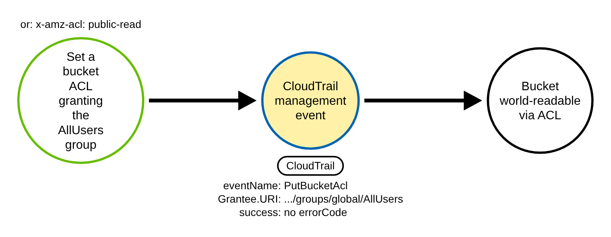
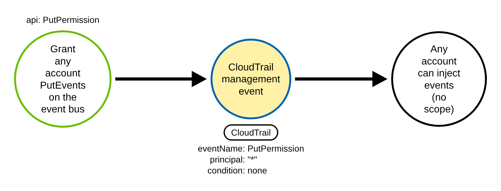
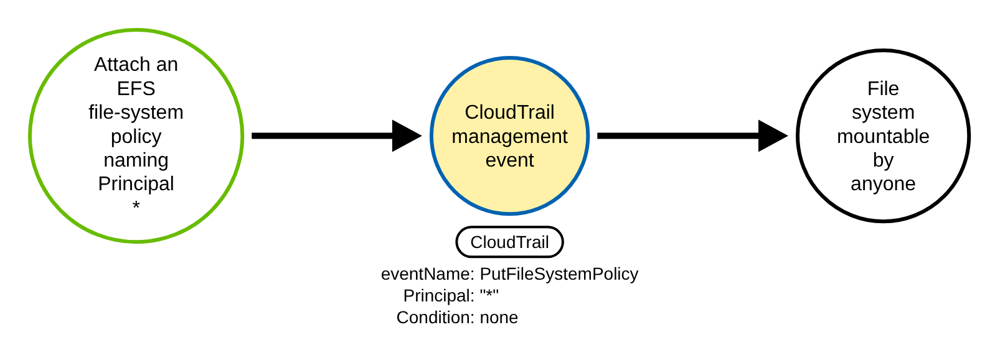
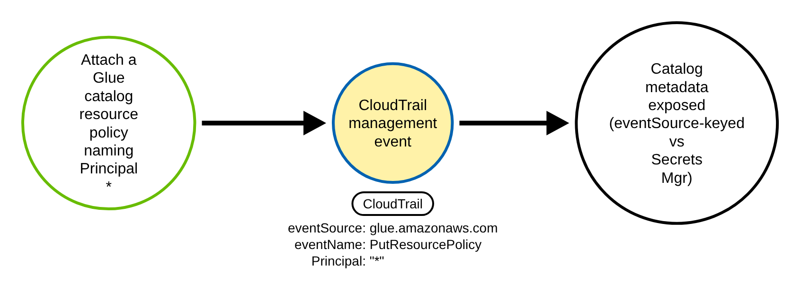
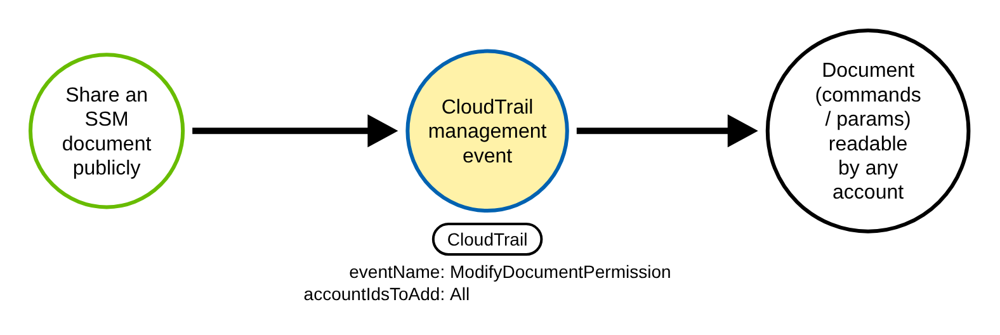

# AWS Public Resource Exposure via ACLs and the Service Long-Tail (AWS)

> Prose uses Simplified Technical English (ASD-STE100) where practical.
> AWS service names, API names, CloudTrail field names, and ATT&CK IDs are
> technical names.

## Metadata

| Key          | Value |
|--------------|-------|
| ID           | TRR9021 |
| External IDs | T1537 |
| Tactics      | Exfiltration |
| Platforms    | AWS |
| Contributors | det-eng |
| Status       | draft |

### Scope Statement

This TRR covers **public exposure of an AWS resource** through a control-plane write that uses an
**access-control list (ACL)** or a resource grant on one of four long-tail services. An operator —
or an adversary with the right permission — makes a bucket world-readable with its ACL, grants an
EventBridge event bus to any account, attaches an EFS file-system policy or a Glue Data Catalog
resource policy that names the public principal, or shares an SSM document with `All`. As in
T1537 generally, the later cross-account or public **read** of the exposed data is not logged in
the owning account, so the only durable control-plane signal is the **exposure act**. This report
keys on that act.

This TRR is the **sibling** of TRR9019. TRR9019 covered resource **policies** on S3, ECR, KMS, SNS,
SQS, Secrets Manager, and Lambda, plus AMI / EBS / RDS snapshot sharing and the S3 Block Public
Access family. TRR9021 covers the two surfaces TRR9019 scoped out: the **ACL field shape** of S3
(`PutBucketAcl`), and the **long-tail services** EventBridge, EFS, Glue, and SSM. The two reports
share no fixtures and no rule. The only surface-level overlaps are disambiguated by `eventSource`:
`PutResourcePolicy` is used by Glue here (`glue.amazonaws.com`, `policyInJson`) and by Secrets
Manager in TRR9019 (`secretsmanager.amazonaws.com`, `resourcePolicy`), and the field
`requestParameters.policy` is used by EFS here and by KMS in TRR9019 — in both cases the committed
rules pin `eventSource`, so neither fires on the other's events.

The novel, detectable contribution is split honestly:

- **Procedure A (S3 ACL) and Procedure E (SSM document) extend prior detection art.** S3 bucket-ACL
  public-access detection exists in Elastic
  (`collection_s3_bucket_acl_public_access_new_identity`, the canned-ACL header) and in Splunk
  `security_content` ("Detect New Open S3 Buckets", the grant list plus the header). SSM
  public-document detection exists in Turbot / Powerpipe
  (`ssm_document_shared_publicly`). Procedure A also **realises the backlog Procedure D that TRR9019
  documented but did not build** — `PutBucketAcl` AllUsers was flagged as default-logged with no
  committed rule.
- **Procedures B, C, and D (EventBridge, EFS, Glue public-principal) are the genuinely new ground.**
  Public-**principal** detection for `PutPermission`, `PutFileSystemPolicy`, and Glue
  `PutResourcePolicy` is sparse to absent in the major open rule sets. The Endgame IAM catalog flags
  the EFS event as an exposure action, but with no public-principal discriminator.

Stratus Red Team ships **no** technique for any of these surfaces — its nearest neighbors are the
bucket-**policy** backdoor and the account-to-account snapshot / AMI shares, which are TRR9019's
ground, not this report's. Atomic Red Team ships **no** T1537 atomic at all. The enabling
misconfiguration is tracked secondarily as T1098 (Account Manipulation); the paired Sigma rules tag
that ID.

**Redshift was considered and excluded.** A public Redshift snapshot was a candidate sub-procedure,
but `AuthorizeSnapshotAccess` takes `AccountWithRestoreAccess`, which accepts only a 12-digit AWS
account ID or the special value `amazon-redshift-support`. There is **no public `"all"` form** —
Redshift manual-snapshot sharing is account-to-account only, which is the allowlist-gated
foreign-account shape that a stateless public-shape rule cannot carry. It is not claimed here.

## Technique Overview

An AWS resource can be made reachable from outside its own account in one write. This report covers
five of those writes.

The simplest is an **ACL** rather than a policy. An S3 bucket carries an access-control list; a
grant to the group `AllUsers` (anyone on the internet) or `AuthenticatedUsers` (any signed-in AWS
principal, which is effectively public) makes the bucket readable to the world. The same effect is
reached through the canned-ACL header `public-read` / `public-read-write`.

The other four are long-tail services that each carry a public grant in their own field. An
**EventBridge** event bus can be shared to the principal `"*"`, so any account can put events on it.
An **EFS** file system can carry a file-system policy that allows the public principal to mount it.
A **Glue** Data Catalog can carry a resource policy that exposes database, table, and column
metadata — often including the S3 locations of the underlying data. An **SSM** document can be
shared with the account ID `All`, which publishes the document (and any commands, parameters, or
references it embeds) to every AWS account.

All five are normal administrative APIs, used every day for public datasets, static-website buckets,
organization-wide event buses, cross-account data meshes, and community automation. What marks the
malicious use is the **grantee with no effective scope**: a public group, a wildcard principal with
no narrowing condition, or the literal `All`.

The exposure write is logged. The read of the exposed data that the adversary is after is **not**
logged in the victim account. T1537 is therefore **control-plane-only detectable** here: a defender
sees the moment of exposure, never the exfiltration.

## Technical Background

### The log shape

Every procedure in scope is a successful, mutating, management-plane API call. In CloudTrail each one
carries `eventType "AwsApiCall"`, `managementEvent true`, `eventCategory "Management"`,
`readOnly false`, and **no** `errorCode` (success). These are **always-on management events**: they
appear in CloudTrail Event history for 90 days with no trail configured, and a trail (or CloudTrail
Lake / EventBridge) gives durable capture. **No data-event selector is needed for any procedure
here.** This is the key difference from TRR9019's object-ACL / `PutObject` procedure, which was an S3
**data** event (off by default) and is explicitly out of scope in this report.

The coarse gate is `eventSource` in the five-service set — `s3.amazonaws.com`,
`events.amazonaws.com`, `elasticfilesystem.amazonaws.com`, `glue.amazonaws.com`, `ssm.amazonaws.com`
— and `eventName` in the ACL / permission / policy / share write set (`PutBucketAcl`,
`PutPermission`, `PutFileSystemPolicy`, `PutResourcePolicy`, `ModifyDocumentPermission`).

### The discriminator

The field that separates attack from benign is the **grantee token with no effective scope**:

- **S3 ACL (A):** a grant to a group URI
  `http://acs.amazonaws.com/groups/global/AllUsers` or `.../AuthenticatedUsers` in
  `requestParameters.AccessControlPolicy.AccessControlList.Grant[].Grantee.URI`, **or** a canned ACL
  `requestParameters.x-amz-acl` of `public-read` / `public-read-write`. A grant to a named
  `CanonicalUser` (a specific account's canonical ID), or `private` / `bucket-owner-full-control`, is
  not public and must not fire.
- **EventBridge (B):** flat form — `requestParameters.principal` equal to the string `"*"` with
  `requestParameters.condition` **absent**; or policy form — `requestParameters.policy` (a JSON
  string) with an `Allow` statement naming `Principal "*"` / `{"AWS":"*"}` and no org condition. A
  `"*"` grant that carries an `aws:PrincipalOrgID` condition (`requestParameters.condition.key`) is an
  organization-wide bus and is effectively private.
- **EFS (C) and Glue (D):** a policy statement with `Effect "Allow"` and `Principal` equal to the
  string `"*"` or the object `{"AWS":"*"}` (or `"*"` as any entry of an `AWS` list, such as
  `{"AWS":["arn:aws:iam::123456789012:root","*"]}`), and **none** of the scoping condition keys
  `aws:PrincipalOrgID` / `aws:SourceArn` / `aws:SourceAccount` / `aws:SourceVpc` present. For EFS,
  `aws:SourceOwner` and `elasticfilesystem:AccessedViaMountTarget` set to `true` (the console
  wizard's condition) also scope a statement, and the scope must sit in the same statement: the EFS
  User Guide ("Blocking public access" > "The meaning of 'public'") counts a policy as non-public
  only if it grants access only to fixed values of those keys. The EFS policy sits in
  `requestParameters.policy`; the Glue policy sits in `requestParameters.policyInJson`.
- **SSM (E):** `requestParameters.accountIdsToAdd` containing `"All"` (case-insensitive; the CLI
  constrains the value to `(?i)all` or a 12-digit account ID). A share to a named 12-digit account is
  not public.

All five committed rules **require success** (`not errorCode`). This matters most for S3: since April
2023 new buckets default to Object-Ownership "bucket owner enforced", which disables ACLs, so a
`PutBucketAcl` then fails with `AccessControlListNotSupported` (an `errorCode`) and changes nothing.
Requiring success keeps the rule off no-op attempts and reflects the reduced real-world blast radius
of the ACL vector (legacy and ACL-opt-out buckets remain exposed).

### Encoding and matching notes

The grant is carried differently per service:

- **S3 `PutBucketAcl`** records the grant list as a **nested object** under
  `requestParameters.AccessControlPolicy`, or a canned ACL as the flat header
  `requestParameters.x-amz-acl`. The committed rule matches both shapes.
- **EventBridge `PutPermission`** records **either** flat fields (`principal`, `action`,
  `statementId`, `condition`) **or** a single `policy` JSON string. The rule handles both.
- **EFS `PutFileSystemPolicy`** carries an IAM resource policy in `requestParameters.policy`, and
  **Glue `PutResourcePolicy`** carries one in `requestParameters.policyInJson`. The exact encoding
  (nested object vs escaped JSON string) is **not yet confirmed from a captured event** — the
  recorded fixtures use an escaped JSON string. As TRR9019 did for its seven mixed-encoding policy
  services, the committed rule matches the public-principal token as **text** across whichever
  representation; a production pipeline should JSON-decode and evaluate scope per statement.

Two matching gotchas. The public principal is matched by **regex on the literal asterisk**
(`"(?:Principal|AWS)"\s*:\s*"\*"`), never a Sigma `*` wildcard, so the match is the public principal
and not any named `{"AWS":"arn:..."}` principal. And **Glue `PutResourcePolicy` shares its name with
two other APIs** — Secrets Manager `PutResourcePolicy` (`secretsmanager.amazonaws.com`, field
`resourcePolicy`, already covered by TRR9019) and CloudTrail's own `PutResourcePolicy`
(`cloudtrail.amazonaws.com`). The Glue rule pins `eventSource = glue.amazonaws.com` so it neither
overlaps TRR9019's Secrets Manager rule nor fires on CloudTrail's own call.

## Procedures

| Procedure | ID | Name | Entry point |
|-----------|----|------|-------------|
| A | TRR9021.AWS.A | S3 bucket ACL grants public access | `PutBucketAcl` grantee `.../AllUsers` or `x-amz-acl public-read` |
| B | TRR9021.AWS.B | EventBridge event bus made public | `PutPermission` principal `"*"`, no condition |
| C | TRR9021.AWS.C | EFS file-system policy made public | `PutFileSystemPolicy` `Principal "*"`, no scope |
| D | TRR9021.AWS.D | Glue Data Catalog resource policy made public | `PutResourcePolicy` (`glue.amazonaws.com`) `Principal "*"` |
| E | TRR9021.AWS.E | SSM document shared publicly | `ModifyDocumentPermission` `accountIdsToAdd "All"` |

> A tool is not a procedure. The AWS console, `aws-cli`, an SDK, or infrastructure-as-code all send
> the same write. They are the same procedure.

**Reading the DDMs.** Green borders are operations the client / adversary performs. Blue borders are
operations the AWS control plane performs (CloudTrail). Black borders are the abstract effect. The
pill names the telemetry; the `Key: value` lines are what a rule matches; a shaded node is the primary
detection opportunity. The exposure-write audit event is the shared chokepoint for every procedure;
each one differs only in its field path and encoding.

### Procedure A: S3 bucket ACL grants public access  (`TRR9021.AWS.A`)

The adversary makes a bucket world-readable through its ACL rather than through a bucket policy:
`PutBucketAcl` with a grantee group URI of `http://acs.amazonaws.com/groups/global/AllUsers` (or
`AuthenticatedUsers`), or a canned-ACL header `x-amz-acl` of `public-read` / `public-read-write`.
This reaches the same effect as a public bucket policy by a different field shape. It realises the
backlog Procedure D that TRR9019 documented but shipped no rule for, and extends the Elastic and
Splunk prior art with a committed CI fixture.

- **Prerequisites:** `s3:PutBucketAcl`, and an Object-Ownership / BPA state that still honors ACLs.
- **Mechanics:** one mutating management call writes the grant; the public read that follows is never
  logged in this account. Under "bucket owner enforced" the call fails and must not fire — the rule
  requires success.
- **Impact:** the bucket is readable by anyone.

#### Detection Data Model — `TRR9021.AWS.A`

Source: [`ddms/trr9021_aws_a.json`](ddms/trr9021_aws_a.json) (Arrows app format).

**DDM summary.** The shaded node is the CloudTrail management event (`eventSource` `s3.amazonaws.com`,
`eventName` `PutBucketAcl`), whose key fields are the grantee group URI
`.../groups/global/AllUsers` in `requestParameters.AccessControlPolicy.AccessControlList.Grant[]`
**or** the canned header `requestParameters.x-amz-acl public-read`, with no `errorCode`. The
discriminator against a benign share is the public group (or canned header) versus a named
`CanonicalUser`. The later public read of the objects is unlogged.

### Procedure B: EventBridge event bus made public  (`TRR9021.AWS.B`)

The adversary grants an EventBridge event bus to any account: `PutPermission` with
`requestParameters.principal "*"` and **no** `requestParameters.condition` (flat form), or a
`requestParameters.policy` document whose statement names `Principal "*"`. A public event bus lets any
account put events on it, which can trigger rules, invoke targets, or poison downstream automation.
Public-principal detection for EventBridge is sparse in open rule sets — this is new ground.

- **Prerequisites:** `events:PutPermission` on the target event bus.
- **Mechanics:** `Action` is currently fixed to `events:PutEvents`; the `aws:PrincipalOrgID`
  condition, when present, scopes the `"*"` grant to one organization and makes it effectively private.
- **Impact:** any AWS account can inject events onto the bus.

#### Detection Data Model — `TRR9021.AWS.B`

Source: [`ddms/trr9021_aws_b.json`](ddms/trr9021_aws_b.json) (Arrows app format).

**DDM summary.** The shaded node is the CloudTrail management event (`eventSource`
`events.amazonaws.com`, `eventName` `PutPermission`), whose key fields are
`requestParameters.principal "*"` with `requestParameters.condition` absent (flat form), or a
`requestParameters.policy` naming `Principal "*"`. The discriminator against a benign org-wide bus is
the **missing scope** — an `aws:PrincipalOrgID` condition (`requestParameters.condition.key`)
suppresses the rule.

### Procedure C: EFS file-system policy made public  (`TRR9021.AWS.C`)

The adversary attaches an EFS file-system policy that allows the public principal to mount the file
system: `PutFileSystemPolicy` with a statement of `Effect "Allow"` and `Principal "*"` (or
`{"AWS":"*"}`) and no scoping condition, in `requestParameters.policy`. This exposes a network file
system to anonymous mount and access. Public-principal detection for EFS is largely absent from open
rule sets — this is new ground.

- **Prerequisites:** `elasticfilesystem:PutFileSystemPolicy` on the file system.
- **Mechanics:** when an explicit policy is set, it overrides the default policy; a wildcard principal
  with no `aws:PrincipalOrgID` / `aws:SourceArn` / `aws:SourceAccount` / `aws:SourceVpc` condition
  grants anonymous access.
- **Impact:** the file system is mountable by any principal.

#### Detection Data Model — `TRR9021.AWS.C`

Source: [`ddms/trr9021_aws_c.json`](ddms/trr9021_aws_c.json) (Arrows app format).

**DDM summary.** The shaded node is the CloudTrail management event (`eventSource`
`elasticfilesystem.amazonaws.com`, `eventName` `PutFileSystemPolicy`), whose key field is
`requestParameters.policy` carrying `Effect "Allow"` + `Principal "*"` with no scoping condition. The
discriminator against a benign named / org-scoped grant is the public principal with the condition
keys absent.

### Procedure D: Glue Data Catalog resource policy made public  (`TRR9021.AWS.D`)

The adversary attaches a Glue Data Catalog resource policy that names the public principal:
`PutResourcePolicy` on `glue.amazonaws.com` with `requestParameters.policyInJson` carrying
`Effect "Allow"` + `Principal "*"` and no scoping condition. This exposes catalog metadata — database,
table, and column definitions, often including the S3 locations of the underlying data —
cross-account or publicly. Public-principal detection for Glue is absent from the major prebuilt rule
sets — this is new ground.

- **Prerequisites:** `glue:PutResourcePolicy` on the catalog.
- **Mechanics:** the rule is keyed to `eventSource glue.amazonaws.com` to avoid the name collision
  with Secrets Manager `PutResourcePolicy` (TRR9019) and CloudTrail's own `PutResourcePolicy`.
- **Impact:** catalog metadata is readable by any account.

#### Detection Data Model — `TRR9021.AWS.D`

Source: [`ddms/trr9021_aws_d.json`](ddms/trr9021_aws_d.json) (Arrows app format).

**DDM summary.** The shaded node is the CloudTrail management event (`eventSource`
`glue.amazonaws.com`, `eventName` `PutResourcePolicy`), whose key field is
`requestParameters.policyInJson` carrying `Effect "Allow"` + `Principal "*"` with no scoping
condition. The `eventSource` pin is itself a discriminator: a public Secrets Manager or CloudTrail
`PutResourcePolicy` does not fire this rule.

### Procedure E: SSM document shared publicly  (`TRR9021.AWS.E`)

The adversary shares a Systems Manager document publicly: `ModifyDocumentPermission` with
`requestParameters.accountIdsToAdd` containing `"All"`. A publicly shared SSM document is a known
data-exposure vector — documents embed commands, automation steps, and sometimes parameters, secrets,
or internal references that any AWS account can then read. This extends the Turbot / Powerpipe prior
art with a committed CI fixture.

- **Prerequisites:** `ssm:ModifyDocumentPermission` on the document.
- **Mechanics:** `permissionType` is `Share`; the `remove` direction (`accountIdsToRemove`) is a
  de-exposure and is excluded. The rule requires success.
- **Impact:** the document is readable by every AWS account.

#### Detection Data Model — `TRR9021.AWS.E`

Source: [`ddms/trr9021_aws_e.json`](ddms/trr9021_aws_e.json) (Arrows app format).

**DDM summary.** The shaded node is the CloudTrail management event (`eventSource`
`ssm.amazonaws.com`, `eventName` `ModifyDocumentPermission`), whose key field is
`requestParameters.accountIdsToAdd` containing `"All"`, with no `errorCode`. The discriminator against
a benign partner share is the literal `All` rather than a named 12-digit account ID.

## Available Emulation Tests

Cloud attacks have no free live target, so the emulation has two halves. The runnable half is an
Atomic-Red-Team-style test
([`atomics/T1537/src/emulate_aws_public_exposure_longtail.sh`](../../../atomics/T1537/src/emulate_aws_public_exposure_longtail.sh),
with wrappers in [`atomics/T1537/T1537.yaml`](../../../atomics/T1537/T1537.yaml)) that performs one
throwaway exposure in **your own AWS account** and immediately reverts it (guarded by
`TRR9021_LIVE=1`); it is **not run in CI** because it needs AWS credentials and a resource to expose.
The proven half is a pair of committed, schema-faithful CloudTrail fixtures
([`detections/cloud/fixtures/trr9021/`](../../../detections/cloud/fixtures/trr9021/)) that the CI
validator runs the rules over. Every object is named `trr9021-*`, the public source IP is the RFC 5737
TEST-NET address `198.51.100.23`, the benign source IP is the RFC 1918 egress address `10.0.4.9`, the
account is the AWS documentation account `123456789012`, and each record carries the full
`eventType` / `managementEvent` / `eventCategory` / `readOnly` / `recipientAccountId` envelope.
The records are documentation-derived, not captured from a run. The emulation's procedure A uses
the canned ACL `--acl public-read`, and procedures C and D have no live step, so no emulation step
writes the two `PutBucketAcl` grant records or the EFS and Glue records. The second `PutBucketAcl`
record, whose `AccessControlList.Grant` is a single object (one `AllUsers` `READ` grant), takes its
shape from the `PutBucketAcl` example in the S3 User Guide ("CloudTrail log file entries for Amazon
S3").

| Procedure | Test | Status |
|-----------|------|--------|
| TRR9021.AWS.A | `emulate_aws_public_exposure_longtail.sh a` — public S3 bucket ACL (fixture: `PutBucketAcl` grantee `.../AllUsers`). | **built** |
| TRR9021.AWS.B | `emulate_aws_public_exposure_longtail.sh b` — public EventBridge bus (fixture: `PutPermission` `principal "*"`, no condition). | **built** |
| TRR9021.AWS.C | `emulate_aws_public_exposure_longtail.sh c` — public EFS policy (fixture: `PutFileSystemPolicy` `Principal "*"`). | **built** |
| TRR9021.AWS.D | `emulate_aws_public_exposure_longtail.sh d` — public Glue catalog policy (fixture: `PutResourcePolicy` `glue.amazonaws.com` `Principal "*"`). | **built** |
| TRR9021.AWS.E | `emulate_aws_public_exposure_longtail.sh e` — public SSM document (fixture: `ModifyDocumentPermission` `accountIdsToAdd ["All"]`). | **built** |

Redshift public-snapshot sharing was considered and **dropped**: `AuthorizeSnapshotAccess` has no
public `"all"` form, so it is account-to-account only and belongs to an allowlist-gated
foreign-account pipeline, not this stateless public-shape report. OpenSearch
`UpdateDomainConfig` / `CreateDomain` (`es.amazonaws.com`), whose `AccessPolicies` field can carry
`Principal "*"`, is a natural in-family sixth procedure once a captured event pins its field path.

## Detection Strategy

Compare the DDMs. The exfiltration leaves no API trace in every procedure, so the only control-plane
signal is the **exposure write**. Across A–E that write is one audit-event family — a successful,
mutating, always-on management call in the five-service set whose payload names a public grantee with
no effective scope. Five rules split it by `eventSource` / `eventName` and field path.

**Telemetry requirement.** A CloudTrail trail (or Event history) capturing management events — present
by default, no data-event selector needed. Multi-account organizations must capture member-account
trails and pivot on `recipientAccountId`; there is no org-wide default that guarantees durable capture
beyond the 90-day Event history, so a trail or CloudTrail Lake is the deployment prerequisite.

**Strategy 1 — public S3 bucket ACL (covers A).** Match `PutBucketAcl` and fire on a grantee group URI
`.../AllUsers` / `.../AuthenticatedUsers` or a canned `x-amz-acl` of `public-read` /
`public-read-write`, requiring success.

**Strategy 2 — public EventBridge bus (covers B).** Match `PutPermission` and fire on
`principal "*"` (flat) or a `policy` naming `Principal "*"`, **unless** a scoping condition is present
(`condition.key` set, or `aws:PrincipalOrgID` / `aws:SourceArn` / `aws:SourceAccount` in the policy).

**Strategy 3 — public EFS file-system policy (covers C).** Match `PutFileSystemPolicy` and fire on an
`Allow` + `Principal "*"` token (a string, or any entry of an `AWS` list) in
`requestParameters.policy` unless every statement that allows the public principal carries a
scoping condition key, or `elasticfilesystem:AccessedViaMountTarget` set to `true`, in that same
statement.

**Strategy 4 — public Glue resource policy (covers D).** Match `PutResourcePolicy` on
`glue.amazonaws.com` only and fire on an `Allow` + `Principal "*"` token in
`requestParameters.policyInJson` with no scoping condition.

**Strategy 5 — public SSM document (covers E).** Match `ModifyDocumentPermission` and fire on
`requestParameters.accountIdsToAdd` containing `"All"`, requiring success.

**The hard negative control.** The sharpest benign baseline is the EventBridge org-scoped bus: the
same `events.amazonaws.com` / `PutPermission` / success event, the same `principal "*"`, suppressed
**only** by an `aws:PrincipalOrgID` condition (`statementId trr9021-org-bus`,
`condition.key aws:PrincipalOrgID`, `value o-trr9021example`). Strategy 2 must stay silent on it. That
pass proves the rule keys on the **absence of a scoping condition**, not on `Principal "*"` alone —
keying on the wildcard alone over-fires on every legitimate org-wide bus. Each other procedure has its
own close negative: a `CanonicalUser` bucket ACL for A, a named `{"AWS":"...:root"}` + org condition
policy for C, a named-account policy for D, and a named 12-digit `accountIdsToAdd` for E. The Glue
benign also carries a **confounder** — a Secrets Manager `PutResourcePolicy` with `Principal "*"` that
the Glue rule must ignore, proving the `eventSource` pin works.

**Limits and demonstrated gaps.**

- **The exfiltration itself** — the public or cross-account read of the exposed data — emits **no
  CloudTrail event** in the victim account. This report detects the exposure act, never the read.
- **S3 ACLs are increasingly inert.** Under Object-Ownership "bucket owner enforced" (the default for
  new buckets since April 2023) ACLs are disabled and `PutBucketAcl` fails; the rule requires success,
  so the real-world blast radius is legacy and ACL-opt-out buckets.
- **EFS / Glue field encoding** (nested object vs escaped JSON string) is not yet confirmed from a
  captured event; the fixtures use an escaped string, and the text-match discriminator is
  encoding-agnostic (TRR9019 precedent). Confirm with one real capture at build time.
- **Per-statement scoping and decoy conditions** (inherited from TRR9019): a policy can mix an
  org-scoped statement with a second unconditioned `Principal "*"` statement, or add a wildcard-value
  decoy condition. The EFS rule evaluates the scoping filters per statement with a bounded,
  portable regex (no lookahead), so it fires on the mix, but it checks only that a key is present in
  the statement's `Condition`, not its value, and when it finds no public `Allow` statement it
  still reads the `Allow` and the `"*"` across the whole document (a named-principal `Allow` next
  to a public `Deny` with no scoping key fires).
  It tests statements 1 to 5 one by one, so a policy whose public `Allow` statements are all scoped
  is quiet; a public `Allow` at statement 6 or later fires without a scope test. The EventBridge and Glue rules match tokens across the whole
  document. A production pipeline should JSON-decode and evaluate scope per statement and reject
  wildcard condition values.
- **Named-foreign-account exposure** (a 12-digit partner account rather than `"*"` / `All`) is
  cross-account exposure too, but telling a hostile account from a legitimate partner needs an
  organization allowlist a stateless rule cannot carry. It is left to a production pipeline.
- **False positives share the structural fields:** intentionally public static-website buckets and
  open datasets (`public-read`), AWS-published or community SSM documents, org-wide event buses scoped
  by `aws:PrincipalOrgID`, cross-service grants carrying `SourceArn` / `SourceAccount`, and IaC
  automation. Match the public token exactly (`"*"` / `{"AWS":"*"}` / the two group URIs / `All`),
  never a loose `*` substring, and allowlist by resource.

## Detections

| Strategy | Covers | Sigma rule | Sensor |
|----------|--------|------------|--------|
| 1 (S3 bucket ACL) | A | [`detections/sigma/T1537/aws_s3_bucket_acl_made_public.yml`](../../../detections/sigma/T1537/aws_s3_bucket_acl_made_public.yml) | CloudTrail |
| 2 (EventBridge bus) | B | [`detections/sigma/T1537/aws_eventbridge_bus_made_public.yml`](../../../detections/sigma/T1537/aws_eventbridge_bus_made_public.yml) | CloudTrail |
| 3 (EFS policy) | C | [`detections/sigma/T1537/aws_efs_file_system_policy_made_public.yml`](../../../detections/sigma/T1537/aws_efs_file_system_policy_made_public.yml) | CloudTrail |
| 4 (Glue policy) | D | [`detections/sigma/T1537/aws_glue_resource_policy_made_public.yml`](../../../detections/sigma/T1537/aws_glue_resource_policy_made_public.yml) | CloudTrail |
| 5 (SSM document) | E | [`detections/sigma/T1537/aws_ssm_document_shared_publicly.yml`](../../../detections/sigma/T1537/aws_ssm_document_shared_publicly.yml) | CloudTrail |

The validator
[`detections/validate_cloud_detections.py`](../../../detections/validate_cloud_detections.py)
runs the rules over the recorded attack fixture (each must fire, and the match must carry the
`trr9021-` marker) and over the benign baseline (they must fire on nothing) — proving **attack-fires +
benign-clean**. The attack fixture carries one event per procedure: `PutBucketAcl` AllUsers for A,
`PutPermission` `principal "*"` with no condition for B, `PutFileSystemPolicy` `Principal "*"` for C,
Glue `PutResourcePolicy` `Principal "*"` for D, and `ModifyDocumentPermission` `["All"]` for E. The
benign fixture is the close negative control: the same APIs with the exposure removed — the bucket ACL
to a named `CanonicalUser`, the event bus scoped by `aws:PrincipalOrgID`, the EFS policy to a named
`{"AWS":"...:root"}` with an `aws:PrincipalOrgID` condition, the Glue policy to a named
`{"AWS":"...:root"}` (no public principal), the SSM share to a named account — plus the
Secrets Manager `PutResourcePolicy` `Principal "*"` confounder that the Glue rule must ignore. The pass
proves the rules key on the public grantee and the missing scope, not on the API alone.

The detection idea has prior art for two of the five procedures and must cite it: S3 bucket-ACL public
access in Elastic (`collection_s3_bucket_acl_public_access_new_identity`) and Splunk `security_content`
("Detect New Open S3 Buckets"); SSM public-document sharing in Turbot / Powerpipe
(`ssm_document_shared_publicly`). The EventBridge, EFS, and Glue public-principal rules are the
genuinely new ground (the Endgame IAM catalog flags the EFS event as an exposure action, but with no
public-principal discriminator). The contribution across the whole set is the paired **emulation +
committed CI fixtures** for the ACL field shape and the four long-tail services, which neither Stratus
Red Team nor Atomic Red Team ships.

## References

- MITRE ATT&CK, T1537 Transfer Data to Cloud Account:
  <https://attack.mitre.org/techniques/T1537/>
- MITRE ATT&CK, T1098 Account Manipulation:
  <https://attack.mitre.org/techniques/T1098/>
- AWS, S3 `PutBucketAcl` API (`x-amz-acl` canned ACLs, `AccessControlPolicy`, `Grantee`):
  <https://docs.aws.amazon.com/AmazonS3/latest/API/API_PutBucketAcl.html>
- AWS, S3 access control list (ACL) overview (`AllUsers` / `AuthenticatedUsers` group URIs):
  <https://docs.aws.amazon.com/AmazonS3/latest/userguide/acl-overview.html>
- AWS, EventBridge `PutPermission` API (`Principal "*"`, `Condition aws:PrincipalOrgID`, `Policy` form):
  <https://docs.aws.amazon.com/eventbridge/latest/APIReference/API_PutPermission.html>
- AWS, EFS `PutFileSystemPolicy` API (resource-based `Policy`):
  <https://docs.aws.amazon.com/efs/latest/ug/API_PutFileSystemPolicy.html>
- AWS, EFS Blocking public access ("The meaning of 'public'": the non-public condition keys,
  including `elasticfilesystem:AccessedViaMountTarget` set to `true`):
  <https://docs.aws.amazon.com/efs/latest/ug/access-control-block-public-access.html>
- AWS, CloudTrail log file entries for Amazon S3 (a `PutBucketAcl` record whose single `Grant` is
  an object):
  <https://docs.aws.amazon.com/AmazonS3/latest/userguide/cloudtrail-logging-understanding-s3-entries.html>
- AWS, Glue `PutResourcePolicy` API (`PolicyInJson`):
  <https://docs.aws.amazon.com/glue/latest/webapi/API_PutResourcePolicy.html>
- AWS, SSM `ModifyDocumentPermission` API (`AccountIdsToAdd = All` for public):
  <https://docs.aws.amazon.com/systems-manager/latest/APIReference/API_ModifyDocumentPermission.html>
- AWS, SSM `modify-document-permission` CLI (value pattern `(?i)all|[0-9]{12}`):
  <https://docs.aws.amazon.com/cli/latest/reference/ssm/modify-document-permission.html>
- AWS, Redshift `AuthorizeSnapshotAccess` API (`AccountWithRestoreAccess`; no public `"all"` value):
  <https://docs.aws.amazon.com/redshift/latest/APIReference/API_AuthorizeSnapshotAccess.html>
- AWS, IAM global condition keys (`aws:PrincipalOrgID`, `aws:SourceArn`, `aws:SourceAccount`):
  <https://docs.aws.amazon.com/IAM/latest/UserGuide/reference_policies_condition-keys.html>
- Elastic, prebuilt rule — S3 bucket ACL public access (`x-amz-acl public-read`):
  <https://github.com/elastic/detection-rules/blob/main/rules/integrations/aws/collection_s3_bucket_acl_public_access_new_identity.toml>
- Splunk `security_content`, "Detect New Open S3 Buckets" (`PutBucketAcl` AllUsers / AuthenticatedUsers):
  <https://research.splunk.com/cloud/2a9b80d3-6340-4345-b5ad-290bf3d0dac4/>
- Turbot / Powerpipe, tailpipe AWS CloudTrail detections — `ssm_document_shared_publicly`:
  <https://hub.powerpipe.io/mods/turbot/tailpipe-mod-aws-cloudtrail-log-detections/benchmarks/detection.ssm_document_shared_publicly>
- Endgame IAM dataset — EFS risks (`PutFileSystemPolicy` exposure):
  <https://endgame.readthedocs.io/en/latest/risks/efs/>
- Stratus Red Team, AWS attack techniques (no coverage of these; account-to-account neighbors only):
  <https://stratus-red-team.cloud/attack-techniques/AWS/>
- TRR9019 (local, the resource-policy / snapshot / BPA report this complements):
  [`research/trr9019/aws/README.md`](../../trr9019/aws/README.md)
- TRR method:
  <https://github.com/tired-labs/techniques/blob/main/docs/TECHNIQUE-RESEARCH-REPORT.md>
