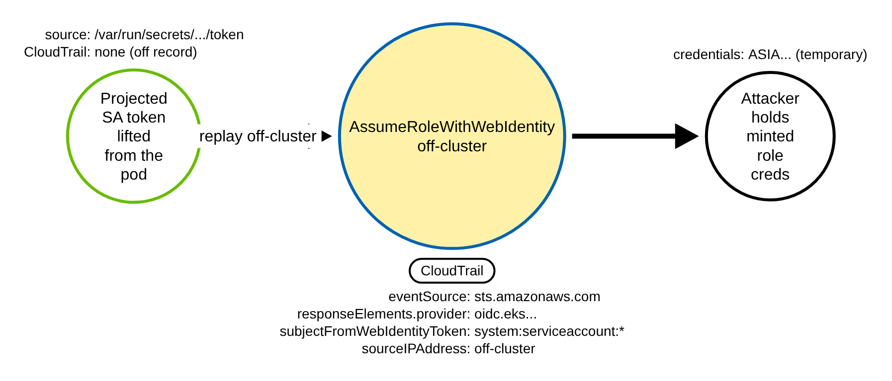
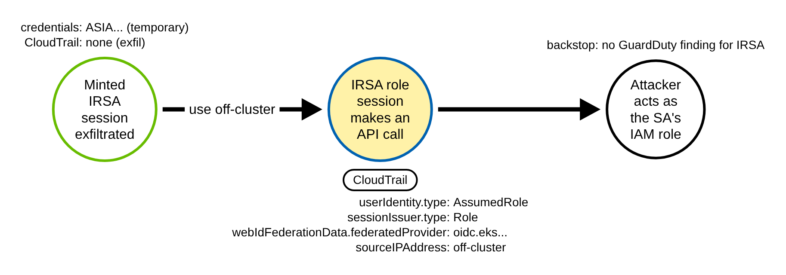
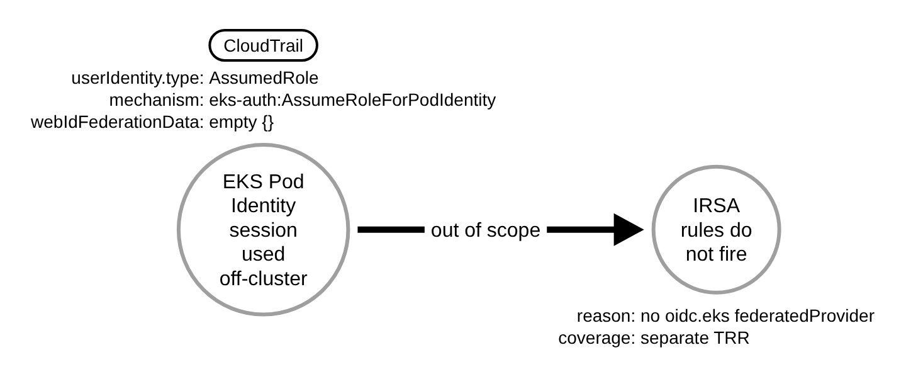
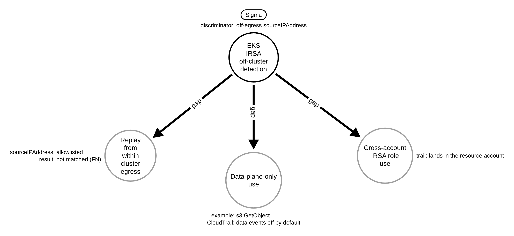

# EKS IRSA Credentials Used Off-Cluster (AWS)

> Prose uses Simplified Technical English (ASD-STE100) where practical.
> AWS service names, API names, CloudTrail field names, and ATT&CK IDs are
> technical names.

## Metadata

| Key          | Value |
|--------------|-------|
| ID           | TRR9022 |
| External IDs | T1550.001, T1078.004 |
| Tactics      | Stealth, Lateral Movement |
| Platforms    | AWS |
| Contributors | det-eng |
| Status       | draft |

### Scope Statement

This TRR covers the **off-cluster use** of Amazon EKS **IRSA** (IAM Roles for Service
Accounts) credentials: an adversary lifts a pod's projected service-account OIDC token
(or the temporary role credentials it mints) and uses it from a source the cluster does
not own — their own machine, another account, or anywhere off the worker nodes.

The novel, detectable contribution is the **off-cluster use**, not the theft. Reading a
projected service-account token off a pod's volume is the upstream enabler and is out
of scope here. ATT&CK v20 places that read under T1528 (Steal Application Access Token)
and T1552.001 (Credentials In Files); this repository documents it as TRR9006 Procedure
E (filed under T1552.007). No emulation in Stratus Red Team or Atomic Red Team steals an IRSA
web-identity token and uses it off-cluster (Stratus ships the GCP equivalent,
`use-compute-sa-outside-gcp`, but no EKS IRSA one). The only prior production detections
are Elastic's: two prebuilt rules — "AssumeRoleWithWebIdentity from a Kubernetes service
account and an external ASN" (a CloudTrail rule on the exchange leg) and "AWS Lateral
Movement from Kubernetes SA via AssumeRoleWithWebIdentity" (an ES|QL correlation rule on
the use leg) — and this report is honestly differentiated from both (below). SigmaHQ,
Panther, and Splunk ESCU ship none, so the Sigma rules here are the first for this
behavior in those ecosystems.

This is the EKS sibling of TRR9011 (EC2 instance-role credentials used off-instance),
with a **cleaner, non-forgeable provenance anchor** and — unlike TRR9011 — **no
GuardDuty backstop**, which makes the CloudTrail rule the primary detection rather than
a secondary one.

## Technique Overview

A pod on EKS that uses IRSA is given a short-lived, signed OIDC token on a projected
volume (`/var/run/secrets/eks.amazonaws.com/serviceaccount/token`). The pod's AWS SDK
presents that token to AWS STS with `sts:AssumeRoleWithWebIdentity` and receives
temporary credentials for the IAM role its service account is annotated with. This is
how a workload gets AWS permissions without a stored key, and the credentials are
rotated for you.

The weakness is that the projected token is a bearer token: anything that can read it
from the pod — a container compromise, a vulnerable dependency, an over-mounted volume
— can present it to STS from anywhere, until it expires. And once the token is
exchanged, the resulting role credentials (an `ASIA...` access key) are themselves
bearer credentials that work from anywhere until they expire. An attacker therefore has
two off-cluster surfaces: replay the **token** (the exchange) off-cluster, or exfiltrate
the **minted credentials** and use them off-cluster.

Lifting the token off the pod is invisible to AWS (it is a file read inside the
container, not an AWS API call). The first thing AWS sees is either the
`AssumeRoleWithWebIdentity` exchange or the first API call made with the minted
credentials — and each carries a tell: the session is federated from the cluster's EKS
OIDC provider, but the call comes from an IP the cluster does not own.

## Technical Background

### What an IRSA exchange looks like in CloudTrail

The token exchange is a default-logged STS management event
(`eventType` `AwsApiCall`, `managementEvent` `true`; no data-event selector needed).
Its shape (field casing is load-bearing — CloudTrail normalises `responseElements` and
`requestParameters` to lowerCamelCase even though the STS API model is PascalCase):

- `eventSource` is `sts.amazonaws.com` and `eventName` is `AssumeRoleWithWebIdentity`;
- `userIdentity.type` is `WebIdentityUser` (there is no AWS principal on the request
  side — the caller is externally, OIDC-authenticated);
- `responseElements.provider` is the cluster's IAM OIDC-provider ARN, which contains
  `oidc.eks.<region>.amazonaws.com/id/<id>`;
- `responseElements.subjectFromWebIdentityToken` is the pod's service account,
  `system:serviceaccount:<namespace>:<serviceaccount>`;
- `responseElements.audience` is `sts.amazonaws.com`;
- `responseElements.credentials.accessKeyId` is the minted `ASIA...` key (the pivot to
  every later call made with it — `secretAccessKey` is the only field CloudTrail
  redacts).

### What a subsequent IRSA call looks like in CloudTrail

Every later call made with the minted session is an ordinary `AssumedRole` event, but
it keeps a federation marker:

- `userIdentity.type` is `AssumedRole` and
  `userIdentity.sessionContext.sessionIssuer.type` is `Role`;
- `userIdentity.sessionContext.webIdFederationData.federatedProvider` is the cluster's
  EKS OIDC-provider ARN (contains `oidc.eks...`). **This field is populated by STS from
  the validated OIDC token and the caller cannot forge it.**

The `federatedProvider` is the decisive, non-forgeable in-record marker — the IRSA
analog of TRR9011's `ec2RoleDelivery`, but richer, because it names the specific
cluster OIDC provider. It is present **only** for IRSA sessions: EKS **Pod Identity**
sessions carry an **empty** `webIdFederationData`, and GitHub Actions or other
web-identity sessions carry a **different** provider — so keying on `oidc.eks` both
confirms IRSA and excludes those. One limitation: the service-account subject does
**not** propagate to subsequent calls (only the role ARN and the provider ARN do), so
attributing a downstream call to a specific pod requires joining its `accessKeyId` back
to the `AssumeRoleWithWebIdentity` event.

These fields are **provenance, not a detection**. They are true of essentially every
benign IRSA exchange and call, so on their own they match ~100% of normal workload
activity.

### The discriminator is the source, and there is no GuardDuty backstop

What separates theft-and-use from normal use is the source. Legitimate IRSA traffic
egresses from the worker nodes — a node-ENI private IP, a VPC-endpoint ENI, or the
account's NAT-gateway / Elastic IP. Stolen tokens or credentials used off-cluster come
from somewhere else.

Whether a `sourceIPAddress` is "the cluster's own" **cannot be decided from a single
CloudTrail record**; it has to be joined against the cluster's egress. TRR9011 can lean
on GuardDuty, which does this join natively for EC2 instance roles
(`InstanceCredentialExfiltration.OutsideAWS` / `.InsideAWS`). **For EKS IRSA there is no
equivalent finding:** `InstanceCredentialExfiltration` is EC2-instance-profile only, and
the newer `ResourceCredentialExfiltration` covers ECS / Lambda (endpoint-delivered,
resource-bound sessions) but **not** a classic IRSA `AssumeRoleWithWebIdentity` session,
which carries no resource binding for GuardDuty to join. GuardDuty's EKS features do not
close this either — EKS Protection reads the Kubernetes audit log (not AWS IAM
credential use) and EKS Runtime Monitoring is an on-node agent that is blind to
off-cluster replay. So the CloudTrail rule here is the **primary** detection, and its
source-IP allowlist approximation is load-bearing, not a backstop.

### Why the technique works

IRSA hands a pod a signed bearer token and mints bearer credentials from it, and the
theft of either leaves no AWS API trace. Both work from anywhere until they expire. The
only durable control-plane signal is the off-cluster use, so a detection must key on the
IRSA federation provenance and test the source against what the cluster owns.

## Procedures

| Procedure | ID | Name | Entry point |
|-----------|----|------|-------------|
| A | TRR9022.AWS.A | Off-cluster IRSA token exchange | replay stolen projected token to STS |
| B | TRR9022.AWS.B | Off-cluster use of a minted IRSA session | use exfiltrated `ASIA...` creds |
| C | TRR9022.AWS.C | EKS Pod Identity (out of scope) | `eks-auth:AssumeRoleForPodIdentity` |
| D | TRR9022.AWS.D | Residual detection gaps | in-egress replay / data plane / cross-account |

> A tool is not a procedure. `aws-cli`, boto3, a custom SigV4 client, and bespoke
> exfiltration tooling that reuses the stolen token or credentials all send the same
> off-cluster call. They are the same procedure.

**Reading the DDMs.** Green borders are operations the attacker performs off the record
(the theft is unlogged). Blue borders with a shaded fill are the CloudTrail chokepoint —
the primary detection opportunity; the pill names the telemetry and the `Key: value`
lines are what a rule matches. Black borders are the abstract effect. Grey borders are
out-of-scope or gap paths that the rules do not match.

### Procedure A: Off-cluster IRSA token exchange  (`TRR9022.AWS.A`)

The adversary has lifted a pod's projected service-account token and replays it to STS
from off-cluster (`aws sts assume-role-with-web-identity --role-arn <irsa-role>
--web-identity-token file://<stolen-token>`), minting the role's temporary credentials.

- **Prerequisites:** read access to a pod's projected token (a container compromise or
  over-mounted volume); the token is still inside its short validity window.
- **Mechanics:** the token read is off-record; the `AssumeRoleWithWebIdentity` exchange
  is the first logged event, carrying the `oidc.eks` provider and the
  `system:serviceaccount:*` subject from a non-cluster `sourceIPAddress`.
- **Impact:** the attacker obtains the service account's role credentials off-cluster.
- **Tools on this path:** any AWS client plus the stolen token file.

#### Detection Data Model — `TRR9022.AWS.A`

Source: [`ddms/trr9022_aws_a.json`](ddms/trr9022_aws_a.json) (Arrows app format).

**DDM summary.** The shaded node is the `AssumeRoleWithWebIdentity` CloudTrail event
(`eventSource` `sts.amazonaws.com`, `responseElements.provider` containing `oidc.eks`,
`subjectFromWebIdentityToken` `system:serviceaccount:*`, `sourceIPAddress` off-cluster).
The token-lift edge is unlogged.

### Procedure B: Off-cluster use of a minted IRSA session  (`TRR9022.AWS.B`)

Rather than replay the token, the adversary exfiltrates the already-minted `ASIA...`
session credentials and uses them off-cluster, making ordinary API calls as the service
account's role.

- **Prerequisites:** access to the minted credentials (from the pod's environment /
  SDK cache, or captured from the exchange response); within their validity window.
- **Mechanics:** every call is an `AssumedRole` event whose
  `sessionContext.webIdFederationData.federatedProvider` names the cluster's EKS OIDC
  provider (`oidc.eks`), from a non-cluster `sourceIPAddress`.
- **Impact:** the attacker acts as the service account's IAM role off-cluster, with no
  GuardDuty finding to catch it.
- **Tools on this path:** any AWS client with the exfiltrated credentials.

#### Detection Data Model — `TRR9022.AWS.B`

Source: [`ddms/trr9022_aws_b.json`](ddms/trr9022_aws_b.json) (Arrows app format).

**DDM summary.** The shaded node is the subsequent `AssumedRole` call
(`webIdFederationData.federatedProvider` containing `oidc.eks`, `sourceIPAddress`
off-cluster) — the chokepoint for stolen already-exchanged credentials. There is no
GuardDuty enriched finding for this, so the source-IP allowlist carries the detection.

### Procedure C: EKS Pod Identity (out of scope)  (`TRR9022.AWS.C`)

EKS **Pod Identity**, the newer mechanism, is **not** covered by this report. Its pods
receive credentials from the node Pod Identity Agent via
`eks-auth:AssumeRoleForPodIdentity`, not `AssumeRoleWithWebIdentity`, and its subsequent
`AssumedRole` events carry an **empty** `webIdFederationData` (no `oidc.eks`
`federatedProvider`). The IRSA rules deliberately do not fire on it; Pod Identity
off-cluster use needs its own treatment.

- **Prerequisites:** a Pod Identity association rather than an IRSA annotation.
- **Mechanics:** no `oidc.eks` federation marker, so the IRSA provenance selection is
  absent.
- **Impact:** a coverage boundary, documented so it is explicit, not silent.

#### Detection Data Model — `TRR9022.AWS.C`

Source: [`ddms/trr9022_aws_c.json`](ddms/trr9022_aws_c.json) (Arrows app format).

**DDM summary.** A Pod Identity call is `AssumedRole` but has an empty
`webIdFederationData`, so the `oidc.eks` provenance selection does not match and the
rule correctly stays silent. This is the discriminator that separates IRSA from Pod
Identity at the record level.

### Procedure D: Residual detection gaps  (`TRR9022.AWS.D`)

The source-IP approximation has the same class of blind spots as TRR9011, plus two EKS
specifics. These are documented, not covered.

- **In-egress replay:** a token or session reused from **within** the cluster's own
  egress (a compromised node, or a pivot through cluster egress) shows an allowlisted
  source IP and is a false negative; pair with a first-seen overlay per service account
  / role.
- **Data-plane-only use:** use limited to data-plane APIs (for example `s3:GetObject`)
  needs CloudTrail data events, which are off by default.
- **Cross-account IRSA:** a pod assuming a role in **another** account lands the use
  event in the resource account's trail, whose allowlist will not contain the cluster
  account's egress unless baselined there. IPv6 / dual-stack egress likewise widens the
  allowlist you must baseline.

#### Detection Data Model — `TRR9022.AWS.D`

Source: [`ddms/trr9022_aws_d.json`](ddms/trr9022_aws_d.json) (Arrows app format).

**DDM summary.** The three grey nodes are the residual gaps around the off-egress
discriminator: in-egress replay (allowlisted source), data-plane-only use (no management
event), and cross-account use (event in the resource account).

## Detection Strategy

Compare the DDMs. The theft leaves no API trace, so the only control-plane signal is the
off-cluster **use**, which appears as two event shapes: the `AssumeRoleWithWebIdentity`
exchange (Procedure A) and the subsequent `AssumedRole` call (Procedure B). Both carry
the non-forgeable `oidc.eks` federation provenance; the source-IP test is the
discriminator, and — with no GuardDuty backstop — it is the whole detection.

**Telemetry requirement.** A CloudTrail trail capturing management events, configured to
include global service events (STS is a global service). No data-event selector is
needed for either leg. The source-IP allowlist must be baselined per cluster/account
(node-ENI and VPC-endpoint private CIDRs, the NAT-gateway / Elastic IPv4 egress, and the
IPv6 egress prefixes).

**Strategy 1 — exchange leg (covers A).**
Match `AssumeRoleWithWebIdentity` whose `responseElements.provider` contains `oidc.eks`
and whose `responseElements.subjectFromWebIdentityToken` is a `system:serviceaccount:*`
subject, from a `sourceIPAddress` outside the egress allowlist, excluding failed calls.

- Sensor: CloudTrail. No enriched authority (no GuardDuty finding for IRSA).
- Rule: [`detections/sigma/T1550.001/aws_eks_irsa_web_identity_assumed_off_cluster.yml`](../../../detections/sigma/T1550.001/aws_eks_irsa_web_identity_assumed_off_cluster.yml) (built).

**Strategy 2 — use leg (covers B).**
Match an `AssumedRole` call (`sessionIssuer.type` Role) whose
`sessionContext.webIdFederationData.federatedProvider` contains `oidc.eks`, from a
`sourceIPAddress` outside the egress allowlist. This catches stolen already-exchanged
credentials, where no exchange event is seen from off-cluster.

- Sensor: CloudTrail. No enriched authority.
- Rule: [`detections/sigma/T1550.001/aws_eks_irsa_role_session_used_off_cluster.yml`](../../../detections/sigma/T1550.001/aws_eks_irsa_role_session_used_off_cluster.yml) (built).

**Differentiation from prior art.** Elastic's rule keys the anomaly on an **enriched
external ASN** (`source.as.organization.name` not Amazon), which needs GeoIP/ASN
enrichment and breaks on corporate proxy / VPN egress and on `AMAZON-02` ranges. This
report keys on an **enrichment-free source-IP allowlist** plus **`oidc.eks` provenance**
— a different signal with a different false-positive profile, scoped strictly to EKS
IRSA rather than any Kubernetes service account. Both share the service-account-subject
and `AssumeRoleWithWebIdentity` predicates. Elastic's second rule, "AWS Lateral Movement
from Kubernetes SA via AssumeRoleWithWebIdentity", is the nearest prior art to Strategy 2
(the use leg): it is an ES|QL **correlation** rule that groups by access key / source IP /
ASN and fires on an exchange followed by multiple post-assume actions — a volume/behavioral
heuristic with no off-cluster predicate. Strategy 2 differs: it fires on a **single**
off-cluster `AssumedRole` event keyed on the `oidc.eks` `federatedProvider` and the
source-IP allowlist, needing no correlation window or enrichment. SigmaHQ, Panther, and
Splunk ESCU ship no equivalent of either leg.

**Demonstrated gaps.** As in Procedure D: in-egress replay (allowlisted source), data-
plane-only use (needs data events), cross-account IRSA (event in the resource account),
IPv6 egress baselining, and EKS Pod Identity (Procedure C, a different mechanism).

**Coverage summary.**

| Procedure | Covered by | How |
|-----------|-----------|-----|
| A | Strategy 1 | off-cluster `AssumeRoleWithWebIdentity`, `oidc.eks` provider |
| B | Strategy 2 | off-cluster `AssumedRole`, `oidc.eks` `federatedProvider` |
| C | not covered (by design) | Pod Identity has empty `webIdFederationData` |
| D | not covered (documented gaps) | in-egress / data-plane / cross-account / IPv6 |

## Available Emulation Tests

Cloud attacks have no free live target, so the emulation has two halves. The runnable
half is an Atomic-Red-Team-style test
([`atomics/T1550.001/src/emulate_eks_irsa_offpod.sh`](../../../atomics/T1550.001/src/emulate_eks_irsa_offpod.sh),
with wrappers in
[`atomics/T1550.001/T1550.001.yaml`](../../../atomics/T1550.001/T1550.001.yaml)) that
performs the real, read-only off-cluster calls in **your own AWS account / EKS cluster**
and is **not run in CI** (it needs an IRSA token or its minted credentials). The proven
half is a pair of committed, schema-faithful CloudTrail fixtures
([`detections/cloud/fixtures/trr9022/`](../../../detections/cloud/fixtures/trr9022/))
that the CI validator runs the rules over. Every object is named `trr9022-*`, the
off-cluster source IPs are RFC 5737 TEST-NET addresses, the allowlisted egress is the
`203.0.113.0/24` documentation range, and the account is the AWS documentation account
`123456789012`.

| Procedure | Test | Status |
|-----------|------|--------|
| TRR9022.AWS.A | `emulate_eks_irsa_offpod.sh a` — off-cluster `AssumeRoleWithWebIdentity` (fixture: `oidc.eks` provider, `system:serviceaccount:*` subject, TEST-NET source IP). | **built** |
| TRR9022.AWS.B | `emulate_eks_irsa_offpod.sh b` — off-cluster use of the minted `AssumedRole` session (fixture: `webIdFederationData.federatedProvider` `oidc.eks`, TEST-NET source IP). | **built** |
| TRR9022.AWS.C | documented — EKS Pod Identity, out of scope (empty `webIdFederationData`); included as a benign confounder in the baseline. | backlog |
| TRR9022.AWS.D | documented gaps — in-egress replay / data-plane-only / cross-account / IPv6. | backlog |

## Detections

| Strategy | Covers | Sigma rule | Sensor |
|----------|--------|------------|--------|
| 1 (exchange leg) | A | [`detections/sigma/T1550.001/aws_eks_irsa_web_identity_assumed_off_cluster.yml`](../../../detections/sigma/T1550.001/aws_eks_irsa_web_identity_assumed_off_cluster.yml) | CloudTrail |
| 2 (use leg) | B | [`detections/sigma/T1550.001/aws_eks_irsa_role_session_used_off_cluster.yml`](../../../detections/sigma/T1550.001/aws_eks_irsa_role_session_used_off_cluster.yml) | CloudTrail |

The validator
[`detections/validate_cloud_detections.py`](../../../detections/validate_cloud_detections.py)
runs each rule over the recorded attack fixture (it must fire, and the match must carry
the `trr9022` marker) and over the benign baseline (it must fire on nothing). The benign
baseline is hard: it includes the **same** IRSA exchange and use from the cluster's own
NAT egress (differing only on `sourceIPAddress`), a **GitHub Actions** OIDC exchange from
an external IP (a different provider, not `oidc.eks`), and an **EKS Pod Identity** call
from an external IP (empty `webIdFederationData`). A pass therefore proves each rule keys
on the off-cluster source **and** on the EKS IRSA provenance, not on the identity shape,
the marker, or the source IP alone.

The off-cluster-IRSA detection idea has prior production art — Elastic's two rules (the
external-ASN exchange rule and the ES|QL lateral-movement correlation on the use leg) —
differentiated above; the contribution here is the enrichment-free, EKS-scoped Sigma pair
(a single-event off-cluster signal on both legs, no correlation window or ASN
enrichment), the committed CloudTrail fixtures for both the exchange and use legs, and the
emulation — none of which Stratus Red Team, Atomic Red Team, SigmaHQ, Panther, or Splunk
ESCU ship.

## References

- MITRE ATT&CK, T1550.001 Use Alternate Authentication Material: Application Access
  Token: <https://attack.mitre.org/techniques/T1550/001/>
- MITRE ATT&CK, T1078.004 Valid Accounts: Cloud Accounts:
  <https://attack.mitre.org/techniques/T1078/004/>
- AWS, Logging IAM and AWS STS API calls with CloudTrail (AssumeRoleWithWebIdentity
  record): <https://docs.aws.amazon.com/IAM/latest/UserGuide/cloudtrail-integration.html>
- AWS, CloudTrail userIdentity element (sessionContext, webIdFederationData,
  federatedProvider): <https://docs.aws.amazon.com/awscloudtrail/latest/userguide/cloudtrail-event-reference-user-identity.html>
- AWS, IAM roles for service accounts (IRSA):
  <https://docs.aws.amazon.com/eks/latest/userguide/iam-roles-for-service-accounts.html>
- AWS, GuardDuty IAM finding types (InstanceCredentialExfiltration /
  ResourceCredentialExfiltration scope): <https://docs.aws.amazon.com/guardduty/latest/ug/guardduty_finding-types-iam.html>
- Elastic, AWS AssumeRoleWithWebIdentity from a Kubernetes SA and External ASN (prior
  art, exchange leg): <https://www.elastic.co/guide/en/security/current/aws-assumerolewithwebidentity-from-kubernetes-sa-and-external-asn.html>
- Elastic, AWS Lateral Movement from Kubernetes SA via AssumeRoleWithWebIdentity (prior
  art, use leg; ES|QL correlation): <https://github.com/elastic/detection-rules/pull/6740>
- TRR method:
  <https://github.com/tired-labs/techniques/blob/main/docs/TECHNIQUE-RESEARCH-REPORT.md>
