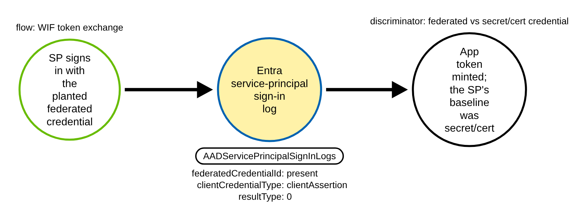
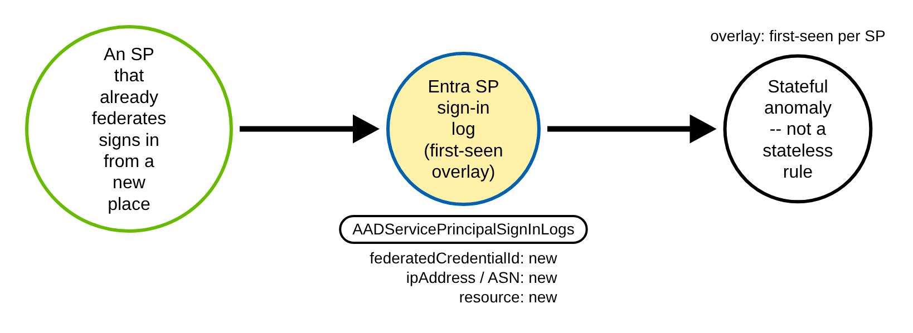
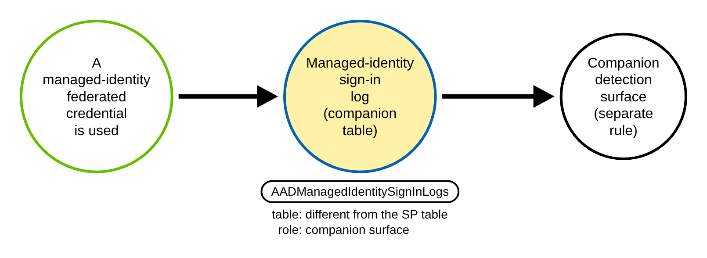
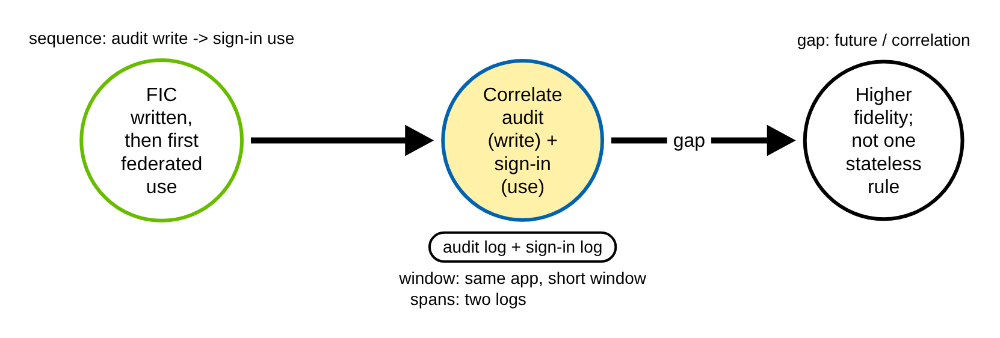

# Entra Federated Service-Principal Sign-In Abuse (Azure)

> Prose uses Simplified Technical English (ASD-STE100) where practical.
> Microsoft Entra / Graph object names, sign-in log field names, and ATT&CK IDs
> are technical names.

## Metadata

| Key          | Value |
|--------------|-------|
| ID           | TRR9023 |
| External IDs | T1078.004, T1550.001 |
| Tactics      | Stealth, Persistence, Privilege Escalation |
| Platforms    | Azure / Microsoft Entra ID |
| Contributors | det-eng |
| Status       | draft |

### Scope Statement

This TRR covers the **use** of a federated identity credential (FIC): a Microsoft
Entra **service principal** signs in to Entra through workload identity federation —
it presents a client assertion (an OIDC token from an external issuer) and receives an
application access token with no stored secret. The event lands in the Entra
**service-principal sign-in log** and is marked by one field, `FederatedCredentialId`.

This is the **use-side** companion to TRR9013. TRR9013 detects the FIC **write** in the
Entra **audit** log (the modified property `FederatedIdentityCredentials`, keyed on an
issuer that is not allowlisted). TRR9023 detects the planted credential being **used**
in the **sign-in** log. It realises TRR9013's documented-but-unbuilt Procedure D
(use the backdoor: the token exchange, seen in the service-principal sign-in logs),
which TRR9013 shipped as a backlog gap.

The emulation and detection idea are **cite-and-extend**, not greenfield, and this TRR
says so plainly:

- **Stratus Red Team** emulates the FIC **write** only — `azure.persistence.backdoor-
  managed-identity-fic` (managed identity) and `entra-id.persistence.backdoor-
  application-fic` (app registration). Both are persistence/write techniques. Neither
  emulates the **use** (the federated sign-in / token exchange).
- **Atomic Red Team** has nothing: a repo code search for `federatedIdentityCredential`
  or `federated-credential` returns no results — no write atomic and no use atomic.
- **Prior detection art is near-exact.** Elastic ships a prebuilt `new_terms` rule,
  *"Entra ID Service Principal Federated Credential Authentication by Unusual Client"*
  (severity **high**, risk score **73**), plus a public Sigma rule of the same name. The
  detection logic here is not novel. By the TRR9017 precedent — which shipped with
  *"the novel, detectable contribution is the adversary-emulation and committed CI
  fixtures … **not** the detection idea"* — the novel contribution is the **runnable
  emulation plus committed CI fixtures keyed on `FederatedCredentialId`**, and the
  realisation of TRR9013's Procedure D. We cite and extend the Elastic rule.

It does **not** cover the FIC write (TRR9013), the illicit-consent or device-code
sign-in paths (TRR9017), or managed-identity FIC use (a different table — documented
below as a companion, not shipped).

## Technique Overview

Workload identity federation lets a workload prove who it is with an OIDC token from its
own identity provider — GitHub Actions, GitLab, AKS, another cloud — and exchange that
token for a Microsoft Entra access token, with no stored secret. The trust is a
federated identity credential attached to an Entra app or service principal.

An attacker who plants a FIC (TRR9013's write) then **uses** it. The service principal
signs in to Entra with a client assertion instead of its client secret or certificate.
Entra issues an application access token, and the adversary acts as the app. The
authentication is passwordless, it is unaffected by rotating the app's client secret,
and it bypasses password-based MFA.

Every such sign-in is recorded in the Entra **service-principal sign-in log**. One field
in that record, `FederatedCredentialId`, is populated **only** when a federated
credential was used. That field is the chokepoint for this report: it separates a
federated sign-in from an ordinary secret or certificate sign-in.

## Technical Background

### The log, the table, and the event

| Item | Value |
|------|-------|
| Log product | Microsoft Entra ID **service-principal sign-in logs** |
| Diagnostic category (routing) | `ServicePrincipalSignInLogs` |
| Log Analytics / Sentinel table | `AADServicePrincipalSignInLogs` |
| Diagnostic stream envelope | camelCase `properties.*` (same ingestion path as the TRR9017 sign-in fixtures) |
| Graph equivalent | `GET /auditLogs/signIns` filtered to the service-principal sign-in type |
| Event | the SP's OAuth client-credentials token issuance at Entra ESTS (`login.microsoftonline.com`) |

Target the **`AADServicePrincipalSignInLogs`** table (your own apps and SPs). Do **not**
target `MicrosoftServicePrincipalSignInLogs` — that is a first-party, Microsoft
service-to-service, preview table that Microsoft states is *"not necessary for security
investigations,"* and it does **not** carry a `FederatedCredentialId` column.

### The chokepoint field

- **`FederatedCredentialId`** (table column) / raw `properties.federatedCredentialId` —
  Azure Monitor table reference, verbatim: *"The identifier of an application's
  federated identity credential if a federated identity credential was used to sign
  in."* It carries the FIC **object GUID** and is populated **only** when a FIC was used;
  it is empty for secret/certificate sign-ins. **This is the structural chokepoint
  field.**

Corroborating fields in the same record:

- **`ClientCredentialType`** — *"The type of client credential used."* A WIF sign-in
  presents a **client assertion** (the JWT exchanged from the external IdP). A
  certificate confidential-client **also** presents a client assertion, so
  `ClientCredentialType` alone does not isolate WIF — it is a corroborator, not the
  discriminator.
- **`ServicePrincipalCredentialKeyId`** / **`ServicePrincipalCredentialThumbprint`** —
  the key id / cert thumbprint of the credential that initiated the sign-in. **Empty on
  a FIC sign-in**, populated on a secret/cert sign-in. Their absence alongside a
  populated `FederatedCredentialId` is the cleanest "federated, not secret/cert" signal.
- **`AppId`**, **`ServicePrincipalId`**, **`ServicePrincipalName`** — the signing
  identity.
- **`ResultType`** (`0` = success), **`ResultSignature`** / **`ResultDescription`**.
- **`IPAddress`**, **`AutonomousSystemNumber`**, **`Location`** / **`LocationDetails`** —
  client network, for the first-seen overlay.
- **`ResourceDisplayName`**, **`ResourceIdentity`**, **`ResourceServicePrincipalId`** —
  the target resource the SP authenticated to.
- **`UniqueTokenIdentifier`**, **`CorrelationId`** — token/trace correlation.

### The discriminator

The chokepoint field and the discriminator are **not** the same field. A service
principal that legitimately federates (GitHub Actions, AKS) populates
`FederatedCredentialId` on every sign-in, so "federated" alone is a **funnel, not an
alert**. There are two regimes:

- **Regime A (clean, field-level, CI-proven).** For a service principal whose baseline
  is **secret or certificate** authentication, a federated sign-in is anomalous.
  Discriminator: `FederatedCredentialId` present (with `ServicePrincipalCredentialKeyId`
  / `ServicePrincipalCredentialThumbprint` empty and `ClientCredentialType`
  clientAssertion). An attacker who added a FIC and then used it makes the SP sign in
  federated when it has only ever signed in with its secret. This is a true "differs only
  on the discriminating field" pair and is the regime shipped as a stateless rule.
- **Regime B (stateful, noisier).** For a service principal whose baseline **is**
  federation, `FederatedCredentialId` present is normal. The discriminator degrades to a
  **first-seen / anomaly overlay**: a new `FederatedCredentialId` GUID (a second FIC), a
  new `IPAddress` / `AutonomousSystemNumber` / `Location`, or a new `ResourceDisplayName`,
  relative to that SP's history. This is what the Elastic `new_terms` rule does. It is
  honest but stateful and noisy for roaming workloads, so it ships as a hunting overlay,
  not a committed stateless rule.

### The hard provenance limit

The service-principal sign-in log does **not** carry the FIC's `issuer` or `subject` —
only the credential **object GUID** (`FederatedCredentialId`). The
`AADServicePrincipalSignInLogs` column set has no issuer/subject field. Consequence:
**TRR9013's "attacker-controlled issuer" signal is not available here.** A rule can key
on *"a federated credential was used, id = X"* and on first-seen anomalies, but not on
*"this credential trusts an untrusted external issuer."* This is a **credential-type /
anomaly signal, not a trust signal** — the honest limit of this telemetry.

### Logged by default, with a telemetry gate

The SP sign-in event is **always generated** by the Entra control plane; nothing is
per-resource opt-in (unlike AWS CloudTrail data events or GCP Data Access logs). But two
gates stand between generation and a SIEM, both identical to the TRR9017 sign-in
strategy:

1. **License.** Querying or retaining sign-in logs (via Graph `auditLogs/signIns` or
   ingestion into Sentinel) requires **Entra ID P1/P2**.
2. **Diagnostic routing.** `ServicePrincipalSignInLogs` is **not** in the default export
   set. It must be selected explicitly in Entra diagnostic settings and streamed to Log
   Analytics / an Event Hub. Microsoft Learn, verbatim: *"These logs are only available
   by configuring diagnostic settings."*

Net: stronger than a per-resource data-event candidate (the event is always captured),
but weaker than a Free-tier management-audit chokepoint (TRR9013's audit log). It is
still CI-validatable with a synthetic sign-in fixture, exactly as TRR9017's device-code
strategy is.

## Procedures

| Procedure | ID | Name | Signal |
|-----------|----|------|--------|
| A | TRR9023.AZR.A | Federated sign-in by a secret/cert-baseline SP | `federatedCredentialId` present (Regime A) |
| B | TRR9023.AZR.B | Federated sign-in by an SP that legitimately federates | first-seen overlay (Regime B) |
| C | TRR9023.AZR.C | Managed-identity FIC use | `AADManagedIdentitySignInLogs` (companion) |
| D | TRR9023.AZR.D | Cross-log correlation: FIC write → first federated use | spans audit + sign-in logs |

> A tool is not a procedure. A WIF token exchange reached through `az`, the Graph token
> endpoint, an SDK, or a CI runner all produce the same federated SP sign-in. They are
> the same procedure (A).

**Reading the DDMs.** Green borders are operations the client/attacker performs. Blue
borders are operations the control plane records (Entra sign-in logs, the Entra audit
log). Black borders are the abstract effect. The pill names the telemetry; the
`Key: value` lines are what a rule matches; a shaded node is the primary detection
opportunity.

### Procedure A: Federated sign-in by a secret/cert-baseline SP  (`TRR9023.AZR.A`)

The service principal signs in to Entra with a client assertion (the external OIDC
token), after the attacker planted a FIC. The SP's baseline is a client secret or
certificate, so the federated sign-in is anomalous on its face.

- **Prerequisites:** a FIC already planted on the app/SP (TRR9013's write); an external
  OIDC token the FIC trusts.
- **Mechanics:** one client-credentials token exchange at the Entra token endpoint;
  logged in `AADServicePrincipalSignInLogs` with `properties.federatedCredentialId`
  populated, `clientCredentialType` clientAssertion, `resultType` 0.
- **Impact:** the adversary mints an application access token and acts as the app,
  passwordless and MFA-free.

#### Detection Data Model — `TRR9023.AZR.A`

Source: [`ddms/trr9023_azr_a.json`](ddms/trr9023_azr_a.json) (Arrows app format).

**DDM summary.** The shaded node is the Entra service-principal sign-in event (table
`AADServicePrincipalSignInLogs`, category `ServicePrincipalSignInLogs`) with
`properties.federatedCredentialId` present, `clientCredentialType` clientAssertion,
`servicePrincipalCredentialKeyId` empty, and `resultType` 0 — the CI-proven chokepoint.
For a secret/cert-baseline SP this federated sign-in is the clean, field-level signal.
This procedure realises TRR9013's documented Procedure D.

### Procedure B: Federated sign-in by an SP that legitimately federates  (`TRR9023.AZR.B`)

The service principal already federates as part of normal operation, so
`FederatedCredentialId` present is routine. The attacker's use blends in, and the signal
degrades to a stateful first-seen.

- **Prerequisites:** the same planted or abused FIC on a workload that normally
  federates.
- **Mechanics:** same chokepoint field; the discriminator is a new
  `federatedCredentialId`, `ipAddress`, `autonomousSystemNumber`, or
  `resourceDisplayName` relative to the SP's history.
- **Impact:** stealthier — the federated sign-in itself is expected.

#### Detection Data Model — `TRR9023.AZR.B`

Source: [`ddms/trr9023_azr_b.json`](ddms/trr9023_azr_b.json) (Arrows app format).

**DDM summary.** The shaded node is the same sign-in event and the same field
(`properties.federatedCredentialId` present), but the baseline is federation, so the
alert condition moves to a stateful first-seen on a new `federatedCredentialId`,
`ipAddress`, `autonomousSystemNumber`, or `resourceDisplayName`. This is a hunting
overlay, not a committed stateless rule.

### Procedure C: Managed-identity FIC use  (`TRR9023.AZR.C`)

A user-assigned managed identity that federates authenticates, and the event lands in a
**different** table from the SP sign-in log.

- **Prerequisites:** a FIC on a user-assigned managed identity (TRR9013 Procedure C
  object).
- **Mechanics:** the sign-in is recorded in `AADManagedIdentitySignInLogs`
  (`ManagedIdentitySignInLogs` diagnostic category), not `AADServicePrincipalSignInLogs`.
- **Impact:** same trust, different telemetry — the SP-sign-in rule is blind to it.

#### Detection Data Model — `TRR9023.AZR.C`

Source: [`ddms/trr9023_azr_c.json`](ddms/trr9023_azr_c.json) (Arrows app format).

**DDM summary.** The shaded node is a sign-in on a different table,
`AADManagedIdentitySignInLogs`, for a user-assigned managed identity that federates. The
TRR9023 SP-sign-in rule does not read this table; this is a documented **companion
surface**, not the TRR9023 chokepoint, and would need its own rule.

### Procedure D: Cross-log correlation — FIC write → first federated use  (`TRR9023.AZR.D`)

The highest-fidelity signal joins two logs: the FIC write in the Entra audit log and the
first federated use in the SP sign-in log for the same app, in a short window.

- **Prerequisites:** both telemetry sources routed (audit log and SP sign-in log).
- **Mechanics:** correlate an audit event with modified property
  `FederatedIdentityCredentials` to a later `AADServicePrincipalSignInLogs` record whose
  `federatedCredentialId` matches, same `appId`.
- **Impact:** strong write-then-use evidence, but it is stateful and spans two logs.

#### Detection Data Model — `TRR9023.AZR.D`

Source: [`ddms/trr9023_azr_d.json`](ddms/trr9023_azr_d.json) (Arrows app format).

**DDM summary.** The shaded path spans two logs — the FIC write in the Entra audit log
(modified property `FederatedIdentityCredentials`) joined to the first federated use in
`AADServicePrincipalSignInLogs` (`properties.federatedCredentialId`) for the same app.
It is higher fidelity than either log alone, but it is hard to express as one stateless
Sigma rule, so it is a documented **gap / future** correlation.

## Available Emulation Tests

The runnable half
([`atomics/T1078.004/src/emulate_entra_sp_fic_signin.sh`](../../../atomics/T1078.004/src/emulate_entra_sp_fic_signin.sh),
wrappers in [`atomics/T1078.004/T1078.004.yaml`](../../../atomics/T1078.004/T1078.004.yaml))
performs a workload-identity-federation client-credentials token exchange at the Entra
token endpoint, so a service principal signs in federated **in your own tenant**. It is
guarded by `TRR9023_LIVE=1` and needs an external OIDC token the app's FIC trusts plus
the target `appId`/`tenant`; a dry run otherwise just prints the chokepoint. It is **not
run in CI** (a full live run needs a real external OIDC issuer). The proven half is
committed Entra service-principal sign-in fixtures
([`detections/cloud/fixtures/trr9023/`](../../../detections/cloud/fixtures/trr9023/)):
an attack record with `federatedCredentialId` populated (clientAssertion, empty
credential key id) and a benign record for the **same** SP, same resource, same success,
that carries `federatedCredentialId` empty and `clientCredentialType` clientSecret — so
the pair differs **only** on the credential type.

| Procedure | Test | Status |
|-----------|------|--------|
| TRR9023.AZR.A | `emulate_entra_sp_fic_signin.sh a` — federated SP sign-in (WIF token exchange); CI runs the rule over the committed fixtures. | **built** |
| TRR9023.AZR.B | documented overlay — first-seen on a new `federatedCredentialId` / IP / ASN / resource for an SP that legitimately federates (stateful). | overlay |
| TRR9023.AZR.C | documented companion — managed-identity FIC use lands in `AADManagedIdentitySignInLogs`. | backlog |
| TRR9023.AZR.D | documented gap — cross-log correlation of the FIC write (audit) to the first federated use (sign-in). | gap |

## Detection Strategy

**Strategy 1 — chokepoint (covers A).** Match the service-principal sign-in stream
(`category` `ServicePrincipalSignInLogs` → `AADServicePrincipalSignInLogs`) on a
successful sign-in (`properties.resultType` `0`) whose `properties.federatedCredentialId`
is **non-empty** (expressed as the regex `.+`). That field is populated only when a
federated credential was used, so a non-empty match means "this sign-in was federated."

**Hard negative control.** The benign baseline is the **same** service principal signing
in with its client secret: `federatedCredentialId` empty, `clientCredentialType`
clientSecret, `servicePrincipalCredentialKeyId` populated. It is the identical
structural sign-in — same SP, same resource, same `resultType` 0 — and differs only on
the credential type. A rule that fires on the attack record and stays silent on this
baseline proves it keys on *"a federated credential was used,"* not on the SP sign-in
itself. This is the same shape as TRR9013 (issuer not allowlisted) and TRR9017 (scope /
`deviceCode`).

**Limits.**

- **Not a trust signal.** The sign-in log has no issuer/subject, so Strategy 1 cannot
  tell an attacker-planted FIC from a legitimate one on provenance. It keys on
  credential type and, for Regime B, on first-seen anomalies.
- **Regime B is a funnel.** For a service principal that legitimately federates,
  Strategy 1 fires on every run. It must be paired with a per-SP first-seen overlay
  (new `federatedCredentialId` / IP / ASN / resource) — Procedure B, documented, not
  shipped as a stateless rule.
- **Telemetry gate.** Entra ID P1/P2 and the opt-in `ServicePrincipalSignInLogs`
  diagnostic category must both be in place (same posture as TRR9017's sign-in
  strategy).
- **Companion surface.** Managed-identity FIC use lands in
  `AADManagedIdentitySignInLogs` (Procedure C), which this rule does not read.

## Detections

| Strategy | Covers | Sigma rule | Sensor |
|----------|--------|------------|--------|
| 1 (chokepoint) | A | [`detections/sigma/T1078.004/entra_service_principal_federated_credential_signin.yml`](../../../detections/sigma/T1078.004/entra_service_principal_federated_credential_signin.yml) | Entra ID service-principal sign-in log |

The validator
[`detections/validate_cloud_detections.py`](../../../detections/validate_cloud_detections.py)
runs the rule over its attack fixture (must fire, carrying the `trr9023-` marker) and its
benign baseline (must fire on nothing). The benign baseline is the same SP signing in
with a client secret — same structural event, `federatedCredentialId` empty — so the
pass proves the rule keys on the federated credential being used and not on the sign-in
alone.

Prior detection art is near-exact and vendor-published: the Elastic prebuilt `new_terms`
rule *"Entra ID Service Principal Federated Credential Authentication by Unusual Client"*
(severity high, risk score 73) and a public Sigma rule of the same name. The
contribution here is the runnable emulation and the committed CI fixtures keyed on
`FederatedCredentialId`, plus the realisation of TRR9013's Procedure D — not a novel
detection idea. Regime B's "unusual client / known-good tenant" tuning follows the
Elastic rule.

## References

- MITRE ATT&CK, T1078.004 Valid Accounts: Cloud Accounts:
  <https://attack.mitre.org/techniques/T1078/004/>
- MITRE ATT&CK, T1550.001 Use Alternate Authentication Material: Application Access
  Token: <https://attack.mitre.org/techniques/T1550/001/>
- Microsoft, Azure Monitor table reference — AADServicePrincipalSignInLogs (columns incl.
  `FederatedCredentialId`, `ClientCredentialType`, `ServicePrincipalCredentialKeyId`):
  <https://learn.microsoft.com/azure/azure-monitor/reference/tables/aadserviceprincipalsigninlogs>
- Microsoft, What are service principal sign-ins in Microsoft Entra? (nonuser SPs,
  cert/secret auth):
  <https://learn.microsoft.com/entra/identity/monitoring-health/concept-service-principal-sign-ins>
- Microsoft, Identity logs you can stream (`ServicePrincipalSignInLogs` and
  `ManagedIdentitySignInLogs` are opt-in diagnostic categories):
  <https://learn.microsoft.com/entra/identity/monitoring-health/concept-diagnostic-settings-logs-options>
- Microsoft, Microsoft service principal sign-in logs table (*"only available by
  configuring diagnostic settings"*; first-party table has no `FederatedCredentialId`):
  <https://learn.microsoft.com/entra/identity/monitoring-health/reference-service-principal-table>
- Microsoft, Workload identity federation (issuer/subject/audience trust; token
  exchange): <https://learn.microsoft.com/entra/workload-id/workload-identity-federation>
- Microsoft, Microsoft Entra monitoring and health licensing (sign-in log access needs
  P1/P2; logs generated regardless):
  <https://learn.microsoft.com/entra/fundamentals/licensing#microsoft-entra-monitoring-and-health>
- Elastic, Entra ID Service Principal Federated Credential Authentication by Unusual
  Client (prebuilt `new_terms` rule, high / 73 — cite and extend):
  <https://www.elastic.co/guide/en/security/current/entra-id-service-principal-federated-credential-authentication-by-unusual-client.html>
- Stratus Red Team, attack-technique registry (FIC = write/persistence only, no use):
  <https://github.com/DataDog/stratus-red-team/blob/main/v2/internal/attacktechniques/main.go>
- Atomic Red Team (code search for `federatedIdentityCredential` returns nothing):
  <https://github.com/redcanaryco/atomic-red-team>
- Local precedent — TRR9013 (FIC write; Procedure D gap):
  [`research/trr9013/azr/README.md`](../../trr9013/azr/README.md)
- Local precedent — TRR9017 (device-code sign-in; novelty is emulation + CI fixtures, not
  the detection idea): [`research/trr9017/azr/README.md`](../../trr9017/azr/README.md)
- TRR method:
  <https://github.com/tired-labs/techniques/blob/main/docs/TECHNIQUE-RESEARCH-REPORT.md>
