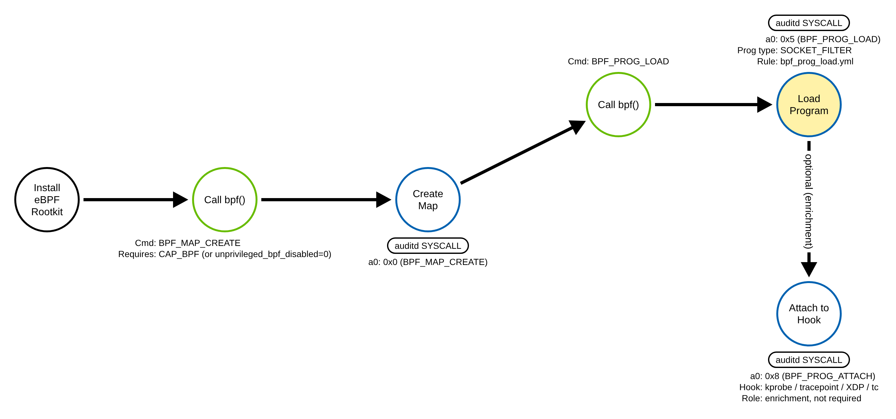
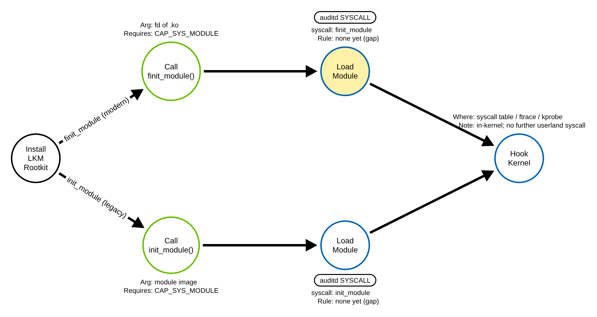
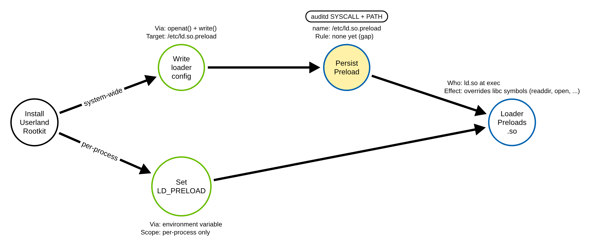

# Rootkit via eBPF Program Load (Linux)

> Prose uses Simplified Technical English (ASD-STE100) where practical.
> Syscall names, constants, CVE IDs, and ATT&CK IDs are technical names.

## Metadata

| Key          | Value |
|--------------|-------|
| ID           | TRR9024 |
| External IDs | T1014 |
| Tactics      | Stealth |
| Platforms    | Linux |
| Contributors | det-eng |
| Status       | experimental |

### Scope Statement

This TRR covers **rootkits on Linux hosts**: code an adversary installs to hide
its presence and to keep control of the host. ATT&CK T1014 is broad. This report
models three Linux rootkit families by where they install — an eBPF program, a
loadable kernel module, and a userland library preload — and it builds the proof
loop for the **eBPF program-load** path, which is the one with a registered
atomic and rule in this repository. The kernel-module and userland-preload paths
are modeled and left as documented detection gaps. The report does not cover
bootkits, firmware implants, or hypervisor rootkits; those are separate
techniques with their own telemetry.

## Technique Overview

A rootkit is code that hides an adversary on a host and keeps their access. Once
it is in place, it can hide files, processes, network connections, and the
adversary's own login, so the normal tools on the host report a clean system
when it is not. A rootkit is a stealth tool first: its job is to make
the rest of the intrusion invisible.

On Linux a rootkit can live in three places. It can run as kernel code, loaded
either as a classic kernel module or as an eBPF program that the kernel runs in
a sandbox. It can also run in user space, by making the dynamic loader pull a
malicious library into every program that starts. Each place gives the adversary
a different amount of power and leaves a different trace.

This report finds the trace each install leaves at the system-call boundary and
shows where to detect it. The newest of the three paths — the eBPF program load
— is the one this repository emulates and detects today.

## Technical Background

A rootkit must first get its code to run with enough privilege to hide things.
The install step is the detection opportunity: it crosses the kernel boundary
with a system call that is rare on a normal server.

**eBPF programs.** eBPF lets a program load bytecode into the kernel, where the
kernel verifies it and runs it in a sandbox on events such as network packets,
tracepoints, and kprobes. A program is loaded with the `bpf(2)` system call and
command `BPF_PROG_LOAD`; maps that hold its state are created with
`BPF_MAP_CREATE`. Loading a program normally needs `CAP_BPF` (with
`CAP_NET_ADMIN` or `CAP_PERFMON` for some program types), though a host with
`kernel.unprivileged_bpf_disabled=0` lets an unprivileged process load some
types. eBPF is a legitimate and heavily used technology (observability,
networking, security tools), which is exactly why it is attractive to an
adversary: a loaded program can read and change kernel data, hook functions, and
hide activity, while blending in with the many benign loaders on a modern host.
Open-source eBPF rootkits (TripleCross, boopkit, ebpfkit) all begin with the
same `BPF_MAP_CREATE` + `BPF_PROG_LOAD` pair, then attach the program to a hook.
The program load is the invariant first step; the attach that follows raises
fidelity but is not needed to see the load.

**Loadable kernel modules.** A kernel module is native code that runs with full
kernel privilege. It is loaded with `finit_module(2)` (modern; reads a module
`.ko` from a file descriptor) or `init_module(2)` (legacy; takes the image in
memory). Both need `CAP_SYS_MODULE`. A module rootkit can edit the syscall
table, install `ftrace` or `kprobe` hooks, and hide itself from the module list.
This is the classic Linux rootkit family (Reptile, Diamorphine).

**Userland library preload.** Without kernel access an adversary can still hook
every dynamically linked program. Writing a path into `/etc/ld.so.preload`, or
setting the `LD_PRELOAD` environment variable, tells the dynamic loader `ld.so`
to load a malicious shared object first, so it can override libc functions such
as `readdir`, `open`, and `access` to hide files and processes. This needs only
the ability to write that file (for the system-wide path) — no kernel
capability. It is weaker than a kernel rootkit, as it affects only dynamically
linked user programs, but it is common and easy (Jynx, Azazel).

**Why detection is at the install call.** A rootkit's whole purpose is to defeat
host inspection after it is running, so a rule that reads the running kernel or
the file system can be lied to by the rootkit itself. The reliable signal is the
act of installation: the `bpf(BPF_PROG_LOAD)`, the `finit_module`/`init_module`,
or the write to `/etc/ld.so.preload`. Recorded by `auditd` or an eBPF sensor,
that call is the detection opportunity, captured before the rootkit can hide it.

## Procedures

| ID | Title | Tactic | Entry point |
|----|-------|--------|-------------|
| TRR9024.LIN.A | eBPF program load (`BPF_PROG_LOAD`) | Stealth | `bpf(BPF_MAP_CREATE)` + `bpf(BPF_PROG_LOAD)` |
| TRR9024.LIN.B | Loadable kernel module | Stealth | `finit_module()` / `init_module()` |
| TRR9024.LIN.C | Userland library preload | Stealth | `write()` to `/etc/ld.so.preload`, or `LD_PRELOAD` |

> Tool is not procedure. TripleCross, boopkit, and a hand-written eBPF loader all
> pass through `bpf(BPF_PROG_LOAD)`; they are Procedure A, not a procedure each.
> Reptile and Diamorphine both call `finit_module`; they are Procedure B.

**Reading the DDMs.** Each DDM is a PNG in the style of the
`tired-labs/techniques` reports, rendered from the Arrows app JSON beside it.
Green borders are operations the installing process performs in user space. Blue
borders are operations the kernel performs. A black border is an abstract step.
The pill on a node names the telemetry that records it, and the `Key: value`
lines are the details a rule can match. The shaded node is the procedure's
primary detection opportunity.

### Procedure A: eBPF program load (`BPF_PROG_LOAD`)  (`TRR9024.LIN.A`)

The program creates a BPF map with `bpf(BPF_MAP_CREATE)`, then loads a program
with `bpf(BPF_PROG_LOAD)`. A real eBPF rootkit then attaches the program to a
hook (a kprobe, a tracepoint, XDP, or `tc`) so the kernel runs it on each event,
and uses it to read and hide kernel state. The load is the invariant first step
and is where this procedure is detected.

- **Prerequisites:** `CAP_BPF` for the common case (plus `CAP_NET_ADMIN` or
  `CAP_PERFMON` for some program types); an unprivileged process can load some
  types where `kernel.unprivileged_bpf_disabled=0`. A load the kernel rejects is
  still a recorded `bpf` syscall, but it is an attempt, not an execution.
- **Mechanics:** the kernel verifies the bytecode, allocates a program, and
  returns a file descriptor. Nothing is hidden yet; the hide happens after the
  attach.
- **Impact:** kernel-level read and modify, used to hide files, processes, and
  connections, and to backdoor authentication.
- **Tools on this path:** TripleCross, boopkit, ebpfkit, and custom loaders.

#### Detection Data Model — `TRR9024.LIN.A`



Source: [`ddms/trr9024_lin_a.json`](ddms/trr9024_lin_a.json) (Arrows app format).

**DDM summary.** The shaded node is the `bpf()` event with `a0 = 0x5`
(`BPF_PROG_LOAD`); its `auditd` record is the primary detection opportunity. It
is unavoidable: an eBPF rootkit cannot run in the kernel without it. The
`BPF_MAP_CREATE` that precedes it and the `BPF_PROG_ATTACH` that follows are good
enrichment — the attach in particular separates a rootkit from a short-lived
benign load — but neither is needed to see the install. This is the node the
registered rule keys on.

### Procedure B: Loadable kernel module  (`TRR9024.LIN.B`)

The adversary loads a native kernel module. The modern path opens the `.ko` file
and calls `finit_module(fd, ...)`; the legacy path reads the image into memory
and calls `init_module(image, ...)`. Both run with full kernel privilege and can
edit the syscall table or install `ftrace`/`kprobe` hooks to hide the rootkit.

- **Prerequisites:** `CAP_SYS_MODULE`. On a host with Secure Boot and module
  signature enforcement, an unsigned module is refused — still a recorded
  syscall attempt.
- **Impact:** the strongest rootkit position; full kernel read and modify, and
  self-hiding from the module list.
- **Tools on this path:** Reptile, Diamorphine, and most classic LKM rootkits.

#### Detection Data Model — `TRR9024.LIN.B`



Source: [`ddms/trr9024_lin_b.json`](ddms/trr9024_lin_b.json) (Arrows app format).

**DDM summary.** The shaded node is the module-load syscall (`finit_module` or
`init_module`). It is a **different** anchor from Procedure A — the eBPF
program-load rule does not reach it — so this procedure needs its own rule. No
rule is built for it in this repository yet; it is a documented gap (see the
Detection Strategy).

### Procedure C: Userland library preload  (`TRR9024.LIN.C`)

The adversary makes the dynamic loader pull a malicious shared object into
programs as they start. The system-wide path writes the library path into
`/etc/ld.so.preload`, so `ld.so` preloads it for every dynamically linked
program. The per-process path sets the `LD_PRELOAD` environment variable. The
preloaded library overrides libc functions (`readdir`, `open`, `access`) to hide
files and processes.

- **Prerequisites:** write access to `/etc/ld.so.preload` for the system-wide
  path (typically root); no kernel capability. The `LD_PRELOAD` path needs only
  to control a process's environment and does not affect set-user-ID programs.
- **Impact:** hides activity from dynamically linked user programs; weaker than a
  kernel rootkit and visible to a statically linked scanner.
- **Tools on this path:** Jynx, Azazel, and similar userland rootkits.

#### Detection Data Model — `TRR9024.LIN.C`



Source: [`ddms/trr9024_lin_c.json`](ddms/trr9024_lin_c.json) (Arrows app format).

**DDM summary.** The shaded node is the write that creates or changes
`/etc/ld.so.preload`, caught as an `auditd` `SYSCALL` + `PATH` record on a watch
of that file. It is a third, distinct anchor that neither Procedure A nor B
covers. No rule is built for it in this repository yet; it is a documented gap.
The `LD_PRELOAD`-only variant leaves no file-write trace and is the gap within
the gap — it shows only in process environment telemetry, which `auditd`
`SYSCALL` records do not carry.

## Detection Strategy

Read across the three DDMs. Unlike a technique where many procedures share one
syscall, the three rootkit families install in **three different places**, so
there is no single syscall chokepoint across all of T1014. The honest strategy
is one anchor per procedure. This repository builds and proves the eBPF path and
documents the other two as gaps.

**Strategy 1 — eBPF program-load anchor (covers A). Built and proven.**
Key on the `bpf()` syscall where command `a0 = 0x5` (`BPF_PROG_LOAD`) from a
process outside the set that normally loads eBPF. An eBPF rootkit cannot run in
the kernel without this call, whatever tool loads it, so it is the invariant for
Procedure A. The rule has two filters. `bpf_processes` allowlists the known eBPF
loaders by `comm` (`systemd`, `bpftool`, `bpftrace`, `cilium-agent`, `falco`,
`tetragon`, `node_exporter`). `runtime_images` filters stock runtime behaviour by
`exe`: runc, which loads a cgroup-v2 device-filter program for every container it
creates (the runc install paths, paired with comm `runc`), and snap-confine, which
loads a device-cgroup program on snap launches (by its snapd install path). The
rule fires on any other process that loads a program. Tune both filters for your
fleet — observability and networking stacks load eBPF legitimately. A filter
trusts the name and the binary, not the code that runs in it: a process can set
its own `comm` with `prctl`, a process in a container controls the path that the
kernel logs as `exe` (it is relative to the process's root), and code injected
into an allowlisted binary keeps both values. Except for socket filters where
`kernel.unprivileged_bpf_disabled` is 0, loading a program needs `CAP_BPF` or
`CAP_SYS_ADMIN`, so this is usually an evasion for an attacker who already has
that privilege.
- Sensor: `auditd` `bpf` rule (already in `atomic.rules`).
- Rule: [`detections/sigma/T1014/bpf_prog_load.yml`](../../../detections/sigma/T1014/bpf_prog_load.yml)
  (`bpf a0=5 and not bpf_processes and not runtime_images`).

**Strategy 2 — kernel-module anchor (covers B). Gap, not built.**
Key on `finit_module` and `init_module` from a non-allowlisted process. These
syscalls are rare outside package managers, `kmod`/`modprobe`, and driver setup,
so the anchor is strong; it needs a `comm`/`exe` allowlist for those benign
loaders. No rule is built here yet.

**Strategy 3 — userland-preload anchor (covers C). Gap, not built.**
Watch `/etc/ld.so.preload` for `write`/`openat`-for-write (an `auditd` `-w`
watch, or a `SYSCALL`+`PATH` rule). The file barely changes on a normal host, so
a write to it is a high-fidelity signal. No rule is built here yet. The
`LD_PRELOAD`-environment variant is the residual gap: it leaves no file write and
is not visible in `auditd` `SYSCALL` records.

**Enrichment (raises fidelity; not a primary anchor).**
For Procedure A, a `BPF_PROG_ATTACH` (`bpf a0=0x8`) or a
`perf_event_open` + `PERF_EVENT_IOC_SET_BPF` that follows the load shows the
program was wired to a hook, which separates a rootkit from a benign one-shot
load. Correlate it with the Strategy 1 hit to raise confidence.

**Telemetry caveats.**
These strategies assume the modern direct syscalls and `auditd` with the audit
rules from `atomic.rules` loaded. Scope the audit rules to both architectures
(`-F arch=b64` and `-F arch=b32`) so a 32-bit process is still recorded. A
rootkit that is already in the kernel can tamper with telemetry, so the signal is
only reliable when it is captured at install time — load the audit rules before
the host is exposed, and forward records off-host promptly.

**Coverage summary.**

| Procedure | Covered by | How | Status |
|-----------|-----------|-----|--------|
| A | Strategy 1 (eBPF anchor) | `bpf(BPF_PROG_LOAD)` from non-allowlisted process | built + proven |
| B | Strategy 2 (module anchor) | `finit_module`/`init_module` | gap (not built) |
| C | Strategy 3 (preload anchor) | write to `/etc/ld.so.preload` | gap (not built) |

One procedure — the modern eBPF path, which is the one public emulation
libraries do not cover — is detected and proven end to end. The two classic
paths are modeled with their anchors named, ready to build next.

## Available Emulation Tests

| ID | Test | Status |
|----|------|--------|
| TRR9024.LIN.A | [`atomics/T1014/src/ebpf_prog_load_behavioral.c`](../../../atomics/T1014/src/ebpf_prog_load_behavioral.c) (YAML: [`atomics/T1014/T1014.yaml`](../../../atomics/T1014/T1014.yaml)) | **built** |
| TRR9024.LIN.B | loadable kernel module | backlog |
| TRR9024.LIN.C | userland `ld.so.preload` write | backlog |

The Procedure A atomic emits `bpf(BPF_MAP_CREATE)` then `bpf(BPF_PROG_LOAD)` of a
no-op `SOCKET_FILTER` program and never attaches it, so it generates the install
telemetry safely and stops before any rootkit behavior.

## Detections

| Strategy | Covers | Sigma rule | Audit rule |
|----------|--------|------------|------------|
| 1 (eBPF anchor) | A | [`detections/sigma/T1014/bpf_prog_load.yml`](../../../detections/sigma/T1014/bpf_prog_load.yml) | `bpf` in [`atomic.rules`](../../../detections/audit/atomic.rules) |
| 2 (module anchor) | B | — (gap) | `finit_module`/`init_module` watch (to add) |
| 3 (preload anchor) | C | — (gap) | `/etc/ld.so.preload` watch (to add) |

Procedure A is wired into the validator
([`detections/validate_detections.py`](../../../detections/validate_detections.py)):
the atomic runs, its `bpf(BPF_PROG_LOAD)` record is read back, and the rule must
match it; a control
([`detections/controls/bpf_prog_load_fails.c`](../../../detections/controls/bpf_prog_load_fails.c))
that calls `bpf(BPF_PROG_LOAD)` with arguments the kernel rejects must **not**
match, so a refused attempt cannot pass as an execution.

Prove the loop:

```
sudo python3 detections/validate_detections.py           # real: atomic -> telemetry -> rule
python3 detections/validate_detections.py --dry-run       # compile + parse only
```

The Sigma rule also tags `attack.t1068` / `attack.privilege-escalation`: a
`bpf(BPF_PROG_LOAD)` from an unexpected process is both a rootkit-install signal
(T1014) and a classic eBPF privilege-escalation surface. This same node is the
eBPF half of the TRR9001 (T1040) network-sniffing fallback, so one rule serves
three reports.

## References

- `bpf(2)` — https://man7.org/linux/man-pages/man2/bpf.2.html
- `finit_module(2)` / `init_module(2)` — https://man7.org/linux/man-pages/man2/finit_module.2.html
- `ld.so(8)` — `LD_PRELOAD` and `/etc/ld.so.preload`:
  https://man7.org/linux/man-pages/man8/ld.so.8.html
- TripleCross eBPF rootkit — https://github.com/h3xduck/TripleCross
- boopkit — https://github.com/kris-nova/boopkit
- Diamorphine LKM rootkit — https://github.com/m0nad/Diamorphine
- MITRE ATT&CK T1014 — Rootkit: https://attack.mitre.org/techniques/T1014/
- TRR method — https://github.com/tired-labs/techniques/blob/main/docs/TECHNIQUE-RESEARCH-REPORT.md
