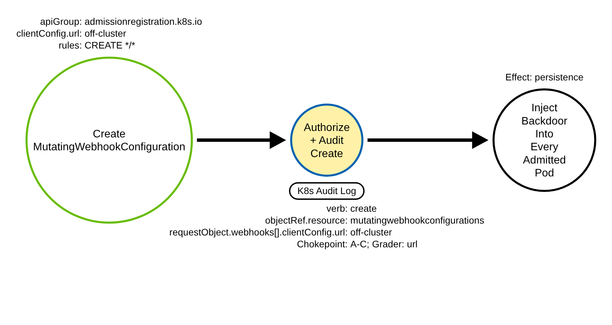
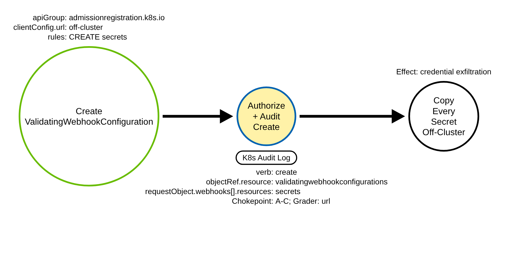
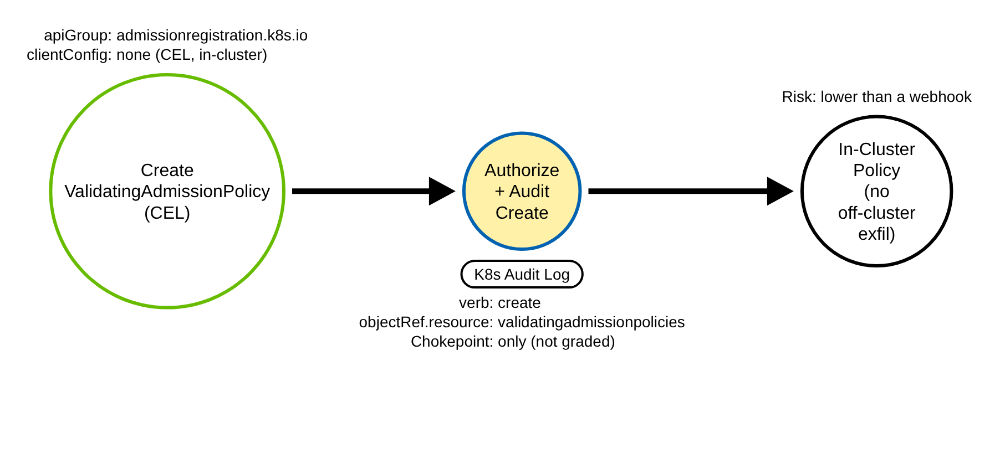

# Malicious Admission Webhook (Kubernetes)

> Prose uses Simplified Technical English (ASD-STE100) where practical.
> API group names, resource names, field names, verbs, and ATT&CK IDs are technical
> names.

## Metadata

| Key          | Value |
|--------------|-------|
| ID           | TRR9025 |
| External IDs | T1546 |
| Tactics      | Persistence, Privilege Escalation |
| Platforms    | Kubernetes |
| Contributors | det-eng |
| Status       | draft |

### Scope Statement

This TRR covers persistence and privilege escalation through a **malicious dynamic
admission controller**: creating a MutatingWebhookConfiguration or a
ValidatingWebhookConfiguration (or a CEL ValidatingAdmissionPolicy) in the
`admissionregistration.k8s.io` API group so that the adversary's endpoint runs on,
or receives a copy of, every object the API server admits.

This TRR does not cover these related actions:

- **Disabling** admission control — deleting a webhook configuration, neutering one
  in place, or removing the policy engine's workload. ATT&CK T1685 covers that, and
  it is TRR9008 in this repository. TRR9008 keys on delete/update/patch and
  **explicitly excludes `create`**, naming the creation of a malicious webhook as a
  separate report; this is that report. Detecting the disable plus the install gives
  both halves of the admission-control attack surface.
- The RBAC grant that lets an adversary write admission objects. TRR9004
  (T1098.006) detects the grant; this report detects the use. An attacker usually
  needs the grant first, so the two are correlated but distinct.
- Running an ordinary workload (Deploy Container, T1610). A webhook is control-plane
  configuration, not a workload.

> **ATT&CK mapping caveat.** The best available ID is **T1546 (Event Triggered
> Execution)**, whose ATT&CK tactics are Persistence and Privilege Escalation (a
> mutating webhook that injects a privileged sidecar escalates). This is the mapping
> Elastic uses for its admission-webhook rule. The validating-webhook
> Secret-exfiltration path (Procedure B) additionally achieves **credential access** —
> the Microsoft Threat Matrix for Kubernetes files "Malicious admission controller"
> under both Persistence and Credential Access — but credential access is a behavioral
> effect here, not a T1546 tactic, so the Sigma rule tags stay on T1546's own tactics.
> Unlike TRR9008's T1685 (which lists Containers among its platforms), T1546's platform
> list is IaaS/Linux/macOS/Windows/Office/SaaS and does **not** include Containers, so
> this mapping cannot lean on a Containers platform tag — ATT&CK has no clean
> Kubernetes sub-technique for admission-controller persistence. T1554 (Compromise Host
> Software Binary) is a worse fit and is rejected. The platform fit is imperfect; the
> technique is right.

## Technique Overview

Kubernetes lets an administrator extend the API server with webhooks that run on
every object as it is admitted. A MutatingWebhookConfiguration points the API server
at an endpoint that may *change* each object before it is stored; a
ValidatingWebhookConfiguration points it at an endpoint that may *accept or reject*
each object, and that therefore *receives a full copy* of it. These are the
mechanisms OPA/Gatekeeper, Kyverno, cert-manager, and sidecar injectors use. The
webhook endpoint is named by a `clientConfig`, which is normally an in-cluster
Service, but may be any URL.

An adversary who can write these objects turns the extension point into a foothold.
A mutating webhook that matches every pod can inject a sidecar or an init container —
a backdoor that re-appears on every new pod, cluster-wide, with no further action. A
validating webhook scoped to Secrets receives a copy of every Secret the moment it is
created or updated, and a `clientConfig.url` pointing off-cluster ships each one to
the attacker. The webhook lives in the cluster's own configuration, so it survives a
credential rotation and a pod restart, and it looks like the admission tooling every
cluster already runs. The defensive goal is to see the webhook being created, and to
tell an operator's in-cluster webhook apart from one wired to an off-cluster endpoint
or reaching across the whole cluster for Secrets.

## Technical Background

### The objects and the clientConfig

A MutatingWebhookConfiguration and a ValidatingWebhookConfiguration are
cluster-scoped objects in `admissionregistration.k8s.io/v1`. Each carries a
`webhooks` list; each webhook has a `clientConfig`, `rules`, `failurePolicy`,
`sideEffects`, `namespaceSelector`, and `objectSelector`. The `clientConfig` is the
load-bearing field: it is either `clientConfig.service` (a namespace/name/path/port
of an in-cluster Service, the normal case) **or** `clientConfig.url` (a raw URL,
which may point anywhere). A legitimate webhook almost always uses a Service; a raw
URL, especially an off-cluster one, is the strongest single tell that the webhook is
built to call out.

Each webhook's `rules` list says which operations and objects trigger it:
`operations` (`CREATE`/`UPDATE`/`DELETE`/`CONNECT`/`*`, uppercase), `apiGroups`,
`apiVersions`, `resources`, and `scope`. A webhook with `apiGroups: ["*"]`,
`resources: ["*"]`, and `operations: ["CREATE"]` runs on, or receives, *everything*.
A validating webhook whose rules include `secrets` receives every Secret.

### The CEL ValidatingAdmissionPolicy sibling

The same API group also holds the in-process CEL `ValidatingAdmissionPolicy` and its
`ValidatingAdmissionPolicyBinding`. These evaluate a CEL expression inside the API
server; they cannot call an external endpoint, so they cannot exfiltrate or inject a
callback. A malicious CEL policy is a weaker primitive (it can only allow or deny),
so this report covers it at the chokepoint only and does not grade it as high.

### The audit shape, and the two levels

Every install is a `create` on the `admissionregistration.k8s.io` group. Webhook
configurations are cluster-scoped, so the audit event carries `objectRef.name` with
an empty `objectRef.namespace`; the gate for an emulation is the name. A create is
fully described at `Metadata` level (verb, apiGroup, resource, name), which is enough
to fire the chokepoint. But `Metadata` hides whether the webhook is malicious: the
`clientConfig`, the `rules`, and the `resources` all live only in `requestObject`,
which `Metadata` does not record. At `Metadata` a cert-manager webhook and an
off-cluster exfiltration webhook are byte-for-byte identical. So the severity grader
must run at `Request` level. The shared audit policy
(`detections/k8s/audit-policy-apiserver.yaml`) already records
`admissionregistration.k8s.io` creates at `Request` — its comment reserves this for
"a future malicious-webhook persistence report" — so no policy change is needed.

### Why the technique works

Dynamic admission control is a designed extension point, protected only by RBAC on
the admission objects. An identity that can create them can wire the API server to an
endpoint it controls. The webhook is ordinary configuration, so it persists; it runs
on every admitted object, so it reaches everything; and it resembles the admission
tooling a cluster already runs, so it hides in plain sight. A detection must see the
create and, to grade it, read the submitted webhook body.

## Procedures

| Procedure | ID | Name | Entry point |
|-----------|----|------|-------------|
| A | TRR9025.K8S.A | Mutating webhook backdoor | `create mutatingwebhookconfigurations` |
| B | TRR9025.K8S.B | Validating webhook Secret exfiltration | `create validatingwebhookconfigurations` |
| C | TRR9025.K8S.C | CEL admission policy (chokepoint only) | `create validatingadmissionpolicies` |

> A tool is not a procedure. `kubectl`, a client library, Helm, and a raw HTTP client
> all send the same admission-object create. They are the same procedure.

**Reading the DDMs.** Green borders are operations the client performs. Blue borders
are operations the API server performs. Black borders are the abstract effect. The
pill names the telemetry; the `Key: value` lines are what a rule matches; a shaded
node is the primary detection opportunity.

### Procedure A: Mutating webhook backdoor  (`TRR9025.K8S.A`)

The adversary creates a MutatingWebhookConfiguration whose rules match every pod and
whose `clientConfig.url` points at an endpoint they control, so the API server calls
out on every admitted pod and the response injects a sidecar or init container.

- **Prerequisites:** `create` on `mutatingwebhookconfigurations` (cluster-scoped).
- **Mechanics:** the webhook runs on every matching admission and mutates it.
- **Impact:** a backdoor re-injected into every new pod, cluster-wide, that survives
  credential rotation.
- **Tools on this path:** `kubectl`, Helm, any client.

#### Detection Data Model — `TRR9025.K8S.A`

Source: [`ddms/trr9025_k8s_a.json`](ddms/trr9025_k8s_a.json) (Arrows app format).

**DDM summary.** The shaded node is the API server's authorize-and-audit of the
create (`objectRef.apiGroup: admissionregistration.k8s.io`, verb `create`), the
chokepoint for A, B, and C. The `requestObject.webhooks[].clientConfig.url` is the
off-cluster tell the grader keys on (Request level).

### Procedure B: Validating webhook Secret exfiltration  (`TRR9025.K8S.B`)

The adversary creates a ValidatingWebhookConfiguration scoped to Secrets (or to every
resource) whose `clientConfig.url` points off-cluster. A validating webhook receives
a full copy of each matching object, so every Secret created or updated is sent to the
attacker's endpoint, and the webhook may still "allow" so nothing breaks.

- **Prerequisites:** `create` on `validatingwebhookconfigurations`.
- **Mechanics:** the webhook receives a copy of each matching object; `sideEffects`
  and `failurePolicy: Ignore` keep the cluster working while it harvests.
- **Impact:** continuous Secret exfiltration.
- **Tools on this path:** `kubectl`, any client.

#### Detection Data Model — `TRR9025.K8S.B`

Source: [`ddms/trr9025_k8s_b.json`](ddms/trr9025_k8s_b.json) (Arrows app format).

**DDM summary.** Same chokepoint create. The grader fires on the off-cluster
`clientConfig.url`; the `resources: ["secrets"]` scope raises severity further.

### Procedure C: CEL admission policy  (`TRR9025.K8S.C`)

The adversary creates a CEL ValidatingAdmissionPolicy (and binding) in the same API
group. It evaluates in-process and cannot call out, so it can only allow or deny —
a weaker primitive, covered at the chokepoint only.

- **Prerequisites:** `create` on `validatingadmissionpolicies` /
  `validatingadmissionpolicybindings`.
- **Mechanics:** an in-process CEL expression; no external endpoint.
- **Impact:** policy manipulation (for example, always-allow), but no off-cluster
  exfiltration or injection.
- **Tools on this path:** `kubectl`, any client.

#### Detection Data Model — `TRR9025.K8S.C`

Source: [`ddms/trr9025_k8s_c.json`](ddms/trr9025_k8s_c.json) (Arrows app format).

**DDM summary.** Same chokepoint create, a different resource. The grader
deliberately does not fire (CEL cannot exfiltrate off-cluster), so C is caught by the
chokepoint and triaged, not graded high.

## Detection Strategy

Compare the three DDMs. Every procedure is a `create` on the
`admissionregistration.k8s.io` group, so one chokepoint rule covers all three. A and
B are gradable from the submitted body; C is not, by design.

**Telemetry requirement.** The audit policy must record `admissionregistration.k8s.io`
creates at `Request` level so `requestObject.webhooks` is present. The shared policy
(`detections/k8s/audit-policy-apiserver.yaml`) already does; no change is needed.

**Strategy 1 — chokepoint (covers A, B, C).**
Match an audit event where `objectRef.apiGroup` is `admissionregistration.k8s.io` and
`verb` is `create`. This is the inverse of the TRR9008 chokepoint, which keys on the
disabling verbs and excludes create. It is noisy — cert-manager, Gatekeeper, Kyverno,
and Helm legitimately create webhooks — so baseline the installer identity by
`user.username`/`user.groups`. SigmaHQ's `kubernetes_audit_change_admission_controller`
and Elastic's "Kubernetes Admission Webhook Created or Modified" cover this same
create at Metadata; this rule matches theirs and is positioned as the anchor the
grader builds on.

- Sensor: API server audit log.
- Rule: `detections/sigma/T1546/k8s_admission_webhook_created.yml` (built).

**Strategy 2 — grader (grades A, B; needs Request level).**
On top of the chokepoint, match a created MutatingWebhookConfiguration or
ValidatingWebhookConfiguration whose `requestObject.webhooks` carries a
`clientConfig.url` pointing off-cluster (an http(s) URL). This is the novel layer:
neither SigmaHQ's nor Elastic's rule reads the webhook body, and the off-cluster URL
is the one non-spoofable, low-false-positive discriminator — a benign webhook calls
an in-cluster `clientConfig.service`, not a raw URL. The grader deliberately does
**not** key on cluster-wide rules or a Secrets scope: Kyverno and Gatekeeper validate
cluster-wide and over Secrets, so grading on those would be a high-severity false
positive on the admission tooling every cluster runs.

- Sensor: API server audit log at Request level.
- Rule: `detections/sigma/T1546/k8s_malicious_admission_webhook_created.yml` (built).

**Demonstrated gaps.**
- **In-cluster malicious endpoint.** A webhook wired to an in-cluster
  `clientConfig.service` backed by an attacker pod has no off-cluster URL, so the
  grader does not fire — it is caught at the chokepoint only. This is a deliberate
  trade: a cluster-wide-rules-plus-Secrets heuristic would fire on Kyverno and
  Gatekeeper, so it is not used. Correlate the webhook create with the creation of
  its backing Service and pod instead.
- **Control-plane bypass.** An adversary with control-plane node or etcd access can
  write a webhook configuration straight into etcd, with no API `create` and no audit
  event. The lab demonstrates this read-only (it shows that a node-local etcd write
  emits no audit event); a node file/etcd sensor is the only cover.

**Coverage summary.**

| Procedure | Covered by | How |
|-----------|-----------|-----|
| A | Strategy 1; graded by Strategy 2 | off-cluster `clientConfig.url` |
| B | Strategy 1; graded by Strategy 2 | off-cluster `clientConfig.url` |
| C | Strategy 1 | `create` on a CEL policy (not graded; lower risk) |

One chokepoint rule covers every admission-object install. One grader separates the
malicious webhook from the hundreds of benign ones. The in-cluster-endpoint and
control-plane-bypass variants are stated gaps.

## Available Emulation Tests

The tests run in a lab cluster with the shared audit policy. The lab is a `kind`
cluster; its config and audit policy are in
[`detections/k8s/`](../../../detections/k8s/). Every object is named `trr9025-*` so a
validator matches the emulation's own events, and every webhook is a **no-op**
(`failurePolicy: Ignore`, a bogus unreachable `clientConfig.url`, scoped so it cannot
intercept real admission), the same safety convention as TRR9008. One script drives
them:
[`atomics/T1546/src/emulate_k8s.sh`](../../../atomics/T1546/src/emulate_k8s.sh), with
Atomic Red Team wrappers in
[`atomics/T1546/T1546.yaml`](../../../atomics/T1546/T1546.yaml).

| Procedure | Test | Status |
|-----------|------|--------|
| TRR9025.K8S.A | `emulate_k8s.sh a` — create a no-op MutatingWebhookConfiguration with an off-cluster URL and wildcard rules. | **built** |
| TRR9025.K8S.B | `emulate_k8s.sh b` — create a no-op ValidatingWebhookConfiguration scoped to Secrets with an off-cluster URL. | **built** |
| TRR9025.K8S.C | `emulate_k8s.sh c` — create a benign CEL ValidatingAdmissionPolicy (chokepoint only). | **built** |
| TRR9025.K8S (gap) | `emulate_k8s.sh gap` — show the control-plane etcd path on the node (read-only). | **built** |

## Detections

| Strategy | Covers | Sigma rule | Sensor |
|----------|--------|------------|--------|
| 1 (chokepoint) | A, B, C | [`detections/sigma/T1546/k8s_admission_webhook_created.yml`](../../../detections/sigma/T1546/k8s_admission_webhook_created.yml) | API server audit log |
| 2 (grader) | A, B | [`detections/sigma/T1546/k8s_malicious_admission_webhook_created.yml`](../../../detections/sigma/T1546/k8s_malicious_admission_webhook_created.yml) | API server audit log (Request) |

The validator
[`detections/validate_apiserver_detections.py`](../../../detections/validate_apiserver_detections.py)
reads the API server audit log the emulation produced and asserts each rule matches an
event whose `objectRef.name` carries the `trr9025-` marker. The workflow
[`validate-apiserver-detections.yml`](../../../.github/workflows/validate-apiserver-detections.yml)
runs the loop on a `kind` cluster, with a negative control on the pre-emulation log.

Upstream: SigmaHQ `kubernetes_audit_change_admission_controller.yml` and Elastic
"Kubernetes Admission Webhook Created or Modified" both match the create at Metadata.
Propose the Request-level grader that reads the webhook body to separate an
off-cluster exfiltration webhook from a benign in-cluster one.

## References

- MITRE ATT&CK, T1546 Event Triggered Execution:
  <https://attack.mitre.org/techniques/T1546/>
- Kubernetes documentation, Dynamic Admission Control (webhook configuration,
  clientConfig, rules, failurePolicy):
  <https://kubernetes.io/docs/reference/access-authn-authz/extensible-admission-controllers/>
- Kubernetes documentation, Validating Admission Policy (CEL):
  <https://kubernetes.io/docs/reference/access-authn-authz/validating-admission-policy/>
- Kubernetes documentation, Auditing:
  <https://kubernetes.io/docs/tasks/debug/debug-cluster/audit/>
- Microsoft Threat Matrix for Kubernetes, Malicious admission controller:
  <https://microsoft.github.io/Threat-Matrix-for-Kubernetes/techniques/Malicious%20admission%20controller/>
- SigmaHQ rule, Kubernetes Admission Controller Changed:
  <https://github.com/SigmaHQ/sigma/blob/master/rules/application/kubernetes/audit/kubernetes_audit_change_admission_controller.yml>
- TRR method:
  <https://github.com/tired-labs/techniques/blob/main/docs/TECHNIQUE-RESEARCH-REPORT.md>
