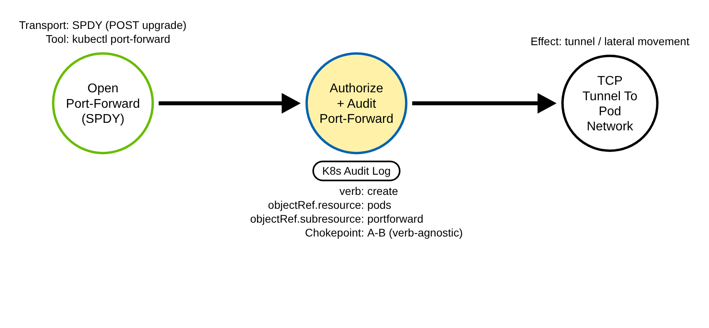
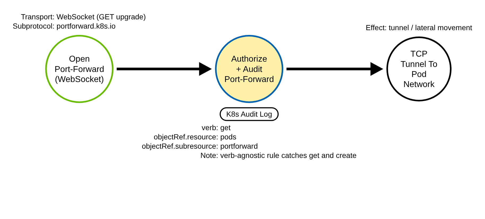
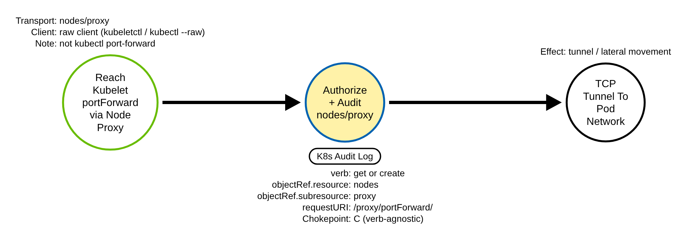

# Pod Port-Forward Tunnel (Kubernetes)

> Prose uses Simplified Technical English (ASD-STE100) where practical.
> API paths, resource names, subresource names, field names, and ATT&CK IDs are
> technical names.

## Metadata

| Key          | Value |
|--------------|-------|
| ID           | TRR9026 |
| External IDs | T1572 |
| Tactics      | Command and Control |
| Platforms    | Kubernetes |
| Contributors | det-eng |
| Status       | draft |

### Scope Statement

This TRR covers **port-forward tunneling** through the Kubernetes API server: using
the `pods/portforward` subresource to open a TCP tunnel from the client, through the
kube-apiserver, to a port on a pod — reaching an in-cluster service, database, or
dashboard the client could not reach directly.

This TRR does not cover these related actions:

- Command execution in a container (`pods/exec`, `pods/attach`, ephemeral
  containers). ATT&CK T1609 (TRR9002) covers that. TRR9002 **explicitly scoped
  port-forward out** ("It opens a network tunnel. It does not run a command."); this
  report owns that tunnel. Port-forward and exec are siblings on the same
  chokepoint family (a pod subresource), different subresources.
- Port-forward that goes **directly to the kubelet** (`:10250`) or through
  `nodes/proxy`, bypassing the pods subresource. That leaves a `nodes/proxy` record
  or no API audit event at all; it is the direct-kubelet gap TRR9002 already
  documents, and it is Procedure C here (a demonstrated gap).
- The application-layer attack carried **over** the tunnel (a database login, a
  dashboard exploit). The tunnel is the C2/lateral-movement primitive; what rides it
  is a separate technique.

> **ATT&CK mapping caveat.** The best available ID is **T1572 (Protocol Tunneling)**,
> tactic Command and Control — a `kubectl port-forward` tunnels arbitrary TCP through
> the API server, which is the mapping Elastic's kubectl-networking rules also use.
> The ATT&CK Containers matrix has **no dedicated port-forward technique**, so T1572
> is a stated cross-domain best-fit. The lateral-movement framing (reach an internal
> service) is real, but the T1021 (Remote Services) sub-techniques are
> protocol-specific (SSH/RDP/SMB/VNC) and do not fit an API-server tunnel, so T1021 is
> a weaker secondary and is not the primary ID.

## Technique Overview

Kubernetes lets a client forward a local port to a port on a pod. `kubectl
port-forward` does this: it opens a tunnel from the client, through the API server, to
the pod, so the client can speak to the pod's own network as if it were local.
Operators use it to reach a service that is not exposed outside the cluster — a
database, an admin UI, a metrics endpoint — for debugging.

An adversary with a credential that can port-forward uses the same feature to reach
those same internal targets. The tunnel is a general TCP conduit: it lets the attacker
talk to an in-cluster database, an unauthenticated dashboard, or another pod's service
from outside the cluster, turning a single API credential into network reach inside
the cluster. It is a control channel and a lateral-movement primitive at once. The
request looks like ordinary debugging; the difference is who opens it, from where,
and into which pod.

## Technical Background

### The subresource and the two transports

A port-forward is a request to the `portforward` subresource of a pod:
`/api/v1/namespaces/<ns>/pods/<pod>/portforward`. The API server authenticates the
client, authorizes the `pods/portforward` resource, writes an audit event, and then
proxies the tunnel to the kubelet. In the audit event, `objectRef.resource` is
`pods`, `objectRef.subresource` is `portforward` (lowercase — the kubelet URL path
uses camelCase `portForward`, but the pods subresource in `objectRef` is lowercase),
and `objectRef.name` is the pod. These are set by the API server from the request
path; the attacker cannot forge them.

The tunnel runs over one of two transports, and the transport decides the audit
**verb**:

- **SPDY** (the legacy transport): an HTTP `POST` connection upgrade, recorded as
  `verb: create`.
- **WebSocket** (the `portforward.k8s.io` subprotocol that recent kubectl uses): an
  HTTP `GET` connection upgrade, recorded as `verb: get`.

A rule that matched only `verb: create` would be dead against a current kubectl — the
same WebSocket verb trap TRR9002 documents for exec. The invariant is the
subresource, independent of the verb.

### What the audit event carries, and what it does not

A port-forward is fully described at `Metadata` level: the verb, `objectRef`
(resource/subresource/namespace/name), the identity, `sourceIPs`, the user agent, the
`requestURI`, and the response code. Unlike exec, there is no command in the request —
`requestObject` is empty — so there is nothing in the body to key on; the subresource
is the whole signal. The forwarded ports and the bytes on the tunnel are not in the
audit log.

### Why the technique works, and the fidelity limit

Port-forward is a designed debugging feature, gated only by RBAC on the
`pods/portforward` resource. A developer's port-forward and an attacker's tunnel are
byte-identical in the audit record. So the detection is a low-fidelity hunting and
correlation anchor, not a standalone alert: the usable signal comes from context — a
port-forward by a service-account principal, cross-namespace, into kube-system or a
Secrets-bearing or database pod, off-hours, or from an unexpected source IP.

## Procedures

| Procedure | ID | Name | Entry point |
|-----------|----|------|-------------|
| A | TRR9026.K8S.A | Port-forward over SPDY | `create pods/portforward` |
| B | TRR9026.K8S.B | Port-forward over WebSocket | `get pods/portforward` |
| C | TRR9026.K8S.C | Direct-kubelet / nodes-proxy tunnel | kubelet `:10250` (no pods/portforward event) |

> A tool is not a procedure. `kubectl port-forward`, a client library, and a raw HTTP
> client all send the same `pods/portforward` request. They are the same procedure;
> the transport (SPDY vs WebSocket) is the distinction between A and B.

**Reading the DDMs.** Green borders are operations the client performs. Blue borders
are operations the API server performs. Purple borders are operations on the node. The
pill names the telemetry; the `Key: value` lines are what a rule matches; a shaded
node is the primary detection opportunity.

### Procedure A: Port-forward over SPDY  (`TRR9026.K8S.A`)

The adversary opens a port-forward over the legacy SPDY transport — an HTTP POST
upgrade — recorded as `verb: create` on `pods/portforward`.

- **Prerequisites:** `create`/`get` on `pods/portforward`.
- **Mechanics:** a POST connection upgrade; the API server proxies the tunnel.
- **Impact:** a TCP tunnel to the pod's network.
- **Tools on this path:** `kubectl port-forward` (older clients, many libraries).

#### Detection Data Model — `TRR9026.K8S.A`

Source: [`ddms/trr9026_k8s_a.json`](ddms/trr9026_k8s_a.json) (Arrows app format).

**DDM summary.** The shaded node is the API server's authorize-and-audit of the
port-forward (`objectRef.resource: pods`, `objectRef.subresource: portforward`), the
chokepoint for A and B. The verb is `create` on this transport.

### Procedure B: Port-forward over WebSocket  (`TRR9026.K8S.B`)

The adversary opens a port-forward over the WebSocket transport (the
`portforward.k8s.io` subprotocol) — an HTTP GET upgrade — recorded as `verb: get` on
`pods/portforward`. Modern kubectl defaults here.

- **Prerequisites:** `create`/`get` on `pods/portforward`.
- **Mechanics:** a GET connection upgrade; otherwise identical to A.
- **Impact:** the same TCP tunnel.
- **Tools on this path:** current `kubectl port-forward`, WebSocket-aware clients.

#### Detection Data Model — `TRR9026.K8S.B`

Source: [`ddms/trr9026_k8s_b.json`](ddms/trr9026_k8s_b.json) (Arrows app format).

**DDM summary.** Same chokepoint, `verb: get`. A create-only rule would miss this; the
rule is verb-agnostic and matches both.

### Procedure C: Direct-kubelet / nodes-proxy tunnel  (`TRR9026.K8S.C`)

The adversary port-forwards straight to the kubelet on `:10250`, or through
`nodes/proxy`, bypassing the pods subresource. There is then no `pods/portforward`
audit event — the record is a `nodes/proxy` event or nothing at all.

- **Prerequisites:** a node credential or network reach to the kubelet.
- **Mechanics:** a direct kubelet `/portForward` call, or a request proxied through
  `nodes/proxy`.
- **Impact:** the same tunnel, with no `pods/portforward` audit trace.
- **Tools on this path:** `kubeletctl`, a raw client to `:10250`.

#### Detection Data Model — `TRR9026.K8S.C`

Source: [`ddms/trr9026_k8s_c.json`](ddms/trr9026_k8s_c.json) (Arrows app format).

**DDM summary.** The shaded node is a node sensor, not the audit log: a direct kubelet
port-forward writes no `pods/portforward` event. This is the TRR9002 direct-kubelet
gap, restated for the tunnel; a `nodes/proxy` variant is partially visible as a
`nodes/proxy` audit event (Elastic ships AKS rules there), which this report
references rather than duplicates.

## Detection Strategy

Compare the three DDMs. Procedures A and B both produce a `pods/portforward` audit
event and differ only on the verb, so one verb-agnostic chokepoint rule covers both.
Procedure C never produces a `pods/portforward` event, so no API-audit rule can see
it.

**Telemetry requirement.** The audit policy must record `pods/portforward` at
`Metadata` or higher. The shared policy
(`detections/k8s/audit-policy-apiserver.yaml`) records it: this report adds an
explicit `pods/portforward` Metadata rule so the capture is self-documenting and does
not rely on the catch-all. No request body is needed.

**Strategy 1 — chokepoint (covers A, B).**
Match an audit event where `objectRef.resource` is `pods` and `objectRef.subresource`
is `portforward`, with no verb filter. This is the first `pods/portforward` rule in
the Sigma rule set (SigmaHQ ships only the exec sibling); Falco's default k8saudit
ruleset ships an equivalent `port-forward` rule, so this is its provider-agnostic
Sigma/pySigma counterpart, stated as a backstop, not a discovery. It is a low-fidelity
hunting anchor: baseline the identities that legitimately port-forward.

- Sensor: API server audit log.
- Rule: `detections/sigma/T1572/k8s_pod_portforward.yml` (built).

**Correlation and severity lift (built on Strategy 1).**
A port-forward is high-signal when the context is wrong: the principal is a service
account (`system:serviceaccount:*`), the target pod is cross-namespace from the
caller, the target is in kube-system or is a Secrets-bearing or database pod, the time
is off-hours, or the `sourceIPs` are unexpected. These are triage lifts on the
chokepoint, not separate rules.

**Demonstrated gap — the direct-kubelet tunnel (Procedure C).**
A port-forward straight to the kubelet, or through `nodes/proxy`, leaves no
`pods/portforward` event. The audit-log chokepoint is structurally blind to it, the
same gap TRR9002 demonstrates for exec. A node/kubelet-access sensor, and the existing
`nodes/proxy` coverage, are the only cover; the lab demonstrates the gap read-only.

**Coverage summary.**

| Procedure | Covered by | How |
|-----------|-----------|-----|
| A | Strategy 1 (chokepoint) | `create pods/portforward` (SPDY) |
| B | Strategy 1 (chokepoint) | `get pods/portforward` (WebSocket) |
| C | gap (node sensor) | direct kubelet `:10250`; no `pods/portforward` event |

One verb-agnostic chokepoint rule covers both API-server transports. The direct-kubelet
tunnel is a stated gap, shared with TRR9002.

## Available Emulation Tests

The tests run in a lab cluster with the shared audit policy. The lab is a `kind`
cluster; its config and audit policy are in
[`detections/k8s/`](../../../detections/k8s/). The emulation port-forwards to a
throwaway pod named `trr9026-target` so a validator matches the emulation's own events,
and the forwarded connection is harmless (it opens and closes a local listener; no
traffic is sent to the pod). One script drives them:
[`atomics/T1572/src/emulate.sh`](../../../atomics/T1572/src/emulate.sh), with Atomic
Red Team wrappers in [`atomics/T1572/T1572.yaml`](../../../atomics/T1572/T1572.yaml).

| Procedure | Test | Status |
|-----------|------|--------|
| TRR9026.K8S.A | `emulate.sh a` — port-forward to `trr9026-target` over SPDY (`verb=create`). | **built** |
| TRR9026.K8S.B | `emulate.sh b` — port-forward to `trr9026-target` over WebSocket (`verb=get`). | **built** |
| TRR9026.K8S.C | `emulate.sh gap` — attempt a direct-kubelet port-forward (no `pods/portforward` event). | **built** |

## Detections

| Strategy | Covers | Sigma rule | Sensor |
|----------|--------|------------|--------|
| 1 (chokepoint) | A, B | [`detections/sigma/T1572/k8s_pod_portforward.yml`](../../../detections/sigma/T1572/k8s_pod_portforward.yml) | API server audit log |

The validator
[`detections/validate_apiserver_detections.py`](../../../detections/validate_apiserver_detections.py)
reads the API server audit log the emulation produced and asserts the rule matches an
event whose `objectRef.name` is the `trr9026-target` pod. The workflow
[`validate-apiserver-detections.yml`](../../../.github/workflows/validate-apiserver-detections.yml)
runs the loop on a `kind` cluster, with a negative control on the pre-emulation log.

Upstream: SigmaHQ has an exec rule but no `pods/portforward` rule; Falco's default
ruleset has a `port-forward` rule. Propose the Sigma `pods/portforward` rule, matching
both transports (the verb-agnostic form that catches the WebSocket `get`).

## References

- MITRE ATT&CK, T1572 Protocol Tunneling:
  <https://attack.mitre.org/techniques/T1572/>
- Kubernetes documentation, Use Port Forwarding to Access Applications in a Cluster:
  <https://kubernetes.io/docs/tasks/access-application-cluster/port-forward-access-application-cluster/>
- Kubernetes blog, Enabling WebSocket for port-forward (portforward.k8s.io):
  <https://kubernetes.io/blog/2024/08/20/websockets-transition/>
- Kubernetes documentation, Auditing:
  <https://kubernetes.io/docs/tasks/debug/debug-cluster/audit/>
- Falco default k8s_audit ruleset (the `port-forward` rule):
  <https://github.com/falcosecurity/rules/blob/main/rules/k8s_audit_rules.yaml>
- TRR method:
  <https://github.com/tired-labs/techniques/blob/main/docs/TECHNIQUE-RESEARCH-REPORT.md>
