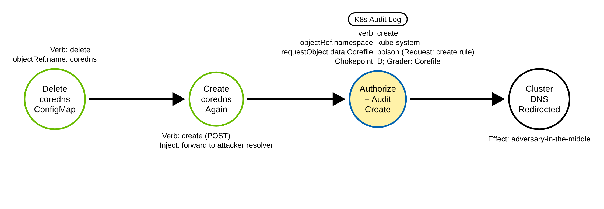

# Cluster DNS Poisoning via the CoreDNS ConfigMap (Kubernetes)

> Prose uses Simplified Technical English (ASD-STE100) where practical.
> Resource names, ConfigMap names, CoreDNS plugin names, field names, and ATT&CK IDs
> are technical names.

## Metadata

| Key          | Value |
|--------------|-------|
| ID           | TRR9027 |
| External IDs | T1565.001 |
| Tactics      | Impact |
| Platforms    | Kubernetes |
| Contributors | det-eng |
| Status       | draft |

### Scope Statement

This TRR covers cluster adversary-in-the-middle through **DNS configuration
poisoning**: writing the ConfigMap that cluster DNS reads — `coredns` (the Corefile),
the legacy `kube-dns` ConfigMap, or the `coredns-custom` import ConfigMap, all in
`kube-system` — to redirect in-cluster name resolution to an attacker-controlled
resolver.

This TRR does not cover these related actions:

- Host-level DNS spoofing (ARP/LLMNR/DHCP poisoning on a node, or editing a pod's
  `/etc/resolv.conf`). ATT&CK T1557 describes that effect, but it is an endpoint
  protocol-spoofing technique with no cluster-config variant; this report is the
  control-plane config edit, not the on-wire spoof.
- Deploying a rogue DNS **workload** (a pod that answers DNS). That is Deploy
  Container, and it does not touch the CoreDNS ConfigMap.
- Editing other `kube-system` ConfigMaps (kubelet config, kube-proxy). Those are
  different objects and different techniques.

> **ATT&CK mapping caveat.** The best available ID is **T1565.001 (Stored Data
> Manipulation)**, tactic Impact — the Corefile is stored configuration data being
> manipulated, which is the mapping Elastic's nearest rule also uses. T1565.001's
> listed platforms are Linux/Windows/macOS and do **not** include Containers, so this
> is a cross-domain mapping of the mechanism, as TRR9025 does for T1546 (TRR9008's
> T1685 is not comparable: it lists Containers).
> The technique's *effect* is better described by T1557 (Adversary-in-the-Middle),
> but T1557's sub-techniques are endpoint protocol-spoofing with no Containers
> platform and no config-edit variant, so it is cited as the effect cross-map only.
> The Microsoft Threat Matrix for Kubernetes places this as "CoreDNS poisoning" under
> Lateral Movement. T1556 (Modify Authentication Process) is rejected — DNS
> redirection is not an authentication change.

## Technique Overview

Every pod in a cluster resolves names through the cluster DNS service, CoreDNS.
CoreDNS reads its configuration — the *Corefile* — from a ConfigMap named `coredns` in
the `kube-system` namespace, and reloads it automatically when it changes. The
Corefile says where to send each query: which domains CoreDNS answers itself, and
where it forwards everything else.

An adversary who can write that ConfigMap controls name resolution for the whole
cluster. By adding a `forward` to an attacker-run resolver, a `rewrite` that
rewrites a service name to an attacker address, or a `template`/`hosts` entry, the
adversary makes pods resolve a legitimate name to a machine the adversary controls.
Every service that looks up that name then connects to the attacker, who can capture
credentials, read traffic, or relay it onward — an adversary-in-the-middle for the
entire cluster from a single config edit. The edit looks like ordinary DNS
administration; the difference is who makes it and what they inject into the Corefile.

## Technical Background

### The ConfigMaps cluster DNS reads

Cluster DNS configuration lives in a small set of ConfigMaps in `kube-system`:

- **`coredns`** — the primary. Its `data.Corefile` key is the CoreDNS configuration.
  The CoreDNS Deployment mounts this exact object, so an attacker who wants CoreDNS to
  read their config **must** write the ConfigMap named `coredns`; they cannot rename
  it. That makes `objectRef.name` a load-bearing, non-spoofable anchor.
- **`kube-dns`** — the legacy name. On older or migrated clusters, stub domains and
  upstream nameservers live here as JSON (`data.stubDomains`,
  `data.upstreamNameservers`). CoreDNS can be configured to honor it.
- **`coredns-custom`** — a sanctioned extension point (AKS ships it; CoreDNS's
  `import` plugin reads it). Snippets under arbitrary `data` keys (for example
  `*.server`, `*.override`) are imported into the running config without touching the
  base Corefile. Because it is sanctioned, it is a higher-false-positive surface and
  must be graded on content, not on name alone.

### The audit shape, and the two levels

Every poisoning path is a write to a ConfigMap in `kube-system`. The audit event
carries `objectRef.resource: configmaps`, `objectRef.namespace: kube-system`,
`objectRef.name` (one of the three), and the verb (`update`/`patch` for an in-place
edit, `create` for `coredns-custom`, `delete` for an availability attack). The
`objectRef.apiGroup` is the empty core group and is often omitted, so a rule must not
pin it. A write is fully described at `Metadata` level, which is enough to fire the
chokepoint.

But `Metadata` hides the injected content. The Corefile lives only in
`requestObject.data.Corefile`, which `Metadata` does not record. At `Metadata` a
benign Corefile edit and a poisoning edit are indistinguishable. So the content grader
must run at `Request` level or higher. The shared audit policy keeps configmap writes
at `Metadata` through its catch-all; this report adds a `RequestResponse`-level rule
for writes to the three DNS ConfigMaps in `kube-system` (`coredns`, `kube-dns`,
`coredns-custom`, by `resourceNames`), the way the policy already raises
`admissionregistration` and pods. `RequestResponse` adds `responseObject`, the stored
ConfigMap after the write, whose Corefile is a plain string whatever the patch type.
A `create` (a POST to the collection) carries no name for `resourceNames` to match, so
a second rule logs every ConfigMap `create` in `kube-system` at `Request`. A
server-side apply that creates one is a PATCH to the named object, so the first rule
logs it.

Both rules copy data into the log that can be secret. The create rule logs the body of
every ConfigMap created in `kube-system`, and some tools keep secrets there: Helm 2
(Tiller) stores each release revision as a ConfigMap in `kube-system` by default, and
Helm 3 does the same in the release namespace with `HELM_DRIVER=configmap`. The release
payload (base64 of gzip) holds the rendered manifests, Secret data included, and the
chart values. A cluster that stores Helm releases (or any credential) in `kube-system`
ConfigMaps must drop the create rule, and then sees a recreated `coredns` at the
chokepoint only. The `RequestResponse` rule logs the full Corefile twice on every write,
and a Corefile can hold credentials inline (the `route53` plugin's `aws_access_key`, the
`azure` plugin's `secret`, the `tsig` plugin's `secret`): keep them out of the Corefile,
or protect and retain the audit log as you would the credential. The policy file
states the same at each rule.

### What a poisoned Corefile looks like

A kubeadm default Corefile forwards upstream with `forward . /etc/resolv.conf` and
runs no `rewrite`, `template`, or `hosts` plugin. Two distributions ship a `hosts`
block in their default: k3s (`hosts /etc/coredns/NodeHosts { ttl 60 reload 15s
fallthrough }`, whose NodeHosts key the k3s node controller rewrites on node changes)
and minikube (`hosts { <IP> host.minikube.internal fallthrough }`). A poisoning edit
shows up as one of: a `rewrite` or `template` plugin (neither is in the kubeadm, k3s or
minikube default), a `hosts` block other than those two defaults, an environment
placeholder (`{$NAME}` or ``, which CoreDNS replaces when it parses the
Corefile, so `re{$UNSET}write` is a hidden `rewrite` and `forward . {$UNSET}192.0.2.53`
a hidden IP target; no default uses one), a forward of the cluster zone
(`cluster.local`) to an IP, or a `forward` to an explicit IP address (the default
forwards to a file, not a literal IP). Those are the content signals the grader keys
on. The grader excludes the two default `hosts` blocks only when the block is the only
`hosts` text in the Corefile, so an added entry, a second `hosts` block or a changed
file still fires. An entry added to the k3s NodeHosts data key (not to the Corefile)
is seen by the chokepoint only. A `forward` to any IP is a poisoning signal in
the root server block (the block for zone `.`, which serves every name). In any other
block, a `forward` to a public IP (outside the private, loopback, link-local and
shared ranges) sends a zone to a resolver outside the cluster and the organization,
and is graded too. A stub zone that sends one domain to a PRIVATE IP (a
`corp.example.com:53` block with `forward . 10.10.0.53`) is routine, and its audit
record differs from a redirect of one domain to an attacker resolver in a pod or
Service at a private IP only in the zone name and the address: whether that address is
the corporate resolver is network inventory, not in the record. The grader leaves
those to the chokepoint, except a forward of the cluster zone itself (a server block
whose key ends in `cluster.local`, such as `cluster.local:53` or
`kubernetes.default.svc.cluster.local:53`, or a `forward` whose FROM ends in
`cluster.local`): the `kubernetes` plugin answers that zone, so a forward of it to any
IP sends Service names to another resolver. A cluster with another
`--cluster-domain` is not covered by that clause.

To find the root block, the grader must read the Corefile as CoreDNS does. The
Caddyfile parser that CoreDNS uses accepts more than one layout for the same block:
the opening brace on the key line or on a later line, no braces at all for a
single-block Corefile, a key list separated by commas and continued onto the next
line, and a directive on the brace line. Comments and quoted tokens can hold a
brace that is not structure. An adversary writes the whole Corefile, so each of
these layouts must grade. The grader therefore reads the Corefile from its top,
skips the server blocks before the root block, and checks the `forward` directives
of the root block. It does not follow an `import`: matching a snippet's name with its
definition needs a comparison of two arbitrary strings, which no regular expression
can do, and an imported file is not in the record. It reads only three levels of
nested braces (balanced braces of any depth are not a regular language). A forward
to a private IP that reaches the root block that way is seen by the chokepoint only;
a forward to a public IP fires wherever it is written.

The grader is a portable regular expression (no lookaround, no possessive
quantifiers; see `detections/README.md`, "Portable regular expressions"). When the
root block is the first block, or the Corefile is one braceless block, it reads tokens
as CoreDNS's lexer does: a brace is structure only as a token of its own, so a brace
inside a longer or quoted token (`{remote}`, `{1}`, `{{ .Name }}`) and a `#` inside a
quoted token do not shift the block count. A root block after other blocks is read
with a simpler grammar in which such a brace counts (a token-aware grammar for that
layout exceeds Lucene's default determinization budget); a balanced brace pair inside
a token still nets out there. Every portable construct treats a tab and a line break
alike (a class, `\s` and `\S` hold both or neither, and Lucene's `.` matches both),
so in the Corefile string a tab inside a comment ends it, and a braceless block's
keys must be separated by spaces or a comma. In the JSON-patch text a tab is `\t` and a
line break `\n`, so there the grammar reads them exactly. The full grammar, re-spelled
for the JSON escapes, exceeds Lucene's budget too, so the JSON-patch text is read by a
reduced grammar (the root block first, after other blocks, or braceless; one nested
brace level; a `#` comment as plain text, so a brace inside it counts; no quoted
`import` path). At `RequestResponse` the stored Corefile of a JSON patch is read by the
full grammar.

The plugin clause anchors a directive at the start of the Corefile, after a line
break, or after the `{` that opens a block (the parser reads the first token after `{`
as a directive), and accepts a quoted directive name (`"rewrite"`, `"hosts" {`).
CoreDNS splits tokens on Go's `unicode.IsSpace`, but `\s` is ASCII in RE2 and in
Lucene (Lucene's holds only tab, line feed, carriage return and space). The plugin
clause adds U+00A0 and U+0085 to its blanks; the forward grammars do not, so there
those two match as blanks only on a backend whose `\s` holds them (Python's does). A
vertical tab and a form feed cannot be written in the portable subset at all (RE2's
`\s` holds the form feed, not the vertical tab). The lexer also drops every carriage
return, even inside a token, so `ho<CR>sts` is `hosts` to CoreDNS but not to the
grader, and no portable construct names a carriage return alone. These are stated
limits.

### Why the technique works

Cluster DNS is central configuration protected only by RBAC on `kube-system`
ConfigMaps. An identity that can write them redirects resolution for every workload,
and CoreDNS reloads the change on its own. The edit resembles routine DNS
administration, so a detection must see the write to the DNS ConfigMap and, to grade
it, read the submitted Corefile.

## Procedures

| Procedure | ID | Name | Entry point |
|-----------|----|------|-------------|
| A | TRR9027.K8S.A | Repoint the coredns Corefile | `update`/`patch configmaps coredns` |
| B | TRR9027.K8S.B | Edit the legacy kube-dns ConfigMap | `update`/`patch configmaps kube-dns` |
| C | TRR9027.K8S.C | Inject via coredns-custom import | `create`/`update configmaps coredns-custom` |
| D | TRR9027.K8S.D | Recreate the coredns ConfigMap | `delete`, then `create configmaps coredns` |

> A tool is not a procedure. `kubectl`, a client library, and a raw HTTP client all
> send the same ConfigMap write. They are the same procedure.

**Reading the DDMs.** Green borders are operations the client performs. Blue borders
are operations the API server performs. Black borders are the abstract effect. The
pill names the telemetry; the `Key: value` lines are what a rule matches; a shaded
node is the primary detection opportunity.

### Procedure A: Repoint the coredns Corefile  (`TRR9027.K8S.A`)

The adversary edits `data.Corefile` of the `coredns` ConfigMap to inject a `forward`
to an attacker resolver, or a `rewrite` that redirects a service name.

- **Prerequisites:** `update`/`patch` on `configmaps` named `coredns` in
  `kube-system`.
- **Mechanics:** CoreDNS reloads the edited Corefile and applies the redirect.
- **Impact:** cluster-wide name resolution redirected to the attacker.
- **Tools on this path:** `kubectl patch`/`apply`, any client.

#### Detection Data Model — `TRR9027.K8S.A`

Source: [`ddms/trr9027_k8s_a.json`](ddms/trr9027_k8s_a.json) (Arrows app format).

**DDM summary.** The shaded node is the API server's authorize-and-audit of the
configmap write (`objectRef.resource: configmaps`, `objectRef.namespace: kube-system`,
`objectRef.name: coredns`), the chokepoint for A, B, and C. The poisoned
`requestObject.data.Corefile` is what the grader keys on (Request level).

### Procedure B: Edit the legacy kube-dns ConfigMap  (`TRR9027.K8S.B`)

The adversary edits the `kube-dns` ConfigMap, setting `stubDomains` or
`upstreamNameservers` to redirect resolution for a domain to an attacker resolver.

- **Prerequisites:** `update`/`patch`/`create` on `configmaps` named `kube-dns` in
  `kube-system`.
- **Mechanics:** the redirect is JSON (`stubDomains`), not a Corefile.
- **Impact:** resolution for the targeted domains redirected.
- **Tools on this path:** `kubectl`, any client.

#### Detection Data Model — `TRR9027.K8S.B`

Source: [`ddms/trr9027_k8s_b.json`](ddms/trr9027_k8s_b.json) (Arrows app format).

**DDM summary.** Same chokepoint, `objectRef.name: kube-dns`. The redirect is JSON
(`stubDomains`), not a Corefile, so the Corefile content grader does not apply; B is
caught at the chokepoint and triaged.

### Procedure C: Inject via coredns-custom import  (`TRR9027.K8S.C`)

The adversary creates or edits the `coredns-custom` ConfigMap, whose snippets CoreDNS
imports, to inject a `rewrite`/`forward` without touching the base Corefile.

- **Prerequisites:** `create`/`update` on `configmaps` named `coredns-custom` in
  `kube-system`.
- **Mechanics:** CoreDNS's `import` plugin folds the snippet into the running config.
- **Impact:** the same redirect, without a visible base-Corefile change.
- **Tools on this path:** `kubectl`, any client.

#### Detection Data Model — `TRR9027.K8S.C`

Source: [`ddms/trr9027_k8s_c.json`](ddms/trr9027_k8s_c.json) (Arrows app format).

**DDM summary.** Same chokepoint, `objectRef.name: coredns-custom`, verb often
`create`. It is a sanctioned customization mechanism, so it is higher-FP: covered at
the chokepoint and triaged there. The content grader reads `data.Corefile`, so a
`coredns-custom` snippet (under its own data key) is not graded when it is created,
applied or merge-patched. The grader's JSON-patch clauses scan the raw operation text of
any of the three ConfigMaps, so a snippet added by `kubectl patch --type=json` is
graded.

### Procedure D: Recreate the coredns ConfigMap  (`TRR9027.K8S.D`)

The adversary deletes the `coredns` ConfigMap and creates it again with a poisoned
Corefile, instead of editing it in place.

- **Prerequisites:** `delete` and `create` on `configmaps` in `kube-system`.
- **Mechanics:** a DELETE of the named object, then a POST to the collection. CoreDNS
  keeps its loaded config while the ConfigMap is absent and reloads the new Corefile.
- **Impact:** the same redirect as Procedure A, through a create.
- **Tools on this path:** `kubectl delete` and `kubectl create`/`replace --force`,
  any client.

#### Detection Data Model — `TRR9027.K8S.D`

Source: [`ddms/trr9027_k8s_d.json`](ddms/trr9027_k8s_d.json) (Arrows app format).

**DDM summary.** The chokepoint sees both the delete and the create. A create names no
object when the audit policy is evaluated, so the `resourceNames` rule cannot select
it; the policy's `kube-system` ConfigMap create rule logs it at `Request`, and the
grader reads the created Corefile.

## Detection Strategy

Compare the four DDMs. Every procedure is a write to a DNS ConfigMap in `kube-system`,
so one chokepoint rule covers all four. The Corefiles of Procedures A and D are
content-gradable; B's JSON and C's imported snippets are caught at the chokepoint and
triaged.

**Telemetry requirement.** The chokepoint fires at `Metadata`. The grader needs the
Corefile, so the audit policy must record the DNS ConfigMap writes at `Request` level
or higher. The shared policy keeps configmap writes at `Metadata` via its catch-all,
so this report adds a `RequestResponse`-level rule scoped by `resourceNames` to
`coredns`, `kube-dns` and `coredns-custom` in `kube-system`: patches, updates and
deletes of those three, and a server-side apply that creates one (a PATCH by name),
are logged with the request body and the stored object. A plain `create` has no name
for `resourceNames` to match, so a second rule logs every ConfigMap `create` in
`kube-system` at `Request`. No other ConfigMap update or read is logged with a body,
but every `kube-system` ConfigMap create is (see the Helm caveat above).

**Strategy 1 — chokepoint (covers A, B, C, D).**
Match an audit event where `objectRef.resource` is `configmaps`,
`objectRef.namespace` is `kube-system`, `objectRef.name` is `coredns`, `kube-dns`, or
`coredns-custom`, and the verb is `update`, `patch`, `delete`, or `create`. Baseline
the actor: the coredns/kube-dns service accounts, `system:node:*`,
kube-controller-manager, GitOps/Helm, and the managed-control-plane principals. Elastic
ships near-identical rules at this layer; this is the provider-agnostic Sigma
counterpart, stated as a backstop.

- Sensor: API server audit log.
- Rule: `detections/sigma/T1565.001/k8s_coredns_configmap_modified.yml` (built).

**Strategy 2 — content grader (grades A and D; needs Request level).**
On top of the chokepoint, match a write whose Corefile (`requestObject.data.Corefile`,
the JSON-patch text in `requestObject`, or the stored `responseObject.data.Corefile`)
carries a `rewrite` or `template` plugin, a `hosts` block other than the k3s and
minikube defaults, an environment placeholder, a root-block `forward` to an explicit IP
address, a forward of the cluster zone to an IP, or a `forward` in any block to a
public IP address. This separates a poisoning edit from a benign Corefile change. A
stub zone that forwards another domain to a private IP is not graded (it is routine,
and its record differs from a targeted redirect to a private address only in the zone
and the address); the chokepoint sees it.

- Sensor: API server audit log at Request level.
- Rule: `detections/sigma/T1565.001/k8s_coredns_corefile_poisoned.yml` (built).

**Demonstrated gap — availability and the node bypass.**
Deleting the `coredns` ConfigMap (verb `delete`, caught by the chokepoint) breaks DNS
for the cluster — an availability impact rather than a redirect; the chokepoint sees
it but the grader does not (no Corefile to grade). And an adversary with control-plane
node access can edit CoreDNS's mounted config on disk or in etcd with no API write and
no audit event; a node file/etcd sensor is the only cover, which the lab notes
read-only.

**Coverage summary.**

| Procedure | Covered by | How |
|-----------|-----------|-----|
| A | Strategy 1; graded by Strategy 2 | poisoned `requestObject.data.Corefile` |
| B | Strategy 1 | `kube-dns` JSON redirect (chokepoint; triaged) |
| C | Strategy 1 | `coredns-custom` import (chokepoint; triaged; graded only in the JSON-patch form) |
| D | Strategy 1; graded by Strategy 2 | created `requestObject.data.Corefile` (Request: create rule) |

One chokepoint rule covers every write to the cluster DNS ConfigMaps. One content
grader separates a Corefile poisoning from a benign edit. Availability deletion and the
node bypass are stated gaps.

## Available Emulation Tests

The tests run in a lab cluster with the shared audit policy. The lab is a `kind`
cluster; its config and audit policy are in
[`detections/k8s/`](../../../detections/k8s/). Every procedure's write carries the
sentinel token `trr9027` (a `forward` to a sentinel `.invalid` zone that no workload
resolves). A patches `coredns`, and B and C create `kube-dns` and `coredns-custom` by
server-side apply (a PATCH by name), which the `resourceNames` rule logs. D deletes
`coredns` and creates it again with a plain create (a POST), which the `kube-system`
create rule logs. Each write reaches the log with its body and sentinel, and the
validator proves A, B, C and D. **Procedure D saves the coredns object first, creates
it again at once with the original Corefile plus an inert sentinel stub zone, and
restores the original Corefile**; it skips a coredns ConfigMap that has an owner, an
addon-manager label or the EKS add-on label (`eks.amazonaws.com/component`), runs only
when `kubectl auth can-i` allows create, patch and delete of ConfigMaps in
`kube-system`, puts the saved object back if the create fails, and then checks that
`coredns` exists with the saved Corefile byte for byte; if not, it prints a `::error::`
line with the saved object and exits 1.
B and C run only when no ConfigMap of that name exists (a GKE `kube-dns` or an AKS
`coredns-custom` is never touched), and cleanup deletes only the ConfigMaps the
emulation labelled `app.kubernetes.io/part-of=trr9027`. **Procedure A captures and restores
the original Corefile** (byte for byte, trailing line break included, verified after
the restore) so cluster DNS is unchanged after the run. Procedures B and C
operate on ConfigMaps that a CoreDNS `kind` cluster does not read (`kube-dns`,
`coredns-custom`), so they are inert, and are deleted on cleanup. One script drives
them:
[`atomics/T1565.001/src/emulate.sh`](../../../atomics/T1565.001/src/emulate.sh), with
Atomic Red Team wrappers in
[`atomics/T1565.001/T1565.001.yaml`](../../../atomics/T1565.001/T1565.001.yaml).

| Procedure | Test | Status |
|-----------|------|--------|
| TRR9027.K8S.A | `emulate.sh a` — patch the `coredns` Corefile with a sentinel forward, then restore. | **built** |
| TRR9027.K8S.B | `emulate.sh b` — create a `kube-dns` ConfigMap with a stubDomains redirect by server-side apply (inert). | **built** |
| TRR9027.K8S.C | `emulate.sh c` — create a `coredns-custom` ConfigMap with a forward snippet by server-side apply (inert). | **built** |
| TRR9027.K8S.D | `emulate.sh d` — delete `coredns`, create it again with a sentinel stub zone forwarded to a TEST-NET IP, then restore. | **built** |

## Detections

| Strategy | Covers | Sigma rule | Sensor |
|----------|--------|------------|--------|
| 1 (chokepoint) | A, B, C, D | [`detections/sigma/T1565.001/k8s_coredns_configmap_modified.yml`](../../../detections/sigma/T1565.001/k8s_coredns_configmap_modified.yml) | API server audit log |
| 2 (grader) | A, D | [`detections/sigma/T1565.001/k8s_coredns_corefile_poisoned.yml`](../../../detections/sigma/T1565.001/k8s_coredns_corefile_poisoned.yml) | API server audit log (Request / RequestResponse) |

The validator
[`detections/validate_apiserver_detections.py`](../../../detections/validate_apiserver_detections.py)
reads the API server audit log the emulation produced and asserts that the chokepoint
matches each procedure's own write (A `coredns`, B `kube-dns`, C `coredns-custom`, D
the create of `coredns`), and that the grader matches Procedure A's `coredns` write and
Procedure D's create. It tells the emulation's writes
apart by the `trr9027` sentinel in the logged body. The workflow
[`validate-apiserver-detections.yml`](../../../.github/workflows/validate-apiserver-detections.yml)
runs the loop on a `kind` cluster, with a negative control on the pre-emulation log.

Upstream: Elastic ships near-identical rules for a modified coredns/kube-dns ConfigMap.
Propose the provider-agnostic Sigma chokepoint, plus the Request-level Corefile content
grader that separates a poisoning edit from a benign one.

## References

- MITRE ATT&CK, T1565.001 Data Manipulation: Stored Data Manipulation:
  <https://attack.mitre.org/techniques/T1565/001/>
- Kubernetes documentation, Customizing DNS Service (the coredns ConfigMap and
  Corefile):
  <https://kubernetes.io/docs/tasks/administer-cluster/dns-custom-nameservers/>
- CoreDNS, rewrite plugin:
  <https://coredns.io/plugins/rewrite/>
- CoreDNS, forward plugin:
  <https://coredns.io/plugins/forward/>
- CoreDNS Caddyfile lexer and parser (server block addresses, braceless blocks,
  directives):
  <https://github.com/coredns/caddy/blob/master/caddyfile/parse.go>
- Kubernetes documentation, Auditing:
  <https://kubernetes.io/docs/tasks/debug/debug-cluster/audit/>
- Microsoft Threat Matrix for Kubernetes, CoreDNS poisoning:
  <https://microsoft.github.io/Threat-Matrix-for-Kubernetes/techniques/CoreDNS%20poisoning/>
- TRR method:
  <https://github.com/tired-labs/techniques/blob/main/docs/TECHNIQUE-RESEARCH-REPORT.md>
