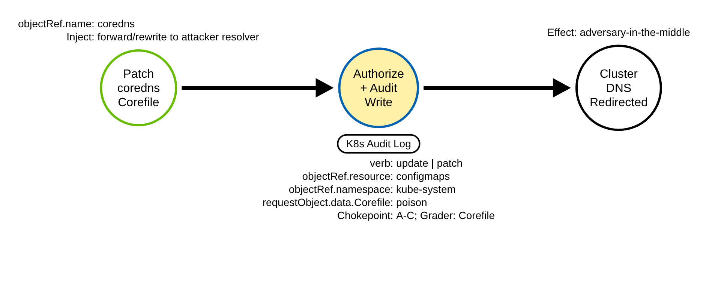
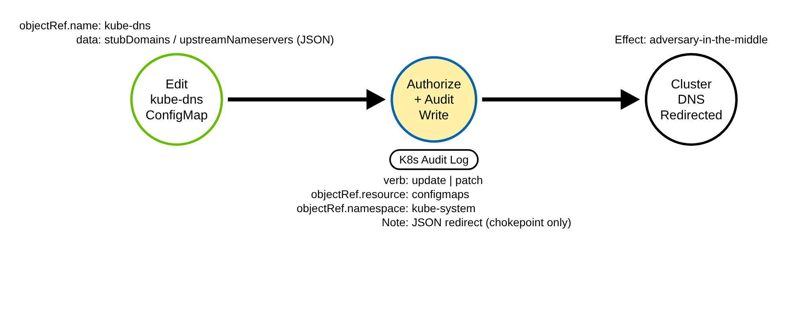
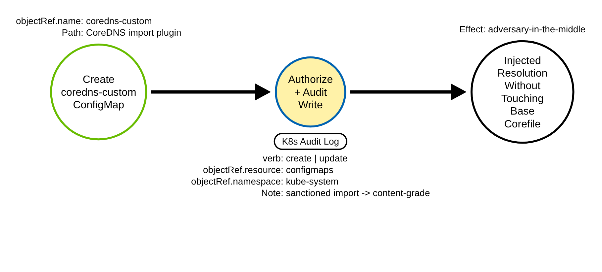

# Cluster DNS Poisoning via the CoreDNS ConfigMap (Kubernetes)

> Prose uses Simplified Technical English (ASD-STE100) where practical.
> Resource names, ConfigMap names, CoreDNS plugin names, field names, and ATT&CK IDs
> are technical names.

## Metadata

| Key          | Value |
|--------------|-------|
| ID           | TRR9027 |
| External IDs | T1565.001 |
| Tactics      | Impact |
| Platforms    | Kubernetes |
| Contributors | det-eng |
| Status       | draft |

### Scope Statement

This TRR covers cluster adversary-in-the-middle through **DNS configuration
poisoning**: writing the ConfigMap that cluster DNS reads — `coredns` (the Corefile),
the legacy `kube-dns` ConfigMap, or the `coredns-custom` import ConfigMap, all in
`kube-system` — to redirect in-cluster name resolution to an attacker-controlled
resolver.

This TRR does not cover these related actions:

- Host-level DNS spoofing (ARP/LLMNR/DHCP poisoning on a node, or editing a pod's
  `/etc/resolv.conf`). ATT&CK T1557 describes that effect, but it is an endpoint
  protocol-spoofing technique with no cluster-config variant; this report is the
  control-plane config edit, not the on-wire spoof.
- Deploying a rogue DNS **workload** (a pod that answers DNS). That is Deploy
  Container, and it does not touch the CoreDNS ConfigMap.
- Editing other `kube-system` ConfigMaps (kubelet config, kube-proxy). Those are
  different objects and different techniques.

> **ATT&CK mapping caveat.** The best available ID is **T1565.001 (Stored Data
> Manipulation)**, tactic Impact — the Corefile is stored configuration data being
> manipulated, which is the mapping Elastic's nearest rule also uses. T1565.001's
> listed platforms are Linux/Windows/macOS and do **not** include Containers, so this
> is a cross-domain mapping of the mechanism — the same move TRR9008 makes for T1685.
> The technique's *effect* is better described by T1557 (Adversary-in-the-Middle),
> but T1557's sub-techniques are endpoint protocol-spoofing with no Containers
> platform and no config-edit variant, so it is cited as the effect cross-map only.
> The Microsoft Threat Matrix for Kubernetes places this as "CoreDNS poisoning" under
> Lateral Movement. T1556 (Modify Authentication Process) is rejected — DNS
> redirection is not an authentication change.

## Technique Overview

Every pod in a cluster resolves names through the cluster DNS service, CoreDNS.
CoreDNS reads its configuration — the *Corefile* — from a ConfigMap named `coredns` in
the `kube-system` namespace, and reloads it automatically when it changes. The
Corefile says where to send each query: which domains CoreDNS answers itself, and
where it forwards everything else.

An adversary who can write that ConfigMap controls name resolution for the whole
cluster. By adding a `forward` to an attacker-run resolver, a `rewrite` that
rewrites a service name to an attacker address, or a `template`/`hosts` entry, the
adversary makes pods resolve a legitimate name to a machine the adversary controls.
Every service that looks up that name then connects to the attacker, who can capture
credentials, read traffic, or relay it onward — an adversary-in-the-middle for the
entire cluster from a single config edit. The edit looks like ordinary DNS
administration; the difference is who makes it and what they inject into the Corefile.

## Technical Background

### The ConfigMaps cluster DNS reads

Cluster DNS configuration lives in a small set of ConfigMaps in `kube-system`:

- **`coredns`** — the primary. Its `data.Corefile` key is the CoreDNS configuration.
  The CoreDNS Deployment mounts this exact object, so an attacker who wants CoreDNS to
  read their config **must** write the ConfigMap named `coredns`; they cannot rename
  it. That makes `objectRef.name` a load-bearing, non-spoofable anchor.
- **`kube-dns`** — the legacy name. On older or migrated clusters, stub domains and
  upstream nameservers live here as JSON (`data.stubDomains`,
  `data.upstreamNameservers`). CoreDNS can be configured to honor it.
- **`coredns-custom`** — a sanctioned extension point (AKS ships it; CoreDNS's
  `import` plugin reads it). Snippets under arbitrary `data` keys (for example
  `*.server`, `*.override`) are imported into the running config without touching the
  base Corefile. Because it is sanctioned, it is a higher-false-positive surface and
  must be graded on content, not on name alone.

### The audit shape, and the two levels

Every poisoning path is a write to a ConfigMap in `kube-system`. The audit event
carries `objectRef.resource: configmaps`, `objectRef.namespace: kube-system`,
`objectRef.name` (one of the three), and the verb (`update`/`patch` for an in-place
edit, `create` for `coredns-custom`, `delete` for an availability attack). The
`objectRef.apiGroup` is the empty core group and is often omitted, so a rule must not
pin it. A write is fully described at `Metadata` level, which is enough to fire the
chokepoint.

But `Metadata` hides the injected content. The Corefile lives only in
`requestObject.data.Corefile`, which `Metadata` does not record. At `Metadata` a
benign Corefile edit and a poisoning edit are indistinguishable. So the content grader
must run at `Request` level. The shared audit policy keeps configmap writes at
`Metadata` through its catch-all; this report adds a `Request`-level rule for writes
to the three DNS ConfigMaps in `kube-system` (`coredns`, `kube-dns`,
`coredns-custom`, by `resourceNames`), the way the policy already raises
`admissionregistration` and pods to `Request`. A `create` carries no name for
`resourceNames` to match, so creates of those ConfigMaps stay at `Metadata`.

### What a poisoned Corefile looks like

A default Corefile forwards upstream with `forward . /etc/resolv.conf` and runs no
`rewrite`, `template`, or `hosts` plugin. A poisoning edit shows up as one of: a
`rewrite` or `template` plugin (neither is in a default Corefile), or a `forward` to
an explicit IP address (the default forwards to a file, not a literal IP). Those are
the content signals the grader keys on.

### Why the technique works

Cluster DNS is central configuration protected only by RBAC on `kube-system`
ConfigMaps. An identity that can write them redirects resolution for every workload,
and CoreDNS reloads the change on its own. The edit resembles routine DNS
administration, so a detection must see the write to the DNS ConfigMap and, to grade
it, read the submitted Corefile.

## Procedures

| Procedure | ID | Name | Entry point |
|-----------|----|------|-------------|
| A | TRR9027.K8S.A | Repoint the coredns Corefile | `update`/`patch configmaps coredns` |
| B | TRR9027.K8S.B | Edit the legacy kube-dns ConfigMap | `update`/`patch configmaps kube-dns` |
| C | TRR9027.K8S.C | Inject via coredns-custom import | `create`/`update configmaps coredns-custom` |

> A tool is not a procedure. `kubectl`, a client library, and a raw HTTP client all
> send the same ConfigMap write. They are the same procedure.

**Reading the DDMs.** Green borders are operations the client performs. Blue borders
are operations the API server performs. Black borders are the abstract effect. The
pill names the telemetry; the `Key: value` lines are what a rule matches; a shaded
node is the primary detection opportunity.

### Procedure A: Repoint the coredns Corefile  (`TRR9027.K8S.A`)

The adversary edits `data.Corefile` of the `coredns` ConfigMap to inject a `forward`
to an attacker resolver, or a `rewrite` that redirects a service name.

- **Prerequisites:** `update`/`patch` on `configmaps` named `coredns` in
  `kube-system`.
- **Mechanics:** CoreDNS reloads the edited Corefile and applies the redirect.
- **Impact:** cluster-wide name resolution redirected to the attacker.
- **Tools on this path:** `kubectl patch`/`apply`, any client.

#### Detection Data Model — `TRR9027.K8S.A`

Source: [`ddms/trr9027_k8s_a.json`](ddms/trr9027_k8s_a.json) (Arrows app format).

**DDM summary.** The shaded node is the API server's authorize-and-audit of the
configmap write (`objectRef.resource: configmaps`, `objectRef.namespace: kube-system`,
`objectRef.name: coredns`), the chokepoint for A, B, and C. The poisoned
`requestObject.data.Corefile` is what the grader keys on (Request level).

### Procedure B: Edit the legacy kube-dns ConfigMap  (`TRR9027.K8S.B`)

The adversary edits the `kube-dns` ConfigMap, setting `stubDomains` or
`upstreamNameservers` to redirect resolution for a domain to an attacker resolver.

- **Prerequisites:** `update`/`patch`/`create` on `configmaps` named `kube-dns` in
  `kube-system`.
- **Mechanics:** the redirect is JSON (`stubDomains`), not a Corefile.
- **Impact:** resolution for the targeted domains redirected.
- **Tools on this path:** `kubectl`, any client.

#### Detection Data Model — `TRR9027.K8S.B`

Source: [`ddms/trr9027_k8s_b.json`](ddms/trr9027_k8s_b.json) (Arrows app format).

**DDM summary.** Same chokepoint, `objectRef.name: kube-dns`. The redirect is JSON
(`stubDomains`), not a Corefile, so the Corefile content grader does not apply; B is
caught at the chokepoint and triaged.

### Procedure C: Inject via coredns-custom import  (`TRR9027.K8S.C`)

The adversary creates or edits the `coredns-custom` ConfigMap, whose snippets CoreDNS
imports, to inject a `rewrite`/`forward` without touching the base Corefile.

- **Prerequisites:** `create`/`update` on `configmaps` named `coredns-custom` in
  `kube-system`.
- **Mechanics:** CoreDNS's `import` plugin folds the snippet into the running config.
- **Impact:** the same redirect, without a visible base-Corefile change.
- **Tools on this path:** `kubectl`, any client.

#### Detection Data Model — `TRR9027.K8S.C`

Source: [`ddms/trr9027_k8s_c.json`](ddms/trr9027_k8s_c.json) (Arrows app format).

**DDM summary.** Same chokepoint, `objectRef.name: coredns-custom`, verb often
`create`. It is a sanctioned customization mechanism, so it is higher-FP: covered at
the chokepoint and content-graded, never alerted on the name alone.

## Detection Strategy

Compare the three DDMs. Every procedure is a write to a DNS ConfigMap in `kube-system`,
so one chokepoint rule covers all three. Procedure A's Corefile is content-gradable;
B's JSON and C's imported snippets are caught at the chokepoint and triaged.

**Telemetry requirement.** The chokepoint fires at `Metadata`. The grader needs the
Corefile, so the audit policy must record the DNS ConfigMap writes at `Request` level.
The shared policy keeps configmap writes at `Metadata` via its catch-all, so this
report adds a `Request`-level rule scoped by `resourceNames` to `coredns`, `kube-dns`
and `coredns-custom` in `kube-system` (no other ConfigMap's body is copied into the
log). Patches, updates and deletes of those three are logged at `Request`; a `create`
has no name for `resourceNames` to match, so it stays at `Metadata`.

**Strategy 1 — chokepoint (covers A, B, C).**
Match an audit event where `objectRef.resource` is `configmaps`,
`objectRef.namespace` is `kube-system`, `objectRef.name` is `coredns`, `kube-dns`, or
`coredns-custom`, and the verb is `update`, `patch`, `delete`, or `create`. Baseline
the actor: the coredns/kube-dns service accounts, `system:node:*`,
kube-controller-manager, GitOps/Helm, and the managed-control-plane principals. Elastic
ships near-identical rules at this layer; this is the provider-agnostic Sigma
counterpart, stated as a backstop.

- Sensor: API server audit log.
- Rule: `detections/sigma/T1565.001/k8s_coredns_configmap_modified.yml` (built).

**Strategy 2 — content grader (grades A; needs Request level).**
On top of the chokepoint, match a write whose `requestObject.data.Corefile` carries a
`rewrite` or `template` plugin, or a `forward` to an explicit IP address. This
separates a poisoning edit from a benign Corefile change.

- Sensor: API server audit log at Request level.
- Rule: `detections/sigma/T1565.001/k8s_coredns_corefile_poisoned.yml` (built).

**Demonstrated gap — availability and the node bypass.**
Deleting the `coredns` ConfigMap (verb `delete`, caught by the chokepoint) breaks DNS
for the cluster — an availability impact rather than a redirect; the chokepoint sees
it but the grader does not (no Corefile to grade). And an adversary with control-plane
node access can edit CoreDNS's mounted config on disk or in etcd with no API write and
no audit event; a node file/etcd sensor is the only cover, which the lab notes
read-only.

**Coverage summary.**

| Procedure | Covered by | How |
|-----------|-----------|-----|
| A | Strategy 1; graded by Strategy 2 | poisoned `requestObject.data.Corefile` |
| B | Strategy 1 | `kube-dns` JSON redirect (chokepoint; triaged) |
| C | Strategy 1 | `coredns-custom` import (chokepoint; content-triaged) |

One chokepoint rule covers every write to the cluster DNS ConfigMaps. One content
grader separates a Corefile poisoning from a benign edit. Availability deletion and the
node bypass are stated gaps.

## Available Emulation Tests

The tests run in a lab cluster with the shared audit policy. The lab is a `kind`
cluster; its config and audit policy are in
[`detections/k8s/`](../../../detections/k8s/). Every procedure's write carries the
sentinel token `trr9027` (a `forward` to a sentinel `.invalid` zone that no workload
resolves), but only Procedure A's `coredns` patch is logged with its body, so only A's
sentinel reaches the log and the validator proves Procedure A only. The B and C creates
are logged at `Metadata`: the policy's `Request` rule is scoped by `resourceNames`, and a
`create` names no object when the policy is evaluated, so they carry no body and no
sentinel, and only the chokepoint rule sees them. **Procedure A captures and restores
the original Corefile** so cluster DNS is unchanged after the run. Procedures B and C
operate on ConfigMaps that a CoreDNS `kind` cluster does not read (`kube-dns`,
`coredns-custom`), so they are inert, and are deleted on cleanup. One script drives
them:
[`atomics/T1565.001/src/emulate.sh`](../../../atomics/T1565.001/src/emulate.sh), with
Atomic Red Team wrappers in
[`atomics/T1565.001/T1565.001.yaml`](../../../atomics/T1565.001/T1565.001.yaml).

| Procedure | Test | Status |
|-----------|------|--------|
| TRR9027.K8S.A | `emulate.sh a` — patch the `coredns` Corefile with a sentinel forward, then restore. | **built** |
| TRR9027.K8S.B | `emulate.sh b` — create a `kube-dns` ConfigMap with a stubDomains redirect (inert). | **built** |
| TRR9027.K8S.C | `emulate.sh c` — create a `coredns-custom` ConfigMap with a forward snippet (inert). | **built** |

## Detections

| Strategy | Covers | Sigma rule | Sensor |
|----------|--------|------------|--------|
| 1 (chokepoint) | A, B, C | [`detections/sigma/T1565.001/k8s_coredns_configmap_modified.yml`](../../../detections/sigma/T1565.001/k8s_coredns_configmap_modified.yml) | API server audit log |
| 2 (grader) | A | [`detections/sigma/T1565.001/k8s_coredns_corefile_poisoned.yml`](../../../detections/sigma/T1565.001/k8s_coredns_corefile_poisoned.yml) | API server audit log (Request) |

The validator
[`detections/validate_apiserver_detections.py`](../../../detections/validate_apiserver_detections.py)
reads the API server audit log the emulation produced and asserts that the chokepoint
and the grader both match Procedure A's `coredns` write, which it tells apart by the
`trr9027` sentinel in the logged Corefile. B and C's creates reach the log at `Metadata`
with no sentinel, so the validator does not prove them. The workflow
[`validate-apiserver-detections.yml`](../../../.github/workflows/validate-apiserver-detections.yml)
runs the loop on a `kind` cluster, with a negative control on the pre-emulation log.

Upstream: Elastic ships near-identical rules for a modified coredns/kube-dns ConfigMap.
Propose the provider-agnostic Sigma chokepoint, plus the Request-level Corefile content
grader that separates a poisoning edit from a benign one.

## References

- MITRE ATT&CK, T1565.001 Data Manipulation: Stored Data Manipulation:
  <https://attack.mitre.org/techniques/T1565/001/>
- Kubernetes documentation, Customizing DNS Service (the coredns ConfigMap and
  Corefile):
  <https://kubernetes.io/docs/tasks/administer-cluster/dns-custom-nameservers/>
- CoreDNS, rewrite plugin:
  <https://coredns.io/plugins/rewrite/>
- CoreDNS, forward plugin:
  <https://coredns.io/plugins/forward/>
- Kubernetes documentation, Auditing:
  <https://kubernetes.io/docs/tasks/debug/debug-cluster/audit/>
- Microsoft Threat Matrix for Kubernetes, CoreDNS poisoning:
  <https://microsoft.github.io/Threat-Matrix-for-Kubernetes/techniques/CoreDNS%20poisoning/>
- TRR method:
  <https://github.com/tired-labs/techniques/blob/main/docs/TECHNIQUE-RESEARCH-REPORT.md>
