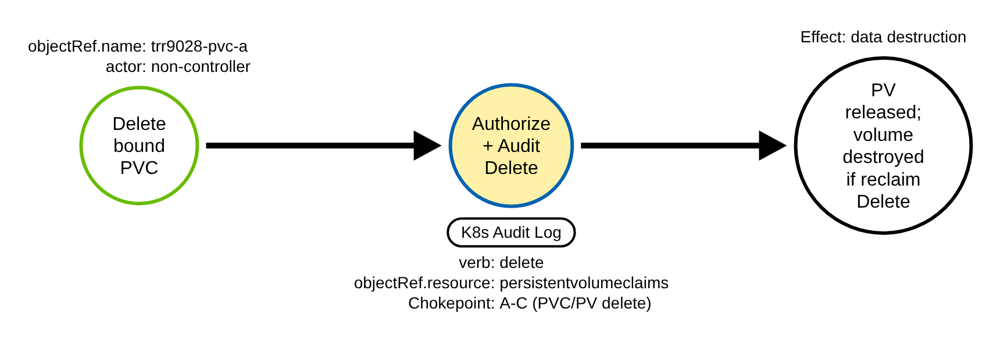
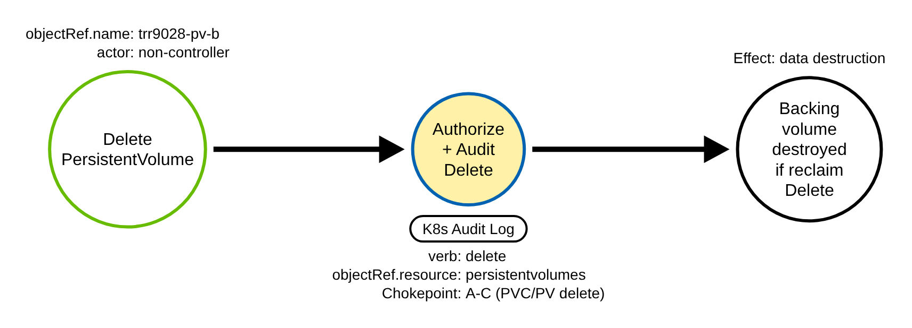
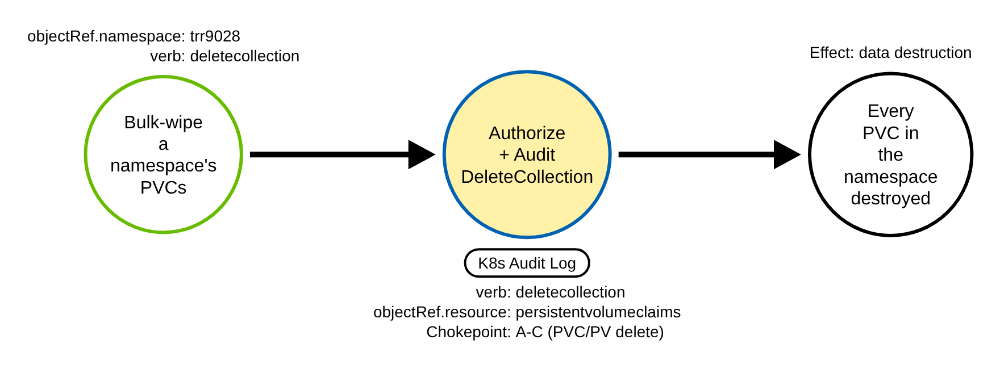
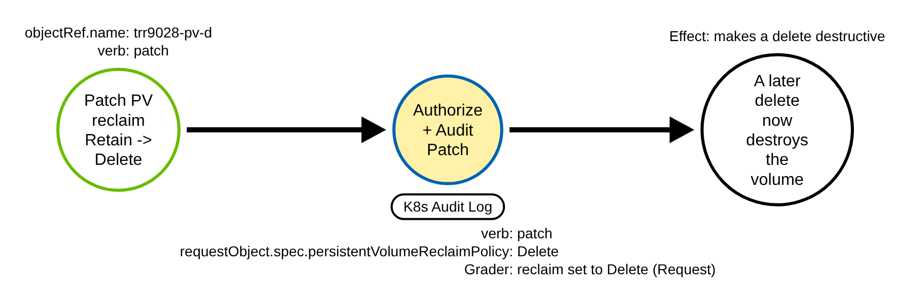

# Storage Destruction via PVC and PV Deletes (Kubernetes)

> Prose uses Simplified Technical English (ASD-STE100) where practical.
> Resource names, field names, service-account names, and ATT&CK IDs are technical
> names.

## Metadata

| Key          | Value |
|--------------|-------|
| ID           | TRR9028 |
| External IDs | T1485 |
| Tactics      | Impact |
| Platforms    | Kubernetes |
| Contributors | det-eng |
| Status       | draft |

### Scope Statement

This TRR covers **data destruction through the API server by deleting the storage
objects that hold a workload's data**: a `PersistentVolumeClaim` (PVC), a
`PersistentVolume` (PV), or a whole namespace's PVCs with `deletecollection`. It also
covers the preparatory step that makes a delete destructive: a patch that sets a PV's
`spec.persistentVolumeReclaimPolicy` to `Delete`.

This TRR does **not** cover:

- `VolumeSnapshot`, `VolumeSnapshotContent` or Velero backup deletion, which is the
  **T1490 (Inhibit System Recovery)** half of the same storage-destruction GO. It is
  built as **TRR9029**; the two chokepoints are deliberately separate rules in separate
  TRRs (AGENTS.md: one technique per TRR).
- Node-local or storage-backend destruction (wiping the disk, deleting the cloud
  volume directly through the provider API). Those leave no Kubernetes audit record;
  this report is the control-plane delete.
- Deleting application data **inside** a running pod (that is endpoint T1485 on the
  container, not a storage-object delete through the API server).

> **ATT&CK mapping.** T1485 (Data Destruction), tactic Impact, lists Containers. The
> effect is the irreversible loss of a volume's data; the Kubernetes mechanism is the
> delete of the storage object that binds that volume.

## Technique Overview

A Kubernetes workload keeps persistent data on a `PersistentVolume`, bound to the
workload through a `PersistentVolumeClaim`. An adversary with delete rights on PVCs or
PVs can destroy that data through one API call. Deleting a bound PVC releases its PV;
when that PV's `persistentVolumeReclaimPolicy` is `Delete` (the default for every
dynamically provisioned volume), the provisioner then deletes the PV **and the backing
volume**, so the data is gone and cannot be recovered from the cluster. Deleting a PV
directly, or running `deletecollection` on every PVC in a namespace, does the same in
bulk. A PV whose reclaim policy is `Retain` keeps its volume on a delete, so a careful
adversary first patches the policy to `Delete` and then deletes.

The destruction is a routine-looking API call — the same `delete` that an operator
uses to decommission a volume. What separates the adversary from the cluster's own
controllers is **who makes the call**: the storage controllers delete PVCs and PVs by
design, and the rule filters them; every other identity's delete is the signal.

## Technical Background

### The storage objects and the audit shape

A PVC (`objectRef.resource: persistentvolumeclaims`, namespaced) and a PV
(`objectRef.resource: persistentvolumes`, cluster-scoped) are both in the core API
group (`objectRef.apiGroup` empty). A delete is fully described at `Metadata` level:
`verb` (`delete` or `deletecollection`), `objectRef.resource`, `objectRef.name` (empty
for a collection delete), `objectRef.namespace` (for a PVC), the caller
(`user.username`) and `responseStatus.code`. A delete carries no object body: its
`requestObject` is a `DeleteOptions` only, so `Metadata` loses nothing the chokepoint
reads.

The chokepoint fires at `Metadata`. The repository raises PVC and PV
delete/deletecollection to `Request` so the `DeleteOptions` body is present and the
dry-run filter can read a `kubectl delete --dry-run=server` (the same reason the
TRR9010 delete rules are at `Request`).

### Which identities delete PVCs and PVs by design

The discriminator is the actor class, verified against kubernetes v1.36.4 source:

- **namespace controller**
  (`system:serviceaccount:kube-system:namespace-controller`): on a namespace delete it
  deletecollections the namespace's namespaced objects, PVCs included
  (`pkg/controller/namespace/deletion/namespaced_resources_deleter.go`). Only its
  `deletecollection` is filtered, so a single PVC delete by that identity still fires.
- **garbage collector**
  (`system:serviceaccount:kube-system:generic-garbage-collector`): deletes an owned PVC
  when its owner is gone — a generic ephemeral volume's pod, or a StatefulSet with a
  `persistentVolumeClaimRetentionPolicy` (GA at v1.32).
- **in-tree PV binder**
  (`system:serviceaccount:kube-system:persistent-volume-binder`): deletes a released
  in-tree PV whose reclaim policy is `Delete`
  (`pkg/controller/volume/persistentvolume/pv_controller.go` `deleteVolumeOperation`,
  `PersistentVolumes().Delete`; the client name is set in
  `cmd/kube-controller-manager/app/core.go`).
- **external (CSI) provisioner**: deletes a dynamically provisioned PV. On the kind CI
  lab that is
  `system:serviceaccount:local-path-storage:local-path-provisioner-service-account`;
  a managed platform runs a different service account (`ebs-csi-controller-sa` on EKS,
  and so on). The rule filters the kind identity; on a managed platform the operator
  must baseline the provisioner's own service account (see **Detection Strategy** and
  [RULE_DEFECTS KTBD-H2](../../../detections/RULE_DEFECTS.md#ktbd-h2-k8s_storage_volume_deleted-the-storage-controller-filters-trust-the-identity)).

The `pv-protection` and `pvc-protection` controllers do **not** delete; they only
`update` an object to remove a finalizer
(`pkg/controller/volume/pvprotection/pv_protection_controller.go` and
`pkg/controller/volume/pvcprotection/pvc_protection_controller.go`), so they are not
storage deletes and are not filtered.

### The one-record reclaim-policy gap

A PVC or PV delete record does **not** carry the bound PV's reclaim policy (a delete
body is `DeleteOptions`). So, from one record, a **destructive** delete (reclaim
`Delete`, the volume is destroyed) looks identical to a **non-destructive** one
(reclaim `Retain`, the volume is kept). The chokepoint fires on both and cannot tell
them apart. The separate grader `k8s_volume_reclaim_set_to_delete` catches the step
that makes a delete destructive — a patch that sets a PV's reclaim policy to `Delete`.
This gap is tracked as
[RULE_DEFECTS KTBD-H1](../../../detections/RULE_DEFECTS.md#ktbd-h1-k8s_storage_volume_deleted-one-delete-record-does-not-show-whether-the-volume-is-destroyed).

## Procedures

### Procedure A: Delete a bound PersistentVolumeClaim  (`TRR9028.K8S.A`)

The adversary deletes a PVC that is bound to a PV. The PV is released; with reclaim
policy `Delete` the provisioner then destroys the backing volume.

- **Prerequisites:** `delete` on `persistentvolumeclaims` in the target namespace.
- **Mechanics:** `kubectl delete pvc <name>`, any client.
- **Impact:** the workload's data is released and, with reclaim `Delete`, destroyed.

#### Detection Data Model — `TRR9028.K8S.A`

Source: [`ddms/trr9028_k8s_a.json`](ddms/trr9028_k8s_a.json) (Arrows app format).

**DDM summary.** The shaded node is the API server's authorize-and-audit of the PVC
delete (`verb: delete`, `objectRef.resource: persistentvolumeclaims`), the chokepoint
for A, B and C. The rule fires on any non-controller identity.

### Procedure B: Delete a PersistentVolume  (`TRR9028.K8S.B`)

The adversary deletes a PV directly.

- **Prerequisites:** `delete` on `persistentvolumes` (cluster-scoped).
- **Mechanics:** `kubectl delete pv <name>`, any client.
- **Impact:** the PV is removed; with reclaim `Delete` the backing volume is destroyed.

#### Detection Data Model — `TRR9028.K8S.B`

Source: [`ddms/trr9028_k8s_b.json`](ddms/trr9028_k8s_b.json) (Arrows app format).

**DDM summary.** The shaded node is the same chokepoint on
`objectRef.resource: persistentvolumes`.

### Procedure C: Bulk-wipe a namespace's PVCs with deletecollection  (`TRR9028.K8S.C`)

The adversary sends a collection `DELETE` on the PVCs of a namespace, destroying every
claim at once. `kubectl delete pvc --all` lists and deletes each by name (verb
`delete`); a real `deletecollection` is a `DELETE` to the collection URL (`kubectl
delete --raw`), recorded as `verb: deletecollection` whatever the count.

- **Prerequisites:** `deletecollection` on `persistentvolumeclaims` in the namespace.
- **Mechanics:** a collection `DELETE` to
  `/api/v1/namespaces/<ns>/persistentvolumeclaims`.
- **Impact:** every PVC in the namespace is destroyed in one call.

#### Detection Data Model — `TRR9028.K8S.C`

Source: [`ddms/trr9028_k8s_c.json`](ddms/trr9028_k8s_c.json) (Arrows app format).

**DDM summary.** The shaded node is the chokepoint on `verb: deletecollection`.

### Procedure D: Flip a PV reclaim policy to Delete  (`TRR9028.K8S.D`)

The adversary patches a PV whose reclaim policy is `Retain` so that
`spec.persistentVolumeReclaimPolicy` is `Delete`, making a later release destroy the
backing volume. This is the separate grader, not the chokepoint.

- **Prerequisites:** `patch` on `persistentvolumes`.
- **Mechanics:** `kubectl patch pv <name> -p
  '{"spec":{"persistentVolumeReclaimPolicy":"Delete"}}'` (a strategic-merge patch; a
  `kubectl patch --type=json` op list is also graded).
- **Impact:** a non-destructive storage object becomes destructive on its next delete.

#### Detection Data Model — `TRR9028.K8S.D`

Source: [`ddms/trr9028_k8s_d.json`](ddms/trr9028_k8s_d.json) (Arrows app format).

**DDM summary.** The shaded node is the API server's audit of the PV patch
(`verb: patch`, `requestObject.spec.persistentVolumeReclaimPolicy: Delete`), which the
grader keys on at `Request` level.

## Detection Strategy

Platform coverage: [detections/k8s/PLATFORMS.md](../../../detections/k8s/PLATFORMS.md#rules-on-each-platform)

Two rules, one chokepoint and one grader.

**Strategy 1 — chokepoint (covers A, B, C).** `k8s_storage_volume_deleted` (level
medium) matches a `delete` or `deletecollection` of a core `persistentvolumeclaims` or
`persistentvolumes` object by an authenticated user that is **not** a storage
controller. It filters the four control-plane identities named in **Technical
Background** (`namespace-controller`'s `deletecollection`, `generic-garbage-collector`,
`persistent-volume-binder`, and the kind CSI provisioner) by `user.username`, and a
server-side dry run by the `DeleteOptions` body. It does **not** key on the object name
(attacker-chosen). Every positive item is a surface field (the record kind itself is
the technique), so the rule carries a human-approved `CHOKEPOINT` waiver in
`check_sufficiency.py`.

Scope: the filter reads only the identity, so a delete sent with a stolen provisioner
or controller token is filtered too, and on a managed platform the CSI provisioner's
own service account (not the kind `local-path` identity) must be baselined, or its PV
deletes fire. Both are tracked as
[RULE_DEFECTS KTBD-H2](../../../detections/RULE_DEFECTS.md#ktbd-h2-k8s_storage_volume_deleted-the-storage-controller-filters-trust-the-identity).
The chokepoint also cannot tell a destructive delete from a non-destructive one in one
record ([KTBD-H1](../../../detections/RULE_DEFECTS.md#ktbd-h1-k8s_storage_volume_deleted-one-delete-record-does-not-show-whether-the-volume-is-destroyed)).

**Strategy 2 — grader (covers D).** `k8s_volume_reclaim_set_to_delete` (level high)
matches an accepted `patch` of a `persistentvolumes` object whose request body sets
`spec.persistentVolumeReclaimPolicy` to `Delete` (a strategic-merge/JSON-merge body,
or a `kubectl patch --type=json` op list). It keys on `patch`, not a full-object `PUT`
(a PUT carries the whole object whose reclaim policy may already be `Delete`, and the
`pv-protection` controller removes finalizers with a PUT), so it fires on a deliberate
flip, not on ordinary churn. A GitOps or server-side-apply reconcile that declares a PV
with reclaim `Delete` fires and must be baselined.

**Telemetry requirement.** The chokepoint fires at `Metadata`; the dry-run filter and
the grader need `Request`. The shipped lab policy
(`detections/k8s/audit-policy-apiserver.yaml`) and the recommended production policy
(`detections/k8s/audit-policy-recommended.yaml`) both log PVC and PV
delete/deletecollection and PV update/patch at `Request`. Managed platforms that log
these at `Metadata` lose the dry-run filter (a `kubectl delete --dry-run=server` fires)
and blind the grader (no body); see
[detections/k8s/PLATFORMS.md](../../../detections/k8s/PLATFORMS.md#rules-on-each-platform)
and RULE_DEFECTS K39/K40.

**Prior art.** No PVC/PV deletion rule was found in SigmaHQ, Elastic detection-rules,
Splunk security_content or Falco's k8saudit ruleset, and no PVC/PV test in Stratus Red
Team or Atomic Red Team (re-checked at build time). The nearest are SigmaHQ
`kubernetes_audit_deployment_deleted.yml` (a Deployment delete, not storage) and
Elastic's cloud-side AWS Backup / RDS snapshot-deletion rules (a different, provider
API layer). No provider-native finding for a Kubernetes PVC/PV delete was confirmed;
the AWS and GCP documentation hosts are unreachable from the build sandbox, so that is
**unverified**. This rule is a provider-agnostic backstop at the API-server layer, not
a claim of first or only coverage.

## Available Emulation Tests

The atomic [`atomics/T1485/`](../../../atomics/T1485) (ART-style
[`T1485.yaml`](../../../atomics/T1485/T1485.yaml) and
[`src/emulate.sh`](../../../atomics/T1485/src/emulate.sh)) runs each procedure on a
reachable cluster with audit logging. Every object is **inert**: each PV is a
no-provisioner, `Retain` `hostPath` reference, so deleting a PVC or PV destroys no
backing volume and no real data; every object is in the throwaway namespace `trr9028`
(or `trr9028-dryrun-ns`) with `trr9028-` names, and cleanup removes them all. The
emulation is fail-loud: a `must`/`run_proc` block times each procedure, writes an
emulation-ledger row, and exits non-zero naming any failure.

| Procedure | Test | Status |
|-----------|------|--------|
| TRR9028.K8S.A | `emulate.sh a` — create a PV + bound PVC, then delete the PVC (releases its PV). | **built** |
| TRR9028.K8S.B | `emulate.sh b` — create and delete a PersistentVolume. | **built** |
| TRR9028.K8S.C | `emulate.sh c` — create two PVCs, then deletecollection them (bulk wipe). | **built** |
| TRR9028.K8S.D | `emulate.sh d` — create a Retain PV, then patch its reclaim policy to Delete (the destructive step). | **built** |
| control | `emulate.sh dryrun` — `kubectl delete --dry-run=server` of a PVC, a PV and a deletecollection, and a dry-run reclaim patch; the rules must not fire (validator `MISS_MANIFEST`). | control |

The CI job `validate-apiserver` runs the atomic on a kind cluster (kindest/node
v1.36.4) and proves, per procedure, that the paired rule fires on the emulation's own
record and stays quiet on the dry runs; `validate-apiserver-recommended` proves the
same under the recommended production policy.

## Detections

| Strategy | Covers | Sigma rule | Sensor |
|----------|--------|------------|--------|
| 1 (chokepoint) | A, B, C | [`detections/sigma/T1485/k8s_storage_volume_deleted.yml`](../../../detections/sigma/T1485/k8s_storage_volume_deleted.yml) | API server audit log (medium) |
| 2 | D | [`detections/sigma/T1485/k8s_volume_reclaim_set_to_delete.yml`](../../../detections/sigma/T1485/k8s_volume_reclaim_set_to_delete.yml) | API server audit log, Request (high) |

Each ships `status: experimental` with a `<stem>.cases.jsonl` sidecar (positives per
procedure, verified near-misses, controller filtered cases and confounders).

## References

- https://attack.mitre.org/techniques/T1485/
- https://kubernetes.io/docs/concepts/storage/persistent-volumes/#reclaiming
- https://kubernetes.io/docs/tasks/debug/debug-cluster/audit/
- https://github.com/kubernetes/kubernetes/blob/v1.36.4/pkg/controller/volume/persistentvolume/pv_controller.go
