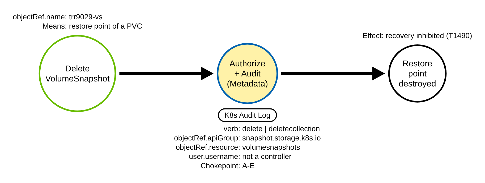
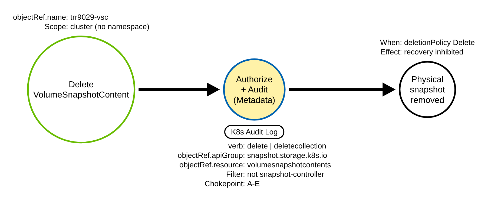
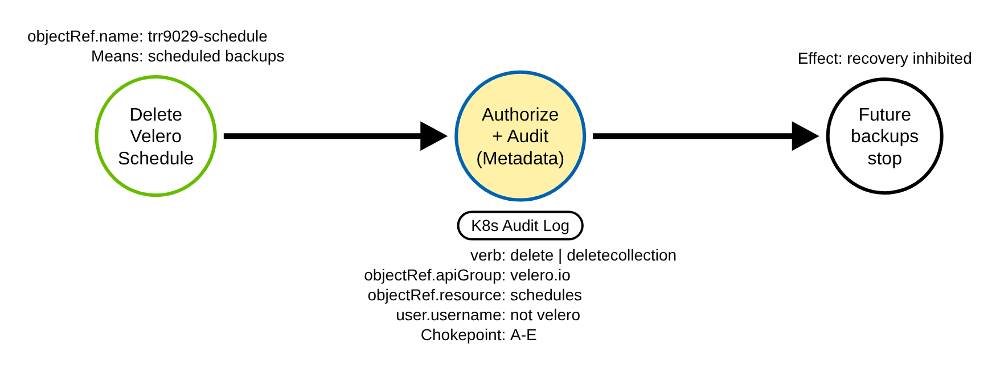
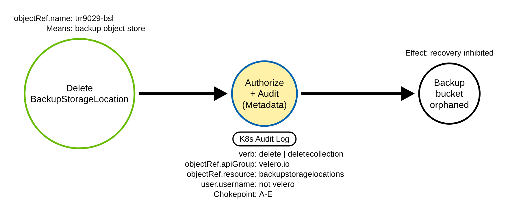
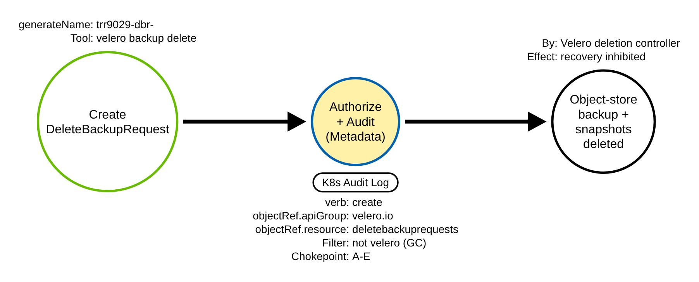

# Inhibit Recovery by Destroying Snapshots and Velero Backups (Kubernetes)

## Metadata

| Key          | Value |
|--------------|-------|
| ID           | TRR9029 |
| External IDs | T1490 |
| Tactics      | Impact |
| Platforms    | Kubernetes |
| Contributors | det-eng |
| Status       | experimental |

### Scope Statement

This report is the T1490 (Inhibit System Recovery) half of the storage-and-backup
destruction work: it covers the deletion of VolumeSnapshots and VolumeSnapshotContents
and the destruction of Velero backups. The T1485 (Data Destruction) half -- deleting
the PersistentVolumeClaims and PersistentVolumes that hold the live data -- is TRR9028.
Deleting the data (T1485) and deleting the means to restore it (T1490) are distinct
ATT&CK techniques; an actor often does both. This report does not cover the on-disk or
etcd paths, nor managed backup services outside the cluster (AWS Backup, Backup for GKE,
AKS Backup), which are cloud-side.

**Prior art.** At build time no rule in SigmaHQ, Elastic detection-rules, Splunk ESCU or
Falco, and no test in Stratus Red Team or Atomic Red Team, covered the Kubernetes
VolumeSnapshot/Velero destruction path (re-checked here against SigmaHQ and Falco: no
`velero`/`volumesnapshot`/`snapshot.storage.k8s.io` rule; SigmaHQ's T1490 rules are
Windows host-side). The nearest existing coverage is Elastic's cloud-side AWS Backup/RDS
snapshot-deletion rules, which act on the cloud provider's API, not the cluster's
`snapshot.storage.k8s.io`/`velero.io` objects. No "first" or "only" claim is made.

## Technique Overview

After an actor destroys or encrypts a cluster's data, the victim recovers from a
snapshot or a backup. So the actor first destroys the recovery means. In a Kubernetes
cluster those are the CSI snapshots (the `snapshot.storage.k8s.io` VolumeSnapshot and
VolumeSnapshotContent objects) and the cluster's backup tool. The most common backup
tool is Velero, whose state lives in `velero.io` custom resources: Backups, Schedules,
BackupStorageLocations and DeleteBackupRequests.

An actor with delete rights on these objects can, through the API server alone and with
no node access: delete the restore points (the VolumeSnapshots), delete the
cluster-scoped bindings to the physical snapshots (the VolumeSnapshotContents), stop
future backups (delete the Velero Schedules), orphan the backup bucket (delete the
BackupStorageLocations), or destroy an existing backup and its volume snapshots (create a
Velero DeleteBackupRequest). Each is a single authorized API request. The victim then has
nothing to restore from.

## Technical Background

### CSI snapshots: VolumeSnapshot and VolumeSnapshotContent

The CSI external-snapshotter defines three CustomResourceDefinitions in the group
`snapshot.storage.k8s.io` (version `v1`): the namespaced `VolumeSnapshot` (a user's
request for a point-in-time copy of a PVC), the cluster-scoped `VolumeSnapshotContent`
(the binding to the physical snapshot in the storage backend), and the cluster-scoped
`VolumeSnapshotClass`. A VolumeSnapshotContent has a `deletionPolicy`: with `Delete`, the
snapshot-controller removes the underlying storage snapshot when the content is removed;
with `Retain`, only the API object goes.

The snapshot-controller (the deployment `snapshot-controller` in `kube-system`, service
account `system:serviceaccount:kube-system:snapshot-controller`) owns the lifecycle. When
a VolumeSnapshot bound to a `Delete`-policy content is deleted, the controller deletes the
VolumeSnapshotContent, which triggers the storage deletion
(`pkg/common-controller/snapshot_controller.go` in external-snapshotter v8.7.0: the
`VolumeSnapshotContents().Delete` call). The controller deletes VolumeSnapshotContents
only; it never deletes VolumeSnapshots, which are user objects.

### Velero backups

Velero (default namespace `velero`, service account
`system:serviceaccount:velero:velero`) defines the group `velero.io` (version `v1`): among
others `Backup`, `Schedule`, `BackupStorageLocation`, `VolumeSnapshotLocation` and
`DeleteBackupRequest`. A Schedule creates Backups on a cron. A BackupStorageLocation names
the object store a backup is written to.

Deleting a backup in Velero is not a `delete` of the Backup custom resource. Velero's
backup-sync controller lists the backups in the object store and re-creates any Backup CR
that is missing (`pkg/controller/backup_sync_controller.go` in velero v1.18.4: the
`client.Create(ctx, backup, ...)` call), so a `kubectl delete backup` is undone on the
next sync. The real deletion path is a `DeleteBackupRequest`: `velero backup delete`
creates one with `generateName '<backup>-'`
(`pkg/cmd/cli/backup/delete.go`), and its controller deletes the object-store backup and
its CSI volume snapshots (`pkg/controller/backup_deletion_controller.go`). Velero's own
garbage collector creates DeleteBackupRequests for expired backups
(`pkg/controller/gc_controller.go`).

### The audit shape

Every one of these actions passes through the API server, which writes an audit event. The
chokepoint fields are server-set: `verb` (`delete`, `deletecollection` or `create`),
`objectRef.apiGroup` (`snapshot.storage.k8s.io` or `velero.io`), `objectRef.resource`, the
namespace and name, and `responseStatus.code`. The API server's authenticator sets
`user.username`, which separates an actor's request from the two controllers that churn
these objects by design.

These objects are CustomResourceDefinitions. No audit policy in this repo names them
above its catch-all, so they are logged at `Metadata`: the verb, objectRef and identity are
all present, which is what the chokepoint needs. The request body (`requestObject`) is not
recorded, and the rule does not read it. A `VolumeSnapshotContent` is cluster-scoped, so its
record carries no `objectRef.namespace`. A `DeleteBackupRequest` is created with a
`generateName`, so its record carries no `objectRef.name` (the server assigns the name) and
`responseStatus.code` is `201`.

### Why the technique works

A cluster's resilience depends on its snapshots and backups surviving an incident. An
actor who can delete those objects, or trigger Velero's own deletion path, removes the
victim's recovery without touching a node. RBAC on these resources is often broad (a
cluster-admin, a backup operator, or a compromised controller token), and the deletion is
indistinguishable at the object level from a legitimate cleanup -- only the actor and the
correlation with other impact actions tell them apart.

## Procedures

| Procedure | ID | Name | Entry point |
|-----------|----|------|-------------|
| A | TRR9029.K8S.A | Delete a VolumeSnapshot | `delete volumesnapshots` |
| B | TRR9029.K8S.B | Delete a VolumeSnapshotContent | `delete volumesnapshotcontents` (cluster-scoped) |
| C | TRR9029.K8S.C | Delete a Velero Schedule | `delete schedules.velero.io` |
| D | TRR9029.K8S.D | Delete a Velero BackupStorageLocation | `delete backupstoragelocations.velero.io` |
| E | TRR9029.K8S.E | Create a Velero DeleteBackupRequest | `create deletebackuprequests.velero.io` |

### Procedure A: Delete a VolumeSnapshot  (`TRR9029.K8S.A`)

The actor deletes a `snapshot.storage.k8s.io` VolumeSnapshot, the restore point of a PVC.
If the bound VolumeSnapshotContent has `deletionPolicy: Delete`, the snapshot-controller
then removes the physical snapshot. A `deletecollection` on the namespace removes every
restore point in it at once. The actor's record is the `delete` (or `deletecollection`),
verb and resource server-set, by a non-controller identity.

#### Detection Data Model — `TRR9029.K8S.A`

Source: [`ddms/trr9029_k8s_a.json`](ddms/trr9029_k8s_a.json) (Arrows app format).

The yellow node is the chokepoint: the audit record of the accepted delete, which the one
Sigma rule keys on. It is shared with Procedures B through E.

### Procedure B: Delete a VolumeSnapshotContent  (`TRR9029.K8S.B`)

The actor deletes the cluster-scoped VolumeSnapshotContent directly, the binding to the
physical snapshot. The record carries no namespace. The rule filters the snapshot-controller
on this resource, because the controller deletes VolumeSnapshotContents by design when a
`Delete`-policy VolumeSnapshot is removed; an actor's own delete, or a delete by any other
identity, is not filtered.

#### Detection Data Model — `TRR9029.K8S.B`

Source: [`ddms/trr9029_k8s_b.json`](ddms/trr9029_k8s_b.json) (Arrows app format).

### Procedure C: Delete a Velero Schedule  (`TRR9029.K8S.C`)

The actor deletes a `velero.io` Schedule, so no new backups are created on that cron. Past
backups stay, but the cluster stops protecting itself going forward.

#### Detection Data Model — `TRR9029.K8S.C`

Source: [`ddms/trr9029_k8s_c.json`](ddms/trr9029_k8s_c.json) (Arrows app format).

### Procedure D: Delete a Velero BackupStorageLocation  (`TRR9029.K8S.D`)

The actor deletes the BackupStorageLocation that names the backup object store. New backups
have nowhere to go, and Velero marks dependent backups unavailable.

#### Detection Data Model — `TRR9029.K8S.D`

Source: [`ddms/trr9029_k8s_d.json`](ddms/trr9029_k8s_d.json) (Arrows app format).

### Procedure E: Create a Velero DeleteBackupRequest  (`TRR9029.K8S.E`)

The actor creates a `velero.io` DeleteBackupRequest, which is exactly what `velero backup
delete` does. Velero's deletion controller then deletes the object-store backup and its CSI
volume snapshots. This, not a `delete` of the Backup custom resource, is the destructive
path: deleting the Backup CR alone is undone by the backup-sync controller. The record is a
`create`, answered `201`, with no `objectRef.name` (the request uses `generateName`). The
rule filters the Velero server's own identity, which creates DeleteBackupRequests for
expired backups through its garbage collector.

#### Detection Data Model — `TRR9029.K8S.E`

Source: [`ddms/trr9029_k8s_e.json`](ddms/trr9029_k8s_e.json) (Arrows app format).

## Detection Strategy

Compare the five DDMs. Every procedure is a server-set verb on a server-set
`objectRef.apiGroup`/`objectRef.resource`, by an identity that is not the controller that
churns the object. One chokepoint rule covers all five. There is no body grader: the
chokepoint is the whole signal, so the rule fires at `Metadata`.

**Strategy 1 — chokepoint (covers A, B, C, D, E).**
Match an audit event where the verb is `delete`/`deletecollection` on
`snapshot.storage.k8s.io` `volumesnapshots`/`volumesnapshotcontents`, or `delete`/
`deletecollection` on `velero.io` `schedules`/`backupstoragelocations`, or `create` on
`velero.io` `deletebackuprequests`. Two controllers churn these objects by design and are
filtered by `user.username`, both verified from source:

- the snapshot-controller (`system:serviceaccount:kube-system:snapshot-controller`) on
  VolumeSnapshotContent deletes (external-snapshotter `snapshot_controller.go`; it deletes
  VolumeSnapshotContents only);
- the Velero server (`system:serviceaccount:velero:velero`), which creates
  DeleteBackupRequests for expired backups (velero `gc_controller.go`) and deletes CSI
  VolumeSnapshots while processing one (`backup_deletion_controller.go`). The filter is
  scoped to the resources the server churns (deletebackuprequests, volumesnapshots,
  volumesnapshotcontents); it never deletes a Schedule or BackupStorageLocation, so a
  velero-SA delete of those is not suppressed and fires.

Baseline the human and automation identities that delete snapshots or Velero objects by
design (cluster admins, the backup operator, GitOps pruning), and correlate a hit with the
same actor's other impact actions (a PVC/PV delete -- TRR9028 -- an Events or workload
delete, a cluster DNS change). This is the bare chokepoint, so a refused attempt (`403`/
`404`) also matches, by design; it is a medium-fidelity correlation anchor, not a standalone
alert.

- Sensor: API server audit log (`Metadata` is enough).
- Rule: `detections/sigma/T1490/k8s_snapshot_or_backup_destroyed.yml` (built).

A server-side dry run persists nothing. The rule filters only the query form (`?dryRun=All`):
a create carries CreateOptions.dryRun in the query (Procedure E), and a delete carries it in
the query only when the client puts it there (`kubectl delete --raw`,
kubernetes-client/python). kubectl's default `kubectl delete --dry-run=server` instead sends
the dry run in the DeleteOptions body; at `Metadata` the body is not logged and the record
carries no query marker, so it is indistinguishable from a real delete and the rule fires (an
accepted false positive, see Limits). Go `net/url` parses `?dryRun=All` regardless of how
many `&` the query carries, so no parse-count guard is needed.

**Limits.** A stolen snapshot-controller or velero service-account token evades the identity
filters within that controller's churn (a velero token still fires on a Schedule or
BackupStorageLocation delete, which the server never does)
([RULE_DEFECTS K51](../../../detections/RULE_DEFECTS.md#k51-k8s_snapshot_or_backup_destroyed-a-stolen-controller-token-evades-the-identity-filters));
and kubectl's default `kubectl delete --dry-run=server` carries the dry run in the
DeleteOptions body, which at `Metadata` is not logged, so its record is indistinguishable
from a real delete and the rule fires -- an accepted false positive
([RULE_DEFECTS K52](../../../detections/RULE_DEFECTS.md#k52-k8s_snapshot_or_backup_destroyed-a-server-side-dry-run-delete-is-indistinguishable-from-a-real-delete-at-metadata-and-fires)).

**Portability.** The chokepoint is `Metadata`-only (verb, apiGroup, resource,
user.username), so it fires under every managed audit policy modeled here: all positives
fire on EKS, GKE, AKS (both categories), the GCE kube-up policy and the k3s starter policy
(`k8s_policy_coverage.py`). On GKE the dry-run query filter is not expressible, because GKE's
Cloud Audit Logs record does not carry the requestURI query -- the chokepoint still fires,
only the dry-run filter is dropped (`check_provider_mappings.py` NOT_PORTABLE). No platform
loses a positive.

Platform coverage: [detections/k8s/PLATFORMS.md](../../../detections/k8s/PLATFORMS.md#rules-on-each-platform)

**Demonstrated gaps.**
A `delete` of a VolumeSnapshotContent set to `Retain`, or of a Velero Schedule or
BackupStorageLocation, is an availability or future-protection impact rather than an
immediate storage deletion; the chokepoint sees it, and the record does not show the
reclaim/deletion policy, so a `Retain` content delete and a `Delete` content delete look the
same (the enrichment that would tell them apart is the content's `deletionPolicy`, which a
`Metadata` record does not carry). And an actor with control-plane node access can edit the
objects in etcd directly with no API write and no audit event; a node/etcd sensor is the
only cover.

**Coverage summary.**

| Procedure | Covered by | How |
|-----------|-----------|-----|
| A | Strategy 1 | `delete`/`deletecollection volumesnapshots` |
| B | Strategy 1 | `delete volumesnapshotcontents` (not the snapshot-controller) |
| C | Strategy 1 | `delete schedules.velero.io` |
| D | Strategy 1 | `delete backupstoragelocations.velero.io` |
| E | Strategy 1 | `create deletebackuprequests.velero.io` (not the Velero server) |

## Available Emulation Tests

The tests run in a lab cluster with the shared API-server audit policy. The lab is a `kind`
cluster; its config and audit policy are in [`detections/k8s/`](../../../detections/k8s/).
The atomic installs the vendored snapshot and Velero CRDs
([`atomics/T1490/src/crds/`](../../../atomics/T1490/src/crds/)) only when they are absent,
creates inert objects (a VolumeSnapshotContent with `deletionPolicy: Retain`, fake handles,
a namespace no real Velero watches), and on cleanup removes only the trr9029- objects and
the CRDs it installed, so it destroys no real snapshot or backup.

| Procedure | Test | Status |
|-----------|------|--------|
| TRR9029.K8S.A | [`emulate.sh a`](../../../atomics/T1490/src/emulate.sh) — create then delete a VolumeSnapshot `trr9029-vs`. | **built** |
| TRR9029.K8S.B | [`emulate.sh b`](../../../atomics/T1490/src/emulate.sh) — create then delete a cluster-scoped VolumeSnapshotContent `trr9029-vsc` (Retain). | **built** |
| TRR9029.K8S.C | [`emulate.sh c`](../../../atomics/T1490/src/emulate.sh) — create then delete a Velero Schedule `trr9029-schedule`. | **built** |
| TRR9029.K8S.D | [`emulate.sh d`](../../../atomics/T1490/src/emulate.sh) — create then delete a Velero BackupStorageLocation `trr9029-bsl`. | **built** |
| TRR9029.K8S.E | [`emulate.sh e`](../../../atomics/T1490/src/emulate.sh) — create a Velero DeleteBackupRequest (generateName `trr9029-dbr-`). | **built** |
| control | [`emulate.sh dryrun`](../../../atomics/T1490/src/emulate.sh) — server-side dry runs (`?dryRun=All`) that must NOT fire the rule. | **built** |

## Detections

| Strategy | Covers | Sigma rule | Audit source |
|----------|--------|------------|--------------|
| 1 (chokepoint) | A, B, C, D, E | [`detections/sigma/T1490/k8s_snapshot_or_backup_destroyed.yml`](../../../detections/sigma/T1490/k8s_snapshot_or_backup_destroyed.yml) | API server audit log (`Metadata`) |

## References

- https://attack.mitre.org/techniques/T1490/
- https://kubernetes.io/docs/tasks/debug/debug-cluster/audit/
- https://kubernetes.io/docs/concepts/storage/volume-snapshots/
- external-snapshotter v8.7.0: `pkg/common-controller/snapshot_controller.go`,
  `deploy/kubernetes/snapshot-controller/rbac-snapshot-controller.yaml` —
  https://github.com/kubernetes-csi/external-snapshotter/tree/v8.7.0
- Velero v1.18.4: `pkg/cmd/cli/backup/delete.go`,
  `pkg/controller/backup_deletion_controller.go`, `pkg/controller/gc_controller.go`,
  `pkg/controller/backup_sync_controller.go` —
  https://github.com/vmware-tanzu/velero/tree/v1.18.4
- Vendored CRD facts and provenance: [`atomics/T1490/src/crds/SOURCES.md`](../../../atomics/T1490/src/crds/SOURCES.md)
