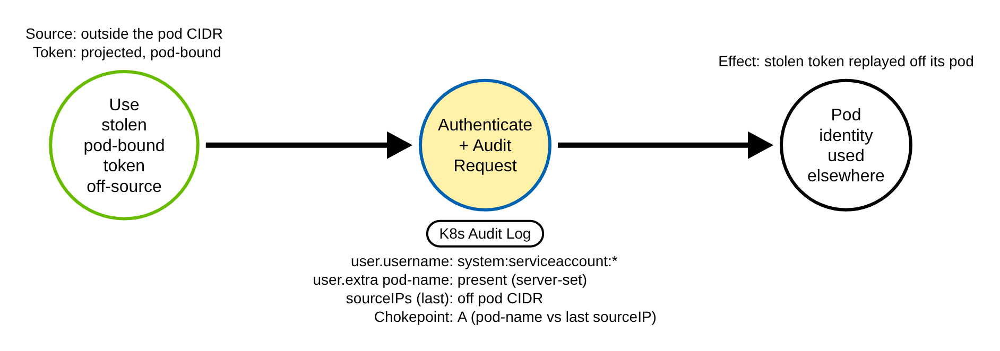

# Pod-Bound Service Account Token Used From An Unexpected Source (Kubernetes)

> Prose uses Simplified Technical English (ASD-STE100) where practical.
> Resource names, field names, user.extra keys, and ATT&CK IDs are technical names.

## Metadata

| Key          | Value |
|--------------|-------|
| ID           | TRR9030 |
| External IDs | T1528 |
| Tactics      | Credential Access |
| Platforms    | Kubernetes |
| Contributors | det-eng |
| Status       | draft |

### Scope Statement

This TRR covers the **use side** of a stolen Kubernetes service-account token: a
**pod-bound** projected token, taken from a compromised pod, replayed against
kube-apiserver **from a source the cluster does not expect for that pod** (another pod, a
node, or off-cluster). It is the k8s sibling of TRR9022 (EKS IRSA credentials used
off-cluster) and the use-side sibling of TRR9006, which stops at the mounted-token read
(its Procedure E gap) and never sees where the token is later used. The chokepoint is a
single API-server audit record: the server-set, non-spoofable pod-binding marker in
`user.extra` versus the one trustworthy source address in `sourceIPs`.

This TRR does not cover these related actions:

- **Stealing** the token (reading it off a pod's projected volume, or minting one). That
  is credential access on the read side, covered by TRR9006 (`T1552.007`); this report is
  the subsequent use.
- A **non-pod-bound** service-account token (a legacy Secret-based token, or a bare
  `TokenRequest` token with no `boundObjectRef`). It carries no pod-name marker, so the
  pod-source compare does not apply; such a token used off-source is a confounder here.
- **Impersonation** (`T1134`, TRR9009). The impersonated identity's extras land in
  `impersonatedUser.extra`, a different audit field; this rule reads only `user.extra`.

> **ATT&CK mapping.** `T1528` (Steal Application Access Token), tactic Credential Access,
> is the primary ID: a projected service-account token is the application access token,
> and this is its theft and reuse. The report tags `T1550.001` (Use Application Access
> Token) for the use leg and `T1078.004` (Valid Accounts: Cloud Accounts) for the reuse
> of a valid identity, the same cross-map TRR9022 uses for the AWS sibling. `T1528`'s
> listed platforms do not name Containers; this is a cross-domain mapping of the
> mechanism, as TRR9027 notes for T1565.001.

## Technique Overview

Every pod that uses the Kubernetes API authenticates with a **projected service-account
token** the kubelet mounts at `/var/run/secrets/kubernetes.io/serviceaccount/token`.
Since `BoundServiceAccountTokenVolume` (GA v1.22) that token is **pod-bound**: its signed
claims name the pod it was minted for, and kube-apiserver validates the binding on every
request (a live pod lookup, a UID match, and a not-deleting check) before it sets the
pod's name into the authenticated user's `extra`.

An adversary who reads that token out of a compromised pod can replay it against the API
server from anywhere the API server is reachable. The token still authenticates as the
pod's service account, and the API server still records the pod-binding marker — but the
request now arrives from a different pod, a node, or off-cluster. The marker says which
pod the token belongs to; the source address says where it is being used. When the two
disagree, the token is being used away from its pod.

## Technical Background

### The server-set, non-spoofable markers

When kube-apiserver authenticates a projected token, it builds the user's `extra` map
server-side from the signed claims plus live lookups (kubernetes v1.36.4
`pkg/serviceaccount/claims.go` `(*validator).Validate`, and
`apiserver/pkg/authentication/serviceaccount/util.go` `ServiceAccountInfo.UserInfo`):

- **`authentication.kubernetes.io/pod-name`** and **`pod-uid`** — set together only when
  the token is bound to a pod. `claims.go` does a live `GetPod`, requires `pod.UID` to
  equal the claim, and rejects a deleting pod; the value is the pod the token was minted
  for. Present since v1.12; the pod default since `BoundServiceAccountTokenVolume` GA
  v1.22. This is the binding marker the rule keys on.
- **`authentication.kubernetes.io/node-name`** and **`node-uid`** — the node the pod runs
  on, extracted for a pod-bound token when `ServiceAccountTokenPodNodeInfo` is on (GA
  v1.32, so on by default at v1.36.4).
- **`authentication.kubernetes.io/credential-id`** — `JTI=<uuid>`, the token's JWT `jti`,
  when `ServiceAccountTokenJTI` is on (GA v1.32; `CredentialIDForJTI` prepends `JTI=`).
  One token has one credential-id across every request it makes. The correlation fallback
  below keys on it.

A client cannot forge or inject any of these. They are set on the **authenticated user**,
from the signed token and the API server's own lookups. Impersonation (`Impersonate-*`
headers) sets the **impersonated** user, which the audit log records in a separate field,
`impersonatedUser` (`apiserver/pkg/apis/audit/v1/types.go` `Event.ImpersonatedUser`,
distinct from `Event.User`); impersonated extras never land in `user.extra`. So a rule
that reads `user.extra['authentication.kubernetes.io/pod-name']` reads a fact the API
server asserted, not a client-supplied one.

### The one trustworthy source address

`Event.sourceIPs` is a list. The API server fills it (v1.36.4
`apiserver/pkg/apis/audit/v1/types.go`) from, in order, the `X-Forwarded-For` header, then
`X-Real-Ip`, then the connection's remote address — and the type's own comment states:
**"All but the last IP can be arbitrarily set by the client."** A client that sets
`X-Forwarded-For: 10.244.0.5` prepends a forged in-cluster address; only the **last**
entry, the connection's real peer, is trustworthy.

A detection that reads `sourceIPs` must therefore test the **last** element, not the
first or the whole field. `sourceIPs|cidr` is wrong twice over: the SQLite backend
compiles `sourceIPs|cidr: 10.244.0.0/16` to `sourceIPs LIKE '10.244.%'`, which tests the
**whole serialized array text** (and never matches, because the flattened value begins
`[`), so it would fire on every record, the in-pod call included. This rule isolates the
last entry with an `|re` anchored to the end of the serialized array
(`"10\.244\.[0-9]+\.[0-9]+"]$`), in the portable subset
([`detections/README.md`](../../../detections/README.md), Portable regular expressions).
The `sigma_eval` probe below proves both halves.

### What counts as an unexpected source

A pod-bound token should be used only from its own pod IP. A single audit record cannot
prove "the pod's own IP", so the rule **approximates** it with an in-cluster-source
allowlist the operator baselines: the cluster **pod CIDR** (placeholder `10.244.0.0/16`,
kind's default), and — if the cluster runs **hostNetwork** workloads that present
service-account tokens (kube-proxy, CNI agents) — their **node CIDR(s)**. A pod-bound
token whose last source is outside the allowlist is used away from its pod. Two residuals
follow and are stated in the rule's `falsepositives` and below:

- **hostNetwork pods** present a pod-bound token from the node IP, not a pod IP; until the
  node CIDR is in the allowlist they look off-source. Adding the node CIDR makes a token
  stolen from a hostNetwork pod and used elsewhere on the node network a residual false
  negative.
- **Managed clusters** (EKS/GKE/AKS) route a pod's API call through a konnectivity agent,
  a load balancer, a private endpoint, or node SNAT, so the recorded peer is that
  intermediary, not the pod. The single-record compare degrades to an approximation there
  (a demonstrated gap, [RULE_DEFECTS KTBD-J1](../../../detections/RULE_DEFECTS.md#ktbd-j1-k8s_pod_token_used_off_source-the-single-record-off-source-compare-degrades-on-managed-clusters));
  the portable fallback is the credential-id correlation below.

### Why the technique works

A pod's projected token is a bearer credential readable from inside the pod, and it
authenticates from anywhere the API server is reachable. The binding marker tells a
detector which pod a token belongs to; nothing stops the token from being presented
elsewhere. The only in-record evidence that it has left its pod is the disagreement
between the server-set pod marker and the trustworthy last source address.

## Procedures

| Procedure | ID | Name | Entry point |
|-----------|----|------|-------------|
| A | TRR9030.K8S.A | Pod-bound token used from an unexpected source | any API request whose token carries `user.extra` pod-name, from a source outside the pod CIDR |

> A tool is not a procedure. `kubectl --token`, a client library, and a raw `curl` with a
> bearer header all send the same request. They are the same procedure. The source of the
> request (another pod, a node, or off-cluster) is the variable, not the tool.

**Reading the DDM.** A green border is an operation the client performs. A blue border
with a yellow fill is the API server's authenticate-and-audit, the chokepoint and the
primary detection opportunity. A black border is the abstract effect. The pill names the
telemetry; the `Key: value` lines are what the rule matches.

### Procedure A: Pod-bound token used from an unexpected source  (`TRR9030.K8S.A`)

The adversary takes a projected pod token from a compromised pod and uses it against
kube-apiserver from a source that is not the pod — from the node the token was pulled to,
from another pod, or from off-cluster. The request authenticates as the pod's service
account and carries the server-set pod-name marker, but its last `sourceIPs` entry is
outside the cluster's pod CIDR.

- **Prerequisites:** a projected (pod-bound) service-account token, and network reach to
  the API server from a source outside the pod CIDR.
- **Mechanics:** the API server validates the token's pod binding (live `GetPod`, UID
  match, not-deleting) and sets `user.extra` pod-name / pod-uid (and node-name / node-uid
  and credential-id); the request's last `sourceIPs` entry is the real peer.
- **Impact:** the pod's identity — and whatever RBAC it holds — is wielded from off the
  pod, the use leg of a stolen token.
- **Tools on this path:** `kubectl` with a token kubeconfig, any client library, `curl`
  with a bearer header; all identical in the record.

#### Detection Data Model — `TRR9030.K8S.A`



Source: [`ddms/trr9030_k8s_a.json`](ddms/trr9030_k8s_a.json) (Arrows app format).

**DDM summary.** The shaded node is the API server's authenticate-and-audit of the
request: `user.username` begins `system:serviceaccount:`, `user.extra`
`authentication.kubernetes.io/pod-name` is present (server-set), and the **last**
`sourceIPs` entry is outside the pod CIDR. That disagreement — the pod marker says one
pod, the trustworthy source says somewhere else — is the chokepoint.

## Detection Strategy

Procedure A is one API request. The chokepoint is a single audit record at `Metadata`
level (the markers and `sourceIPs` are request attributes present on every record; no
request body is needed). The near-misses and the benign baseline all differ from the
positive on exactly one field, so each proves the rule keys on the technique, not the
shape of the request.

**Telemetry requirement.** `Metadata` is enough, under every policy. `user.username`,
`user.extra.*` and `sourceIPs` are on every audit record; the shared lab policy and the
recommended production policy both keep every request at least at `Metadata` through
their catch-all, so no audit-policy change is needed, and the emulation's
`selfsubjectreviews` create (a read-only `kubectl auth whoami`, allowed for every
authenticated identity) is logged by both.

**Strategy 1 — single-record off-source rule (covers A).**
Match an audit event whose `user.username` begins `system:serviceaccount:` and whose
`user.extra` carries `authentication.kubernetes.io/pod-name` (a pod-bound token), and
whose **last** `sourceIPs` entry is outside the in-cluster allowlist (the pod CIDR, and
the node CIDR for hostNetwork workloads). The provenance (`system:serviceaccount:` plus
the pod-name marker) matches ~100% of benign pod-bound traffic — it is provenance, not a
detection; the discriminator is the off-source last entry. The allowlist is a parameter
the operator baselines, as TRR9022's off-egress allowlist is. There is **no** GuardDuty
EKS finding, GKE Event Threat Detection detector, or Microsoft Defender audit rule that
keys on a pod-bound token used off its pod from the audit log, so this is the **primary**
detection, not a backstop (see Upstream).

- Sensor: API server audit log (`Metadata` is enough).
- Rule:
  [`detections/sigma/T1528/k8s_pod_token_used_off_source.yml`](../../../detections/sigma/T1528/k8s_pod_token_used_off_source.yml)
  (built).

**Strategy 2 — credential-id correlation fallback (prototype; portable, no CIDR).**
The single-record rule needs an in-cluster-source allowlist, which degrades on managed
clusters (KTBD-J1). A portable fallback keys on the server-set `credential-id` instead:
one token (`JTI=<uuid>`) seen from **two or more distinct source IPs** inside a window is
a token used from more than one place, with no CIDR parameter and no dependence on which
IP the control plane records. This is the Sigma `value_count` correlation prototyped and
proven in `sigma_eval` below. It is **not shipped as a live-gated rule here**, a stated
human decision: the repo's correlation backend keys on a fixed `timestamp` column that a
Kubernetes audit record (`requestReceivedTimestamp`) does not carry, so wiring a
timestamp mapping into the k8s validators and the simulator is a shared-tooling change
left to a human. On GKE the correlation does not run at all (no `user.extra`, KTBD-J1).

```yaml
# PROTOTYPE (not shipped): one pod-bound token (credential-id) from >= 2 distinct source IPs.
title: base pod SA token request
name: pod_sa_token_request
logsource: {product: kubernetes, service: audit}
detection:
  sel:
    user.username|startswith: 'system:serviceaccount:'
    user.extra.authentication.kubernetes.io/credential-id|contains: 'JTI='
  condition: sel
---
title: One pod SA token (credential-id) used from two or more source IPs
correlation:
  type: value_count
  rules: [pod_sa_token_request]
  group-by: [user.extra.authentication.kubernetes.io/credential-id]
  timespan: 1h
  condition: {field: sourceIPs, gte: 2}
```

**`sigma_eval` proofs (reproduced on the current rule).**

- Single-record rule, last-entry isolation: a pod-bound token from `172.18.0.1` fires; the
  same token from its pod IP `10.244.0.31` does not; an X-Forwarded-For chain
  `["198.51.100.23", "203.0.113.9", "10.244.0.31"]` (last entry in-cluster) does **not**
  fire, where `["10.244.0.31", "198.51.100.23"]` (last entry off-cluster) does — the
  anchored `|re` isolates the last element. A `sourceIPs|cidr` filter compiles to
  `sourceIPs LIKE '10.244.%'`, which never matches the `[`-prefixed array text, so it
  would fire on the in-pod call too (the Sigma-wildcard / list-as-text trap).
- A non-pod service-account token (no pod-name) used off-source does **not** fire (the
  near-miss); a `system:node:` token off-source does **not** fire (a benign confounder).
- Correlation: one credential-id from two distinct source IPs raises one alert; the same
  IP twice, or two different credential-ids, raises none.

**Demonstrated gap — managed clusters (KTBD-J1).** On EKS/GKE/AKS the last `sourceIPs`
entry is a konnectivity agent / load balancer / NAT peer, not the pod, so the pod-CIDR
compare cannot separate an off-pod in-cluster source from the pod's own. The single-record
rule still catches a token used from a truly external address; for the in-cluster case use
the credential-id correlation. On GKE the rule does not run at all (GKE's
`AuditLog.authenticationInfo` records `principalEmail` only — no `user.extra` — and one
`callerIp`, not the `sourceIPs` array). Tracked as
[RULE_DEFECTS KTBD-J1](../../../detections/RULE_DEFECTS.md#ktbd-j1-k8s_pod_token_used_off_source-the-single-record-off-source-compare-degrades-on-managed-clusters).

**Residual false negative — in-allowlist reuse.** A token reused from within an
allowlisted CIDR (a compromised pod on the same pod network, or the pod's own node) shows
an in-cluster last source and is not matched; pair with a first-seen overlay per pod or
credential-id, or the correlation.

**Benign budget and corpus gap.** The rule scores **0** on the committed benign corpus
(`detections/benign/`), so its budget is 0. That 0 holds only because every pod-bound
token call in the corpus is sourced from a pod IP (`10.244.x`), and the corpus models the
hostNetwork control-plane components (kube-proxy, CNI agents) as **non**-pod-bound. In a
real cluster those components mount projected (pod-bound) tokens and reach the API server
from the **node** IP, so their records carry the pod-name marker **and** an off-pod
source and trip this rule. That on-node hostNetwork case — not the off-cluster
break-glass, bastion or hybrid-egress case — is the dominant production false positive,
and the corpus has no record of it, which is why the 0 budget looks clean. An operator
sizes a real budget with the node CIDR(s) added to the allowlist (the rule's
`falsepositives` bullet 1). Adding that benign slice is a human decision; it is not added
here.

**Scope (platform gap, like K38 to K42 and K47).** Strategy 1 is proven on
kind/kubeadm, where the pod reaches the API server over the pod network with the CNI's
LOCAL carve-out, so the peer is the pod IP. On managed platforms it degrades (KTBD-J1);
on GKE it is not portable at all. The lab-proven Procedure A stays Proven; the managed-
platform caveat is in KTBD-J1's Scope bullet, not here, so the coverage report does not
mark it an open defect.

**Coverage summary.**

| Procedure | Covered by | How |
|-----------|-----------|-----|
| A | Strategy 1 (single-record rule); Strategy 2 prototype on managed clusters | pod-name marker in `user.extra` vs the last `sourceIPs` entry outside the pod CIDR |

Platform coverage: [detections/k8s/PLATFORMS.md](../../../detections/k8s/PLATFORMS.md#rules-on-each-platform)

## Available Emulation Tests

The test runs in a lab cluster with the shared audit policy. The lab is a `kind` cluster;
its config and audit policy are in [`detections/k8s/`](../../../detections/k8s/). The
emulation creates an inert service account `trr9030-ns/trr9030-sa` that holds **no RBAC**
and a sleeper pod `trr9030-user` that uses it, then runs two procedures:

- **A (positive).** It mints a **pod-bound** token for `trr9030-sa` bound to the running
  `trr9030-user` pod, and uses it with `kubectl auth whoami` (a `create` of
  `selfsubjectreviews`, allowed for every authenticated identity, answered 201) **from
  the runner**, which the API server records as the off-pod docker-bridge gateway
  (`172.18.0.1` on kind, outside the pod CIDR `10.244.0.0/16`). The request carries the
  server-set pod-name marker and an off-source last `sourceIPs` entry, so the rule fires.
- **B (benign baseline, must NOT fire).** It makes the **same** call from **inside** the
  pod, with the pod's own mounted token, so the API server records the pod IP
  (`10.244.x`). The rule's in-cluster-source filter suppresses it. This is the hard benign
  baseline that differs from A only on the last `sourceIPs` entry; the validator's `9030 B`
  absence check proves the rule matches none of it.

The service account grants nothing (`kubectl auth whoami` only reflects the caller's
identity via `SelfSubjectReview`), the minted token lasts 10 minutes and expires on its
own, and cleanup deletes the namespace. **No credential ever reaches a command line or a
log line:** the minted token is captured from stdout into a variable and written to a
mode-0600 `tokenFile` that a throwaway kubeconfig references (never passed as `--token`);
the in-pod call reads the pod's mounted token into a `curl` config file by redirect
(never as an argument). One script drives both:
[`atomics/T1528/src/emulate.sh`](../../../atomics/T1528/src/emulate.sh), with an Atomic
Red Team wrapper in [`atomics/T1528/T1528.yaml`](../../../atomics/T1528/T1528.yaml).

| Procedure | Test | Status |
|-----------|------|--------|
| TRR9030.K8S.A | `emulate.sh a` — mint a pod-bound token, use it with `kubectl auth whoami` from the runner (off-source). | **built** |

> Procedure B (the in-pod benign baseline, `emulate.sh b`) is a control, not a technique
> procedure, so it is not listed as a separate emulation test; `emulate.sh all` runs A and
> B and the validator proves A fires and B stays quiet.

## Detections

| Strategy | Covers | Sigma rule | Sensor |
|----------|--------|------------|--------|
| 1 (single-record off-source) | A | [`detections/sigma/T1528/k8s_pod_token_used_off_source.yml`](../../../detections/sigma/T1528/k8s_pod_token_used_off_source.yml) | API server audit log (Metadata) |
| 2 (credential-id correlation) | A (managed-cluster fallback) | prototype in this report (not shipped; see Strategy 2) | API server audit log (Metadata) |

The validator
[`detections/validate_apiserver_detections.py`](../../../detections/validate_apiserver_detections.py)
reads the API server audit log the emulation produced and asserts the rule matches
Procedure A's own off-source request (the `trr9030-sa` service account, the pod-name
marker, and a last `sourceIPs` entry outside the pod CIDR), and that it matches **none**
of the `trr9030-sa` requests in Procedure B's window (the `9030 B` absence check: the
in-pod baseline must stay quiet). The gate on A requires the pod-name marker and the
off-pod source, so the pod's own in-cluster call and a pre-emulation snapshot (no
`trr9030-ns`) cannot pass it. The workflow
[`validate-apiserver-detections.yml`](../../../.github/workflows/validate-apiserver-detections.yml)
runs the loop on a `kind` cluster, with a negative control on the pre-emulation log.

Upstream: the nearest prior art is Elastic's **"Service Account Token or Certificate
Access Followed by Kubernetes API Request"**
(`rules/cross-platform/execution_d4c_k8s_mda_service_account_token_access_followed_by_kubernetes_api_request.toml`,
an EQL sequence, Defend-for-Containers), plus three more Defend-for-Containers (D4C)
sequences that **join** an in-container process to audit events by `user.extra` pod-name.
All of them need a runtime sensor and correlate a process to the audit log by pod-name;
**none** compares the pod-name/node-name/credential-id markers against `sourceIPs` to flag
off-pod use, and none keys on `credential-id` or `node-name`. A GitHub code search on
2026-11-01 for `authentication.kubernetes.io/pod-name`,
`authentication.kubernetes.io/credential-id` and `authentication.kubernetes.io/node-name`
in SigmaHQ/sigma, elastic/detection-rules, splunk/security_content,
panther-labs/panther-analysis and falcosecurity/rules returned only Elastic's D4C
join-by-pod-name rules; none reads those keys against the source. GuardDuty's EKS findings
(`MaliciousIPCaller`, `TorIPCaller`, `SuccessfulAnonymousAccess`) and GKE Event Threat
Detection ship no token-off-pod audit rule, and Microsoft Defender for Containers'
"suspicious access to a service-account token" is a runtime file-open sensor, not an
audit compare. The det-eng angle — audit-only, no runtime sensor, the server-set pod
marker versus the one trustworthy `sourceIPs` entry — is new ground. Propose the
provider-agnostic Sigma single-record rule, and the credential-id `value_count`
correlation once a backend that keys on `requestReceivedTimestamp` is available.

## References

- MITRE ATT&CK, T1528 Steal Application Access Token:
  <https://attack.mitre.org/techniques/T1528/>
- MITRE ATT&CK, T1550.001 Use Application Access Token:
  <https://attack.mitre.org/techniques/T1550/001/>
- Kubernetes service-account token claims and pod/node binding validation, kubernetes
  v1.36.4 (`pkg/serviceaccount/claims.go`):
  <https://github.com/kubernetes/kubernetes/blob/v1.36.4/pkg/serviceaccount/claims.go>
- The `user.extra` keys the API server sets from the token, kubernetes v1.36.4
  (`apiserver/pkg/authentication/serviceaccount/util.go`):
  <https://github.com/kubernetes/kubernetes/blob/v1.36.4/staging/src/k8s.io/apiserver/pkg/authentication/serviceaccount/util.go>
- `credential-id` key and `CredentialIDForJTI` (JTI= prefix), kubernetes v1.36.4
  (`apiserver/pkg/authentication/user/user.go`,
  `apiserver/pkg/authentication/token/jwt/claims.go`):
  <https://github.com/kubernetes/kubernetes/blob/v1.36.4/staging/src/k8s.io/apiserver/pkg/authentication/user/user.go>
- The audit `Event` type, `ImpersonatedUser` as a separate field, and the `sourceIPs`
  "all but the last IP can be arbitrarily set by the client" note, kubernetes v1.36.4
  (`apiserver/pkg/apis/audit/v1/types.go`):
  <https://github.com/kubernetes/kubernetes/blob/v1.36.4/staging/src/k8s.io/apiserver/pkg/apis/audit/v1/types.go>
- Kubernetes documentation, bound service account tokens:
  <https://kubernetes.io/docs/concepts/security/service-accounts/>
- Kubernetes documentation, Auditing:
  <https://kubernetes.io/docs/tasks/debug/debug-cluster/audit/>
- Elastic Defend-for-Containers service-account-token / API-request sequence (nearest
  prior art):
  <https://github.com/elastic/detection-rules/blob/main/rules/cross-platform/execution_d4c_k8s_mda_service_account_token_access_followed_by_kubernetes_api_request.toml>
- TRR method:
  <https://github.com/tired-labs/techniques/blob/main/docs/TECHNIQUE-RESEARCH-REPORT.md>
