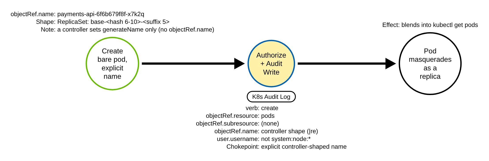
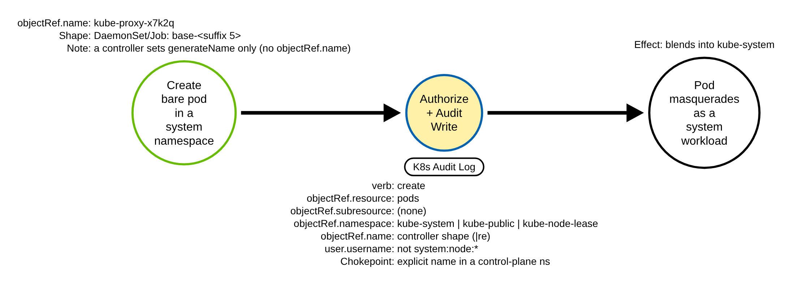

# Lookalike Pod With a Controller-Generated Name (Kubernetes)

> Prose uses Simplified Technical English (ASD-STE100) where practical.
> Resource names, field names, namespaces, and ATT&CK IDs are technical names.

## Metadata

| Key          | Value |
|--------------|-------|
| ID           | TRR9031 |
| External IDs | T1036.005 |
| Tactics      | Defense Evasion |
| Platforms    | Kubernetes |
| Contributors | det-eng |
| Status       | draft |

### Scope Statement

This TRR covers **masquerading a pod by its name**: an adversary creates a *bare pod*
(a pod object, not a workload controller) with an EXPLICIT name in the shape a
controller generates, so the pod reads as a replica of a real Deployment, DaemonSet or
Job in `kubectl get pods`. ATT&CK v20 lists **Containers** on T1036.005 (Match
Legitimate Name or Location), and its Containers analytic AN0986 is "pods using names,
labels, or namespaces that mimic legitimate workloads", so this is a native mapping, not
a cross-domain one.

It does **not** cover, by design (each is a stated gap below and in the Detection
Strategy):

- A lookalike **Deployment, DaemonSet, Job or StatefulSet** itself. Its pods are REAL
  controller creates: the ReplicaSet, DaemonSet and Job controllers create them with
  `generateName` and no explicit name; the StatefulSet controller creates them with an
  explicit `<set>-<ordinal>` name (`web-0`), which is not in the random-suffix shape this
  rule matches. Either way they are indistinguishable at the pod-create chokepoint from a
  legitimate controller's pods. The masquerade there is the *controller* object's name, a
  different detection.
- A **`generateName` masquerade** of a bare pod. A controller and an adversary send a
  byte-identical `generateName` (`<owner>-`), so the audit record cannot tell them apart
  without a per-site controller-identity allowlist (RULE_DEFECTS.md K54).
- A **typosquat** (`cordns`, `kube-prox`): a name that resembles a real workload but is
  not in the controller-generated shape. A name-similarity model, not a shape rule,
  covers that.
- The **container image**. Keying on the image is spoofable (an adversary runs a real
  image) and is a separate signal; see Falco below.

## Technique Overview

Every replica of a Deployment, DaemonSet or Job gets a name the Kubernetes controller
makes up: a base (the workload's name), sometimes a short hash, and a short random
suffix, for example `coredns-6f6b679f8f-x7k2q` or `kube-proxy-9mtlb`. Operators read
those names all day and treat them as trusted system pods.

An adversary abuses that trust. They create their own pod and give it a name in the same
shape, next to the real replicas, so a quick look at `kubectl get pods` reads it as "just
another CoreDNS pod". The backdoor pod hides in plain sight. This is masquerading: the
object is malicious, but its name says it belongs.

The detection does not try to read the operator's mind about which names look legitimate.
It uses a fact about how Kubernetes works: the ReplicaSet, DaemonSet and Job controllers
never give a pod an explicit name (the StatefulSet controller does, with an explicit
`<set>-<ordinal>` name such as `web-0`, which is not in the random-suffix shape this rule
matches). So a pod that was created with an explicit name already in the controller's
random-suffix shape was named by a client on purpose, which those controllers never do.

## Technical Background

### How controllers name pods, and what the audit log records

The ReplicaSet, DaemonSet and Job controllers create pods with `metadata.generateName`
only, never `metadata.name`
([`pkg/controller/controller_utils.go` `GetPodFromTemplate`, v1.36.4](https://github.com/kubernetes/kubernetes/blob/v1.36.4/pkg/controller/controller_utils.go)):
they set `GenerateName` to `<owner>-` and let the API server append a random suffix.

The API server records `objectRef.name` in the audit event from the submitted
`metadata.name` **before** it generates the final name
([`staging/src/k8s.io/apiserver/pkg/audit/request.go` `LogRequestObject`, v1.36.4](https://github.com/kubernetes/kubernetes/blob/v1.36.4/staging/src/k8s.io/apiserver/pkg/audit/request.go):
`if len(ae.ObjectRef.Name) == 0 { ae.ObjectRef.Name = objMeta.GetName() }`). A
`generateName` create has an empty `metadata.name`, so **a controller's own pod-create
record carries no `objectRef.name` at all**. An explicit `objectRef.name` in a bare pod
create is therefore a client's choice. This was confirmed on a local kube-apiserver
v1.36.4 lab: a Deployment's `replicaset-controller` pod create records
`requestObject.metadata.generateName = lookalike-demo-65bb645ff8-` and no
`objectRef.name`, while an adversary's `kubectl apply` of a bare pod records
`objectRef.name = payments-api-6f6b679f8f-x7k2q`.

### The controller-generated name shape

The random suffix is five characters from the vowel-free alphabet
`bcdfghjklmnpqrstvwxz2456789`
([`apimachinery pkg/util/rand/rand.go`](https://github.com/kubernetes/kubernetes/blob/v1.36.4/staging/src/k8s.io/apimachinery/pkg/util/rand/rand.go)
`alphanums`; [`apiserver pkg/storage/names/generate.go`](https://github.com/kubernetes/kubernetes/blob/v1.36.4/staging/src/k8s.io/apiserver/pkg/storage/names/generate.go)
`randomLength = 5`). A Deployment's ReplicaSet name carries a pod-template-hash, which is
`SafeEncodeString(fmt.Sprint(uint32))` — 1 to 10 characters from the same alphabet
(`controller_utils.go` `ComputeHash`), in practice 8 to 10. So the two shapes a pod name
can have are:

- **ReplicaSet / Deployment**: `<base>-<pod-template-hash 6-10>-<suffix 5>`, for example
  `coredns-6f6b679f8f-x7k2q`. The rule uses a 6-character lower bound on the hash
  segment: a shorter one is astronomically unlikely for a 32-bit hash and would widen the
  rule onto ordinary names.
- **DaemonSet / Job**: `<base>-<suffix 5>`, for example `kube-proxy-9mtlb`. This single
  suffix is broad, so the rule scopes it to a control-plane namespace, where an
  explicitly-named bare pod is itself anomalous.

Both shapes are vowel-free in the generated segments, which keeps the regex off ordinary
human and application names. Pod creates are logged at `Request` in the lab and
recommended audit policies; the rule itself needs only `Metadata` fields
(`objectRef.name`, `objectRef.namespace`, `objectRef.subresource`, `user.username`,
`verb`).

### What separates a controller create from an adversary's

Only the server-set identity and the presence of an explicit `objectRef.name` separate
them. The rule excludes `system:node:*` (a kubelet's mirror pod of a static pod is a
legitimate bare create with an explicit name) and excludes a bare-pod subresource
(`pods/exec`, `pods/binding` from the scheduler, `pods/eviction`, `pods/portforward` are
not a create of the pod object). `metadata.ownerReferences` is NOT trusted: a client can
forge it, so the rule never reads it (a positive case proves a forged ownerReference does
not change the result).

## Procedures

| Procedure | ID | Name | Entry point |
|-----------|----|------|-------------|
| A | TRR9031.K8S.A | ReplicaSet-shaped explicit name (any namespace) | `POST pods`, explicit `metadata.name` |
| C | TRR9031.K8S.C | DaemonSet/Job-shaped explicit name (control-plane namespace) | `POST pods` in `kube-system`, explicit `metadata.name` |

> The letters A and C follow the vet's naming (B is the `generateName` masquerade, a
> documented gap with no procedure; see the Detection Strategy and RULE_DEFECTS.md
> K54).

### Procedure A: ReplicaSet-shaped explicit name  (`TRR9031.K8S.A`)

The adversary creates a bare pod whose explicit `metadata.name` matches the
ReplicaSet/Deployment shape `<base>-<pod-template-hash 6-10>-<suffix 5>`, in any
namespace, for example `payments-api-6f6b679f8f-x7k2q` next to a real `payments-api`
Deployment's replicas. The pod needs only `create pods` RBAC. No controller create
carries an explicit `objectRef.name`, so this name in this shape is the tell. Any client
that sends an explicit `metadata.name` (`kubectl run`, `kubectl apply`, a client library)
uses this same path, so it is the same procedure.

#### Detection Data Model — `TRR9031.K8S.A`

Source: [`ddms/trr9031_k8s_a.json`](ddms/trr9031_k8s_a.json) (Arrows app format).

The green node is the adversary's bare-pod create; the blue-and-yellow node is the audit
chokepoint the rule keys on (`verb=create`, `objectRef.resource=pods`, no subresource, an
explicit controller-shaped `objectRef.name`, `user.username` not `system:node:*`); the
black node is the masquerade outcome. The chokepoint node is the single detection
opportunity and is shared with Procedure C (the name shape differs).

### Procedure C: DaemonSet/Job-shaped explicit name in a control-plane namespace  (`TRR9031.K8S.C`)

The adversary creates a bare pod in `kube-system` (or `kube-public`, `kube-node-lease`)
whose explicit `metadata.name` matches the DaemonSet/Job shape `<base>-<suffix 5>`, for
example `kube-proxy-x7k2q` next to the real `kube-proxy` DaemonSet pods. The single
suffix is a broad shape, so the rule restricts this branch to the three control-plane
namespaces, where an explicitly-named bare pod does not belong. `kubectl debug node` run
with `-n kube-system` creates `node-debugger-<node>-<5>` explicitly and is excluded by a
filter.

#### Detection Data Model — `TRR9031.K8S.C`

Source: [`ddms/trr9031_k8s_c.json`](ddms/trr9031_k8s_c.json) (Arrows app format).

The chokepoint node adds `objectRef.namespace` in the control-plane set to the shared
Procedure A chokepoint. Same sensor (the API server audit log), same rule.

## Detection Strategy

**Strategy 1 (chokepoint): a bare pod created with an explicit, controller-shaped name by
a non-node caller.** One rule,
[`detections/sigma/T1036.005/k8s_pod_controller_name_mimicry.yml`](../../../detections/sigma/T1036.005/k8s_pod_controller_name_mimicry.yml),
covers Procedures A and C. It keys on `verb=create`, `objectRef.resource=pods`, no
`objectRef.subresource`, `user.username` not `system:node:*`, and one of: an explicit
`objectRef.name` in the ReplicaSet shape (any namespace), or in the DaemonSet/Job shape
in a control-plane namespace. It keys on a property a benign controller create cannot
have — an explicit `objectRef.name` — not on the namespace alone and not on the image.

| Procedure | Covered by | Fires on |
|-----------|-----------|----------|
| A | Strategy 1 | explicit ReplicaSet-shaped `objectRef.name`, any namespace |
| C | Strategy 1 | explicit DaemonSet/Job-shaped `objectRef.name` in `kube-system` / `kube-public` / `kube-node-lease` |

**Stated gaps** (no rule, by design):

- **A `generateName` masquerade (vet Procedure B).** An adversary sends
  `generateName: coredns-6f6b679f8f-` and lets the API server append the suffix. A real
  ReplicaSet controller sends the byte-identical `generateName`, and both records carry
  no `objectRef.name`, so the shape cannot separate them. The only server-trusted
  discriminator is identity (a per-site allowlist of controller service accounts), which
  is noisy and platform-specific. Confirmed on the lab (RULE_DEFECTS.md **K54**):
  the real `replicaset-controller` create's `generateName` has the same
  base-plus-pod-template-hash prefix shape an adversary would send, so a generateName
  rule keyed on that shape fires on every controller create.
- **A lookalike controller** (Deployment, DaemonSet, Job, StatefulSet): its pods are real
  controller creates. ReplicaSet, DaemonSet and Job pods have no explicit name;
  StatefulSet pods carry an explicit `<set>-<ordinal>` name (`web-0`) that is not in the
  random-suffix shape the rule matches.
- **A single-suffix (`<base>-<5>`, DaemonSet/Job-shaped) lookalike in an application
  namespace**, for example `payments-x7k2q` in `prod`. Branch C is scoped to the
  control-plane namespaces to hold false positives at 0 (an explicit `<base>-<5>` bare
  pod is only anomalous there); the double-suffix Deployment/ReplicaSet shape (branch A)
  is covered in every namespace.
- **A controller-shaped name carrying a `node-debugger-` prefix**
  (`node-debugger-coredns-6f6b679f8f-x7k2q`). The node-debugger exclusion is a name
  heuristic, and a node name can itself contain hyphens, so no regex separates a genuine
  `node-debugger-<node>-<5>` from a `node-debugger-<controller-shape>` adversary name;
  anchoring the filter does not close it. The prefix also abandons the target-workload
  masquerade, so the residual value is low (reproduced with `sigma_eval`).
- **A typosquat**: a name that is close but not in the controller-generated shape.
- **The container image**.

**Known false positives.** Branch A fires on any explicit controller-shaped
`objectRef.name` by any non-node identity (the rule excludes only `system:node:*` and
`node-debugger-*`, **not** `system:serviceaccount:*`), so two benign patterns can fire
and should be baselined by actor and namespace:

- A **CI or ephemeral-pod naming scheme** that mimics the Deployment/ReplicaSet shape,
  for example `<app>-<short-git-sha>-<rand5>` where both tail segments avoid vowels and
  `0`/`1`/`3` (a short hex git-sha is fully in the suffix alphabet about 5% of the time;
  reproduced: `build-2ccfb7d9-x7k2q` fires).
- A **backup/restore or clone/migration tool** (for example Velero restoring a standalone
  pod, or a namespace-clone utility) that recreates a pod under its ORIGINAL
  controller-generated name. Because service-account identities are not excluded, a
  restore run by `system:serviceaccount:velero:velero` fires (reproduced with
  `sigma_eval`); baseline the restore and migration service accounts.

The benign corpus lacks a restore/clone slice and a CI-SHA slice, so neither pattern is
exercised there (the rule scores 0 of 2666 on the existing corpus). Adding such a slice
is a maintainer decision (see the builder's report); until then these are documented,
baseline-by-actor false positives.

**Scope: managed platforms.** The rule is proven on the lab's audit log (upstream
Kubernetes v1.36.4). It needs the API server to log a pod `create` at `Metadata` or
higher with `objectRef.name`, `objectRef.namespace` and `user.username`. A managed
platform whose audit policy drops pod creates (for example a cluster that sets
`level: None` for them) is blind to it; the lab-proven procedures stay Proven on the lab.
The name-shape regex is **not portable to GKE**: GKE records the name inside
`protoPayload.resourceName` (the object path), so its pipeline cannot apply the regex
(RULE_DEFECTS.md **K55**; AKS is unaffected). GKE Event Threat Detection's
'Potential Kubernetes Pod Masquerading' covers GKE; this rule is the backstop for EKS,
AKS and self-managed clusters.

Platform coverage: [detections/k8s/PLATFORMS.md](../../../detections/k8s/PLATFORMS.md#rules-on-each-platform)

**Prior art, and how this differs.** It keys on the name SHAPE a controller cannot set,
not on the namespace or the image:

- **SigmaHQ `Creation Of Pod In System Namespace`** (`kubernetes_audit_pod_in_system_namespace.yml`,
  T1036.005): any pod create in `kube-system`, including every controller create and
  `pods/exec`. On this repo's benign corpus it scores 12 of 2666 hits (controller, mirror
  and scheduler creates); this rule scores 0 of 2666 and does not fire on `pods/exec` (it
  excludes subresources and controller-named creates).
- **Falco `Pod Created in Kube Namespace`** (`k8s_audit_rules.yaml`): an image-repository
  allowlist, which an adversary evades by running a real image.
- **GKE Event Threat Detection `Defense Evasion: Potential Kubernetes Pod Masquerading`**:
  matches a Pod named like a GKE default workload; GKE-only and keyed on a fixed
  default-workload name list. This rule is a provider-agnostic backstop for EKS, AKS and
  self-managed clusters keyed on the generated name shape, and it duplicates GKE ETD on
  GKE.
- **Elastic `Suspicious Assignment of Controller Service Account`**: a controller SA in a
  pod spec — a different signal.

Stratus Red Team has no masquerade technique, and Atomic Red Team's T1036.005 tests are
Windows/Linux process-name tests, so the emulation ground is new; the detection ground is
new against the name shape.

## Available Emulation Tests

The tests run in a lab cluster with the shared audit policy. The lab is a `kind` cluster;
its config and audit policy are in [`detections/k8s/`](../../../detections/k8s/). The
atomic creates inert pods (`registry.k8s.io/pause`, no command, no host access) with a
controller-generated name and the label `trr=trr9031`, and deletes them on cleanup; the
`trr9031` namespace is created and deleted. The emulation's marker is the namespace (A)
and the label (C), never the pod name, which keeps the controller shape for the rule.

| Procedure | Test | Status |
|-----------|------|--------|
| A | [`atomics/T1036.005/src/emulate.sh`](../../../atomics/T1036.005/) `a` | built |
| C | [`atomics/T1036.005/src/emulate.sh`](../../../atomics/T1036.005/) `c` | built |

## Detections

| Strategy | Covers | Sigma rule | Audit |
|----------|--------|------------|-------|
| 1 (chokepoint) | A, C | [`detections/sigma/T1036.005/k8s_pod_controller_name_mimicry.yml`](../../../detections/sigma/T1036.005/k8s_pod_controller_name_mimicry.yml) | pod `create` at `Metadata`+ (lab/recommended: `Request`) |

## References

- https://attack.mitre.org/techniques/T1036/005/
- https://kubernetes.io/docs/reference/access-authn-authz/audit/
- https://github.com/kubernetes/kubernetes/blob/v1.36.4/pkg/controller/controller_utils.go
- https://github.com/kubernetes/kubernetes/blob/v1.36.4/staging/src/k8s.io/apiserver/pkg/storage/names/generate.go
- https://github.com/kubernetes/kubernetes/blob/v1.36.4/staging/src/k8s.io/apimachinery/pkg/util/rand/rand.go
- https://github.com/kubernetes/kubernetes/blob/v1.36.4/staging/src/k8s.io/apiserver/pkg/audit/request.go
