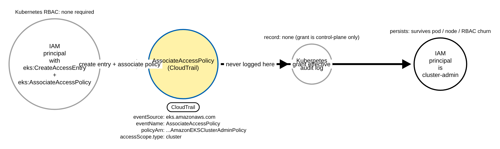
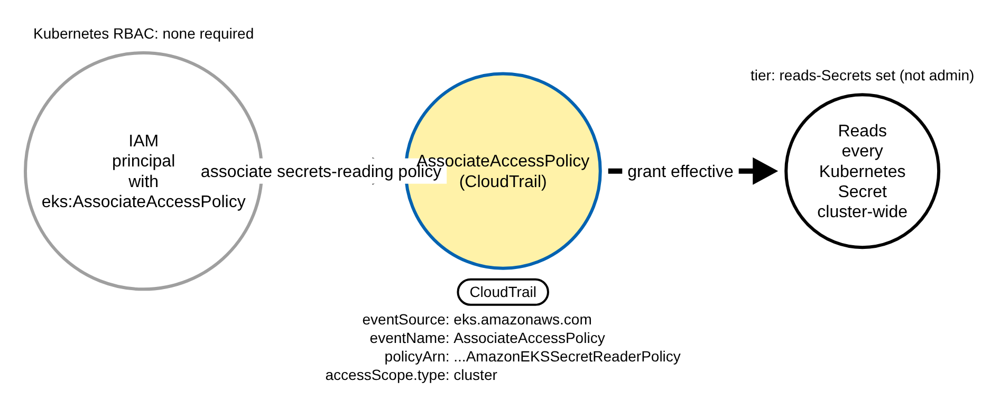
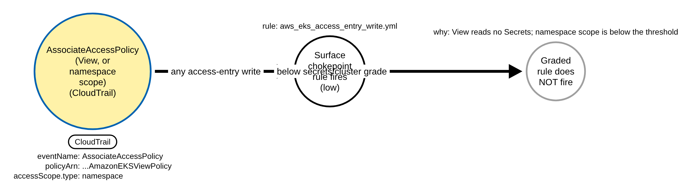
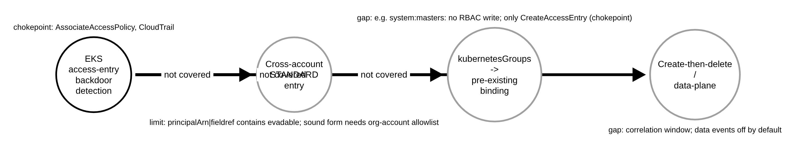

# EKS Access-Entry Backdoor in CloudTrail (AWS)

> Prose uses Simplified Technical English (ASD-STE100) where practical.
> AWS service names, API names, CloudTrail field names, and ATT&CK IDs are
> technical names.

## Metadata

| Key          | Value |
|--------------|-------|
| ID           | TRR9032 |
| External IDs | T1098.006, T1098.003 |
| Tactics      | Persistence, Privilege Escalation |
| Platforms    | AWS |
| Contributors | det-eng |
| Status       | draft |

### Scope Statement

This TRR covers the **EKS access-entry backdoor**: an adversary with the IAM
permissions `eks:CreateAccessEntry` and `eks:AssociateAccessPolicy`, and **no
Kubernetes access at all**, grants an IAM principal standing access to the Kubernetes
control plane entirely through the EKS **control-plane** API. The grant lives in the
EKS control plane, not in a Kubernetes object, so the **Kubernetes audit log never sees
it** — the only control-plane trace is AWS **CloudTrail** (`eventSource`
`eks.amazonaws.com`). This is therefore a **cloud** TRR, proven by committed CloudTrail
fixtures through [`detections/validate_cloud_detections.py`](../../../detections/validate_cloud_detections.py),
and it sits alongside (it does not touch) the Kubernetes RBAC rules already filed under
T1098.006 (TRR9004), which key on the in-cluster RBAC write.

The detectable contribution is the **graded grant**: which AWS-managed cluster-access
policy is associated, and at what scope. ATT&CK v20 places this under T1098.006
(Additional Container Cluster Roles), with a secondary mapping to T1098.003 (Additional
Cloud Roles) because the grant is made through an AWS IAM-adjacent control-plane API.

Stratus Red Team ships the emulation (`eks.lateral-movement.create-access-entry`).
Elastic ships three detections (differentiated below). SigmaHQ, Splunk ESCU, Falco and
Panther ship none, so the Sigma rules here are the first for this behaviour in those
ecosystems. There is **no** GuardDuty or Microsoft Defender for Containers finding for an
access-entry write (GuardDuty EKS findings read the Kubernetes audit log, which this
grant never reaches), so this CloudTrail detection is a provider-agnostic backstop for a
native gap, not a rediscovery.

## Technique Overview

EKS **access entries** are the current way to let an AWS IAM principal talk to a
cluster's Kubernetes API, replacing the deprecated `aws-auth` ConfigMap. An
administrator creates an access entry for a principal ARN (`CreateAccessEntry`) and then
associates one or more AWS-managed **cluster-access policies** with it
(`AssociateAccessPolicy`), optionally scoped to the whole cluster or to named
namespaces. The EKS authenticator then authorises that IAM principal against those
policies — no Kubernetes RBAC object is created.

An adversary who holds only the two IAM permissions, and who may have **no Kubernetes
RBAC at all**, can use this as a persistence and privilege-escalation primitive: create
an access entry for a role they control and associate `AmazonEKSClusterAdminPolicy` at
cluster scope. The principal is now cluster-admin, and the grant survives pod, node and
in-cluster RBAC clean-up because nothing in the cluster changed. A responder scrubbing
Kubernetes RBAC objects will not find it.

## Technical Background

### What the grant looks like in CloudTrail

Both calls are default-logged EKS management events (`eventSource` `eks.amazonaws.com`,
`eventType` `AwsApiCall`, `managementEvent` `true`; CloudTrail management events are on by
default, so no logging change is needed). Field casing is load-bearing — CloudTrail
normalises `requestParameters` to **lowerCamelCase** even though the EKS API model is
PascalCase:

- **`CreateAccessEntry`**: `requestParameters.name` is the cluster, `requestParameters.principalArn`
  is the IAM principal (plain form). `responseElements.accessEntry` echoes `clusterName`,
  `type` (`STANDARD`), `principalArn`, `kubernetesGroups`.
- **`AssociateAccessPolicy`**: `requestParameters.policyArn` is one of a **closed set** of
  AWS-managed ARNs (`arn:aws:eks::aws:cluster-access-policy/<Name>`);
  `requestParameters.accessScope.type` is the enum `cluster` or `namespace` (with
  `accessScope.namespaces` for the latter); `requestParameters.name` is the cluster; and
  **`requestParameters.principalArn` is URL-encoded** (it is a path parameter, e.g.
  `arn%3Aaws%3Aiam%3A%3A123456789012%3Arole%2Ftrr9032-backdoor`). A denied call carries
  `errorCode` (for example `AccessDeniedException`) and no `responseElements`.

### Which policies matter, and why scope is the second discriminator

The AWS-managed cluster-access policies are a fixed, documented set
(`access-policy-reference`). The ones that confer cluster administrator privileges **or
read Kubernetes Secrets** are the high-value grants:

| Policy | What it grants | Reads Secrets |
|--------|----------------|---------------|
| `AmazonEKSClusterAdminPolicy` | full cluster admin (`*`/`*`/`*`) | yes |
| `AmazonEKSAdminPolicy` | most resources (namespace-typical) | yes |
| `AmazonEKSAdminViewPolicy` | `get`/`list`/`watch` on `*`/`*` | yes (AWS notes this) |
| `AmazonEKSEditPolicy` | edit most resources | yes |
| `AmazonEKSSecretAdminPolicy` | `*` on `secrets` | yes |
| `AmazonEKSSecretReaderPolicy` | `get`/`list`/`watch` on `secrets` | yes |
| `AmazonEKSArgoCDPolicy` | `*` on `secrets` (a capability policy) | yes |
| `AWSBackupFullAccessPolicyForBackup` | `get`/`list` on `*`/`*` | yes (via `*`) |
| `AWSBackupFullAccessPolicyForRestore` | `get`/`list`/`create` on `*`/`*` **plus** `rbac` `roles`/`clusterroles` `create`/`update`/`escalate`/`bind` | yes (via `*`) |
| `AmazonEKSViewPolicy` | view most resources | **no** |

The list is the complete set of AWS-managed cluster-access policies that (a) read the
Kubernetes `secrets` resource — either through the core `secrets` resource directly, or
through a `*`/`*` rule that spans it — and (b) can be associated with a customer-controlled
principal (`access-policy-reference`, pinned below). `AmazonEKSArgoCDPolicy` is a
**capability** policy that EKS normally associates at **namespace** scope (the Argo CD
namespace), so a **cluster**-scoped grant of it is itself anomalous;
`AmazonEKSArgoCDClusterPolicy` is the cluster-scoped Argo CD policy and reads **no**
Secrets, so it is not in the set. The two `AWSBackupFullAccessPolicyFor*` policies read
every Secret cluster-wide through a `*`/`*` `get`/`list` rule (the `Restore` variant also
grants `rbac` `escalate`/`bind`), and carry no service-linked restriction, so an attacker
who can `AssociateAccessPolicy` can grant either — they belong in the set by the same `*`
criterion as `AmazonEKSClusterAdminPolicy` and `AmazonEKSAdminViewPolicy`. Three further
policies are **excluded** and why: `AmazonEKSClusterInsightsPolicy` carries an explicit
`[NOTE]` that it is "designated for AWS service-linked roles only and cannot be used with
customer-managed roles" (not associable to an attacker); `AmazonEKSACKPolicy` and
`AmazonEKSKROPolicy` are capability policies whose only `*`/`*` rules are scoped to the
capability's own API groups (`*.services.k8s.aws`, `kro.run`), not the core group, so they
read **no** core Secrets. `AmazonEKSViewPolicy` deliberately does **not** read Secrets, so
a View grant is not a high-fidelity signal. Scope is the second discriminator: a
**cluster**-scoped grant
reaches every namespace; a **namespace**-scoped grant is limited to the named namespaces.
A grant of a reads-Secrets/admin policy **at cluster scope** is the high-fidelity
backdoor; everything else is caught only by the broad chokepoint.

### Why a trusted marker exists (and where it does not)

`requestParameters.policyArn` is non-spoofable to evade, because it **is** the permission
the attacker asks for — there is no renamable "policyArn that still grants admin". Access
entry usernames cannot start with `system:`, `eks:`, `aws:`, `amazon:` or `iam:`
(`creating-access-entries`), so an identity filter cannot be spoofed either. The one form
with **no** safe Sigma marker is **cross-account**: a `STANDARD` entry may name a
principal in another AWS account, and a provenance predicate
`principalArn|fieldref|contains: recipientAccountId` goes quiet when the attacker puts the
victim account ID inside its own role name or path (see Procedure D). That form is
documented as a limit, not shipped.

## Procedures

| Procedure | ID | Name | Entry point |
|-----------|----|------|-------------|
| A | TRR9032.AWS.A | Cluster-admin access-entry backdoor | `CreateAccessEntry` + `AssociateAccessPolicy` ClusterAdmin, cluster scope |
| B | TRR9032.AWS.B | Secrets-reading policy grant | `AssociateAccessPolicy` of a reads-Secrets policy, cluster scope |
| C | TRR9032.AWS.C | Grading boundary (View / namespace scope) | a lower-tier grant caught only by the chokepoint |
| D | TRR9032.AWS.D | Residual gaps and the cross-account limit | cross-account / `kubernetesGroups` / create-then-delete |

> A tool is not a procedure. `aws-cli`, boto3, eksctl, Terraform and Stratus Red Team all
> send the same `AssociateAccessPolicy` call; they are the same procedure.

**Reading the DDMs.** Blue borders with a shaded fill are the CloudTrail chokepoint — the
primary detection opportunity; the pill names the telemetry and the `Key: value` lines are
what a rule matches. Black borders are the abstract effect. Grey borders are
out-of-scope, a coverage boundary, or a gap the rules do not match. (There is no green
"unlogged theft" node here: the backdoor is not a stolen credential; its calls are logged
in CloudTrail — what is absent is any **Kubernetes audit** record, shown grey.)

### Procedure A: Cluster-admin access-entry backdoor  (`TRR9032.AWS.A`)

The adversary creates an access entry for a role they control and associates
`AmazonEKSClusterAdminPolicy` at cluster scope (Stratus
`eks.lateral-movement.create-access-entry`).

- **Prerequisites:** the IAM permissions `eks:CreateAccessEntry` and
  `eks:AssociateAccessPolicy`; no Kubernetes access.
- **Mechanics:** `CreateAccessEntry` registers the principal; `AssociateAccessPolicy`
  grants it `*`/`*`/`*`. Both are CloudTrail events; neither is a Kubernetes audit event.
- **Impact:** the IAM principal is cluster-admin, and the grant survives pod / node /
  RBAC churn.
- **Tools on this path:** any AWS client (aws-cli, boto3, eksctl, Terraform, Stratus).

#### Detection Data Model — `TRR9032.AWS.A`

Source: [`ddms/trr9032_aws_a.json`](ddms/trr9032_aws_a.json) (Arrows app format).

**DDM summary.** The shaded node is the `AssociateAccessPolicy` CloudTrail event
(`eventSource` `eks.amazonaws.com`, `policyArn` ending `AmazonEKSClusterAdminPolicy`,
`accessScope.type` `cluster`). The grey node is the Kubernetes audit log, where the grant
never appears.

### Procedure B: Secrets-reading policy grant  (`TRR9032.AWS.B`)

Rather than full admin, the adversary associates a policy that reads Kubernetes Secrets
without being an admin policy (`AmazonEKSSecretReaderPolicy`, or `AmazonEKSEditPolicy` /
`AmazonEKSAdminViewPolicy` / `AmazonEKSSecretAdminPolicy`) at cluster scope — a quieter
grant that still reads every Secret cluster-wide.

- **Prerequisites:** `eks:AssociateAccessPolicy` on an existing (or freshly created) entry.
- **Mechanics:** `AssociateAccessPolicy` with a reads-Secrets `policyArn` at cluster scope.
- **Impact:** the principal reads every Secret in the cluster (service-account tokens,
  TLS keys, registry creds) — a credential-access foothold short of full admin.
- **Tools on this path:** any AWS client.

#### Detection Data Model — `TRR9032.AWS.B`

Source: [`ddms/trr9032_aws_b.json`](ddms/trr9032_aws_b.json) (Arrows app format).

**DDM summary.** The shaded node is `AssociateAccessPolicy` with a reads-Secrets
`policyArn` at cluster scope; the graded rule fires on the reads-Secrets set, not only on
the two admin policies.

### Procedure C: Grading boundary (View / namespace scope)  (`TRR9032.AWS.C`)

A grant of `AmazonEKSViewPolicy` (no Secrets), or any policy at **namespace** scope, is a
real access-entry write but is **below** the graded rule's threshold by design.

- **Prerequisites:** `eks:AssociateAccessPolicy`.
- **Mechanics:** `AssociateAccessPolicy` with `AmazonEKSViewPolicy`, or with
  `accessScope.type` `namespace`.
- **Impact:** limited read access, or scoped access to named namespaces — lower value,
  higher benign rate.
- **Coverage:** the **chokepoint** rule (`aws_eks_access_entry_write.yml`) fires on it
  (any access-entry write); the **graded** rule does not. This is the discriminator that
  separates the high-fidelity rule from the surface one.

#### Detection Data Model — `TRR9032.AWS.C`

Source: [`ddms/trr9032_aws_c.json`](ddms/trr9032_aws_c.json) (Arrows app format).

**DDM summary.** The shaded node is the lower-tier `AssociateAccessPolicy` (View, or
namespace scope); the surface chokepoint rule fires (low), and the grey node is the graded
rule correctly staying silent — the record-level discriminator between the two rules.
A documented residual: a **namespace**-scoped `AmazonEKSSecretReaderPolicy` on a sensitive
namespace (`kube-system`) still reads those Secrets but trips only the chokepoint, because
one CloudTrail record cannot weigh one namespace against another; baseline access-entry
writers instead. This false negative of the graded rule is tracked in
[`detections/RULE_DEFECTS.md`](../../../detections/RULE_DEFECTS.md) **KTBD-L1**.

### Procedure D: Residual gaps and the cross-account limit  (`TRR9032.AWS.D`)

Three forms the rules do **not** match, documented so the boundary is explicit.

- **Cross-account STANDARD entry:** a principal in another AWS account. A `contains`-family
  provenance test (the dynamic `principalArn|fieldref|contains: recipientAccountId`, or the
  literal `principalArn|contains: '<home-account>'`) goes **quiet** when the attacker names
  its own role with the victim account ID (`role/trr9032-123456789012-ext`), proven with
  `sigma_eval` using the literal form (see Detection Strategy). Only an anchored `|re` with an
  org-account allowlist holds, so this form is a documented limit rather than a shipped
  predicate, tracked in [`detections/RULE_DEFECTS.md`](../../../detections/RULE_DEFECTS.md)
  **KTBD-L2**. (A cross-account grant of a cluster-admin / reads-Secrets policy at cluster
  scope still fires the graded rule, which reads no account field; what no safe Sigma
  predicate can add is a *cross-account-specific* elevation of an otherwise low-tier grant.)
- **`kubernetesGroups` → in-cluster binding:** `CreateAccessEntry` with
  `kubernetesGroups` naming a group binds the principal to whatever `ClusterRole` /
  `Role` the group is a subject of. There are two cases. For a **new** custom group that
  is not yet bound, the attacker must also create the matching `ClusterRoleBinding` — an
  in-cluster RBAC write the TRR9004 RBAC rules catch. For a group that is **already**
  bound to a privileged role — notably the default `cluster-admin` → `system:masters`
  binding that every cluster ships — there is **no** RBAC write at all: a single
  `CreateAccessEntry` with `kubernetesGroups: ["system:masters"]` makes the principal
  cluster-admin with no `AssociateAccessPolicy` and no RBAC object change, so TRR9004 sees
  nothing and the graded rule (which keys on `AssociateAccessPolicy`) misses it. The only
  control-plane trace is the `CreateAccessEntry` CloudTrail record, caught by the
  **chokepoint** rule `aws_eks_access_entry_write.yml` (not the graded rule). EKS accepts
  arbitrary group names and does not confirm the binding exists (`creating-access-entries`,
  pinned in References); the `system:` prefix is blocked only for the username, not groups.
- **Create-then-delete / data-plane:** an entry created, used and deleted inside one
  window (Elastic's EQL rule) needs correlation; use limited to data-plane APIs needs
  CloudTrail data events, which are off by default.

#### Detection Data Model — `TRR9032.AWS.D`

Source: [`ddms/trr9032_aws_d.json`](ddms/trr9032_aws_d.json) (Arrows app format).

**DDM summary.** The three grey nodes are the residual gaps around the graded chokepoint:
the cross-account form (a `contains` predicate is evadable; the sound form needs a
per-deployment org-account allowlist), the `kubernetesGroups` path (a group bound to a
**pre-existing** privileged role, e.g. the default `system:masters` → `cluster-admin`
binding, makes no RBAC write — only the `CreateAccessEntry` chokepoint record), and
create-then-delete / data-plane use.

## Detection Strategy

Compare the DDMs. The grant is control-plane only, so the only signal is the CloudTrail
`AssociateAccessPolicy` (and, broadly, any access-entry write). Two rules, graded by
fidelity:

**Strategy 1 — graded cluster-admin / secrets grant (high).**
[`aws_eks_access_entry_cluster_admin_policy.yml`](../../../detections/sigma/T1098.006/aws_eks_access_entry_cluster_admin_policy.yml)
fires on `AssociateAccessPolicy` of a reads-Secrets/admin policy **at cluster scope**,
with no `errorCode`. The discriminators (`requestParameters.policyArn`,
`requestParameters.accessScope.type`) are outside the surface-field set, so no waiver is
needed. The `errorCode` negation is null-safe (`(sel_no_error_code or not filter_failed)`)
because CloudTrail writes `errorCode` only on an error. This covers Procedures A and B.

**Strategy 2 — surface chokepoint (medium).**
[`aws_eks_access_entry_write.yml`](../../../detections/sigma/T1098.006/aws_eks_access_entry_write.yml)
fires on **any** access-entry write (`CreateAccessEntry`, `UpdateAccessEntry`,
`DeleteAccessEntry`, `AssociateAccessPolicy`, `DisassociateAccessPolicy`). It is
pure-surface — it keys only on the record kind — so it carries a human-approved
`CHOKEPOINT` waiver in [`detections/check_sufficiency.py`](../../../detections/check_sufficiency.py)
and must be baselined by the IAM principals that manage access entries. It covers
Procedure C and backstops A, B and D (except the forms in the gaps).

**The cross-account limit, reproduced.** The evadable shape is any `contains` test that the
recipient account ID is a substring of `principalArn` — the dynamic
`principalArn|fieldref|contains: recipientAccountId` and the equivalent literal
`principalArn|contains: '<home-account>'` share one flaw. Reproduced on
`detections/sigma_eval.py` with the **real `|fieldref` form** (pySigma's SQLite backend
compiles `|fieldref` to a column-reference comparison, so the dynamic form runs here):
`sel and not (requestParameters.principalArn|fieldref|contains: recipientAccountId)`, with
`recipientAccountId` `123456789012`, fires on an honest off-account role
(`arn%3Aaws%3Aiam%3A%3A210987654321%3Arole%2Ftrr9032-ext`) but goes **quiet** when the
attacker embeds the victim account ID in its own role name
(`...%3A210987654321%3Arole%2Ftrr9032-123456789012-ext`), because the ID is then a substring
of `principalArn`. The **sound, portable** form reads only the account position of the
URL-encoded ARN at the Sigma condition level — a selection
`requestParameters.principalArn|re: 'arn%3Aaws%3Aiam%3A%3A[0-9]{12}%3A'` minus a filter
`requestParameters.principalArn|re: 'arn%3Aaws%3Aiam%3A%3A(<org-account-1>|<org-account-2>)%3A'`
of the org's own account IDs (`sel_external and not filter_org_accounts`). It catches the
embedded-ID evasion and stays silent on the org accounts (proven with `sigma_eval`; both
`|re` patterns are in the enforced portable subset — no `(?` group — so they compile under
Python `re` and RE2, unlike a `(?!...)` negative-lookahead form, which RE2 and
`check_sigma_regex --require-re2` reject). The org-account allowlist is operator-specific, so
the cross-account form is documented here, not shipped (Procedure D; `RULE_DEFECTS.md` KTBD-L2).

**Prior art (named, differentiated).** Elastic ships three rules: *AWS EKS Access Entry
Granted Cluster Admin Policy* (`AssociateAccessPolicy` with `AmazonEKSClusterAdminPolicy`
or `AmazonEKSAdminPolicy` at **any** scope), *AWS EKS Access Entry Modified* (any of the
access-entry APIs, minus named automation ARNs), and *AWS EKS Access Entry Created Then
Deleted by Same Identity* (an EQL correlation). Datadog Cloud SIEM ships `def-000-cm5`,
`def-000-dzx` and `def-000-b69` (a closed rule set). SigmaHQ, Splunk ESCU, Falco and
Panther ship none. The differentiation here is the **scope grade** (cluster vs namespace),
the full **reads-Secrets policy set** (all nine AWS-managed cluster-access policies that
read Secrets and are associable to a customer principal, not only the two admin policies
Elastic checks), the **surface chokepoint** as a disclosed backstop (the Sigma counterpart
of Elastic's "Access Entry Modified"), and being the first Sigma rules for the behaviour.

**Coverage summary.**

| Procedure | Covered by | How |
|-----------|-----------|-----|
| A | Strategy 1 (+ Strategy 2) | ClusterAdmin at cluster scope |
| B | Strategy 1 (+ Strategy 2) | reads-Secrets policy at cluster scope |
| C | Strategy 2 only (by design) | View / namespace scope is below the graded threshold |
| D | not covered (documented gaps) | cross-account / `kubernetesGroups` / create-then-delete / data-plane |

## Available Emulation Tests

Cloud attacks have no free live target, so the emulation has two halves. The runnable
half is an Atomic-Red-Team-style test
([`atomics/T1098.006/src/emulate_eks_access_entry.sh`](../../../atomics/T1098.006/src/emulate_eks_access_entry.sh),
with wrappers in
[`atomics/T1098.006/T1098.006.yaml`](../../../atomics/T1098.006/T1098.006.yaml)) that makes
the real `CreateAccessEntry` + `AssociateAccessPolicy` writes in **your own AWS account /
EKS cluster** against a **disposable** principal and reverts them at once; it is gated by
`TRR9032_LIVE=1` and is **not run in CI**. The proven half is a set of committed,
schema-faithful CloudTrail fixtures
([`detections/cloud/fixtures/trr9032/`](../../../detections/cloud/fixtures/trr9032/)) that
the CI validator runs the rules over. Every object is named `trr9032-*`, source IPs are
RFC 5737 TEST-NET addresses, and the account is the AWS documentation account
`123456789012`.

| Procedure | Test | Status |
|-----------|------|--------|
| TRR9032.AWS.A | `emulate_eks_access_entry.sh a` — `AssociateAccessPolicy` ClusterAdmin at cluster scope (fixture: attack record pair, graded rule fires). | **built** |
| TRR9032.AWS.B | `emulate_eks_access_entry.sh b` — `AssociateAccessPolicy` SecretReader at cluster scope (fixture: reads-Secrets grant, graded rule fires). | **built** |
| TRR9032.AWS.C | documented — View / namespace-scope grants in the benign baseline (graded rule silent, chokepoint fires). | backlog |
| TRR9032.AWS.D | documented gaps — cross-account (no deployment-independent Sigma predicate), `kubernetesGroups` to a pre-existing privileged binding, create-then-delete, data-plane. | backlog |

## Detections

| Strategy | Covers | Sigma rule | Sensor |
|----------|--------|------------|--------|
| 1 (graded) | A, B | [`detections/sigma/T1098.006/aws_eks_access_entry_cluster_admin_policy.yml`](../../../detections/sigma/T1098.006/aws_eks_access_entry_cluster_admin_policy.yml) | CloudTrail |
| 2 (chokepoint) | C (+ backstop A, B) | [`detections/sigma/T1098.006/aws_eks_access_entry_write.yml`](../../../detections/sigma/T1098.006/aws_eks_access_entry_write.yml) | CloudTrail |

The validator
[`detections/validate_cloud_detections.py`](../../../detections/validate_cloud_detections.py)
runs each rule over the recorded attack fixture (it must fire, and the match must carry the
`trr9032` marker) and over a benign baseline (it must fire on nothing). The graded rule's
baseline is **hard**: the **same** `AssociateAccessPolicy` call differing only on the
discriminator — `AmazonEKSViewPolicy` instead of a reads-Secrets policy (breaks
`policyArn`), a **namespace** scope instead of cluster (breaks `accessScope.type`), and a
**denied** call (`errorCode` present) — plus Microsoft Defender for Containers onboarding
calls as benign confounders. The chokepoint rule's baseline is EKS **read** calls on the
same `eventSource` (the two rules cannot share one baseline, because the chokepoint fires
on every access-entry write). A pass proves the graded rule keys on the policy and scope,
not on the fixture's shape or marker.

> **Benign-budget limitation (untested by absence).** Both rules carry the default
> benign budget of **0** on the scored AWS CloudTrail corpus
> ([`detections/benign/`](../../../detections/benign/)). That 0 is *untested by absence*,
> not precision-proven: the four committed AWS slices (`aws-cicd-oidc-irsa`,
> `aws-developer-iam-user-keys`, `aws-ec2-service-roles`, `aws-iac-admin-policy-changes`)
> contain **no** EKS access-entry write traffic (`CreateAccessEntry` /
> `AssociateAccessPolicy` by Terraform `aws_eks_access_policy_association`, eksctl, console
> operators, or the AWS Backup / Microsoft Defender onboarding calls the `falsepositives`
> name), so both rules score 0 by the absence of representative activity, not by proven
> precision. The chokepoint fires on **every** legitimate access-entry write by design
> (reproduced with `sigma_eval`: it fires on all four writes in the graded rule's
> `benign.json` baseline), and the graded rule would fire on a legitimate IaC
> `AmazonEKSClusterAdminPolicy`-at-cluster bootstrap association. A realistic EKS
> access-entry benign slice (IaC / eksctl / console operators, plus the AWS Backup and
> Defender onboarding calls) would measure the real precision and noise floor; adding one
> is a **human decision** (a benign-corpus change), so it is reported here, not added.
> Until then the 0 budgets are correct for new rules but not precision-proven; baseline the
> IAM principals that manage access entries (`userIdentity.arn`), as `falsepositives` says.

## References

- MITRE ATT&CK, T1098.006 Account Manipulation: Additional Container Cluster Roles:
  <https://attack.mitre.org/techniques/T1098/006/>
- MITRE ATT&CK, T1098.003 Account Manipulation: Additional Cloud Roles:
  <https://attack.mitre.org/techniques/T1098/003/>
- AWS, Associate access policies with access entries (cluster-access policy reference):
  <https://docs.aws.amazon.com/eks/latest/userguide/access-policies.html>
- **Pinned ARN source** (`docs.aws.amazon.com` is blocked from the build host, so the
  policy ARN set and each policy's Secrets access were pinned from the awsdocs mirror):
  `awsdocs/amazon-eks-user-guide`, `latest/ug/manage-access/k8s-access/access-policy-reference.adoc`,
  commit `8d43223` (2026-09-16), retrieved 2026-11-02, Apache-2.0 / CC-BY-SA-4.0
  (file sha256 `f4d8057c03e3b804f1c38bdacf7cd23af64407f93293948e422bbd59214a67be`):
  <https://github.com/awsdocs/amazon-eks-user-guide/blob/8d43223/latest/ug/manage-access/k8s-access/access-policy-reference.adoc>.
  The nine AWS-managed cluster-access policies that read Secrets and are associable to a
  customer principal at that commit are `AmazonEKSClusterAdminPolicy`, `AmazonEKSAdminPolicy`,
  `AmazonEKSAdminViewPolicy`, `AmazonEKSEditPolicy`, `AmazonEKSSecretAdminPolicy`,
  `AmazonEKSSecretReaderPolicy`, `AmazonEKSArgoCDPolicy` (core `secrets` or `*`/`*`), and
  `AWSBackupFullAccessPolicyForBackup` and `AWSBackupFullAccessPolicyForRestore` (both read
  every Secret through a `*`/`*` `get`/`list` rule). `AmazonEKSViewPolicy` and
  `AmazonEKSArgoCDClusterPolicy` read no Secrets; `AmazonEKSACKPolicy` and `AmazonEKSKROPolicy`
  read no **core** Secrets (their `*`/`*` is scoped to the capability's own API groups); and
  `AmazonEKSClusterInsightsPolicy` carries an `[NOTE]` that it is for AWS service-linked roles
  only and cannot be used with customer-managed roles, so none of these five are in the set.
- **Pinned access-entry-group source** (same mirror, same host restriction):
  `latest/ug/manage-access/k8s-access/creating-access-entries.adoc`, commit `8d43223`,
  retrieved 2026-11-02 (file sha256
  `fc6e7418d15ae2b7a557287cb162d1c38cea845c27a2aea0214a50019a13ee1e`):
  <https://github.com/awsdocs/amazon-eks-user-guide/blob/8d43223/latest/ug/manage-access/k8s-access/creating-access-entries.adoc>.
  A `STANDARD` entry accepts arbitrary `kubernetesGroups` and "Amazon EKS doesn't confirm
  that any Kubernetes RBAC objects that exist on your cluster include any of the group names
  that you specify"; the `system:`/`eks:`/`aws:`/`amazon:`/`iam:` prefix restriction applies
  to the access-entry **username**, not to group names (Procedure D).
- AWS, Create access entries (STANDARD type, scope, username restrictions):
  <https://docs.aws.amazon.com/eks/latest/userguide/access-entries.html>
- AWS, Logging Amazon EKS API calls with AWS CloudTrail:
  <https://docs.aws.amazon.com/eks/latest/userguide/logging-using-cloudtrail.html>
- Datadog Security Labs, Amazon EKS Cluster Access Management deep dive (2023-12-19):
  <https://securitylabs.datadoghq.com/articles/eks-cluster-access-management-deep-dive/>
- Stratus Red Team, `eks.lateral-movement.create-access-entry`:
  <https://stratus-red-team.cloud/attack-techniques/EKS/eks.lateral-movement.create-access-entry/>
- Elastic, AWS EKS Access Entry Granted Cluster Admin Policy (prior art):
  <https://github.com/elastic/detection-rules/blob/main/rules/integrations/aws/privilege_escalation_eks_access_entry_granted_cluster_admin_policy.toml>
- TRR method:
  <https://github.com/tired-labs/techniques/blob/main/docs/TECHNIQUE-RESEARCH-REPORT.md>
