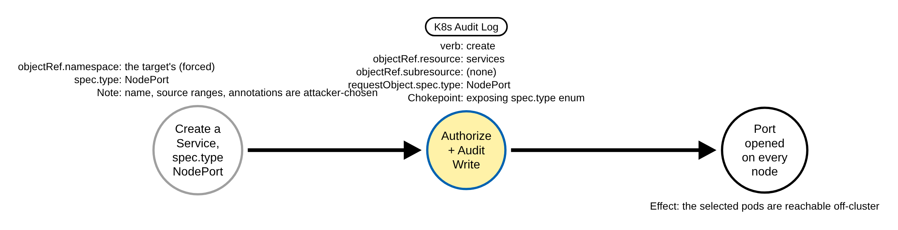
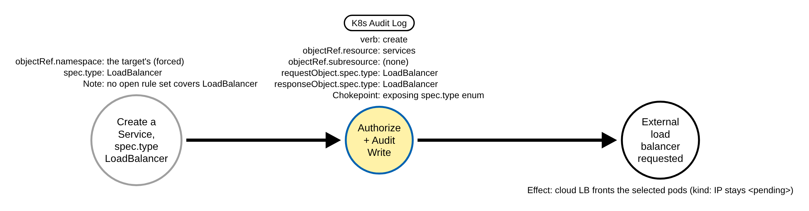
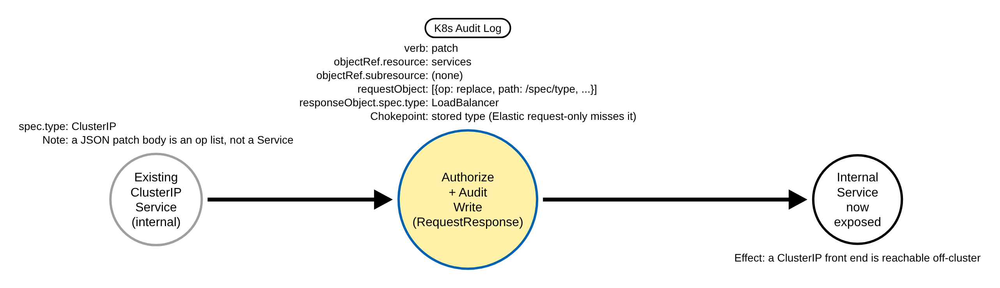

# Service Exposure Through a NodePort or LoadBalancer Service (Kubernetes)

> Prose uses Simplified Technical English (ASD-STE100) where practical.
> Resource names, field names, namespaces, and ATT&CK IDs are technical names.

## Metadata

| Key          | Value |
|--------------|-------|
| ID           | TRR9033 |
| External IDs | T1133 |
| Tactics      | Persistence, Initial Access |
| Platforms    | Kubernetes |
| Contributors | det-eng |
| Status       | draft |

### Scope Statement

This TRR covers **exposing an in-cluster workload outside the cluster by the Service
type**: an adversary with write access to Services sets `spec.type` to `NodePort` or
`LoadBalancer`, which opens the workload to callers outside the cluster. The target is
most often a management interface (the Kubernetes Dashboard, Kubeflow, Argo, Weave Scope,
Apache NiFi), which MS-TA9005 ("Exposed sensitive interfaces") names. ATT&CK v20 lists
**Containers** on T1133 (External Remote Services), the Persistence and Initial Access
tactics, so this is a native mapping.

The exposing write is the chokepoint: `spec.type` is an API enum the API server validates
against `ClusterIP`, `NodePort`, `LoadBalancer`, `ExternalName` (kubernetes v1.36.4
`staging/src/k8s.io/api/core/v1/types.go`, `ServiceType`), and only `NodePort` and
`LoadBalancer` expose pods. `ClusterIP` (in-cluster only) and `ExternalName` (a CNAME, "no
exposing or proxying of any pods involved") do not, so they are the non-exposing values.

It does **not** cover, by design (each is a stated gap below and in the Detection
Strategy):

- **Which `spec.type` write is a *change* and which is a *re-assertion*.** One record
  cannot tell them apart: a create is unambiguous (the Service is exposed by that write,
  though the write itself may be routine), but an update, a PUT or a server-side apply of
  an already-exposed Service carries `spec.type` again, so the rule's update and patch
  branch fires on a re-apply as on a first change (RULE_DEFECTS.md **KTBD-M2**).
- **Grading the exposed interface.** A LoadBalancer or NodePort that exposes a sensitive
  port or workload (a dashboard, Kubeflow, Argo) is higher severity, but a rule that keys
  on a namespace, selector or port list needs a fixed allowlist that ages and that the
  attacker partly chooses (the namespace is forced by the target, but the Service name and
  the port are not). This TRR stays policy-light: it ships the type chokepoint and names
  the provider controls that grade the interface (GuardDuty, Defender).
- **Ingress and Gateway API exposure, and a selectorless Service with a hand-written
  EndpointSlice.** These expose a workload without setting an exposing `spec.type` and are
  a different chokepoint.
- **`spec.externalIPs` exposure or hijack** (CVE-2020-8554): a separate, field-based
  chokepoint. A `ClusterIP` Service can expose or intercept traffic through
  `spec.externalIPs` **without** an exposing `spec.type` — kube-proxy routes traffic that
  ingresses with an external IP as destination, on the Service port, to the endpoints — so
  the type-keyed rule here does not see it. It is out of scope here, like Ingress and
  selectorless EndpointSlices; CVE-2020-8554 is its MITM (T1557) slice.
- **Whether the cloud load balancer actually became reachable from the internet.** The
  audit record shows the request to expose, not the network result.

## Technique Overview

External Remote Services (T1133) in Kubernetes is reaching an in-cluster workload from
outside the cluster. A Service of type `ClusterIP` is reachable only inside the cluster.
An adversary who wants a workload reachable from outside — to keep a foothold
(Persistence) or to reach a management interface from the internet (Initial Access) —
raises its exposure by the Service type:

- **`NodePort`** opens the same port on **every node** (kubernetes v1.36.4 `types.go`:
  "a service will be exposed on one port of every node, in addition to 'ClusterIP'"). A
  caller that can reach any node IP reaches the workload; NodePort can bypass a firewall
  placed in front of a load balancer.
- **`LoadBalancer`** asks the cloud provider for an **external load balancer** in front of
  the Service ("exposed via an external load balancer (if the cloud provider supports
  it)").

The adversary either creates an exposed Service directly (`kubectl expose --type=...`,
`kubectl create service nodeport`) or changes an existing internal Service's type (a merge
patch, a JSON patch of `/spec/type`, a PUT, or a server-side apply). The merge patch is
the step that raises GuardDuty `Policy:Kubernetes/ExposedDashboard` in the EKS workshop
(`aws-samples/eks-workshop-v2`, `exposed_dashboard.md`).

## Technical Background

### What the API server records

The API server sets `verb`, `objectRef.resource` (`services`), `objectRef.subresource` and
`objectRef.namespace`. The exposing signal, `spec.type`, is in the submitted object
(`requestObject.spec.type`) or the stored object (`responseObject.spec.type`). The bodies
are recorded only at the right audit level: `requestObject` at Request and up,
`responseObject` at RequestResponse. The repo logs Services at the Metadata catch-all
today, so a policy rule is needed to record the body (see Detection Strategy and
`detections/k8s/audit-policy-apiserver.yaml`). EKS and AKS already log core-group writes at
RequestResponse.

### Which fields are forced, and which the attacker chooses

- `objectRef.namespace` is **forced by the target**: a Service selects pods only in its own
  namespace (`spec.selector`), so exposing a dashboard in `kubernetes-dashboard` means
  writing the Service in that namespace. It may appear in a record, but it is not a
  discriminator and must never be a filter that narrows the attack away.
- The **Service name**, `spec.loadBalancerSourceRanges`, and the internal /
  internet-facing annotations are **attacker-chosen**. Source ranges narrowed to the
  attacker's own address are still exposure, so none of these is a filter.
- `spec.type` is the exposure itself and is server-validated, so it is the chokepoint.

### Why a JSON patch of `/spec/type` needs the response body

`kubectl patch --type=json` sends an RFC 6902 operation list
(`[{"op":"replace","path":"/spec/type","value":"LoadBalancer"}]`) as the request body, not
a Service. So `requestObject` carries no `spec.type` (on a local kube-apiserver v1.36.4 lab
the record's `requestObject` is the operation list). Only `responseObject.spec.type`, the
stored Service after the write, carries the new type — which needs RequestResponse. A
request-only rule (Elastic's shape) misses this patch form; the repo rule adds the
`responseObject` branch.

### Why `objectRef.subresource == status` must be excluded

The service controller and the cloud-provider helper patch only the `/status` subresource:
kubernetes v1.36.4 `staging/src/k8s.io/cloud-provider/service/helpers/helper.go`
`PatchService` sends `types.StrategicMergePatchType ... "status"` (the trailing `"status"`
is the subresource), and `controller.go` patches `status` for the finalizer and the load
balancer ingress. A `services/status` write returns the whole Service, whose
`responseObject.spec.type` would otherwise fire the rule on a platform that logs the status
subresource with a body (EKS, AKS). The rule filters `objectRef.subresource == status`, and
the lab policy keeps `services/status` at Metadata (audit resource matching is exact:
kubernetes v1.36.4 `checker.go` `ruleMatchesResource`), so no stored object is logged for it
there.

## Procedures

Procedure IDs are `TRR9033.K8S.<LETTER>`. A procedure is a distinct execution path, not a
tool. Procedures A, B and C are the exposing writes the rule fires on. The emulation also
runs two controls the rule must stay quiet on — a ClusterIP create (benign baseline) and a
`services/status` patch (confounder) — which are not exposing procedures and have no
Detection Data Model; the validator asserts the rule's silence on them
(`validate_apiserver_detections.py` ABSENCE `9033 D` and `9033 E`).

### Procedure A: create a NodePort Service  (`TRR9033.K8S.A`)

Create a Service of `spec.type: NodePort`. The API server writes a `services` create at
RequestResponse whose `requestObject.spec.type` and `responseObject.spec.type` are
`NodePort`. NodePort opens the port on every node.

Chokepoint: `verb=create`, `objectRef.resource=services`, no `objectRef.subresource`,
`requestObject.spec.type=NodePort`.

#### Detection Data Model — `TRR9033.K8S.A`

### Procedure B: create a LoadBalancer Service  (`TRR9033.K8S.B`)

Create a Service of `spec.type: LoadBalancer`. The API server writes a `services` create
at RequestResponse whose `requestObject.spec.type` and `responseObject.spec.type` are
`LoadBalancer`. The cloud provider provisions an external load balancer (on `kind`, which
has no cloud provider, the external IP stays `<pending>`, but the object and its audit
record are written). No open rule set keys a detection on the LoadBalancer type (see
Detection Strategy).

Chokepoint: `verb=create`, `objectRef.resource=services`, no `objectRef.subresource`,
`requestObject.spec.type=LoadBalancer`.

#### Detection Data Model — `TRR9033.K8S.B`

### Procedure C: JSON patch of `/spec/type` to LoadBalancer  (`TRR9033.K8S.C`)

Change an existing ClusterIP Service to `LoadBalancer` with a JSON patch of `/spec/type`.
The request body is an RFC 6902 operation list, so the record carries no
`requestObject.spec.type`; only `responseObject.spec.type` (the stored object, at
RequestResponse) carries the new type. This is the patch form Elastic's request-only rule
misses.

Chokepoint: `verb=patch`, `objectRef.resource=services`, no `objectRef.subresource`,
`responseObject.spec.type=LoadBalancer`.

#### Detection Data Model — `TRR9033.K8S.C`

## Detection Strategy

**Strategy 1 (chokepoint): a write to a core Service that sets an exposing `spec.type`.**
One rule,
[`detections/sigma/T1133/k8s_service_exposed_nodeport_loadbalancer.yml`](../../../detections/sigma/T1133/k8s_service_exposed_nodeport_loadbalancer.yml),
covers Procedures A, B and C. It keys on `objectRef.resource=services`, `verb` in
`create` / `update` / `patch`, and `spec.type` in `NodePort` or `LoadBalancer` in
`requestObject` (A, B) or `responseObject` (C). It excludes `objectRef.subresource ==
status` (null-safe, so a main-resource write with no subresource is kept). It keys on the
exposing enum value, not on the namespace, the name, the source ranges or the annotations.

| Procedure | Covered by | Fires on |
|-----------|-----------|----------|
| A | Strategy 1 | `requestObject.spec.type=NodePort` on a `services` create |
| B | Strategy 1 | `requestObject.spec.type=LoadBalancer` on a `services` create |
| C | Strategy 1 | `responseObject.spec.type=LoadBalancer` on a JSON-patch `services` patch |

**Severity: `medium`, kept policy-light.** A LoadBalancer or NodePort that exposes a
**sensitive interface** (a dashboard, Kubeflow, Argo) is higher severity. This rule does
not grade the exposed namespace or port: that needs a fixed allowlist that ages, and the
provider controls already cover that slice where they are enabled (see Prior art). Triage
an alert by whether the Service was internal before and by the identity.

**Accepted approximation (RULE_DEFECTS.md KTBD-M2).** One record cannot tell a type
*change* from a *re-assertion*. A create (A, B) is unambiguous — the Service is exposed by
that write. An update, a PUT or a server-side apply of an already-exposed Service carries
`spec.type` again, so the update and patch branch fires on a re-apply by GitOps (Argo CD,
Flux) or Helm. Baseline those identities, or correlate two records on the same object to
recover the prior type.

**Known false positives.** Ingress controllers (ingress-nginx, Istio ingressgateway,
Traefik, MetalLB) and application front ends are legitimately exposed as NodePort or
LoadBalancer, by GitOps and Helm identities. An attacker exposes the same object a
legitimate operator does, so the rule cannot separate them on one record; baseline the
controllers and GitOps / Helm identities by `user.username` and `user.groups`. A
**first-time create** of an *internal* (annotated) LoadBalancer or NodePort Service is
itself common and benign where a platform or infra team provisions internal load
balancers, and it also fires at `medium`: the rule keys on `spec.type` and never on the
internal / internet-facing annotations (attacker-chosen), so it cannot tell an internal
LoadBalancer from an internet-facing one on one record — triage these create alerts by
identity too. The repo
benign corpus scores the rule 0 because its Service events are Metadata-level patches with
no `spec.type` (`detections/benign/slices/kubernetes/k8s-audit-gitops-ci.json`); a slice of
RequestResponse LoadBalancer re-applies would score it above 0 and is a human decision (not
added here).

**Scope: platform gaps (RULE_DEFECTS.md KTBD-M1).** The rule is proven on the kind lab and
is full on EKS (CloudWatch), GKE, AKS (both categories), OpenShift WriteRequestBodies and
the self-managed `recommended` policy, which log core writes with a body. It is **blind on
OpenShift 4.17 and 4.18 Default and on the k3s starter policy**, which log core writes at
Metadata only (no `spec.type`); the lab-proven procedures stay Proven on the lab, and the
simulator records the gap. On a self-managed cluster, raise the profile to
WriteRequestBodies or run the `recommended` policy.

Platform coverage: [detections/k8s/PLATFORMS.md](../../../detections/k8s/PLATFORMS.md#rules-on-each-platform)

**Prior art, and how this differs.** The bare NodePort create is well-trodden; this rule
is the Sigma counterpart that also covers LoadBalancer and the JSON-patch form:

- **Elastic `Kubernetes Exposed Service Created With Type NodePort`**
  (`persistence_exposed_service_created_with_type_nodeport.toml`, and the GKE variant):
  `create|update|patch` on `requestObject.spec.type` **NodePort only**. It misses
  LoadBalancer and misses a JSON patch of `/spec/type` (its request-only shape has no
  `responseObject` branch; reproduced with `sigma_eval` — Procedure C fires only on the
  `responseObject` branch).
- **Splunk `Kubernetes Node Port Creation`** (`kubernetes_node_port_creation.yml`):
  **create only**, NodePort only, mapped to T1204.
- **Panther `Kubernetes.ServiceTypeNodePortDeployed`** (and the GCP variant): NodePort
  only.
- **Falco `Create NodePort Service`** (`k8s_audit_rules.yaml`): create plus NodePort only;
  it misses every patch and LoadBalancer. Falco also ships a generic `K8s Service Created`
  activity rule (priority INFO; condition `kactivity and kcreate and service`, where
  `kactivity` resolves through `consider_activity_events` to the always-true
  `k8s_audit_always_true`) that fires on **every** Service create, LoadBalancer included.
  It is not a type-discriminating exposure detection — it fires equally on a benign
  ClusterIP create and has no `spec.type` predicate — so it does not grade the exposure.
- **SigmaHQ**: no Service or NodePort rule (a SigmaHQ gap).
- **GuardDuty `Policy:Kubernetes/ExposedDashboard` and `KubeflowDashboardExposed`** (EKS)
  and **Microsoft Defender for Containers "Exposed Kubernetes service detected"** (AKS, and
  EKS/GKE through Arc): these grade the sensitive-interface LoadBalancer slice natively and
  are closed. This rule is the provider-agnostic backstop and, unlike them, covers NodePort
  and the JSON-patch form and is proven in CI on a live `kind` cluster. On EKS and AKS it
  duplicates the provider control; it adds the LoadBalancer and JSON-patch coverage that no
  open rule set keys a detection on.

Stratus Red Team and Atomic Red Team have no Service-exposure technique, so the emulation
ground is new; the detection ground is new for keying a detection on the LoadBalancer type
and for the JSON-patch form, and is the Sigma counterpart for the NodePort create.

## Available Emulation Tests

The tests run in a lab cluster with the shared audit policy. The lab is a `kind` cluster;
its config and audit policy are in [`detections/k8s/`](../../../detections/k8s/). The
atomic creates **inert** Services (each selects `app=trr9033`, which no pod carries, so it
routes to nothing; no real backend is needed) in the `trr9033` namespace, with the name
prefix `trr9033-` and the label `app.kubernetes.io/part-of=trr9033`, and deletes them on
cleanup; the `trr9033` namespace is created and deleted only when the emulation created it.
A namespace `trr9033` that exists without that label is not touched. The emulation's marker
is the `trr9033` name prefix and namespace.

| Procedure | Test | Status |
|-----------|------|--------|
| TRR9033.K8S.A | [`atomics/T1133/src/emulate.sh`](../../../atomics/T1133/) `a` | **built** |
| TRR9033.K8S.B | [`atomics/T1133/src/emulate.sh`](../../../atomics/T1133/) `b` | **built** |
| TRR9033.K8S.C | [`atomics/T1133/src/emulate.sh`](../../../atomics/T1133/) `c` | **built** |

Two controls run under `emulate.sh all` (the rule must stay quiet on each): `d` creates a
ClusterIP Service (the non-exposing baseline), and `e` patches the `/status` subresource of
the LoadBalancer Service (the controller confounder).

## Detections

| Strategy | Covers | Sigma rule | Audit |
|----------|--------|------------|-------|
| 1 (chokepoint) | A, B, C | [`detections/sigma/T1133/k8s_service_exposed_nodeport_loadbalancer.yml`](../../../detections/sigma/T1133/k8s_service_exposed_nodeport_loadbalancer.yml) | `services` `create`/`update`/`patch` at `RequestResponse` (lab and recommended policies; EKS/AKS already) |

## References

- https://attack.mitre.org/techniques/T1133/
- https://kubernetes.io/docs/concepts/services-networking/service/#publishing-services-service-types
- https://kubernetes.io/docs/tasks/debug/debug-cluster/audit/
- https://github.com/kubernetes/kubernetes/blob/v1.36.4/staging/src/k8s.io/api/core/v1/types.go
- https://github.com/kubernetes/kubernetes/blob/v1.36.4/staging/src/k8s.io/cloud-provider/service/helpers/helper.go
