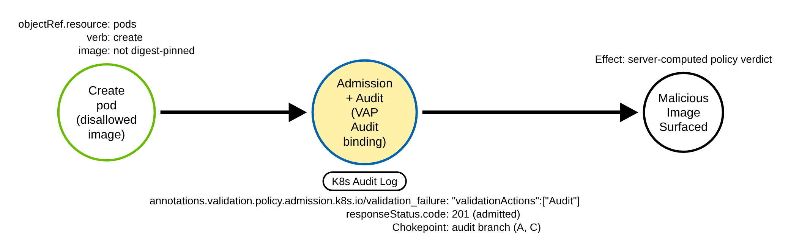
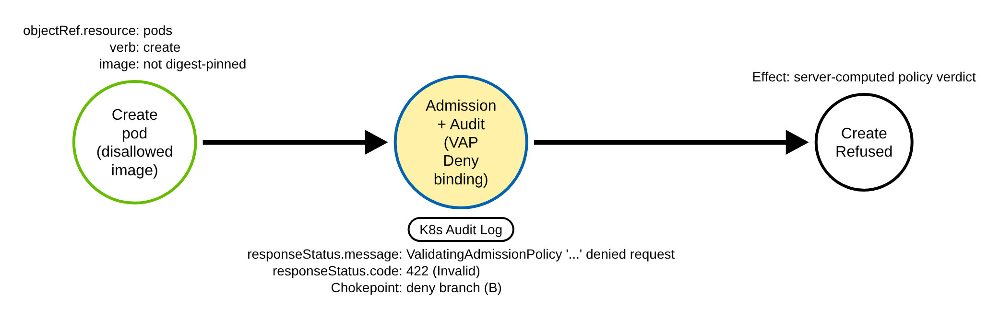
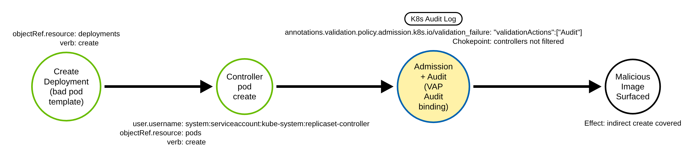

# Malicious Image Surfaced by an Admission-Policy Verdict (Kubernetes)

> Prose uses Simplified Technical English (ASD-STE100) where practical.
> Field names, annotation keys, resource names, and ATT&CK IDs are technical names.

## Metadata

| Key          | Value |
|--------------|-------|
| ID           | TRR9034 |
| External IDs | T1204.003 |
| Tactics      | Execution |
| Platforms    | Kubernetes |
| Contributors | det-eng |
| Status       | experimental |

### Scope Statement

This TRR covers one narrow path for **T1204.003 (Malicious Image)** on Kubernetes: a
workload whose container image a cluster **ValidatingAdmissionPolicy (VAP)** judges a
violation, **surfaced by the server-computed verdict** the API server writes into the
audit record. It is a policy-agnostic **forwarder of that verdict**, not a judge of the
image.

This TRR does **not** cover:

- Keying on the attacker-chosen image string itself (an unapproved registry, a `:latest`
  tag, a known-bad digest). That string is attacker-controlled and needs an out-of-record
  allowlist to interpret; it is the T1610 (Deploy Container) non-starter this candidate
  survives only by forwarding a verdict instead
  (`.claude/skills/trr/references/technique-selection.md`).
- A cluster with **no Audit- or Deny-mode VAP**. The rule is then inert: there is no
  verdict to forward.
- **Webhook-based** image verifiers (Kyverno `verifyImages`, Gatekeeper, Ratify, sigstore
  policy-controller, Defender for Containers gated deployment, GKE Binary Authorization).
  They are admission webhooks, not VAPs, and leave no
  `validation.policy.admission.k8s.io` annotation; each reports in its own engine (see the
  prior-art note).
- **Pure Warn-only** VAP bindings, which leave no audit marker (below).

> **ATT&CK mapping.** T1204.003 (User Execution: Malicious Image), tactic Execution, lists
> Containers and IaaS. Its analytic AN0691 (DET0248) describes Kubernetes but is tagged
> Linux, an ATT&CK data quirk. The detection here is the Kubernetes control-plane view:
> the API server's own verdict on a workload image, not the container runtime's pull.

## Technique Overview

An adversary (or a tricked user) deploys a workload whose image a site does not approve:
not digest-pinned, from an unapproved registry, or a cryptominer image pulled from a
public registry. Many clusters encode that image policy as a **ValidatingAdmissionPolicy**
— a CEL rule the API server evaluates on every matching write, with no external webhook.
When the policy's binding runs in **Audit** mode the API server admits the workload and
records a verdict; in **Deny** mode it refuses the workload and records why.

That verdict is computed by the API server and written into the audit record. It is not
the attacker's image string, and a client cannot forge it. A SIEM that reads the audit log
can therefore report "the cluster's own image policy flagged this workload" without
re-implementing the policy. This TRR builds that backstop: a policy-agnostic Sigma rule
over the two server-set markers. It is inert until a site runs such a policy; mapping and
shipping a real image policy are human decisions, and this repo ships only a reference VAP
that the emulation installs to prove the record shape.

## Technical Background

### ValidatingAdmissionPolicy and its two reporting actions

A `ValidatingAdmissionPolicy` (GA, `admissionregistration.k8s.io/v1`) holds CEL
`validations`; a `ValidatingAdmissionPolicyBinding` scopes it to resources and sets
`validationActions`, any of `Deny`, `Warn`, `Audit`. When a validation expression
evaluates to a violation, the API server's policy dispatcher
(`staging/src/k8s.io/apiserver/pkg/admission/plugin/policy/validating/dispatcher.go` at
**v1.36.4**) handles each action:

- **Audit** (dispatcher.go `publishValidationFailureAnnotation`, line 311): the API server
  **admits** the request and sets the audit **event annotation**
  `validation.policy.admission.k8s.io/validation_failure` (the key is fixed, line 312). Its
  value is a JSON list of
  `{message, policy, binding, expressionIndex, validationActions}` (the `ValidationFailureValue`
  struct, lines 332-340), so the value always contains `"validationActions":[`.
- **Deny** (dispatcher.go lines 289-306): the API server **refuses** the request with the
  server-built message `ValidatingAdmissionPolicy '<policy>' with binding '<binding>'
  denied request: <msg>` (line 294; the no-binding form at line 296), wrapped by
  `admission.NewForbidden` into `<resource> "<name>" is forbidden: <that message>`
  (apimachinery `errors.NewForbidden`). The reason is set to `Invalid` and the code to
  **422** (`reasonToCode(StatusReasonInvalid)`, lines 301-304).
- **Warn** (dispatcher.go lines 246-248): the API server returns a client `Warning:`
  response header (`warning.AddWarning`) and records **nothing** in the audit log. A
  pure Warn-only binding is therefore invisible to this rule. Kyverno-generated VAPs map
  their Audit action to `[Audit, Warn]`, so the Audit action still writes the annotation
  and the rule catches them (`kyverno pkg/admissionpolicy/builder.go`).

### Both markers are at Metadata, and a client cannot set either

The event annotation is request metadata, recorded from `Metadata` level upward
(`apiserver/pkg/audit/context.go`: annotations live on the event, which exists at
`Metadata`). The `responseStatus` (its `Status`, `Message`, `Reason`, `Code`) is copied
onto the event by `LogResponseObject` **regardless of level** (context.go lines 158-168);
only the full `responseObject` body needs `RequestResponse`. So **no request or response
body is needed**: `Metadata` carries both markers.

A client cannot write an event-level audit annotation (only the API server does, through
`AddAuditAnnotation`). An object annotation of the **same key** set by a client lands in
`requestObject.metadata.annotations`, a different field, so it does not trip the rule
(a provenance confounder, tested in the sidecar). `responseStatus` is server-set.

### Where the image lives, and the indirect create

A container image lives in a pod spec (`containers`, `initContainers`,
`ephemeralContainers`) or in a pod-template controller (Deployment, ReplicaSet,
StatefulSet, DaemonSet, Job, CronJob, ReplicationController). A VAP bound to `pods` sees a
**controller's** pod create too: a Deployment whose template violates the policy is
admitted (the Deployment is not matched), and the **replicaset controller's** own pods
create carries the annotation. A rule that filtered controller service accounts would miss
that path, so this rule does **not** filter the actor. The rule is scoped to those
workload resources so that a VAP verdict on an unrelated resource (a label or quota policy
on a ConfigMap) is not reported as a malicious-image event.

### Why the technique works

A site's image policy is only as visible as its reporting. An Audit-mode VAP admits the
workload silently except for the audit annotation; a Deny-mode VAP refuses it, but the
refusal is a transient API error unless something reads the log. Forwarding the
server-computed verdict from the audit log turns the cluster's own policy decision into an
alert a SIEM can act on, with no second implementation of the policy and no trust in the
attacker's image string.

## Procedures

| Procedure | ID | Name | Entry point |
|-----------|----|------|-------------|
| A | TRR9034.K8S.A | Pod the Audit binding flags | `create pods` (admitted + annotation) |
| B | TRR9034.K8S.B | Pod the Deny binding flags | `create pods` (refused, 422 + message) |
| C | TRR9034.K8S.C | Deployment whose controller pod the Audit binding flags | `create deployments` -> controller `create pods` |

> A tool is not a procedure. `kubectl`, a client library, and a raw HTTP client all send
> the same workload create; they are the same procedure.

**Reading the DDMs.** Green borders are operations a client performs; blue borders are
operations the API server performs; black borders are the abstract effect. The pill names
the telemetry; the `Key: value` lines are what a rule matches; a shaded node is the primary
detection opportunity.

### Procedure A: Pod the Audit binding flags  (`TRR9034.K8S.A`)

The adversary creates a pod whose image the reference VAP rejects, in a namespace the
Audit binding covers. The API server admits the pod and writes the
`validation.policy.admission.k8s.io/validation_failure` event annotation.

- **Prerequisites:** `create` on `pods` in a namespace an Audit-mode VAP binding covers.
- **Mechanics:** the CEL expression is a violation; the Audit action annotates and admits.
- **Impact:** the workload runs; the cluster's policy verdict is recorded.
- **Tools on this path:** `kubectl create`/`apply`, any client.

#### Detection Data Model — `TRR9034.K8S.A`

Source: [`ddms/trr9034_k8s_a.json`](ddms/trr9034_k8s_a.json) (Arrows app format).

**DDM summary.** The shaded node is the API server's admission-and-audit of the pods
create, carrying the `validation_failure` annotation (whose value holds
`"validationActions":[`). The rule's audit branch keys on it.

### Procedure B: Pod the Deny binding flags  (`TRR9034.K8S.B`)

The adversary creates the same kind of pod in a namespace the Deny binding covers. The API
server refuses the create; the response carries the `ValidatingAdmissionPolicy '...' denied
request` message (422 Invalid), copied into `responseStatus` at Metadata.

- **Prerequisites:** `create` on `pods` in a namespace a Deny-mode VAP binding covers.
- **Mechanics:** the CEL expression is a violation; the Deny action refuses the request.
- **Impact:** the workload is blocked; the refusal verdict is recorded.
- **Tools on this path:** `kubectl create`/`apply`, any client.

#### Detection Data Model — `TRR9034.K8S.B`

Source: [`ddms/trr9034_k8s_b.json`](ddms/trr9034_k8s_b.json) (Arrows app format).

**DDM summary.** The shaded node is the API server's admission-and-audit of the refused
pods create, carrying `responseStatus.message` with `ValidatingAdmissionPolicy '...' denied
request` and `responseStatus.code` 422. The rule's deny branch keys on the message.

### Procedure C: Deployment whose controller pod the Audit binding flags  (`TRR9034.K8S.C`)

The adversary creates a Deployment whose pod template has a rejected image. The Deployment
is admitted (it is not a pod); the replicaset controller then creates the pod, and **that**
create carries the annotation. This proves the rule must not filter controller identities.

- **Prerequisites:** `create` on `deployments` whose template a VAP binding covers.
- **Mechanics:** the controller's pods create is the request the policy evaluates.
- **Impact:** the same verdict as A, reached through a controller.
- **Tools on this path:** `kubectl create`/`apply`, any client.

#### Detection Data Model — `TRR9034.K8S.C`

Source: [`ddms/trr9034_k8s_c.json`](ddms/trr9034_k8s_c.json) (Arrows app format).

**DDM summary.** The shaded node is the API server's admission-and-audit of the
**replicaset controller's** pods create (`user.username:
system:serviceaccount:kube-system:replicaset-controller`), carrying the annotation. The
rule's audit branch fires on it; no actor filter removes it.

## Detection Strategy

All three procedures reach the same chokepoint: a workload write the API server annotated
or refused by a VAP verdict. One rule covers them.

**Strategy 1 — chokepoint (covers A, B, C).**
Match an audit event on a workload resource (`objectRef.resource` in `pods`, `deployments`,
`replicasets`, `statefulsets`, `daemonsets`, `replicationcontrollers`, `jobs`, `cronjobs`)
that carries **either** the `validation.policy.admission.k8s.io/validation_failure` event
annotation whose value holds `"validationActions":[` (an Audit binding), **or** a
`responseStatus.message` matching `ValidatingAdmissionPolicy '...' denied request` (a Deny
binding). Both markers are server-set and at Metadata. The rule is policy-agnostic: it
fires on any Audit/Deny VAP verdict on a workload, including a site's own non-image policy
failures. A site narrows it to its image policy by adding `"policy":"<site image policy>"`
to the annotation match, or triages by the policy and binding names the annotation carries.

- Sensor: API server audit log (Metadata is enough; it works under the recommended
  production profile).
- Rule: [`detections/sigma/T1204.003/k8s_admission_policy_image_violation.yml`](../../../detections/sigma/T1204.003/k8s_admission_policy_image_violation.yml) (built).

**Demonstrated gaps.**

- **Warn-only bindings.** A pure `[Warn]` binding returns a client warning header and
  writes no audit marker (dispatcher.go `warning.AddWarning`); the rule does not see it.
  Kyverno's `[Audit, Warn]` mapping is covered through its Audit action.
- **Webhook image verifiers.** Kyverno `verifyImages`, Gatekeeper, Ratify, sigstore
  policy-controller, Defender for Containers gated deployment and GKE Binary Authorization
  are admission webhooks, not VAPs, and leave no `validation.policy.admission.k8s.io`
  annotation; each reports in its own engine.
- **No policy, no signal.** Without an Audit- or Deny-mode VAP the rule is inert; shipping
  the image policy is the site's decision.

**Scope (platform coverage).** The verdict is proven on the lab under both the lab and the
recommended audit policies. On a managed platform the Audit-mode branch (the event
annotation) maps to the provider's audit schema, but the **Deny-mode** branch keys on
`responseStatus.message`, which **GKE** Cloud Audit Logs do not carry (they record only
`protoPayload.status`, a `google.rpc.Status`); on GKE the rule sees Audit-mode verdicts and
Deny-mode ones are triaged in the engine (tracked as a NOT_PORTABLE human decision in
`detections/check_provider_mappings.py`). AKS carries both. The lab-proven procedures stay
Proven.

Platform coverage: [detections/k8s/PLATFORMS.md](../../../detections/k8s/PLATFORMS.md#rules-on-each-platform)

## Available Emulation Tests

The tests run in a lab cluster with the shared audit policy. The lab is a `kind` cluster;
its config and audit policy are in [`detections/k8s/`](../../../detections/k8s/). The
emulation installs the **reference** VAP
([`atomics/T1204.003/src/vap-image-provenance.yaml`](../../../atomics/T1204.003/src/vap-image-provenance.yaml),
authored by det-eng, NOT a production policy) and two namespace-scoped bindings (one Audit,
one Deny), then creates inert pods the policy judges a violation. The "malicious image" is a
benign placeholder (`registry.k8s.io/pause` by tag, not digest-pinned); the reference
policy flags it by a chosen condition ("every container image must be digest-pinned"), not
by being malware. Every pod carries a `nodeSelector` no node matches
(`trr9034-unschedulable=true`), so it never schedules, pulls or runs; the image is only a
string the CEL expression reads at admission. The policy is cluster-scoped, but both
bindings are confined to the `trr9034` namespace, so installing it never affects the rest
of the cluster. Cleanup deletes the VAP, both bindings and the namespace. The emulation
splits the two verdicts by a pod label (`trr9034-mode: audit` / `deny`) and waits until the
Deny binding is enforcing before it creates the test pods, so a create admitted before the
policy is live is removed and retried, not counted.

Side effects, expected and harmless: creating the VAP and its bindings fires TRR9025's
admission-controller create chokepoint
([`k8s_admission_webhook_created.yml`](../../../detections/sigma/T1546/k8s_admission_webhook_created.yml)),
and deleting them on cleanup fires TRR9008's disable chokepoint
([`k8s_admission_webhook_disabled.yml`](../../../detections/sigma/T1685/k8s_admission_webhook_disabled.yml)).
Both are documented and benign.

One script drives them:
[`atomics/T1204.003/src/emulate.sh`](../../../atomics/T1204.003/src/emulate.sh), with Atomic
Red Team wrappers in
[`atomics/T1204.003/T1204.003.yaml`](../../../atomics/T1204.003/T1204.003.yaml).

| Procedure | Test | Status |
|-----------|------|--------|
| TRR9034.K8S.A | `emulate.sh a` — create a pod the Audit binding flags (admitted + annotation). | **built** |
| TRR9034.K8S.B | `emulate.sh b` — create a pod the Deny binding flags (refused, 422 + message). | **built** |
| TRR9034.K8S.C | `emulate.sh c` — create a Deployment whose controller pod the Audit binding flags. | **built** |

The control `emulate.sh allow` creates a pod with a digest-pinned image the policy admits
with no verdict, the hard benign baseline that differs from A only in the image; the rule
must not fire on it. The validator
[`detections/validate_apiserver_detections.py`](../../../detections/validate_apiserver_detections.py)
reads the audit log the emulation produced and asserts the rule matches each procedure's
own record in its ledger window: A by the annotation, B by the denied-request message and
422, C by the annotation on the replicaset controller's pods create. The negative control
runs the rule on the pre-emulation log (`--expect-miss`), where no VAP verdict exists.

## Detections

| Strategy | Covers | Sigma rule | Sensor |
|----------|--------|------------|--------|
| 1 (chokepoint) | A, B, C | [`detections/sigma/T1204.003/k8s_admission_policy_image_violation.yml`](../../../detections/sigma/T1204.003/k8s_admission_policy_image_violation.yml) | API server audit log |

**Prior art.** Engine-native and provider-native reporting already exists in each engine's
console: Kyverno PolicyReports; Gatekeeper audit; Defender for Containers gated deployment
(its Audit mode "creates an admission event for review"); GKE Binary Authorization plus the
Security Command Center findings "Breakglass Workload Deployment Created/Updated", and
SigmaHQ's `gcp_breakglass_container_workload_deployed.yml` (keyword
`image-policy.k8s.io/break-glass`, GKE only). Falco's k8saudit plugin **exposes** the field
as `ka.validations.admission.policy.failure` but ships **no rule** over it (plugins
`0fa68c9`, `falcosecurity/rules` `81dfa53`). The nearest spoofable precedent is Falco's
"Create Disallowed Pod" (an image-string allowlist, the discriminator this TRR rejects).
SigmaHQ, Elastic detection-rules and Splunk security_content have no rule keyed on the VAP
annotation (GitHub code search 2026-11-02 for `validation.policy.admission.k8s.io` and
`ValidatingAdmissionPolicy` denied request returned no SIEM rule). This is the
provider-agnostic, engine-agnostic SIEM backstop over the audit log, stated as a backstop
and not a discovery; never claim "first" or "only".

## References

- MITRE ATT&CK, T1204.003 User Execution: Malicious Image:
  <https://attack.mitre.org/techniques/T1204/003/>
- Kubernetes documentation, Validating Admission Policy (validationActions Audit / Deny /
  Warn, auditAnnotations):
  <https://kubernetes.io/docs/reference/access-authn-authz/validating-admission-policy/>
- Kubernetes source, policy dispatcher (the annotation key and the denied-request message),
  v1.36.4:
  <https://github.com/kubernetes/kubernetes/blob/v1.36.4/staging/src/k8s.io/apiserver/pkg/admission/plugin/policy/validating/dispatcher.go>
- Kubernetes source, audit context (responseStatus copied at Metadata), v1.36.4:
  <https://github.com/kubernetes/kubernetes/blob/v1.36.4/staging/src/k8s.io/apiserver/pkg/audit/context.go>
- Kubernetes documentation, Auditing:
  <https://kubernetes.io/docs/tasks/debug/debug-cluster/audit/>
- Falco k8saudit plugin, the exposed (unused) field:
  <https://github.com/falcosecurity/plugins/blob/master/plugins/k8saudit/pkg/k8saudit/fields.go>
- TRR method:
  <https://github.com/tired-labs/techniques/blob/main/docs/TECHNIQUE-RESEARCH-REPORT.md>
