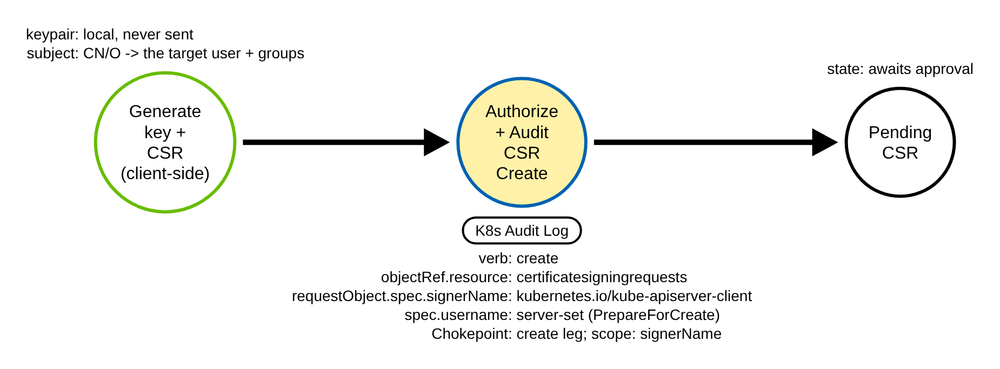
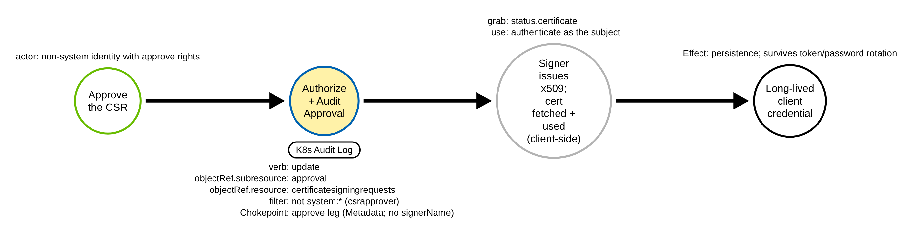

# CSR Client-Certificate Persistence (Kubernetes)

A disclosed backstop detection: an adversary with the right RBAC mints a long-lived
x509 client credential through the CertificateSigningRequest (CSR) API, a persistence
foothold that no RBAC-object write reveals.

## Metadata

| Key          | Value |
|--------------|-------|
| ID           | TRR9035 |
| External IDs | T1098.006, T1136 |
| Tactics      | Persistence, Privilege Escalation |
| Platforms    | Kubernetes |
| Contributors | det-eng |
| Status       | draft |

### Scope Statement

This TRR covers minting a **client-authentication certificate** through the Kubernetes
CSR API as a persistence and (where the subject maps to a privileged identity)
privilege-escalation foothold: creating a `CertificateSigningRequest` whose
`spec.signerName` is `kubernetes.io/kube-apiserver-client` and approving it. The issued
certificate authenticates to `kube-apiserver` as the subject's CN (a user) and O values
(groups), a credential that is not stored in any RBAC object, is not revocable short of
rotating the cluster CA or its expiry, and survives rotation of the compromised
password or service-account token that was used to create it.

This TRR does **not** cover:

- The `kubernetes.io/kube-apiserver-client-kubelet` and `kubernetes.io/kubelet-serving`
  signers (node bootstrap and node serving certificates). Those are the hard benign
  baseline: they differ from the attack only on `signerName` (and a `system:node:*`
  requester), and the shipped rule's create leg excludes them by `signerName`.
- The requested certificate **subject** (the CN/O that become the user and groups). It
  is not Sigma-gradable; see the Technical Background and
  [`RULE_DEFECTS.md` K60](../../../detections/RULE_DEFECTS.md#k60-k8s_csr_client_cert_minted-subject-ungradable-and-self-approval-non-portable).
- **Self-approval** as a distinct, higher-fidelity signal (approver == requester). It
  needs a Sigma field reference that the portable backends reject; see K60.
- The legacy `kubernetes.io/legacy-unknown` signer (the v1 API rejects it on create:
  kubernetes v1.36.4 `pkg/apis/certificates/validation/validation.go` L210).

> **Scope — platform gap.** The create leg needs `requestObject.spec.signerName`,
> which is only logged at Request level. On audit policies that log CSR creates at
> Metadata — the **OpenShift 4.18+/4.17 Default** profiles and the **k3s starter**
> policy — the create leg is blind and only the approve leg fires
> (`k8s_csr_client_cert_minted` is **partial 1/2** on those columns of
> [`PLATFORMS.md`](../../../detections/k8s/PLATFORMS.md#rules-on-each-platform)); on
> those platforms, add a Request-level CSR row (the OpenShift WriteRequestBodies
> profiles already do). The lab proves both legs on `lab-apiserver`, so the procedures
> stay Proven. On **EKS**, Stratus Red Team documents that the managed control plane
> will not issue the certificate even once approved, so a usable credential is only
> minted on self-managed / kind clusters; the create and approve records exist on EKS
> regardless.

## Technique Overview

Kubernetes authenticates clients by x509 client certificate as well as by bearer token.
A certificate signed by the cluster CA with the `kubernetes.io/kube-apiserver-client`
signer authenticates to the API server as the certificate's subject: the Common Name
(CN) is the username and each Organization (O) is a group
(kubernetes v1.36.4 `staging/src/k8s.io/api/certificates/v1/types.go` L149-152). An
adversary who can create and approve CSRs can therefore mint a credential for any
user/group that already has RBAC — a self-contained persistence foothold.

The attack has two API-mediated legs:

1. **Create** a `CertificateSigningRequest` with a locally generated keypair, a PKCS#10
   CSR carrying the chosen subject, and `spec.signerName:
   kubernetes.io/kube-apiserver-client`.
2. **Approve** it (an update of the `approval` subresource). The cluster's signer
   controller then issues the certificate into `status.certificate`, which the
   adversary fetches and uses.

ATT&CK maps this to **T1098.006 (Additional Container Cluster Roles)** — Elastic's
mapping for its CSR rule — and **T1136 (Create Account)**, since the minted credential
is a new cluster identity. Stratus Red Team ships the emulation as
`k8s.persistence.create-client-certificate`.

## Technical Background

### The server-set markers

Both audit markers are set by the API server and are not spoofable:

- On **create**, the CSR admission strategy clears any client-supplied
  `spec.username`, `spec.uid` and `spec.groups` and injects them from the request
  context (kubernetes v1.36.4
  `pkg/registry/certificates/certificates/strategy.go`, `PrepareForCreate`). So the
  stored `spec.username` is the real requester, whatever the client sent.
- The **approval decision** is written only through the `approval` subresource, which
  the audit record names as `objectRef.subresource: approval` with `verb: update`
  (`kubectl certificate approve` / `deny` both PUT the approval subresource). The
  record also names the approver in `user.username`.

### The audit shape, and the two levels

A recorded CSR **create** (v1.36.4, lab), at Request level:

```
verb: create
objectRef: {resource: certificatesigningrequests, apiGroup: certificates.k8s.io, name: ...}
requestObject.spec.signerName: kubernetes.io/kube-apiserver-client
requestObject.spec.request: <base64 of the PEM PKCS#10 CSR>   # public; no private key
responseStatus.code: 201
```

A recorded **approval** (v1.36.4, lab), at Metadata level:

```
verb: update
objectRef: {resource: certificatesigningrequests, apiGroup: certificates.k8s.io,
            name: ..., subresource: approval}
user.username: <the approver>
responseStatus.code: 200
```

The repo's API-server audit policy logged **no** `certificatesigningrequests` at all
before this TRR; it added two rows (both the lab
[`audit-policy-apiserver.yaml`](../../../detections/k8s/audit-policy-apiserver.yaml) and
the
[`audit-policy-recommended.yaml`](../../../detections/k8s/audit-policy-recommended.yaml)):
the **create at Request** (so `spec.signerName` is present — `spec.request` is a public
CSR, no private key, so Request level copies no secret) and the **approval update at
Metadata** (the approve leg needs no body). Placed so no existing level drops;
`certificatesigningrequests/status` stays at the Metadata catch-all.

### Two things a Sigma rule cannot do here (disclosed limits, K60)

1. **The subject is not Sigma-gradable.** The requested CN/O live only inside the DER
   CSR in `spec.request`, base64 of a line-wrapped PEM; pySigma cannot base64-then-DER
   decode it, so a rule cannot tell `system:masters` from an ordinary CN. GKE Event
   Threat Detection does this by decoding in ES|QL. Moreover, the default
   **CertificateSubjectRestriction** admission plugin refuses a
   `kubernetes.io/kube-apiserver-client` CSR that requests the `system:masters` group
   (kubernetes v1.36.4
   `plugin/pkg/admission/certificates/subjectrestriction/admission.go` L84-87; proved
   on the lab: the create is refused with 403 "use of
   kubernetes.io/kube-apiserver-client signer with system:masters group is not
   allowed"). So the highest-value subject cannot even be requested through this
   signer; the realistic attack targets a lower-privilege subject that maps to an
   already-privileged identity, which no rule can grade.
2. **Self-approval is not portably expressible.** Correlating approver (`user.username`)
   with the stored requester (`spec.username`) needs a Sigma field reference. It fires
   correctly in `sigma_eval` (SQLite), but the Elasticsearch Lucene and EQL backends
   raise `SigmaFeatureNotSupportedByBackendError` and Splunk defers, so a portable rule
   cannot pair the two legs.

So the shipped rule is the bare create/approve chokepoint, scoped on the create leg by
`signerName` and on the approve leg by a non-system-approver filter. It is weaker than
TRR9025 / TRR9027, which ship content graders this technique cannot have.

### Why the technique works

A client certificate is a stand-alone credential: once the CA signs it, the holder
authenticates as the subject until the certificate expires, with no server-side record
of the credential (no Secret, no RBAC object, no token in etcd). Kubernetes has no
built-in certificate revocation, so rotating the compromised token that minted it does
not invalidate it. This is why the create and approve are the detection chokepoint:
they are the only cluster-visible moment.

## Procedures

| # | ID | Name | Chokepoint record |
|---|----|------|-------------------|
| A | TRR9035.K8S.A | Create a kube-apiserver-client CSR | `create certificatesigningrequests` + `signerName` |
| B | TRR9035.K8S.B | Approve the CSR | `update certificatesigningrequests/approval` |

Procedure IDs are `TRR9035.PLATFORM.LETTER`; a procedure is a distinct execution path.

### Procedure A: Create a kube-apiserver-client CSR  (`TRR9035.K8S.A`)

The adversary generates a keypair and a PKCS#10 CSR locally (the private key never
leaves the client), then creates a `CertificateSigningRequest` with `spec.signerName:
kubernetes.io/kube-apiserver-client` and the chosen subject.

- **Prerequisites:** `create` on `certificatesigningrequests` (the default
  `system:authenticated` group has it; approval needs more).
- **Mechanics:** the API server injects `spec.username` from the requester and stores
  the CSR Pending.
- **Impact:** a pending request for a credential that will authenticate as the subject.
- **Tools on this path:** `kubectl create -f`, `kubectl certificate`, any client;
  Stratus Red Team `k8s.persistence.create-client-certificate`.

#### Detection Data Model — `TRR9035.K8S.A`



Source: [`ddms/trr9035_k8s_a.json`](ddms/trr9035_k8s_a.json) (Arrows app format).

**DDM summary.** The green node is the client-side keypair + CSR generation (not
logged). The shaded node is the API server's authorize-and-audit of the CSR create
(`verb: create`, `objectRef.resource: certificatesigningrequests`,
`requestObject.spec.signerName: kubernetes.io/kube-apiserver-client`), the create-leg
chokepoint, scoped by `signerName` so node CSRs do not fire it.

### Procedure B: Approve the CSR  (`TRR9035.K8S.B`)

A non-system identity with approval rights approves the pending CSR; the signer
controller then issues the certificate, which the adversary fetches and uses.

- **Prerequisites:** the `approve` verb on
  `signers/kubernetes.io/kube-apiserver-client` and `update` on
  `certificatesigningrequests/approval`.
- **Mechanics:** the approval is written to the `approval` subresource; the issued
  certificate lands in `status.certificate`.
- **Impact:** a usable, long-lived client credential.
- **Tools on this path:** `kubectl certificate approve`, any client.

#### Detection Data Model — `TRR9035.K8S.B`



Source: [`ddms/trr9035_k8s_b.json`](ddms/trr9035_k8s_b.json) (Arrows app format).

**DDM summary.** The shaded node is the audit of the approval
(`verb: update`, `objectRef.subresource: approval`), the approve-leg chokepoint —
logged at Metadata, so no `signerName` is present and the rule keys on the subresource
and verb with a `not system:*` filter (excluding the built-in csrapprover). The grey
node is the signer's issuance and the client-side fetch and use of the certificate,
which leave no further API record.

## Detection Strategy

The two DDMs share one chokepoint object, `certificatesigningrequests`, through two
legs: the **create** (keyed by `signerName: kubernetes.io/kube-apiserver-client`, so the
`kube-apiserver-client-kubelet` and `kubelet-serving` node CSRs — which differ only on
`signerName` — do not fire it) and the **approve** (an update of the `approval`
subresource by a non-system identity, so the built-in csrapprover auto-approving node
CSRs is filtered). One rule covers both legs.

The rule is a disclosed backstop: pure surface on the approve leg (no body at Metadata)
and scoped by `signerName` on the create leg. It carries no content grader, because the
certificate subject is unreadable to Sigma and self-approval is not portably
expressible (see the Technical Background and K60). It is null-safe: the record of a
request that fails authentication has no `user.username`, so the approve-leg filter is
ORed with a `user.username: null` guard.

The approve-leg filter drops every `system:*` identity, which includes all
ServiceAccounts (`system:serviceaccount:...`): that suppresses the built-in csrapprover
but also means an approval made with a stolen ServiceAccount token is not caught by the
approve leg. This does not reduce coverage of the technique: the create leg has no
identity filter, so a `kubernetes.io/kube-apiserver-client` CSR create by any identity —
a ServiceAccount included — fires the rule, and a credential cannot be minted without
that create (reproduced with `sigma_eval.py`).

Platform coverage: [detections/k8s/PLATFORMS.md](../../../detections/k8s/PLATFORMS.md#rules-on-each-platform)

## Available Emulation Tests

| Procedure | Test | Status |
|-----------|------|--------|
| TRR9035.K8S.A | `emulate_csr.sh a` — create a `kubernetes.io/kube-apiserver-client` CSR for an inert subject (CN=trr9035-persist, O=trr9035-group), no privilege granted. | **built** |
| TRR9035.K8S.B | `emulate_csr.sh b` — approve that CSR (approval subresource update); the issued cert authenticates an identity with no RBAC. Cleanup deletes the CSR. | **built** |

The emulation is [`atomics/T1098.006/src/emulate_csr.sh`](../../../atomics/T1098.006/src/emulate_csr.sh),
separate from the TRR9004 RBAC/aws-auth emulation in the same folder. It is fail-loud
(a failed create or approve fails the run), writes one emulation-ledger row per
procedure, and cleans up the CSR. It never writes the private key where a log can reach
it, and never retrieves or uses the issued certificate.

## Detections

| Rule | Chokepoint | Severity |
|------|-----------|----------|
| [`k8s_csr_client_cert_minted.yml`](../../../detections/sigma/T1098.006/k8s_csr_client_cert_minted.yml) | `certificatesigningrequests` create (by `signerName`) or `approval` update (non-system) | medium |

Nearest prior art (this is a **disclosed duplicate backstop**, not a discovery):

- Elastic **"Kubernetes Client Certificate Signing Request Created or Approved"**
  (`rules/integrations/kubernetes/persistence_kubernetes_client_certificate_signing_request_created_or_approved.toml`)
  — same k8s-audit layer, keys on resource + verb + decision, does **not** scope by
  `signerName`.
- Elastic's GKE CSR rules (self-approved / privileged-identity / api-client-signer) and
  the Azure AKS CSR rule.
- **GKE Event Threat Detection** ships CSR detectors (including a subject decode in
  ES|QL that this rule cannot replicate).
- **Stratus Red Team** ships the emulation (`k8s.persistence.create-client-certificate`).

SigmaHQ, Splunk ESCU and Falco ship no CSR rule. The honest differentiation is a
provider-agnostic pySigma rule that scopes the create leg by `signerName`.

## References

- MITRE ATT&CK T1098.006 — https://attack.mitre.org/techniques/T1098/006/
- MITRE ATT&CK T1136 — https://attack.mitre.org/techniques/T1136/
- Kubernetes — Certificate Signing Requests —
  https://kubernetes.io/docs/reference/access-authn-authz/certificate-signing-requests/
- Kubernetes — Auditing —
  https://kubernetes.io/docs/tasks/debug/debug-cluster/audit/
- Stratus Red Team — `k8s.persistence.create-client-certificate` —
  https://stratus-red-team.cloud/attack-techniques/kubernetes/k8s.persistence.create-client-certificate/
