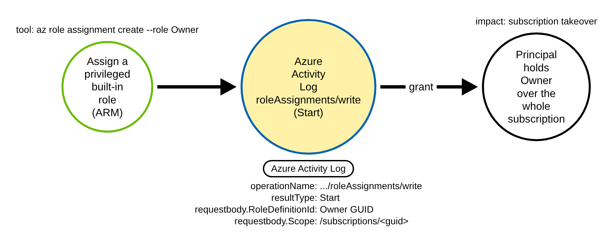
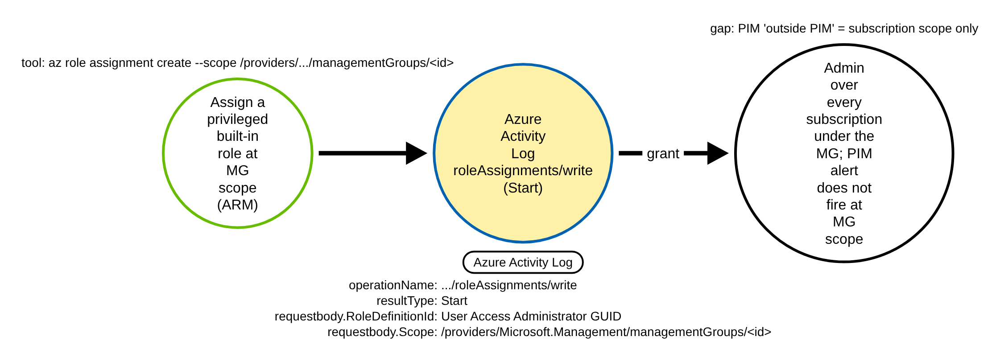
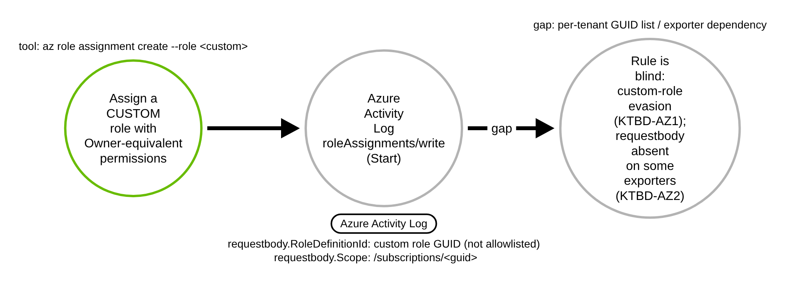

# Azure ARM RBAC Privileged Role Assignment at Subscription or Management-Group Scope (Azure)

> Prose uses Simplified Technical English (ASD-STE100) where practical.
> Azure Resource Manager (ARM) role names, Activity Log field names, and ATT&CK IDs
> are technical names.

## Metadata

| Key          | Value |
|--------------|-------|
| ID           | TRR9036 |
| External IDs | T1098.003 |
| Tactics      | Persistence, Privilege Escalation |
| Platforms    | Azure |
| Contributors | det-eng |
| Status       | draft |

### Scope Statement

This TRR covers assigning one of the **high-privilege built-in Azure roles** — Owner,
Contributor, User Access Administrator, or Role Based Access Control Administrator — to a
principal at **subscription** or **management-group** scope through Azure Resource Manager
(ARM) RBAC, recorded in the **Azure Activity Log** as the Administrative operation
`Microsoft.Authorization/roleAssignments/write`. A grant at this scope is a durable
privilege-escalation and persistence foothold: the principal keeps standing access across
every resource under that scope.

It is explicitly a **disclosed backstop**, not a discovery (question 4 of the vet marked
the detection "trodden"). Elastic, SigmaHQ and Microsoft already ship rules on this
chokepoint; this report states that prior art plainly below and positions the contribution
as a **graded, scope-aware, fixture-proven** Sigma counterpart. It does **not** cover
resource-group or single-resource grants (left to the hard-benign baseline as the
discriminating non-fire), the `elevateAccess` tenant-root toggle (a separate activity), or
custom roles with Owner-equivalent permissions (a disclosed evasion, KTBD-AZ1).

## Technique Overview

Azure RBAC grants access by assigning a **role definition** to a **principal** over a
**scope**. The built-in roles Owner, Contributor, User Access Administrator and Role Based
Access Control Administrator carry (or can grant) full control; assigned at subscription or
management-group scope they confer standing control over everything beneath. An attacker
who already has `Microsoft.Authorization/roleAssignments/write` at a high scope (for
example from a compromised Owner or a stolen User Access Administrator session) can make a
new role assignment to a principal they control. From then on the principal holds the role
with no further action, and to a defender the assignment looks like one more RBAC entry.

The same write at **management-group** scope is strictly broader (it spans every child
subscription) and is the gap Microsoft's PIM "Roles assigned outside PIM" alert does **not**
cover: that alert fires at subscription scope only, and needs Entra ID P2 + PIM, so a
management-group grant and a non-PIM tenant are both blind spots.

## Technical Background

### What the write looks like in the Azure Activity Log

A role assignment made through ARM (`az role assignment create`,
`New-AzRoleAssignment`, the REST `PUT .../roleAssignments/{guid}`, Bicep/Terraform, or the
portal — all map to the same ARM write) is recorded in the Azure Activity Log under
`category` `Administrative`, `operationName`
`Microsoft.Authorization/roleAssignments/write`. ARM logs **two** records for each write: a
`Start` record when the request arrives and a `Success`/`Failure` record when it completes.

### The role and the scope live only on the Start record

The assigned role definition and the scope are server-recorded in
`properties.requestbody` — a **JSON string** (not a nested object) carrying
`Properties.RoleDefinitionId` and `Properties.Scope`. Microsoft's own documented Activity
Log alert query ("Set up an activity log alert when a role is assigned",
`role-assignments-alert`) `extractjson`s both values out of `requestbody`. In the Activity
Log that body is attached to the **Start** record; the completion record does not carry it.
So — the opposite of this repo's TRR9013 managed-identity FIC rule, which drops the Start
record and keys on the completion — this rule **fires on the Start record**
(`resultType` starts `Start`).

The discriminator is therefore two values parsed out of the `requestbody` string:

- `Properties.RoleDefinitionId` ends with one of the pinned privileged built-in role GUIDs
  (MS Learn "Azure built-in roles"): Owner `8e3af657-a8ff-443c-a75c-2fe8c4bcb635`,
  Contributor `b24988ac-6180-42a0-ab88-20f7382dd24c`, User Access Administrator
  `18d7d88d-d35e-4fb5-a5c3-7773c20a72d9`, Role Based Access Control Administrator
  `f58310d9-a9f6-439a-9e8d-f62e7b41a168`; and
- `Properties.Scope` begins `/subscriptions/<guid>` or
  `/providers/Microsoft.Management/managementGroups/<id>` **and is not** a resource-group or
  resource scope (it does not contain `/resourceGroups/`). This high-scope gate follows
  Microsoft's documented query shape (startswith the two prefixes, and not contains
  `/resourceGroups/`) and is a **stated approximation**.

### Traps avoided

`identity.authorization.evidence.roleDefinitionId` is **not** the assigned role — it is the
**caller's own authorization evidence** (what role let the caller make the write), so keying
on it would detect the wrong thing. The rule reads only `properties.requestbody`. The
object name and principal are attacker-chosen, so the rule keys on neither. `operationName`,
`category` and `resultType` are matched case-insensitively because exported Activity Log
records do not keep one casing (MS Learn, "Activity log in Azure Monitor"), and the sibling
TRR9013 rule's capture confirms UPPERCASE export forms.

### Known limits

- **Custom-role evasion (KTBD-AZ1).** A custom role definition with Owner-equivalent
  permissions carries a tenant-specific GUID that is not on the built-in allowlist, so the
  rule misses it. The fix is a per-tenant privileged-role-GUID list, a human/site decision.
- **requestbody absence (KTBD-AZ2).** Some Activity Log exporters / diagnostic settings omit
  or truncate `properties.requestbody`; the role + scope are also only on the Start record.
  Where the body is absent the body-grade degrades to the surface chokepoint — the same
  fixture-provable approximation documented for TRR9011 and TRR9030. Both are tracked in
  [`detections/RULE_DEFECTS.md`](../../../detections/RULE_DEFECTS.md).

## Procedures

| Procedure | ID | Name | Entry point |
|-----------|----|------|-------------|
| A | TRR9036.AZR.A | Privileged built-in role at subscription scope | ARM `PUT .../subscriptions/<guid>/.../roleAssignments/<guid>` |
| B | TRR9036.AZR.B | Privileged built-in role at management-group scope | ARM `PUT .../managementGroups/<id>/.../roleAssignments/<guid>` |
| C | TRR9036.AZR.C | Custom-role / exporter evasion of the body grade | ARM write with a custom role GUID, or an exporter that drops `requestbody` |

> A tool is not a procedure. The Azure CLI, Azure PowerShell, the REST API, Bicep/Terraform
> and the portal all write the same role assignment. They are the same procedure (A or B,
> by scope).

**Reading the DDMs.** Green borders are operations the attacker performs. Blue borders are
operations the control plane records (Azure Activity Log). Blue border + yellow fill is the
Activity-Log chokepoint a rule matches. Black borders are the abstract effect. Grey borders
are out-of-scope or a detection gap. The pill names the telemetry; the `Key: value` lines
are what a rule matches.

### Procedure A: Privileged built-in role at subscription scope  (`TRR9036.AZR.A`)

The adversary assigns Owner (or Contributor / User Access Administrator / RBAC
Administrator) to a principal they control, scoped at the subscription.

- **Prerequisites:** `Microsoft.Authorization/roleAssignments/write` at subscription scope.
- **Mechanics:** one ARM write; the Start record carries `requestbody` with the privileged
  `RoleDefinitionId` and a `/subscriptions/<guid>` `Scope`.
- **Impact:** standing control over the whole subscription.

#### Detection Data Model — `TRR9036.AZR.A`

Source: [`ddms/trr9036_azr_a.json`](ddms/trr9036_azr_a.json) (Arrows app format).

**DDM summary.** The shaded node is the Azure Activity Log `roleAssignments/write` Start
record — privileged `RoleDefinitionId`, subscription `Scope` — the chokepoint for A and B.

### Procedure B: Privileged built-in role at management-group scope  (`TRR9036.AZR.B`)

The adversary assigns the same class of role at management-group scope, which spans every
child subscription.

- **Prerequisites:** the write at management-group scope.
- **Mechanics:** same chokepoint event; `Scope` begins
  `/providers/Microsoft.Management/managementGroups/<id>`.
- **Impact:** broader than A, and the gap PIM's "Roles assigned outside PIM" alert does not
  cover (that alert is subscription-scope only, and needs Entra ID P2 + PIM).

#### Detection Data Model — `TRR9036.AZR.B`

Source: [`ddms/trr9036_azr_b.json`](ddms/trr9036_azr_b.json) (Arrows app format).

**DDM summary.** Same chokepoint; the management-group `Scope` is the only difference, and
the rule's high-scope gate accepts it.

### Procedure C: Custom-role / exporter evasion of the body grade  (`TRR9036.AZR.C`)

The adversary assigns a **custom** role with Owner-equivalent permissions (whose GUID is not
on the built-in allowlist), or the Activity Log reaches the SIEM through an exporter that
drops `properties.requestbody`.

- **Prerequisites:** a custom role with the right permissions, or an exporter/diagnostic
  setting that truncates the body.
- **Mechanics:** the body grade cannot fire — the role GUID is not recognised, or the body
  is absent.
- **Impact:** a false negative. The fallback is the surface chokepoint
  (`roleAssignments/write` at high scope) and a per-tenant GUID list.

#### Detection Data Model — `TRR9036.AZR.C`

Source: [`ddms/trr9036_azr_c.json`](ddms/trr9036_azr_c.json) (Arrows app format).

**DDM summary.** The grey nodes are the two disclosed gaps: the custom-role GUID
(KTBD-AZ1) and the absent `requestbody` (KTBD-AZ2). Neither is covered by this portable
rule.

## Detection Strategy

**Telemetry requirement.** Azure Activity Log for the subscription (and each management
group) routed via a Diagnostic Setting to Log Analytics/Sentinel or an Event Hub. The role
and scope are only on the **Start** record and only in `properties.requestbody`.

**Strategy 1 — chokepoint, body-graded (covers A, B).**
Match Activity Log Administrative `Microsoft.Authorization/roleAssignments/write` **Start**
records whose `properties.requestbody` carries a privileged built-in `RoleDefinitionId`
**and** a subscription / management-group `Scope` that is not a resource-group scope. The
rule is null-safe: `selection_privileged_role` / `selection_high_scope` both require
`requestbody`, so the resource-group filter's negation never reads an absent field, and the
`selection_no_requestbody` guard keeps the two- and three-valued hits identical
(`check_null_safety`). The GUID and scope regexes are in the portable subset (no lookaround;
RE2/Lucene/KQL-safe).

- Sensor: Azure Activity Log.
- Rule:
  [`detections/sigma/T1098.003/azure_privileged_role_assignment.yml`](../../../detections/sigma/T1098.003/azure_privileged_role_assignment.yml)
  (built).

**Demonstrated gaps (Procedure C).** A custom role with Owner-equivalent permissions evades
the built-in-GUID allowlist (KTBD-AZ1); an exporter that drops `requestbody` degrades the
body grade to the surface chokepoint (KTBD-AZ2). Both are tracked in
[`RULE_DEFECTS.md`](../../../detections/RULE_DEFECTS.md).

**Prior detection art (disclosed; this is a backstop).**

- **Elastic** "Azure RBAC Built-In Administrator Roles Assigned" (`azure.activitylogs`,
  T1098) keys on the **same** privileged built-in role GUIDs — a near-1:1 graded match.
- **SigmaHQ** already ships "Granting Of Permissions To An Account"
  (`azure_granting_permission_detection.yml`, id
  `a622fcd2-4b5a-436a-b8a2-a4171161833c`, T1098.003) as a **bare keyword**
  (`Microsoft.Authorization/roleAssignments/write`) with no role or scope filter.
- **Microsoft** documents the identical detection only as a **customer-built** Azure Monitor
  Kusto alert (`role-assignments-alert`), not an automatic finding; **PIM**'s "Roles assigned
  outside PIM" alert needs Entra ID P2 + PIM and fires at **subscription scope only**.
- **Atomic Red Team** T1098 #6/#7 already emulate `New-AzRoleAssignment` at subscription
  scope; **Stratus Red Team** ships the adjacent `elevateAccess` root-user toggle, not this
  role write.

Differentiation, honest and bounded: the graded Sigma counterpart to Elastic/Microsoft,
raising fidelity over SigmaHQ's keyword rule, covering **management-group scope** and the
**no-PIM gap**, and fixture-proving the `requestbody` `RoleDefinitionId`+`Scope`
discriminator. No "first" or "only" is claimed. No built TRR covers this ARM-RBAC chokepoint
(TRR9013/9017/9023 are Entra; TRR9032 is EKS).

**Coverage summary.**

| Procedure | Covered by | How |
|-----------|-----------|-----|
| A | Strategy 1 | Activity Log roleAssignments/write Start, privileged `RoleDefinitionId`, subscription `Scope` |
| B | Strategy 1 | same event; `Scope` begins `/providers/Microsoft.Management/managementGroups/` |
| C | — (gap) | custom-role GUID (KTBD-AZ1) or absent `requestbody` (KTBD-AZ2) |

## Available Emulation Tests

The runnable half
([`atomics/T1098.003/src/emulate_azure.sh`](../../../atomics/T1098.003/src/emulate_azure.sh),
wrappers in [`atomics/T1098.003/T1098.003.yaml`](../../../atomics/T1098.003/T1098.003.yaml))
assigns then **revokes** a privileged built-in role to a throwaway principal at subscription
(A) or management-group (B) scope in **your own tenant**, guarded by `TRR9036_LIVE=1`; it is
**not run in CI**, and it never runs live in this repo (safe markers only). The proven half
is committed Azure Activity Log fixtures
([`detections/cloud/fixtures/trr9036/`](../../../detections/cloud/fixtures/trr9036/)): an
attack grant of Owner at a `/subscriptions/<test-guid>` scope (Start + completion), and a
hard benign baseline — a Terraform grant of the non-privileged Key Vault Secrets User role
at a Key Vault (resource-group) scope — which hits the same chokepoint and differs only on
the `requestbody` `RoleDefinitionId` + `Scope`. The same hard benign already lives in the
scored corpus
([`detections/benign/slices/azure/azure-activity-mi-admin.json`](../../../detections/benign/slices/azure/azure-activity-mi-admin.json)),
where the rule scores **0**.

| Procedure | Test | Status |
|-----------|------|--------|
| TRR9036.AZR.A | `emulate_azure.sh a` — assign Owner at subscription scope to a throwaway principal, then revoke. | **built** |
| TRR9036.AZR.B | `emulate_azure.sh b` — assign User Access Administrator at management-group scope, then revoke. | **built** |
| TRR9036.AZR.C | documented gap here — custom-role evasion (KTBD-AZ1) and `requestbody` absence (KTBD-AZ2). | gap |

## Detections

| Strategy | Covers | Sigma rule | Sensor |
|----------|--------|------------|--------|
| 1 (chokepoint) | A, B | [`detections/sigma/T1098.003/azure_privileged_role_assignment.yml`](../../../detections/sigma/T1098.003/azure_privileged_role_assignment.yml) | Azure Activity Log |

The validator
[`detections/validate_cloud_detections.py`](../../../detections/validate_cloud_detections.py)
runs the rule over its attack fixture (must fire on the Start record, carrying the
`trr9036-attacker` marker in `identity.claims.name`, a field the rule does not read) and its
benign baseline (must fire on nothing). The benign baseline is a legitimate Terraform Key
Vault Secrets User grant — same Activity Log chokepoint, differing only on the `requestbody`
`RoleDefinitionId` + `Scope` — so the pass proves the rule keys on the role and scope, not on
the `roleAssignments/write` write alone.

## References

- MITRE ATT&CK, T1098.003 Account Manipulation: Additional Cloud Roles:
  <https://attack.mitre.org/techniques/T1098/003/>
- Microsoft, Azure built-in roles (role definition GUIDs):
  <https://learn.microsoft.com/azure/role-based-access-control/built-in-roles>
- Microsoft, Set up an activity log alert when a role is assigned (the requestbody query):
  <https://learn.microsoft.com/azure/role-based-access-control/role-assignments-alert>
- Microsoft, Azure Activity Log event schema:
  <https://learn.microsoft.com/azure/azure-monitor/platform/activity-log-schema>
- Microsoft, What are security alerts in Microsoft Entra Privileged Identity Management
  (the "Roles assigned outside PIM" alert, subscription scope):
  <https://learn.microsoft.com/entra/id-governance/privileged-identity-management/pim-how-to-configure-security-alerts>
- Elastic, Azure RBAC Built-In Administrator Roles Assigned rule:
  <https://github.com/elastic/detection-rules/blob/main/rules/integrations/azure/privilege_escalation_azure_builtin_admin_role_assigned.toml>
- SigmaHQ, Granting Of Permissions To An Account (azure_granting_permission_detection.yml):
  <https://github.com/SigmaHQ/sigma/blob/master/rules/cloud/azure/activity_logs/azure_granting_permission_detection.yml>
- TRR method:
  <https://github.com/tired-labs/techniques/blob/main/docs/TECHNIQUE-RESEARCH-REPORT.md>
