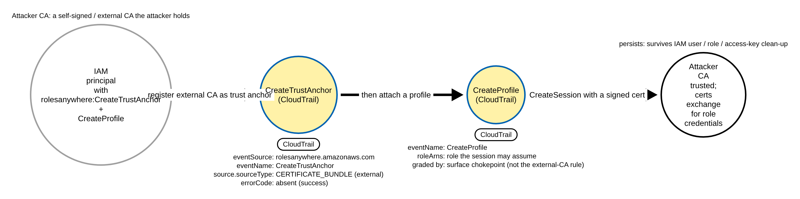
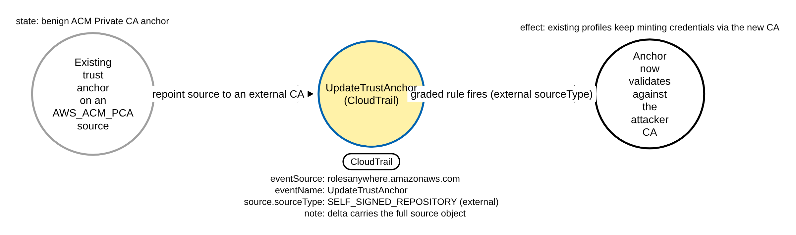
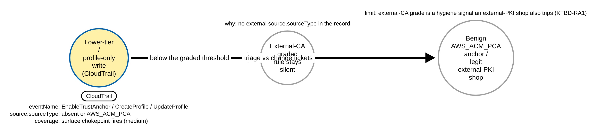

# IAM Roles Anywhere External-CA Trust Anchor (AWS)

> Prose uses Simplified Technical English (ASD-STE100) where practical.
> AWS service names, API names, CloudTrail field names, and ATT&CK IDs are
> technical names.

## Metadata

| Key          | Value |
|--------------|-------|
| ID           | TRR9037 |
| External IDs | T1098.001, T1199 |
| Tactics      | Persistence, Privilege Escalation |
| Platforms    | AWS |
| Contributors | det-eng |
| Status       | draft |

### Scope Statement

This TRR covers **IAM Roles Anywhere trust-anchor abuse**: an adversary with the IAM
permission `rolesanywhere:CreateTrustAnchor` (or `UpdateTrustAnchor`), and optionally
`rolesanywhere:CreateProfile`, registers a certificate authority **they control** as a
trusted root of an AWS account's IAM Roles Anywhere configuration. Any X.509 **client
certificate** that CA signs then exchanges (`rolesanywhere:CreateSession`) for temporary
AWS credentials of whatever role a Roles Anywhere **profile** attaches — standing,
certificate-based persistence that survives IAM user/role and access-key clean-up. ATT&CK
v20 places this under **T1098.001** (Additional Cloud Credentials), with a secondary
mapping to **T1199** (Trusted Relationship) because the external CA is an outside trust
relationship brought into the account.

The chokepoint is the trust-anchor write itself, an **unavoidable, default-logged**
CloudTrail management event (`eventSource` `rolesanywhere.amazonaws.com`; CloudTrail
management events are on by default, so no logging change is needed). This is a **cloud**
TRR, proven by committed CloudTrail fixtures through
[`detections/validate_cloud_detections.py`](../../../detections/validate_cloud_detections.py),
and it sits alongside (it does not touch) the OIDC-federation rules already filed under
T1098.001 — TRR9013 (Entra FIC), TRR9015 (GitHub-OIDC role trust), TRR9018 (GCP WIF). It
is the **X.509 certificate-federation** sibling of those OIDC-federation TRRs, on the
`rolesanywhere.amazonaws.com` `eventSource` that TRR9015's scope statement explicitly
carves out.

The detectable contribution is the **external CA**: the `source.sourceType` of the trust
anchor. An internal **ACM Private CA** anchor (`AWS_ACM_PCA`) is the common, benign
platform-admin form; a caller-supplied **certificate bundle** (`CERTIFICATE_BUNDLE`) or a
**self-signed repository** (`SELF_SIGNED_REPOSITORY`) is an external CA the account owner
did not necessarily issue. Whether the external CA is authorised is a policy-hygiene
question a legitimate external-PKI shop also raises (triage against change tickets, as with
TRR9015's `repo:org/*`); the rule flags the external source type and leaves that triage to
the responder (`detections/RULE_DEFECTS.md` **KTBD-RA1**).

## Technique Overview

**IAM Roles Anywhere** lets a workload **outside** AWS (an on-premises server, another
cloud) obtain temporary AWS credentials by presenting an X.509 client certificate instead
of an AWS access key. The account owner configures two objects:

- a **trust anchor** — the CA (or set of CAs) whose client certificates the account
  trusts. The `source` names the CA: an **ACM Private CA** (`AWS_ACM_PCA`, by
  `source.sourceData.acmPcaArn`) or an **external** CA supplied as a PEM
  (`CERTIFICATE_BUNDLE` / `SELF_SIGNED_REPOSITORY`, by
  `source.sourceData.x509CertificateData`);
- a **profile** — the IAM role(s) a session may assume (`roleArns`) and an optional
  session policy and duration.

A client with a certificate the trust anchor's CA signed calls
`rolesanywhere:CreateSession` and receives temporary credentials for a role the profile
allows. An adversary who holds the IAM permission `rolesanywhere:CreateTrustAnchor` (and
`CreateProfile`) — but **no** standing AWS credential that survives a clean-up — can turn
this into persistence and privilege escalation: register a CA **they** control as a trust
anchor, attach a profile naming a privileged role, and from then on **mint** that role's
credentials at will from any certificate their CA signs. The grant is config-plane only;
it survives IAM user, role and access-key rotation because nothing about those identities
changed. This is the AWS-native analogue of a federated-identity-credential backdoor
(TRR9013/9015/9018), but over **certificate** federation rather than OIDC.

## Technical Background

### What the write looks like in CloudTrail

The trust-anchor and profile writes are default-logged Roles Anywhere management events
(`eventSource` `rolesanywhere.amazonaws.com`, `eventType` `AwsApiCall`, `managementEvent`
`true`). Field casing is load-bearing — CloudTrail normalises `requestParameters` to
**lowerCamelCase** even though the API model is PascalCase:

- **`CreateTrustAnchor`**: `requestParameters.name` is the anchor name,
  `requestParameters.enabled` is the boolean, and `requestParameters.source` is the CA:
  - `requestParameters.source.sourceType` — the enum
    `AWS_ACM_PCA` | `CERTIFICATE_BUNDLE` | `SELF_SIGNED_REPOSITORY`;
  - `requestParameters.source.sourceData.acmPcaArn` — for `AWS_ACM_PCA`;
  - `requestParameters.source.sourceData.x509CertificateData` — the PEM, for the external
    types.
  `responseElements.trustAnchor` echoes `trustAnchorId`, `trustAnchorArn`, `name`,
  `enabled` and `source.sourceType`.
- **`UpdateTrustAnchor`**: carries `requestParameters.trustAnchorId` and the **full**
  `requestParameters.source` object when the source is changed (so a repoint to an external
  CA records `source.sourceType`); an update that edits only `enabled` or
  `notificationSettings` carries **no** `source`.
- **`CreateProfile` / `UpdateProfile`**: `requestParameters.name`,
  `requestParameters.roleArns` (the roles a session may assume), `durationSeconds`,
  `enabled`. A profile write carries no CA `source`.
- A **denied** call carries `errorCode` (for example `AccessDeniedException`) and no
  `responseElements`.

> **Field-casing assumption (unverified against primary docs).** The lowerCamelCase paths
> (`requestParameters.source.sourceType`, `source.sourceData.x509CertificateData`,
> `source.sourceData.acmPcaArn`) are taken from the **botocore / AWS CLI** `rolesanywhere`
> model and the **Elastic** prebuilt rule, because the primary AWS documentation hosts
> (`docs.aws.amazon.com`, `botocore.readthedocs.io`, `docs.amazonaws.cn`) and the Elastic
> and detection.fyi hosts were **unreachable** from the build environment at build time.
> CloudTrail normalises `requestParameters` to lowerCamelCase regardless of the PascalCase
> API model, so the lowerCamel paths are the expected shape, but the exact JSON **nesting**
> of a real `CreateTrustAnchor` record was not confirmed against a captured event. This is
> tracked in [`detections/RULE_DEFECTS.md`](../../../detections/RULE_DEFECTS.md)
> **KTBD-RA2**; confirm against a captured CloudTrail record before production use, and if the
> record flattens the source differently, the rule field path must be updated.

### Why `source.sourceType` is the discriminator, and why it is sound

`source.sourceType` is a closed, server-recorded **API enum** — the API server sets it
from the request body, not from renamable caller free text, so it is **not spoofable to
evade**: an attacker who wants an external CA must record one of the two external values.
The three values split cleanly:

| `source.sourceType` | CA | `sourceData` key | Benign-common? | Graded rule |
|---------------------|----|------------------|----------------|-------------|
| `AWS_ACM_PCA` | AWS ACM Private CA | `acmPcaArn` | yes (platform admin) | **silent** |
| `CERTIFICATE_BUNDLE` | caller-supplied PEM bundle | `x509CertificateData` | rare | **fires** |
| `SELF_SIGNED_REPOSITORY` | self-signed external repository | `x509CertificateData` | rare | **fires** |

A benign anchor on an ACM Private CA differs from an attacker's own-CA anchor in exactly
this one field. That is why the graded rule's hard benign (`benign.json`) is the **same**
`CreateTrustAnchor` call differing **only** on `source.sourceType` (`AWS_ACM_PCA` with
`sourceData.acmPcaArn` instead of `CERTIFICATE_BUNDLE` with `sourceData.x509CertificateData`).

### Residual: `UpdateTrustAnchor` deltas, and the external-PKI-shop false positive

- A delta-style `UpdateTrustAnchor` that **changes** the source to an external CA records
  `source.sourceType` with the external value and **still fires** the graded rule. An
  `UpdateTrustAnchor` that edits only `enabled`/`notificationSettings` carries no `source`
  and correctly does **not** fire (no CA change was made) — only the surface chokepoint
  sees it.
- The external-CA grade is a **policy-hygiene** signal: an organisation that legitimately
  runs its own corporate or on-premises PKI (rather than ACM Private CA) trips it on every
  legitimate anchor. It is a finding to **triage against change tickets and the IAM
  principal** (`userIdentity.arn`), not a certain compromise — the same stance TRR9015
  takes on an org-wide `repo:org/*` grant. Tracked as **KTBD-RA1**.

## Procedures

| Procedure | ID | Name | Entry point |
|-----------|----|------|-------------|
| A | TRR9037.AWS.A | External-CA trust anchor | `CreateTrustAnchor` CERTIFICATE_BUNDLE + `CreateProfile` |
| B | TRR9037.AWS.B | Repoint an existing anchor to an external CA | `UpdateTrustAnchor` to SELF_SIGNED_REPOSITORY |
| C | TRR9037.AWS.C | Grading boundary and residual | profile-only / Enable / ACM-PCA writes caught only by the chokepoint |

> A tool is not a procedure. `aws-cli`, boto3, Terraform and Stratus Red Team all send the
> same `CreateTrustAnchor` call; they are the same procedure.

**Reading the DDMs.** Blue borders with a shaded fill are the CloudTrail chokepoint — the
primary detection opportunity; the pill names the telemetry and the `Key: value` lines are
what a rule matches. Black borders are the abstract effect. Grey borders are out-of-scope,
a coverage boundary, or a gap the rules do not match. (There is no green "unlogged theft"
node: the backdoor is not a stolen credential; its config writes are logged in CloudTrail —
what later credential minting looks like depends on CloudTrail data events, out of scope.)

### Procedure A: External-CA trust anchor  (`TRR9037.AWS.A`)

The adversary registers a CA they control as a Roles Anywhere trust anchor and attaches a
profile naming a role they want (Stratus `aws.persistence.rolesanywhere-create-trust-anchor`).

- **Prerequisites:** `rolesanywhere:CreateTrustAnchor` and `rolesanywhere:CreateProfile`.
- **Mechanics:** `CreateTrustAnchor` with `source.sourceType` `CERTIFICATE_BUNDLE` and the
  attacker's CA PEM in `source.sourceData.x509CertificateData`; then `CreateProfile` with
  `roleArns` naming the target role. Both are CloudTrail management events.
- **Impact:** any certificate the attacker's CA signs exchanges for the role's temporary
  credentials; the grant survives IAM identity and key rotation.
- **Tools on this path:** any AWS client (aws-cli, boto3, Terraform, Stratus).

#### Detection Data Model — `TRR9037.AWS.A`

Source: [`ddms/trr9037_aws_a.json`](ddms/trr9037_aws_a.json) (Arrows app format).

**DDM summary.** The first shaded node is the `CreateTrustAnchor` CloudTrail event
(`eventSource` `rolesanywhere.amazonaws.com`, `source.sourceType` `CERTIFICATE_BUNDLE`, no
`errorCode`) — the graded rule's signal; the second shaded node is the `CreateProfile`
write that the surface chokepoint also catches. The black node is the standing
certificate-based persistence.

### Procedure B: Repoint an existing anchor to an external CA  (`TRR9037.AWS.B`)

Rather than create a new anchor, the adversary **repoints** an existing (benign) anchor's
source to a CA they control with `UpdateTrustAnchor` — a quieter change that reuses the
account's existing profiles.

- **Prerequisites:** `rolesanywhere:UpdateTrustAnchor` on an existing anchor.
- **Mechanics:** `UpdateTrustAnchor` with `source.sourceType` `SELF_SIGNED_REPOSITORY` (the
  second external value); the delta carries the full `source` object, so `source.sourceType`
  is recorded.
- **Impact:** existing profiles keep minting credentials, now validated against the
  attacker's CA — no new profile is needed.
- **Coverage:** the graded rule covers `UpdateTrustAnchor` as well as `CreateTrustAnchor`,
  so this fires the graded rule; a create-only rule (Elastic's) misses it.

#### Detection Data Model — `TRR9037.AWS.B`

Source: [`ddms/trr9037_aws_b.json`](ddms/trr9037_aws_b.json) (Arrows app format).

**DDM summary.** The grey node is the pre-existing ACM-PCA anchor; the shaded node is the
`UpdateTrustAnchor` repoint (`source.sourceType` `SELF_SIGNED_REPOSITORY`, delta still
carrying the source object); the black node is the anchor now validating against the
attacker CA.

### Procedure C: Grading boundary and residual  (`TRR9037.AWS.C`)

Writes that are real Roles Anywhere configuration changes but are **below** the graded
rule's threshold by design, and the external-PKI-shop false positive.

- **Mechanics:** `EnableTrustAnchor` (re-enable a disabled anchor), `CreateProfile` /
  `UpdateProfile` / `EnableProfile` (profile-only writes, no CA source), or a trust-anchor
  write that keeps an `AWS_ACM_PCA` source.
- **Coverage:** the **surface chokepoint** (`aws_rolesanywhere_trust_anchor_write.yml`)
  fires on all of them (any trust-anchor/profile write); the **graded** rule does not —
  there is no external `source.sourceType` in the record. This is the discriminator that
  separates the high-fidelity rule from the surface one.
- **False positive (KTBD-RA1):** a legitimate external-PKI shop's `CERTIFICATE_BUNDLE` /
  `SELF_SIGNED_REPOSITORY` anchor fires the graded rule; triage against change tickets and
  the managing IAM principal.

#### Detection Data Model — `TRR9037.AWS.C`

Source: [`ddms/trr9037_aws_c.json`](ddms/trr9037_aws_c.json) (Arrows app format).

**DDM summary.** The shaded node is a lower-tier / profile-only write that the surface
chokepoint fires on (medium); the first grey node is the graded rule correctly staying
silent (no external source type in the record); the second grey node is the benign
AWS_ACM_PCA anchor and the legitimate external-PKI shop (the KTBD-RA1 hygiene limit).

## Detection Strategy

Two rules, graded by fidelity.

**Strategy 1 — external-CA trust anchor (high).**
[`aws_rolesanywhere_trust_anchor_external_ca.yml`](../../../detections/sigma/T1098.001/aws_rolesanywhere_trust_anchor_external_ca.yml)
fires on `CreateTrustAnchor` / `UpdateTrustAnchor` whose `requestParameters.source.sourceType`
is `CERTIFICATE_BUNDLE` or `SELF_SIGNED_REPOSITORY` (an external CA), with no `errorCode`.
The discriminator (`source.sourceType`) is outside the surface-field set, so **no waiver**
is needed. The `errorCode` negation is null-safe (`(sel_no_error_code or not filter_failed)`)
because CloudTrail writes `errorCode` only on an error. This covers Procedures A and B.

**Strategy 2 — surface chokepoint (medium).**
[`aws_rolesanywhere_trust_anchor_write.yml`](../../../detections/sigma/T1098.001/aws_rolesanywhere_trust_anchor_write.yml)
fires on **any** trust-anchor or profile write (`CreateTrustAnchor`, `UpdateTrustAnchor`,
`EnableTrustAnchor`, `CreateProfile`, `UpdateProfile`, `EnableProfile`), no `errorCode`. It
is pure-surface — it keys only on the record kind — so it carries a **human-approved**
`CHOKEPOINT` waiver in
[`detections/check_sufficiency.py`](../../../detections/check_sufficiency.py) (proposed in
the pull request) and must be baselined by the IAM principals that manage Roles Anywhere.
It covers Procedure C and backstops A and B.

**Prior art (named, differentiated).** This behaviour is **not** novel; the open-Sigma
counterpart and a repo atomic are the new ground:

- **Elastic** ships *AWS IAM Roles Anywhere Trust Anchor Created with External CA*
  (`CreateTrustAnchor` whose source type is not `AWS_ACM_PCA`; tagged T1098.003 + T1556,
  **create-only**). This TRR's graded rule differs by also covering the
  **`UpdateTrustAnchor` repoint** leg (Procedure B) that a create-only rule misses, and by
  mapping T1098.001 + T1199.
- **Amazon GuardDuty**'s opt-in Optional/Custom Detection Rules ship a prebuilt
  `Persistence:RolesAnywhere/AccountManipulation` finding on the bare signal
  `RolesAnywhereTrustAnchorCreated` (any create, **no external-CA grade**) — so this is a
  **provider-agnostic backstop** that grades external-CA **above** that bare-create signal,
  not a native gap.
- **Datadog** Cloud SIEM ships `def-000-bf8` (trust anchor created). **ManageEngine** ships
  a log-report equivalent.
- **Stratus Red Team** emulates `aws.persistence.rolesanywhere-create-trust-anchor`.
- **SigmaHQ**, **Splunk ESCU**, **Falco** and **Panther** ship **none**, and Atomic Red
  Team has no atomic — so the open-Sigma rule pair and the repo atomic here are the net-new
  ground (as TRR9026/9033/9036). Never "first" or "only": GuardDuty, Elastic and Datadog
  all cover the create.

**Coverage summary.**

| Procedure | Covered by | How |
|-----------|-----------|-----|
| A | Strategy 1 (+ Strategy 2) | `CreateTrustAnchor` external source type |
| B | Strategy 1 (+ Strategy 2) | `UpdateTrustAnchor` repoint to an external source type |
| C | Strategy 2 only (by design) | profile-only / Enable / ACM-PCA writes are below the graded threshold |

## Available Emulation Tests

Cloud attacks have no free live target, so the emulation has two halves. The runnable half
is an Atomic-Red-Team-style test
([`atomics/T1098.001/src/emulate_rolesanywhere.sh`](../../../atomics/T1098.001/src/emulate_rolesanywhere.sh),
wrapped in [`atomics/T1098.001/T1098.001.yaml`](../../../atomics/T1098.001/T1098.001.yaml))
that makes the real `CreateTrustAnchor` + `CreateProfile` writes in **your own AWS account**
against **disposable** resources and reverts them at once; it is gated by `TRR9037_LIVE=1`
and is **not run in CI**. It does not disturb the TRR9013/TRR9015/TRR9018 scripts in the
same directory. The proven half is a set of committed, schema-faithful CloudTrail fixtures
([`detections/cloud/fixtures/trr9037/`](../../../detections/cloud/fixtures/trr9037/)) that
the CI validator runs the rules over. Every object is named `trr9037-*`, source IPs are
RFC 5737 TEST-NET addresses, and the account is the AWS documentation account `123456789012`.

| Procedure | Test | Status |
|-----------|------|--------|
| TRR9037.AWS.A | `emulate_rolesanywhere.sh a` — `CreateTrustAnchor` CERTIFICATE_BUNDLE + `CreateProfile` (fixture: attack record pair, both rules fire). | **built** |
| TRR9037.AWS.B | `emulate_rolesanywhere.sh b` — external source type SELF_SIGNED_REPOSITORY; the `UpdateTrustAnchor` repoint is proven by the graded rule's sidecar positive. | **built** |
| TRR9037.AWS.C | documented — profile-only / Enable / ACM-PCA writes in the benign baselines (graded rule silent, chokepoint fires on writes). | backlog |

## Detections

| Strategy | Covers | Sigma rule | Sensor |
|----------|--------|------------|--------|
| 1 (graded) | A, B | [`detections/sigma/T1098.001/aws_rolesanywhere_trust_anchor_external_ca.yml`](../../../detections/sigma/T1098.001/aws_rolesanywhere_trust_anchor_external_ca.yml) | CloudTrail |
| 2 (chokepoint) | C (+ backstop A, B) | [`detections/sigma/T1098.001/aws_rolesanywhere_trust_anchor_write.yml`](../../../detections/sigma/T1098.001/aws_rolesanywhere_trust_anchor_write.yml) | CloudTrail |

The validator
[`detections/validate_cloud_detections.py`](../../../detections/validate_cloud_detections.py)
runs each rule over the recorded attack fixture (it must fire, and the match must carry the
`trr9037` marker) and over a benign baseline (it must fire on nothing). The graded rule's
baseline (`benign.json`) is **hard**: the **same** `CreateTrustAnchor` call differing only
on the discriminator — `source.sourceType` `AWS_ACM_PCA` with `sourceData.acmPcaArn`
instead of the external bundle. The chokepoint rule's baseline (`benign_chokepoint.json`) is
Roles Anywhere **read** calls on the same `eventSource` (the two rules cannot share one
baseline, because the chokepoint fires on every write — including the benign ACM-PCA create
in `benign.json`, which is expected). A pass proves the graded rule keys on the external CA,
not on the fixture's shape or marker.

> **Benign-budget limitation (untested by absence).** Both rules carry the default benign
> budget of **0** on the scored AWS CloudTrail corpus
> ([`detections/benign/`](../../../detections/benign/)). That 0 is *untested by absence*,
> not precision-proven: the four committed AWS slices (`aws-cicd-oidc-irsa`,
> `aws-developer-iam-user-keys`, `aws-ec2-service-roles`, `aws-iac-admin-policy-changes`)
> contain **no** Roles Anywhere trust-anchor/profile traffic, so both rules score 0 by the
> absence of representative activity, not by proven precision. The chokepoint fires on
> **every** Roles Anywhere write by design, and the graded rule fires on a legitimate
> external-PKI shop's anchor (KTBD-RA1). A realistic Roles Anywhere benign slice (IaC / console
> operators, ACM-PCA anchors, profile edits) would measure the real precision; adding one is
> a **human decision** (a benign-corpus change), so it is reported here, not added.
> Baseline the IAM principals that manage Roles Anywhere (`userIdentity.arn`).

## References

- MITRE ATT&CK, T1098.001 Account Manipulation: Additional Cloud Credentials:
  <https://attack.mitre.org/techniques/T1098/001/>
- MITRE ATT&CK, T1199 Trusted Relationship:
  <https://attack.mitre.org/techniques/T1199/>
- AWS, IAM Roles Anywhere `Source` API reference (`sourceType` / `sourceData`):
  <https://docs.aws.amazon.com/rolesanywhere/latest/APIReference/API_Source.html>
- AWS, Logging IAM Roles Anywhere API calls with AWS CloudTrail:
  <https://docs.aws.amazon.com/rolesanywhere/latest/userguide/logging-using-cloudtrail.html>
- Elastic, AWS IAM Roles Anywhere Trust Anchor Created with External CA (prior art,
  create-only):
  <https://github.com/elastic/detection-rules/blob/main/rules/integrations/aws/persistence_iam_roles_anywhere_trusted_anchor_created_with_external_ca.toml>
- Datadog Security, `def-000-bf8` AWS IAM Roles Anywhere trust anchor created:
  <https://docs.datadoghq.com/security/default_rules/def-000-bf8>
- Stratus Red Team, `aws.persistence.rolesanywhere-create-trust-anchor`:
  <https://stratus-red-team.cloud/attack-techniques/AWS/aws.persistence.rolesanywhere-create-trust-anchor/>
- **Field-casing note:** the lowerCamelCase `requestParameters.source.*` paths were taken
  from the botocore/AWS CLI `rolesanywhere` model and the Elastic rule above, because the
  AWS documentation hosts (`docs.aws.amazon.com`, `botocore.readthedocs.io`) were
  unreachable from the build environment at build time; the assumption is tracked in
  [`detections/RULE_DEFECTS.md`](../../../detections/RULE_DEFECTS.md) **KTBD-RA2**.
- TRR method:
  <https://github.com/tired-labs/techniques/blob/main/docs/TECHNIQUE-RESEARCH-REPORT.md>
