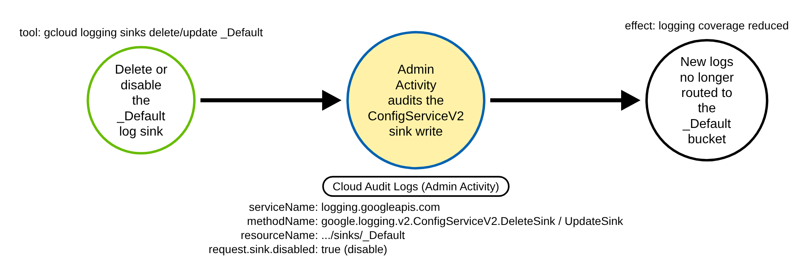
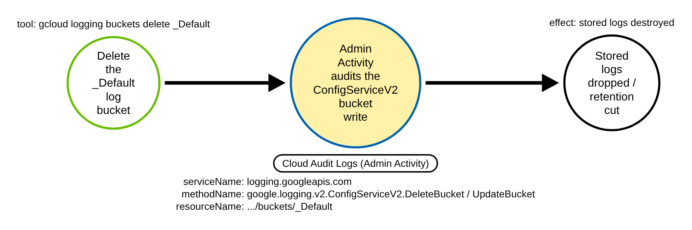
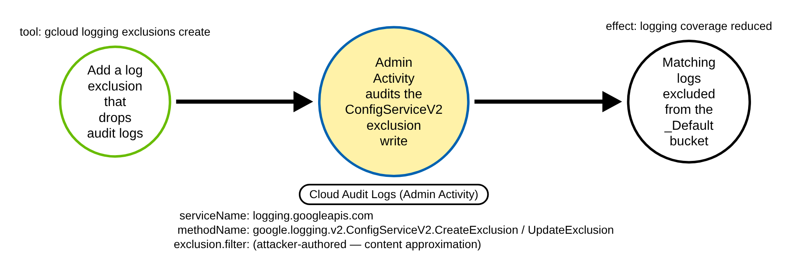

# GCP Cloud Logging Sink, Bucket and Exclusion Tamper (GCP)

> Prose uses Simplified Technical English (ASD-STE100) where practical.
> GCP service names, API method names, Cloud Audit Log field names, and ATT&CK IDs
> are technical names.

## Metadata

| Key          | Value |
|--------------|-------|
| ID           | TRR9038 |
| External IDs | T1562.008 |
| Tactics      | Defense Evasion |
| Platforms    | GCP |
| Contributors | det-eng |
| Status       | draft |

### Scope Statement

This TRR covers an adversary who disrupts **GCP Cloud Logging** so that later
activity is not recorded: deleting, disabling or re-diverting the project's
**`_Default` log sink**, deleting a **log bucket**, or adding/broadening a **log
exclusion** that drops audit logs (ATT&CK **T1562.008**, Impair Defenses: Disable
or Modify Cloud Logs). Its contribution is a **single chokepoint** at the Cloud
Logging configuration write that unifies these shapes in one rule, on the always-on
Admin Activity audit log.

This is the first GCP **defense-evasion** TRR here; the built GCP set (TRR9014
public IAM grant, TRR9018 Workload Identity Federation, TRR9020 Workforce
Federation) is persistence/privilege-escalation and does not touch the Logging
control plane.

**Out of scope / not this chokepoint:** the `_Required` sink and bucket, which are
**LOCKED** and cannot be disabled or deleted (so they are never a target); disabling
Data Access logs in an IAM audit-config change (`SetIamPolicy` with
`auditConfigs`, a different chokepoint); and the public *read* of data after a
grant, which is a different technique (TRR9014).

## Technique Overview

Every GCP project has a built-in `_Default` log sink that routes most logs to the
`_Default` log bucket, and a `_Required` sink/bucket that captures Admin Activity,
System Event and Access Transparency logs. The `_Required` pair is locked: it cannot
be disabled, modified or deleted, and it has a fixed 400-day retention. The
`_Default` sink and bucket, and any custom sinks/buckets, **can** be changed.

An adversary who can write the Logging configuration can quietly cut what is
recorded without touching a single workload:

- **Delete or disable the `_Default` sink**, or re-point its destination, so new
  logs no longer reach the `_Default` bucket.
- **Delete the `_Default` log bucket** (or cut its retention with `UpdateBucket`),
  destroying stored logs.
- **Add a project-level log exclusion** whose filter matches the audit-log stream,
  so matching entries are dropped before they are stored.

Each of these is a single control-plane call that reduces visibility for everything
that follows.

## Technical Background

### The configuration write is always recorded

All of these operations are `ConfigServiceV2` writes on
`serviceName` **`logging.googleapis.com`**, recorded as **`ADMIN_WRITE`** entries in
the **Admin Activity** Cloud Audit Log. Admin Activity is on by default, cannot be
turned off, and is itself routed to the locked `_Required` bucket — so the tamper of
the `_Default` route is **always** captured. That is the detection's strength: the
act of disabling logging is logged where the attacker cannot reach it.

The server-set, non-spoofable fields the chokepoint keys on:

- `protoPayload.serviceName` = `logging.googleapis.com`.
- `protoPayload.methodName` — a `ConfigServiceV2` write:
  `DeleteSink` / `UpdateSink` / `UpdateBucket` / `DeleteBucket` /
  `CreateExclusion` / `UpdateExclusion` / `DeleteExclusion`.
- `protoPayload.resourceName` — the reserved audit path `.../sinks/_Default` or
  `.../buckets/_Default` for the sink/bucket branch.
- `protoPayload.request.sink.disabled` `true` for the disable branch.

### The discriminator vs. benign lifecycle operations

A healthy project constantly creates and edits **custom** sinks and buckets:
`CreateSink` of a new BigQuery/GCS analytics export, `UpdateSink` keeping a custom
sink's destination, decommissioning a custom sink. The discriminator that separates
a tamper from this benign lifecycle is **not** the method; it is:

1. the **`_Default` scope** (`resourceName`) for a sink/bucket delete-or-modify, or
2. the **`disabled` flag** on an `UpdateSink` (disabling *any* export route).

So the chokepoint fires on a sink/bucket write **only when it targets the reserved
`_Default` path**, on an `UpdateSink` that sets `request.sink.disabled` true, or on
any exclusion write. `CreateSink` is never a target (creating a new sink adds a
route, it does not remove one), and `UpdateSink`/`DeleteSink` of a **custom** sink is
the hard-benign baseline.

### Casing and field-shape assumption (unverified against primary docs)

Google's audit-method reference (`docs.cloud.google.com`) was **unreachable** from
the build environment, so the exact `methodName` casing
(`google.logging.v2.ConfigServiceV2.DeleteSink`) and the location of the `disabled`
flag in the request body (`request.sink.disabled`) could not be re-verified against
Google's primary documentation. The casing was taken from Elastic's published GCP
Logging Sink rules. To be robust to both the **API version** and the **casing**, the
rule matches `methodName` with a case-insensitive, version-tolerant regex
(`google\.logging\.v*\.ConfigServiceV*\.<Method>`, `|re|i`). The `disabled`-flag
branch is a bonus leg: even if its field path is wrong, disabling the `_Default` sink
via `UpdateSink` still fires through the `_Default`-scope branch. See
[`detections/RULE_DEFECTS.md`](../../../detections/RULE_DEFECTS.md) (the KTBD-GL2
entry renumbered at integration).

### Provider-native coverage (apparent gap)

No GCP Security Command Center / Event Threat Detection finding for a logging
sink/bucket/exclusion tamper was found at vet time (published ETD Defense-Evasion
findings are "Project HTTP Policy Block Disabled", "GCS Bucket IP Filtering
Modified", "Modify VPC Service Controls" — none for Logging config). This is
**UNVERIFIED** (the SCC/ETD docs host was unreachable) and is the key difference from
the AWS CloudTrail logging-tamper case, where GuardDuty's
`Stealth:IAMUser/CloudTrailLoggingDisabled` covers it natively. If a native GCP
finding exists, this rule is a provider-agnostic backstop; if not, it fills a gap.

## Procedures

| Procedure | ID | Name | Entry point |
|-----------|----|------|-------------|
| A | TRR9038.GCP.A | Delete / disable / re-divert the `_Default` sink | `ConfigServiceV2.DeleteSink` / `UpdateSink` on `.../sinks/_Default` |
| B | TRR9038.GCP.B | Delete a log bucket (or cut retention) | `ConfigServiceV2.DeleteBucket` / `UpdateBucket` on `.../buckets/_Default` |
| C | TRR9038.GCP.C | Add / broaden an audit-dropping exclusion | `ConfigServiceV2.CreateExclusion` / `UpdateExclusion` / `DeleteExclusion` |

> A tool is not a procedure. `gcloud logging sinks delete/update`,
> `gcloud logging buckets delete`, the REST `ConfigServiceV2` API, Terraform
> `google_logging_project_sink` / `google_logging_project_exclusion`, and the Console
> all write the same Logging configuration. They are the same procedure.

**Reading the DDMs.** Green borders are operations the attacker performs. Blue
borders (shaded yellow) are the Cloud Audit Log chokepoint a rule matches. Black
borders are the abstract effect.

### Procedure A: Delete / disable / re-divert the `_Default` sink  (`TRR9038.GCP.A`)

The adversary deletes the `_Default` sink, sets it `disabled`, or re-points its
destination, so new logs stop flowing to the `_Default` bucket.

- **Prerequisites:** `logging.sinks.update` / `logging.sinks.delete` on the project.
- **Mechanics:** Admin Activity log; `methodName`
  `google.logging.v2.ConfigServiceV2.DeleteSink` or `UpdateSink`; `resourceName`
  `projects/
/sinks/_Default`; for a disable, `request.sink.disabled` `true`.
- **Impact:** new logs are no longer routed to the `_Default` bucket.

#### Detection Data Model — `TRR9038.GCP.A`

Source: [`ddms/trr9038_gcp_a.json`](ddms/trr9038_gcp_a.json) (Arrows app format).

**DDM summary.** The shaded node is the Admin Activity `ConfigServiceV2` sink write
targeting `.../sinks/_Default` — the chokepoint for A.

### Procedure B: Delete a log bucket (or cut retention)  (`TRR9038.GCP.B`)

The adversary deletes the `_Default` log bucket, or shortens its retention with
`UpdateBucket`, destroying stored logs.

- **Prerequisites:** `logging.buckets.delete` / `logging.buckets.update`.
- **Mechanics:** Admin Activity log; `methodName`
  `google.logging.v2.ConfigServiceV2.DeleteBucket` or `UpdateBucket`; `resourceName`
  `projects/
/locations/<loc>/buckets/_Default`.
- **Impact:** stored logs are dropped or their retention is cut.

#### Detection Data Model — `TRR9038.GCP.B`

Source: [`ddms/trr9038_gcp_b.json`](ddms/trr9038_gcp_b.json) (Arrows app format).

**DDM summary.** The same chokepoint on the bucket path (`.../buckets/_Default`).

### Procedure C: Add / broaden an audit-dropping exclusion  (`TRR9038.GCP.C`)

The adversary adds a project-level log exclusion whose filter matches the audit-log
stream, so matching entries are dropped before they reach the `_Default` bucket.

- **Prerequisites:** `logging.exclusions.create` / `logging.exclusions.update`.
- **Mechanics:** Admin Activity log; `methodName`
  `google.logging.v2.ConfigServiceV2.CreateExclusion` / `UpdateExclusion` /
  `DeleteExclusion`.
- **Impact:** matching logs (here, the audit-log stream) are excluded from storage.

#### Detection Data Model — `TRR9038.GCP.C`

Source: [`ddms/trr9038_gcp_c.json`](ddms/trr9038_gcp_c.json) (Arrows app format).

**DDM summary.** The shaded node is the exclusion write. The exclusion **filter** is
attacker-authored, so one record cannot weigh whether it is over-broad or which logs
it drops — the exclusion/bucket branch is a filter-content approximation (KTBD-GL1
below), not a precise grade.

## Detection Strategy

**Telemetry requirement.** Cloud Audit Logs **Admin Activity** (on by default, free).
No Data Access log is needed.

**Strategy 1 — chokepoint (covers A, B, C).**
Match Admin Activity events with `serviceName` `logging.googleapis.com` and a
`ConfigServiceV2` write, where either (A/B) a sink/bucket delete-or-modify targets
`.../sinks/_Default` or `.../buckets/_Default`, or (A) an `UpdateSink` sets
`request.sink.disabled` true, or (C) it is any exclusion write; and the call did not
error (`protoPayload.status.code` absent). A lifecycle op on a CUSTOM sink/bucket does
not match the `_Default`-target leg (it may still match the disable leg).

**Coverage assumptions and known limits.** The `_Default` scope is a server-set,
non-spoofable discriminator, but it is not by itself a clean attack/benign separator:

- A benign `UpdateSink` that only edits the `_Default` sink's own inclusion filter or
  description (GCP's documented cost-control knob; re-emitted by a logging-as-code
  reconcile each run) also fires branch A — it targets `.../sinks/_Default`, carries no
  error and is not a disable. One record cannot tell it from a malicious re-divert or
  filter-narrowing of `_Default`; firing is defensible (narrowing the `_Default` filter
  is itself a tamper) but it is a documented false positive — see
  [`RULE_DEFECTS.md` KTBD-GL3](../../../detections/RULE_DEFECTS.md).
- The delete-or-re-divert leg **assumes audit logs flow via `_Default`**. A `DeleteSink`
  or destination re-divert of a CUSTOM aggregated audit-export sink (the GCP-CIS
  pattern) is covered only if it uses the `disabled` flag (branch B); otherwise it is a
  miss. Blanket-firing on custom-sink deletes would reintroduce the benign
  custom-sink-decommission false positive, so the gap stays documented — see
  [`RULE_DEFECTS.md` KTBD-GL4](../../../detections/RULE_DEFECTS.md).

- Sensor: Cloud Audit Logs (Admin Activity).
- Rule: [`detections/sigma/T1562.008/gcp_logging_sink_tampered.yml`](../../../detections/sigma/T1562.008/gcp_logging_sink_tampered.yml) (built).

**Coverage summary.**

| Procedure | Covered by | How |
|-----------|-----------|-----|
| A | Strategy 1 | `DeleteSink`/`UpdateSink` on `.../sinks/_Default`, or `UpdateSink` + `request.sink.disabled` true |
| B | Strategy 1 | `DeleteBucket`/`UpdateBucket` on `.../buckets/_Default` |
| C | Strategy 1 | `CreateExclusion`/`UpdateExclusion`/`DeleteExclusion` (filter content is an approximation) |

### Prior art and differentiation

This is a **differentiated, not novel** detection; the behaviour is covered by
several vendors, and this rule is a provider-agnostic Sigma counterpart that adds the
exclusion leg and the forced-`_Default` fidelity branch.

- **Elastic** ships the nearest prior art: **"GCP Logging Sink Deletion"**
  (`defense_evasion_gcp_logging_sink_deletion`, id
  `51859fa0-d86b-4214-bf48-ebb30ed91305`, `DeleteSink`, T1562.008), **"GCP Logging
  Sink Modification"** (`UpdateSink`), and **"GCP Logging Bucket Deletion"** — three
  separate single-method rules.
- **Panther** ships "GCP Log Bucket or Sink Deleted" and "GCP Logging Settings
  Modified"; Cortex XDR has comparable analytics.
- **SigmaHQ** ships **none** for `ConfigServiceV2` (its `rules/cloud/gcp/audit` set
  has no logging-sink rule), and **Stratus Red Team** ships **none** (draft PRs
  only) — so the open-Sigma counterpart and the repo atomic are the new ground, as
  with TRR9026 / TRR9033.
- Never "first" or "only": Elastic and Panther already detect the sink/bucket legs.

Differentiation is honest and bounded: one chokepoint unifying sink delete/disable +
bucket delete + exclusion add/modify, keyed on the server-set `_Default` scope and
the `disabled` flag, with the exclusion content grade disclosed as an approximation.

### Known limitations (tracked in RULE_DEFECTS.md)

- **KTBD-GL1** — the exclusion/filter-content grade is an approximation: one record
  cannot weigh whether an exclusion's filter is over-broad or which logs it drops
  (the attacker authors the filter). The exclusion branch therefore fires on any
  `ConfigServiceV2` exclusion write; a deliberate narrow exclusion that drops only
  noisy non-security logs is a documented false positive, allowlisted by
  `resourceName` / `principalEmail`. The non-spoofable `_Default`-scope check is the
  discriminator the rule keys on.
- **KTBD-GL2** — the `methodName` casing and the `request.sink.disabled` field path
  are assumptions: Google's primary audit-method docs were unreachable at build and
  the casing is taken from Elastic's query. Mitigated by the case- and
  version-tolerant `|re|i` regex and by the `_Default`-scope branch, which catches a
  `_Default` disable independently of the `disabled`-flag path. Re-verify against a
  real Cloud Audit Log record and Google's docs when reachable.

## Available Emulation Tests

The runnable half
([`atomics/T1562.008/src/emulate_gcp_log_sink.sh`](../../../atomics/T1562.008/src/emulate_gcp_log_sink.sh),
wrappers in [`atomics/T1562.008/T1562.008.yaml`](../../../atomics/T1562.008/T1562.008.yaml))
tampers with the Logging config and then **restores** it in **your own throwaway GCP
project**, guarded by `TRR9038_LIVE=1`; it is **not run in CI**. The proven half is
committed Cloud Audit Log fixtures
([`detections/cloud/fixtures/trr9038/`](../../../detections/cloud/fixtures/trr9038/)):
an attack set (DeleteSink + disable UpdateSink of `_Default`, DeleteBucket of
`_Default`, and a CreateExclusion dropping audit logs) and a hard benign baseline
(an `UpdateSink` keeping a custom sink's destination, a `CreateSink` of a new custom
analytics sink, and a `DeleteSink` of a decommissioned custom sink — differing from
the attack only on the `_Default` scope / `disabled` flag / method).

| Procedure | Test | Status |
|-----------|------|--------|
| TRR9038.GCP.A | `emulate_gcp_log_sink.sh a` — disable then re-enable the `_Default` sink. | **built** |
| TRR9038.GCP.B | `emulate_gcp_log_sink.sh b` — delete then undelete a throwaway custom log bucket. | **built** |
| TRR9038.GCP.C | `emulate_gcp_log_sink.sh c` — add then remove an audit-dropping exclusion. | **built** |

## Detections

| Strategy | Covers | Sigma rule | Sensor |
|----------|--------|------------|--------|
| 1 (chokepoint) | A, B, C | [`detections/sigma/T1562.008/gcp_logging_sink_tampered.yml`](../../../detections/sigma/T1562.008/gcp_logging_sink_tampered.yml) | Cloud Audit Logs (Admin Activity) |

The validator
[`detections/validate_cloud_detections.py`](../../../detections/validate_cloud_detections.py)
runs the rule over the attack set (all four records fire, carrying the `trr9038-`
marker in `protoPayload.resourceName`) and the benign baseline (nothing fires). The
benign baseline shares the attack's method/serviceName and differs only on the
discriminating field (the `_Default` scope, the `disabled` flag, or `CreateSink`
rather than a delete), so the pass proves the rule keys on the tamper discriminator
and not on the method or the marker.

## References

- MITRE ATT&CK, T1562.008 Impair Defenses: Disable or Modify Cloud Logs:
  <https://attack.mitre.org/techniques/T1562/008/>
- GCP, Cloud Audit Logs overview (Admin Activity, ADMIN_WRITE):
  <https://cloud.google.com/logging/docs/audit>
- GCP, Configure and manage sinks:
  <https://cloud.google.com/logging/docs/export/configure_export_v2>
- GCP, Routing and storage overview (`_Default` / `_Required` sinks and buckets):
  <https://cloud.google.com/logging/docs/routing/overview>
- GCP, Exclude log entries:
  <https://cloud.google.com/logging/docs/exclusions>
- Elastic, GCP Logging Sink Deletion (nearest prior art, id
  51859fa0-d86b-4214-bf48-ebb30ed91305):
  <https://www.elastic.co/guide/en/security/current/gcp-logging-sink-deletion.html>
- TRR method:
  <https://github.com/tired-labs/techniques/blob/main/docs/TECHNIQUE-RESEARCH-REPORT.md>
