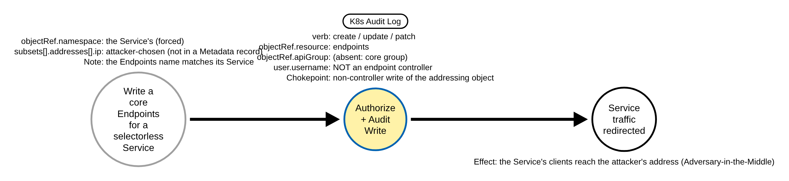
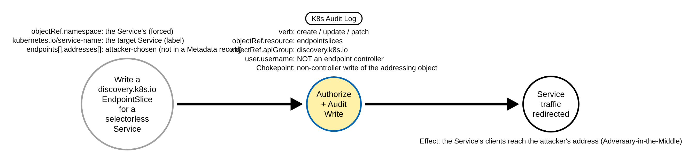

# Service Traffic Hijack Through Endpoints or EndpointSlice Manipulation (Kubernetes)

> Prose uses Simplified Technical English (ASD-STE100) where practical.
> Resource names, field names, namespaces, and ATT&CK IDs are technical names.

## Metadata

| Key          | Value |
|--------------|-------|
| ID           | TRR9039 |
| External IDs | T1557, T1565 |
| Tactics      | Credential Access, Collection, Impact |
| Platforms    | Kubernetes |
| Contributors | det-eng |
| Status       | draft |

### Scope Statement

This TRR covers **redirecting a Kubernetes Service's traffic by writing its backing
addresses**: an adversary with write access to `endpoints` (core) or `endpointslices`
(`discovery.k8s.io`) creates or repoints those objects for a selectorless Service, so the
Service routes to an attacker-chosen IP:port. The attacker can then sniff, relay or alter
the traffic (Adversary-in-the-Middle, T1557) and, because the routed data is changed in
flight, manipulate it (T1565). ATT&CK v20 lists no **Containers** platform on T1557 or
T1565, so this is a cross-domain mapping (as for TRR9025 / TRR9026 / TRR9027).

The write to the addressing object is the chokepoint: an `Endpoints` object's
`subsets[].addresses[].ip`, or an `EndpointSlice`'s `endpoints[].addresses[]`, is the set
of backends `kube-proxy` programs for the Service. Normally only the control plane writes
these objects, so the **actor class** — a write by a principal that is not an endpoint
controller — is the discriminator.

It does **not** cover, by design (each is a stated gap below and in the Detection
Strategy):

- **Grading the written address.** The CVE-2021-25737 node-local / link-local redirect (an
  address in `127.0.0.0/8` or `169.254.0.0/16`, which can reach a node's kubelet or cloud
  metadata) would raise severity, but the address is in the request body, which only a
  Request-level record holds; `endpoints` are among the highest-volume write objects in a
  cluster, so logging their bodies is costly and the shipped policies keep them at
  Metadata. The address grade is a documented gap (RULE_DEFECTS.md **KTBD-EP2**), not
  shipped; the actor-class chokepoint is what ships.
- **Telling a malicious manual write from a legitimate one.** A legitimate manual
  `Endpoints` / `EndpointSlice` write (a selectorless Service pointed at an external
  database, an operator repointing one during a migration) is a non-controller
  create/update/patch of exactly these objects, so on one Metadata record it is
  indistinguishable from the attack minus the attacker-chosen address. The rule is a
  low-fidelity hunting / correlation anchor (RULE_DEFECTS.md **KTBD-EP1**).
- **`spec.externalIPs` exposure or hijack** (CVE-2020-8554) and the exposing `spec.type`
  write (NodePort / LoadBalancer): those are a different chokepoint, TRR9033's
  (`spec.type`) and a separate `spec.externalIPs` field grade. A `ClusterIP` Service can
  be intercepted through `spec.externalIPs` without touching Endpoints, so the
  Endpoints-keyed rule here does not see it.
- **Pods that MITM from inside the data path** (a sidecar, a CNI change, ARP spoofing on
  the node): those leave no API-server write of the addressing object and are out of
  scope.

## Technique Overview

A Kubernetes Service is a stable virtual IP; the data plane (`kube-proxy`, or a CNI such
as Cilium) programs it to load-balance to a set of backend addresses. For a Service **with
a selector**, the control plane keeps that set current: the endpoint controller writes the
Service's `Endpoints`, and the endpointslice controller writes its `EndpointSlices`, from
the Ready pods. For a Service **without a selector**, there is no pod set to track, so an
operator supplies the addresses by hand — a core `Endpoints` with the same name as the
Service, or an `EndpointSlice` labelled `kubernetes.io/service-name=<svc>`.

An adversary with write access to these objects abuses the selectorless path: they point
an existing Service (or a Service they create) at an address they control. Every client
that resolves the Service — in-cluster callers, and anything behind an Ingress that
targets it — then talks to the attacker, who relays (and can alter) the traffic to the
real backend. This is the Kubernetes form of Adversary-in-the-Middle, and it needs no node
access: it is an API write.

## Technical Background

### What the API server records

The API server sets `verb`, `objectRef.resource` (`endpoints` or `endpointslices`),
`objectRef.apiGroup`, `objectRef.namespace`, `objectRef.name` and the caller's
`user.username`. The rule reads only these, so **Metadata level is enough** — it reads no
request body. The repo's lab and recommended audit policies drop only `get`/`list`/`watch`
of `endpoints`/`endpointslices` (noise reduction) and keep every write at the Metadata
catch-all (`detections/k8s/audit-policy-apiserver.yaml`,
`detections/k8s/audit-policy-recommended.yaml`), so no policy change is needed.

`objectRef.apiGroup` is the group discriminator: a core `Endpoints` is in the core group,
which the audit `ObjectReference` serializes with `omitempty`, so `objectRef.apiGroup` is
**absent** on a core Endpoints record; an `EndpointSlice` is in `discovery.k8s.io`, so
`objectRef.apiGroup` is present and equals `discovery.k8s.io`. The rule keys the core
branch on `objectRef.apiGroup` being absent and the discovery branch on it equalling
`discovery.k8s.io`, so a custom resource whose plural happens to be `endpoints` or
`endpointslices` in some other API group does not match.

### Which fields are forced, and which the attacker chooses

- `objectRef.resource`, `objectRef.apiGroup`, `verb` and `user.username` are **set by the
  API server** (`user.username` from the authenticated identity), so they are
  non-spoofable and are what the rule keys on.
- The object **name** and **namespace** are attacker-chosen (the name of a core Endpoints
  must match its Service, but the attacker chooses the Service), and the **written
  address** is entirely the attacker's, so none of these is a filter.
- A write under **impersonation** does not bypass the identity filter: the acting
  controller's own token is in `user.username`, and the impersonated identity goes to
  `impersonatedUser`, so an impersonated endpoints write still carries the caller's own
  username and fires.

### The endpoint controllers (the filtered identities)

Verified against kubernetes v1.36.4. The service-account name is the controller name a
human reads in the RBAC bootstrap policy
(`plugin/pkg/auth/authorizer/rbac/bootstrappolicy/controller_policy.go`, `saRolePrefix`
`system:controller:` + the controller name), used when the controller manager runs with
`--use-service-account-credentials=true` (the kubeadm default, so the kind lab and most
managed clusters):

- `system:serviceaccount:kube-system:endpoint-controller` — writes a selector Service's
  core `Endpoints` (`pkg/controller/endpoint`).
- `system:serviceaccount:kube-system:endpointslice-controller` — writes a selector
  Service's `EndpointSlices` (`pkg/controller/endpointslice`).
- `system:serviceaccount:kube-system:endpointslicemirroring-controller` — mirrors a
  hand-written `Endpoints` into an `EndpointSlice`, so it writes `endpointslices` for a
  selectorless Service (`pkg/controller/endpointslicemirroring`).

When the controller manager runs with `--use-service-account-credentials=false`, every
controller acts as the controller manager's own identity instead,
`system:kube-controller-manager`, so that identity is filtered too; the rule covers both
modes.

### Why `verb deletecollection` is excluded

A namespace teardown `deletecollection`s a namespace's `endpoints` and `endpointslices`
(the namespace controller when a namespace is deleted, `pkg/controller/namespace`). That
is routine and appears in the benign corpus
(`detections/benign/slices/kubernetes/k8s-audit-gitops-ci.json`), and a `deletecollection`
removes addresses rather than repointing them, so the rule matches only `create`, `update`
and `patch`.

## Procedures

Procedure IDs are `TRR9039.K8S.<LETTER>`. A procedure is a distinct execution path, not a
tool. Procedures A and B are the hijack writes the rule fires on. The emulation also runs
one control the rule must stay quiet on — a `deletecollection` of the namespace's
`endpoints` — which is not a hijack procedure and has no Detection Data Model; the
validator asserts the rule's silence on it (`validate_apiserver_detections.py` ABSENCE
`9039 C`).

### Procedure A: hijack a Service with a manual core Endpoints  (`TRR9039.K8S.A`)

Create a selectorless Service and a core `Endpoints` of the same name whose
`subsets[].addresses[].ip` is an attacker address. The API server writes an `endpoints`
create at Metadata, core group (no `objectRef.apiGroup`), by a non-controller identity.

Chokepoint: `verb=create` (or `update`/`patch`), `objectRef.resource=endpoints`, core API
group, `user.username` not an endpoint controller.

#### Detection Data Model — `TRR9039.K8S.A`

### Procedure B: hijack a Service with a manual EndpointSlice  (`TRR9039.K8S.B`)

Create a selectorless Service and a `discovery.k8s.io` `EndpointSlice`
(`kubernetes.io/service-name=<svc>`) whose `endpoints[].addresses[]` is an attacker
address. The API server writes an `endpointslices` create at Metadata,
`objectRef.apiGroup=discovery.k8s.io`, by a non-controller identity.

Chokepoint: `verb=create` (or `update`/`patch`), `objectRef.resource=endpointslices`,
`objectRef.apiGroup=discovery.k8s.io`, `user.username` not an endpoint controller.

#### Detection Data Model — `TRR9039.K8S.B`

## Detection Strategy

**Strategy 1 (chokepoint): a non-controller write to a Service's addressing object.** One
rule,
[`detections/sigma/T1557/k8s_service_endpoints_hijacked.yml`](../../../detections/sigma/T1557/k8s_service_endpoints_hijacked.yml),
covers Procedures A and B. It keys on `objectRef.resource` in `endpoints` (core group) or
`endpointslices` (`discovery.k8s.io`), `verb` in `create` / `update` / `patch`, and
`user.username` not one of the four endpoint-controller identities. It is null-safe (a 401
record has no `user.username`, so each identity filter is ORed with a test that the field
is absent). It keys on server-set fields and the actor class, never on a name, namespace or
the written address.

| Procedure | Covered by | Fires on |
|-----------|-----------|----------|
| A | Strategy 1 | a non-controller `create`/`update`/`patch` of a core `endpoints` object |
| B | Strategy 1 | a non-controller `create`/`update`/`patch` of a `discovery.k8s.io` `endpointslices` object |

**Severity: `medium`, a low-fidelity hunting / correlation anchor.** As with the
service-exposure chokepoint (TRR9033), the rule cannot tell a malicious manual write from a
legitimate one on a single record, so it is an anchor to triage and correlate, not a
high-confidence alert.

**Accepted false positive (RULE_DEFECTS.md KTBD-EP1).** A legitimate manual `Endpoints` /
`EndpointSlice` write — an admin or a GitOps / IaC tool (Argo CD, Flux, Terraform) pointing
a selectorless Service at an out-of-cluster backend, or an operator repointing one during a
migration or fail-over — is a non-controller create/update/patch of exactly these objects,
so on one Metadata record it is indistinguishable from the attack (the written address, the
only difference, is not in a Metadata record). Baseline the identities that write
selectorless-Service endpoints by design (`user.username`, `user.groups`); triage by
whether the Service had a selector before and by the written address. The repo benign
corpus scores the rule **0**: its `endpoints`/`endpointslices` writes are
`deletecollection` namespace teardowns (outside the rule's verb set) or controller-sourced
(filtered). A slice of benign manual non-controller Endpoints writes would score it above 0
and need a budget — a human decision, not added here.

**Accepted evasion (RULE_DEFECTS.md KTBD-EP1).** Because the filter trusts `user.username`,
a write sent with a **stolen** endpoint-controller (or `kube-controller-manager`) token is
filtered and missed — a credential-theft evasion, the class of RULE_DEFECTS.md
K37/K50/K51. The filter is kept because a controller rewrites these objects on every
pod-readiness change; without it every real hit would be buried.

**Gap: the address grade (RULE_DEFECTS.md KTBD-EP2).** The CVE-2021-25737 node-local /
link-local redirect overlay (an address in `127.0.0.0/8` or `169.254.0.0/16`) needs the
addresses in the request body (`requestObject.subsets[].addresses[].ip` for a core
`Endpoints`, `requestObject.endpoints[].addresses[]` for an `EndpointSlice`), which only a
Request-level record holds. `endpoints` are rewritten on every pod-readiness change, so
logging their bodies at Request is costly, and the shipped policies keep them at Metadata.
The address grade is a documented gap, not shipped.

Platform coverage: [detections/k8s/PLATFORMS.md](../../../detections/k8s/PLATFORMS.md#rules-on-each-platform)

**Prior art, and how this differs.** The open-Sigma / provider ground for an
endpoints/endpointslice-manipulation detection is largely empty; the nearest prior art is
narrower and from the CVE-2021-25737 angle:

- **Sysdig / Falco, CVE-2021-25737 blog rule.** Sysdig published a Falco `k8s_audit` rule
  that fires on `endpointslices` `create`/`update`/`patch` whose `requestObject` addresses
  fall in `127.0.0.0/8` or `169.254.0.0/16` (the node-local / link-local redirect). It is a
  **request-body address grade**, not the actor-class chokepoint, and it is **not in the
  Falco default ruleset**, so it ships with no cluster unless an operator adds it. This TRR
  is the Sigma audit-layer counterpart, broadened to **any** non-controller write of
  `endpoints` or `endpointslices` (the chokepoint) and honest that the body-address grade
  is a separate, costly overlay (KTBD-EP2) rather than the detection.
- **Elastic `Kubectl Network Configuration Modification`** (`877cc04a-...`): a **process
  telemetry** rule (a `kubectl` command line that edits network objects), not an
  API-audit rule, so it sees only the `kubectl` client, not the audited write, and misses
  any non-`kubectl` client (a controller-token theft, a direct API call, a GitOps
  controller).
- **SigmaHQ, Panther, Splunk**: no `endpoints` / `endpointslices` manipulation rule
  (the open-Sigma niche this fills).
- **GuardDuty (EKS), GKE Event Threat Detection, Falco default `k8s_audit`**: none has an
  endpoints/endpointslice-manipulation finding (the Falco default ruleset has no endpoints
  macro). Microsoft Defender for Containers was unconfirmed at vet time.

Differentiation: the API-audit `endpoints`/`endpointslices` chokepoint with endpoint-
controller filtering, as a Sigma rule proven in CI on a live `kind` cluster, honest about
the manual-benign-Endpoints confounder and the stolen-token evasion. Stratus Red Team and
Atomic Red Team have no Endpoints/EndpointSlice-hijack technique, so the emulation ground is
new. This TRR does not claim to be the first or only detection of the technique.

## Available Emulation Tests

The tests run in a lab cluster with the shared audit policy. The lab is a `kind` cluster;
its config and audit policy are in [`detections/k8s/`](../../../detections/k8s/). The
atomic creates **inert, selectorless** Services (each selects no pods, so it routes to
nothing) in the `trr9039` namespace, with the name prefix `trr9039-` and the label
`app.kubernetes.io/part-of=trr9039`, and manually writes their `Endpoints` / `EndpointSlice`
pointing at the RFC 5737 address `198.51.100.10` (non-routable); it deletes them on
cleanup. The `trr9039` namespace is created and deleted only when the emulation created it;
a namespace `trr9039` that exists without that label is not touched. The emulation's marker
is the `trr9039` namespace and name prefix.

| Procedure | Test | Status |
|-----------|------|--------|
| TRR9039.K8S.A | [`atomics/T1557/src/emulate.sh`](../../../atomics/T1557/) `a` | **built** |
| TRR9039.K8S.B | [`atomics/T1557/src/emulate.sh`](../../../atomics/T1557/) `b` | **built** |

One control runs under `emulate.sh all` (the rule must stay quiet on it): `c`
`deletecollection`s the `trr9039` namespace's `endpoints` (the teardown verb the rule
excludes).

## Detections

| Strategy | Covers | Sigma rule | Audit |
|----------|--------|------------|-------|
| 1 (chokepoint) | A, B | [`detections/sigma/T1557/k8s_service_endpoints_hijacked.yml`](../../../detections/sigma/T1557/k8s_service_endpoints_hijacked.yml) | `endpoints` / `endpointslices` `create`/`update`/`patch` at `Metadata` (the catch-all; lab and recommended policies, EKS/GKE/AKS) |

## References

- https://attack.mitre.org/techniques/T1557/
- https://attack.mitre.org/techniques/T1565/
- https://kubernetes.io/docs/concepts/services-networking/service/#services-without-selectors
- https://kubernetes.io/docs/concepts/services-networking/endpoint-slices/
- https://kubernetes.io/docs/tasks/debug/debug-cluster/audit/
- https://github.com/kubernetes/kubernetes/blob/v1.36.4/staging/src/k8s.io/api/discovery/v1/types.go
- https://github.com/kubernetes/kubernetes/blob/v1.36.4/plugin/pkg/auth/authorizer/rbac/bootstrappolicy/controller_policy.go
